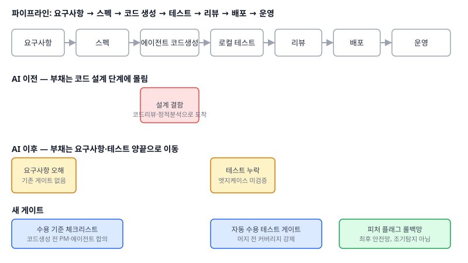

"에이전트 붙인 뒤로 버그 리포트는 확실히 줄었는데, 지난 스프린트에 만든 기능 중 두 개는 완전히 엉뚱한 걸 만들어버렸어요." 2026년 들어 AI 코딩 에이전트를 본격 도입한 팀 리드들에게서 공통으로 나오는 말이다. 처음엔 이상한 보고처럼 들리지만, 2026년 7월 LeadDev 패널이 정리한 관찰과 정확히 일치한다. AI는 지역적인 설계 결함은 줄이지만, 그 대신 요구사항 부채와 테스트 부채를 끌어올린다는 것이다.

이 변화가 중요한 이유는 단순하다. 지금까지 팀이 쌓아온 품질 게이트—코드 리뷰, 정적 분석, 린터—는 전부 "코드 설계 단계에서 생기는 결함"을 잡도록 설계됐다. 부채가 생기는 자리가 바뀌었는데 게이트는 그대로라면, 사고는 기존 게이트를 유유히 통과한 뒤 운영 환경에서야 발견된다. "에이전트 생산성 올려주세요"라는 요청을 받았을 때, 모델 선택이나 레인(lane) 수보다 먼저 물어야 할 질문은 "부채가 어디로 옮겨갔고, 그 자리에 게이트가 있는가"다.

## 부채는 왜 양끝으로 옮겨가는가

에이전트가 코드를 쓰는 동안 사람이 하던 일 중 사라지는 것은 "로직을 한 줄씩 머릿속으로 시뮬레이션하는 과정"이다. 이 과정에서 사람은 자연스럽게 요구사항을 재해석하고("이 조건, 사실 이런 뜻 아니었나?"), 엣지케이스를 떠올린다("이 값이 0이면 어떻게 되지?"). 에이전트는 주어진 스펙을 문자 그대로, 빠르게 구현한다. 설계 결함(변수명, 함수 분리, 중복)은 사람보다 오히려 깔끔하게 나오는 경우가 많다. 문제는 스펙 자체가 모호했거나, 테스트가 "에이전트가 생성한 코드가 통과하는 테스트"로 수렴해버리는 지점이다. Meituan의 31만 라인 리팩터링 사례도 결국 "에이전트 기반 평가 프레임워크로 전수 스캔하되, 고위험 영역은 사람이 고른다"는 구조로 귀결됐다—사람의 판단력을 설계 단계가 아니라 식별 단계에 재배치한 것이다.

## 전체 파이프라인에서 게이트가 있어야 할 자리

요구사항 → 스펙 → 에이전트 코드 생성 → 로컬 테스트 → 리뷰 → 배포 → 운영으로 이어지는 흐름에서, 기존 게이트(코드 리뷰, 정적 분석)는 전부 "코드 생성" 직후에 몰려 있다. 반면 새로 두꺼워진 부채는 "요구사항"과 "로컬 테스트" 양 끝에 있다. 요구사항 쪽은 에이전트에게 스펙이 넘어가기 전에 걸러야 하고, 테스트 쪽은 머지 전에 걸러야 한다. 리뷰 단계에서 사람이 두 가지를 동시에 다시 잡으려 하면, 리뷰어가 요구사항 적합성과 코드 품질을 동시에 판단해야 해서 결국 리뷰가 병목이 된다—이미 여러 팀이 겪은 실패 패턴이다.

## 세 가지 대응 전략과 트레이드오프

| 전략 | 포착 시점 | 장점 | 비용·한계 |
|---|---|---|---|
| 수용 기준(Acceptance Criteria) 체크리스트 | 코드 생성 **전** | 요구사항 오해를 가장 일찍 차단 | PM·에이전트 간 왕복이 늘어 속도 이점이 줄어듦 |
| 자동 수용 테스트 게이트 | 머지 **전** | 엣지케이스 누락을 기계적으로 강제 | 테스트 생성 에이전트가 틀린 동작에 맞춰 assert를 쓰는 자기완결적 오류 위험 |
| 피처 플래그 + 단계적 롤아웃 | 배포 **후** | 되돌리기 쉬움, 구현 비용 낮음 | 조기 탐지가 아니라 피해 축소 수단일 뿐 |

세 전략은 서로 대체재가 아니라 보완재다. 수용 기준 체크리스트만 두면 통과 후 테스트 누락은 못 잡고, 자동 테스트 게이트만 두면 애초에 잘못된 요구사항을 "올바르게" 구현한 코드를 그대로 통과시킨다. 피처 플래그는 둘 다 뚫렸을 때의 마지막 안전망이지, 대체 수단이 아니다. 배포 빈도가 낮고 한 번의 실수 비용이 큰 도메인(결제, 의료)일수록 앞의 두 게이트에 투자해야 하고, 되돌리기 쉬운 내부 도구성 기능일수록 피처 플래그 비중을 높여도 된다.

## 실제로 도입하는 순서

1. **먼저 측정한다.** 최근 사고를 "설계 결함 / 요구사항 오해 / 테스트 누락"으로 분류해 비중을 센다. 분류 없이 게이트부터 깔면 안 맞는 곳에 투자하게 된다.
2. **요구사항 오해 비중이 크면** 에이전트에게 스펙을 넘기기 전 수용 기준 체크리스트를 먼저 넣는다. 전체를 다 체크하지 말고, 과거 사고가 집중된 영역(결제 금액 계산, 권한 분기)부터 좁게 시작한다.
3. **테스트 누락 비중이 크면** 커버리지 숫자보다 "사고가 난 시나리오를 테스트 케이스로 역산"하는 방식으로 자동 수용 테스트를 쌓는다. 테스트 생성 자체를 에이전트에게 맡길 경우, 사람이 최소 샘플링으로 assert 내용을 검수하는 단계를 반드시 둔다.
4. **여기까지 했는데도 사고가 나면** 그때 피처 플래그를 넓힌다. 처음부터 피처 플래그로 시작하면 "일단 켜고 사고 나면 끈다"는 습관이 굳어 앞의 두 게이트에 투자할 동기가 사라진다.

막히는 지점은 보통 2단계다. 체크리스트가 두꺼워지면 에이전트 도입의 원래 목적이었던 속도 이득이 사라지고, 팀은 다시 "그냥 사람이 리뷰하자"로 회귀하려는 압력을 받는다. 이때 체크리스트를 줄이는 대신, 과거 사고 데이터를 근거로 체크 항목의 우선순위를 재조정하는 쪽이 낫다.

## 요약

- AI 코딩 에이전트는 코드 설계 단계의 부채는 줄이지만, 요구사항 오해와 테스트 누락이라는 두 양끝의 부채를 늘린다.
- 기존 품질 게이트(코드 리뷰, 정적 분석)는 설계 단계에 몰려 있어 이동한 부채를 잡지 못한다. 수용 기준 체크리스트와 자동 수용 테스트 게이트를 새로 심어야 한다.
- 세 전략(수용 기준, 자동 테스트, 피처 플래그)은 보완재다. 과거 사고를 먼저 분류해 어느 쪽에 먼저 투자할지 정하고, 피처 플래그는 마지막 안전망으로만 쓴다.

## 참고 자료

- [LeadDev — How to clean up the tech debt your AI is creating](https://leaddev.com/technical-direction/how-to-clean-up-the-tech-debt-your-ai-is-creating)
- [Managing AI-Generated Code with Agent-Based Evaluation: Refactoring 310K Lines of Code](https://besthub.dev/articles/managing-ai-generated-code-with-agent-based-evaluation-refactoring-310k-lines-of-code-1cca7b2a6e50)
