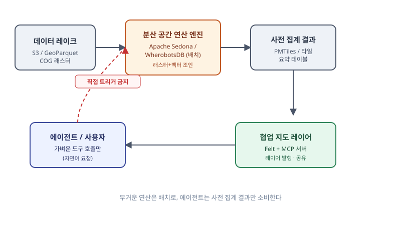

## 왜 지금 이 경계가 중요해졌는가

"전국 단위로 위성 영상과 건물·필지 데이터를 조인해서 지도로 보여주세요. 그것도 기획자가 에이전트한테 말만 하면 바로 만들어지게 해주세요." 최근 몇 주 사이 이 블로그가 다룬 PostGIS vs pgvector, DuckDB Spatial vs PostGIS, PMTiles 서버리스 서빙 같은 글은 모두 암묵적으로 "데이터가 한 대의 서버 혹은 한 번의 프로세스 안에서 처리된다"는 전제를 깔고 있었다. 그런데 요구사항의 스케일이 "전국", "위성 래스터 전체", "에이전트가 직접"으로 커지는 순간 이 전제가 깨진다.

이 변화는 실제 업계 움직임과 정확히 맞물려 있다. Apache Sedona의 원 개발자들이 만든 Wherobots는 2026년 들어 Rust 네이티브 Arrow 컬럼 실행 엔진으로 WherobotsDB를 재구성했고, 래스터와 벡터를 하나의 분산 엔진에서 조인하는 벤치마크를 공개하며 Google Earth Engine·BigQuery 조합과 직접 비교하고 나섰다. 같은 해 2월에는 협업 지도 플랫폼 Felt가 Wherobots와 전략적 파트너십을 발표해 "AI-ready spatial data stack"을 표방했고, Felt 자체도 MCP 서버를 공개해 Claude나 ChatGPT 같은 에이전트가 레이어를 불러오고 공간 SQL을 돌려 바로 공유 가능한 지도를 발행하게 만들었다. 이는 이미 다룬 ArcGIS MCP나 자체 PostGIS 공간 도구 서버 선택 문제와는 결이 다르다 — 여기서 진짜 판단이 필요한 지점은 "에이전트가 어디까지 직접 연산할 것인가"이기 때문이다.

## 요구사항을 두 개의 다른 기술 문제로 쪼개기

"전국 데이터를 조인해서, 에이전트가 직접 만들게" 라는 한 문장은 사실 서로 완전히 다른 레이어의 문제 두 개가 합쳐진 것이다.

첫째는 **연산 규모 문제**다. 전국 단위 위성 래스터와 수천만 건의 벡터 폴리곤을 공간 조인하는 작업은 단일 노드 메모리와 디스크 I/O의 한계를 가볍게 넘는다. PostGIS나 DuckDB Spatial로 돌리면 몇 시간째 끝나지 않거나 메모리 부족으로 죽는다. 이건 더 좋은 서버를 사는 걸로 해결되지 않고, 연산을 여러 노드에 나누는 분산 엔진으로 넘어가야 풀리는 문제다.

둘째는 **접근성·협업 문제**다. 연산 결과가 아무리 정확해도 기획자나 에이전트가 그 결과를 바로 지도로 보고, 공유하고, 수정 요청을 할 수 없으면 쓸모가 없다. 이건 연산 엔진이 아니라 그 위에 얹는 협업 매핑 레이어의 문제이고, 에이전트가 이 레이어를 직접 조작하게 하려면 MCP 같은 도구 호출 인터페이스가 따로 필요하다.

이 둘을 하나의 시스템으로 뭉뚱그리면 사고가 난다. 가장 흔한 실패는 에이전트에게 분산 연산 엔진을 직접 호출할 권한을 주는 것이다 — 비전문가가 자연어로 "전국 데이터 다시 조인해줘"를 반복하면 매번 수십 분짜리 분산 작업과 그만큼의 비용이 발생한다.

## 전체 시스템에서의 위치

아래 구조도처럼 데이터 레이크부터 최종 사용자까지는 명확히 분리된 네 단계를 거친다. 분산 연산 엔진은 배치·온디맨드로 무거운 작업만 처리하고, 그 결과를 사전 집계된 타일이나 요약 테이블로 떨어뜨린 뒤에야 협업 지도 레이어와 에이전트가 그 위에서 가볍게 움직인다.



이 그림에서 핵심은 화살표 방향이다. 에이전트는 분산 엔진 박스를 건너뛰고 곧바로 협업 지도 레이어(사전 집계된 결과)에만 닿는다. 에이전트가 왼쪽 박스까지 직접 넘어가도록 설계하면, 그 순간부터 비용과 응답 시간을 통제할 수 없게 된다.

## 선택의 트레이드오프

| 구분 | 단일 노드 (PostGIS / DuckDB Spatial) | 분산 자체 호스팅 (Apache Sedona on Spark) | 매니지드 분산 (Wherobots) |
|---|---|---|---|
| 적정 데이터 규모 | 수백만~수천만 건, 로컬 디스크 범위 | 전국~글로벌, 노드 수로 확장 | 전국~글로벌, 운영 부담 없음 |
| 래스터+벡터 동시 조인 | 제한적(확장 모듈 필요) | 가능(300여 개 공간 함수) | 가능 + 분산 래스터 추론 내장 |
| 운영 복잡도 | 낮음(기존 DB 운영 지식 재사용) | 높음(Spark 클러스터 운영) | 낮음(매니지드, 대신 비용) |
| 비용 구조 | 서버 고정비 | 클러스터 가동 시간 | 사용량 기반 + 구독 |
| 데이터 주권/락인 | 완전 자체 소유 | 오픈소스, 락인 낮음 | 벤더 종속 있음(오픈코어라 탈출구는 있음) |
| 언제 쓰면 안 되는가 | 전국 단위 래스터 조인에는 처음부터 부적합 | 데이터가 작아서 Spark 기동 오버헤드가 더 큰 경우 | 비용 민감하고 자체 운영 인력이 있는 경우 |

핵심 판단 기준은 "지금 겪는 병목이 쿼리 튜닝으로 풀리는가, 아니면 애초에 한 대로는 안 되는 규모인가"이다. DuckDB Spatial로 넘어가도 여전히 타임아웃이 난다면, 그건 엔진 선택의 문제가 아니라 애초에 단일 프로세스 아키텍처 자체가 틀린 것이다.

## 코드로 보는 경계

분산 엔진 쪽 작업은 배치 잡으로만 존재해야 한다. Sedona SQL로 래스터-벡터 조인을 돌리는 전형적인 형태는 이렇다.

```sql
SELECT b.building_id, ST_Value(r.raster, b.geom) AS ndvi_value
FROM buildings b
JOIN satellite_raster r
ON ST_Intersects(ST_Envelope(r.raster), b.geom)
```

이 쿼리는 사람이 스케줄링한 배치 파이프라인 안에서만 실행되고, 결과는 PMTiles나 요약 테이블로 떨어진다. 에이전트가 보는 쪽은 그 결과를 조회하는 가벼운 도구 호출뿐이어야 한다.

```json
{
  "tool": "felt_publish_layer",
  "args": { "source": "s3://agg/ndvi_by_building.pmtiles", "title": "건물별 식생지수" }
}
```

에이전트에게 노출하는 도구 스키마에 분산 엔진을 직접 트리거하는 함수를 넣지 않는 것, 이것이 설계의 핵심이다.

## 실무 포인트와 함정

운영하면서 자주 걸리는 지점은 세 가지다. 첫째, 분산 엔진 PoC를 할 때 처음부터 멀티노드 클러스터를 띄우지 말고 SedonaDB 같은 싱글노드 버전으로 먼저 쿼리 패턴을 검증한 뒤 분산으로 넘어가는 것이 비용을 줄인다. 둘째, 사전 집계 경계를 너무 좁게 잡으면 에이전트가 "조금만 다르게 봐줘"라는 흔한 요청마다 다시 배치를 돌려야 해서 결국 실시간처럼 보이게 하려다 비용이 터진다 — 자주 바뀌는 파라미터는 사전 집계 테이블에 차원으로 남겨 둔다. 셋째, 매니지드 서비스의 MCP 서버를 쓸 때 에이전트가 "사용자 권한으로" 행동한다는 말을 그대로 믿지 말고, 실제로 어떤 레이어까지 노출되는지 권한 범위를 직접 검증해야 한다.

## 실제 진행 순서

1. 기존 단일 노드 파이프라인에서 타임아웃·OOM 로그를 모아 병목이 실제로 "규모" 문제인지 확인한다.
2. SedonaDB 같은 싱글노드 분산 엔진으로 먼저 쿼리를 재작성해 쿼리 패턴 자체의 문제인지 가려낸다.
3. 그래도 안 되면 Spark 클러스터(자체 호스팅) 또는 Wherobots(매니지드) 중 운영 인력과 비용 구조로 선택한다.
4. 에이전트가 닿을 사전 집계 레이어(타일, 요약 테이블)의 경계와 갱신 주기를 먼저 설계한다.
5. 협업 지도 레이어(Felt 또는 자체 MCP 서버)를 올리고, 에이전트 도구 스키마에 분산 연산 트리거가 없는지 검증한다.
6. 비용 모니터링을 배치 작업 단위로 걸어 에이전트 요청이 숨은 배치를 반복 유발하지 않는지 추적한다.

## 마무리 요약

- 전국 단위 래스터+벡터 조인은 단일 노드 공간 DB의 튜닝으로 풀리지 않는 규모 문제다.
- 분산 연산 엔진(Apache Sedona/Wherobots)과 협업 지도·에이전트 레이어(Felt MCP)는 서로 다른 레이어이며, 에이전트는 사전 집계된 결과에만 닿아야 한다.
- 설계의 핵심은 기술 선택이 아니라 "에이전트가 분산 엔진을 직접 건드리지 못하게 막는 경계"를 어디에 긋느냐다.

## 참고 자료

- [Apache Sedona 공식 문서](https://sedona.apache.org/)
- [Wherobots — What is Apache Sedona](https://wherobots.com/what-is-apache-sedona/)
- [Felt MCP 서버 소개](https://felt.com/blog/introducing-felt-mcp-server)
- [Wherobots × Felt 파트너십 발표](https://wherobots.com/blog/)
