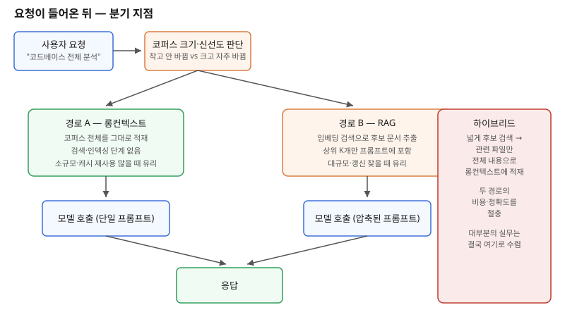

## 왜 지금 이 판단이 다시 중요해졌는가

"우리 레포 전체를 분석해서 리팩터링 계획을 짜주세요." 몇 년 전이었다면 이 요구는 자동으로 RAG(검색 증강 생성) 파이프라인 구축으로 번역됐다. 문서를 청크로 쪼개고, 임베딩을 만들고, 벡터 DB에 넣고, 질의 때마다 관련 조각만 검색해 프롬프트에 끼워 넣는 구조 말고는 선택지가 없었기 때문이다. 그런데 최근 프론티어 모델들의 1M 토큰 컨텍스트 윈도우가 베타 헤더 없이 표준 가격으로 기본 제공되기 시작하면서, 상황이 달라졌다. 이제는 "검색 없이 그냥 다 넣어버리면 안 되나?"라는 질문이 실제로 유효한 설계 선택지가 됐다.

문제는 이 질문에 "둘 중 뭐가 더 좋은가"로 답할 수 없다는 점이다. 같은 1M 토큰짜리 모델이라도 코퍼스 크기, 갱신 빈도, 멀티테넌트 여부, 캐시 재사용 패턴에 따라 정답이 정반대로 바뀐다. 실제로 이 판단을 잘못 내려 작은 PoC에서는 멀쩡했던 구조가 프로덕션 규모에서 비용이 수십 배로 뛰거나, 반대로 RAG 인덱싱 파이프라인을 괜히 먼저 구축했다가 코퍼스가 작아서 그 복잡도가 전혀 쓸모없었던 사례가 늘고 있다. 빌더 입장에서는 이 둘을 가르는 기준을 먼저 세워야, 요구사항이 들어왔을 때 어느 쪽부터 손댈지 머릿속에서 바로 그려진다.

## 전체 시스템에서의 위치

두 경로 모두 "사용자 요청 → 컨텍스트 구성 → 모델 호출 → 응답"이라는 같은 자리에 들어간다. 차이는 컨텍스트 구성 단계의 내부 구조다. 롱컨텍스트 경로는 이 단계가 사실상 비어 있다 — 코퍼스를 그대로 프롬프트에 붙여 넣는다. RAG 경로는 이 자리에 임베딩 인덱스, 유사도 검색, 리랭킹이라는 별도의 서브시스템이 들어간다. 이 서브시스템은 한번 만들면 끝이 아니라, 코퍼스가 갱신될 때마다 재인덱싱해야 하는 운영 부담을 함께 짊어진다. 반대로 롱컨텍스트 경로는 이 운영 부담이 없는 대신, 매 요청마다 같은 분량의 토큰을 모델에 통째로 흘려보내야 한다는 비용 구조를 짊어진다.

## 선택의 트레이드오프

| 기준 | 롱컨텍스트(통째 적재) | RAG(검색 증강) |
|---|---|---|
| 코퍼스 규모 | 작음 — 수십~수백K 토큰 | 큼 — 수백만 토큰 이상, 계속 증가 |
| 갱신 빈도 | 낮음 — 세션 중 거의 고정 | 높음 — 실시간·일 단위 갱신 |
| 비용 구조 | 요청마다 전체 토큰 과금(캐시 재사용 시 완화) | 인덱싱 1회 + 질의마다 소량 토큰만 과금 |
| 지연 시간 | 길다 — 대용량 프롬프트 처리 시간 | 짧다 — 검색 후 소량만 전달 |
| 정확도 경향 | 교차 문서 추론에 강함, 코퍼스 커질수록 품질 저하 가능 | 코퍼스가 클수록 상대적으로 안정적, 검색 누락 리스크 |
| 멀티테넌트 | 테넌트마다 전체를 매번 넣는 구조는 비현실적 | 테넌트별 인덱스 분리로 격리 자연스러움 |
| 근거 제시(citation) | 어느 부분을 근거로 삼았는지 추적 어려움 | 검색된 청크 자체가 근거가 됨 |

가장 흔한 함정은 모델이 광고하는 윈도우 크기와 실제로 안정적으로 추론하는 길이를 혼동하는 것이다. "1M 토큰을 받아줄 수 있다"는 것과 "1M 토큰 전부에 걸쳐 동일한 품질로 추론한다"는 것은 다른 주장이다. 코퍼스가 커질수록 모델이 중간 부분의 세부 사항을 놓치는 경향이 보고되고 있어, 실제 적용 전에는 반드시 목표 코퍼스 규모에서 정확도를 직접 측정해야 한다.

## 실제 프로젝트 진행 순서

1. **코퍼스 규모와 갱신 빈도부터 숫자로 측정한다.** "대충 크다"가 아니라 토큰 수, 하루 평균 변경 비율을 뽑는다. 이 숫자가 모든 후속 판단의 기준선이다.
2. **작게 시작한다면 일단 롱컨텍스트로 프로토타입을 만든다.** 인덱싱 파이프라인부터 짓는 것보다 훨씬 빠르게 요구사항이 실제로 유효한지 검증할 수 있다.
3. **코퍼스 규모를 늘려가며 정확도와 지연 시간을 같이 측정한다.** 품질이 꺾이기 시작하는 지점, 지연 시간이 사용자 경험을 해치기 시작하는 지점을 각각 찾는다.
4. **그 지점을 넘는다면 전면 RAG 전환이 아니라 하이브리드부터 검토한다.** 넓은 후보군은 가벼운 검색으로 추리고, 추려진 소수 파일은 전체 내용을 롱컨텍스트에 그대로 넣는 방식이 실무에서 가장 많이 쓰인다.
5. **캐시 재사용 패턴을 설계에 반영한다.** 같은 코퍼스를 여러 질의에서 재사용한다면 프롬프트 캐싱으로 롱컨텍스트의 비용 열세를 크게 줄일 수 있다. 질의마다 코퍼스가 바뀐다면 이 이점이 사라지므로 RAG 쪽으로 기울어야 한다.

## 실무 포인트

**멀티테넌트 서비스라면 코퍼스 규모와 무관하게 RAG 쪽 격리 구조를 먼저 고려한다.** 테넌트 데이터를 매 요청 프롬프트에 전부 밀어 넣는 구조는 규모와 별개로 데이터 격리·권한 경계를 흐리기 쉽다.

**근거 제시가 요구사항에 들어 있다면 RAG가 유리하다.** 검색된 청크 자체가 "이 부분을 근거로 답했다"는 추적 가능한 단위가 되지만, 통째로 적재한 롱컨텍스트에서는 모델 응답의 근거를 사후에 복원하기 어렵다.

**벤치마크 수치를 그대로 외삽하지 않는다.** 코퍼스 크기, 질의 패턴, 캐시 히트율이 조직마다 다르므로, 공개된 비용·정확도 비교는 설계 방향을 잡는 참고치로만 쓰고 실제 전환 여부는 자체 코퍼스로 다시 측정해야 한다.

## 마무리

- 1M 토큰 컨텍스트가 표준 가격으로 기본 제공되면서 "검색 없이 통째로 넣기"가 실제 선택지가 됐지만, 코퍼스 규모·갱신 빈도·멀티테넌트 여부에 따라 정답은 정반대로 바뀐다.
- 광고된 윈도우 크기와 실제 안정적 추론 길이는 다른 개념이므로, 목표 코퍼스 규모에서 정확도를 직접 측정하지 않고 그대로 적용하면 안 된다.
- 실무는 대부분 전면 RAG도 전면 롱컨텍스트도 아닌, 넓게 검색해 추린 뒤 관련 부분을 통째로 롱컨텍스트에 넣는 하이브리드로 수렴한다.

## 참고 자료

- [Claude 컨텍스트 윈도우 공식 문서](https://platform.claude.com/docs/en/build-with-claude/context-windows)
- [Claude 릴리스 노트](https://platform.claude.com/docs/en/release-notes)
- [RAG vs 롱컨텍스트 트레이드오프 — Redis Blog](https://redis.io/blog/rag-vs-large-context-window-ai-apps/)
- 이전 글: MCP 툴 폭발과 지연 로딩 설계 (2026-10-15)
