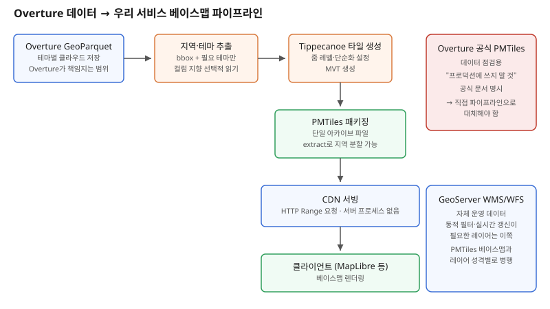

## 왜 지금 이 판단이 중요해졌는가

"전세계 건물·도로·POI를 우리 지도에 베이스맵으로 깔아주세요"라는 요구는 예전이라면 거의 자동으로 OpenStreetMap 추출본이나 상용 베이스맵 공급사로 번역됐다. 그런데 Overture Maps Foundation이 전세계 지도 데이터를 매달 정기적으로 GeoParquet 포맷으로 공개하면서, "우리가 직접 클라우드에서 필요한 지역만 긁어다 베이스맵을 만든다"는 선택지가 현실적인 옵션이 됐다. 문제는 Overture가 참고용으로 함께 공개하는 PMTiles 벡터 타일에 대해 공식 문서가 명시적으로 "이 타일을 프로덕션에 쓰지 말라"고 경고한다는 점이다.

이 경고를 가볍게 넘기면 설계가 꼬인다. "공식에서 타일을 주는데 왜 또 타일을 만들어야 하나"라는 질문에 답하지 못한 채 데모용 타일을 그대로 서비스에 박아 넣었다가, 트래픽이 늘면서 성능·가용성 문제로 되돌아오는 경우가 실제로 있다. 빌더 입장에서는 Overture가 그어놓은 "데이터 배포(GeoParquet)"와 "서빙(타일)" 사이의 책임 경계를 먼저 이해해야, 어디까지가 공짜로 받는 부분이고 어디서부터 직접 구축해야 하는지가 머릿속에서 바로 그려진다.

## 전체 시스템에서의 위치

Overture가 직접 책임지는 영역은 왼쪽 끝 하나뿐이다 — 테마(건물, 도로, 장소, 행정경계 등)별로 분리된 GeoParquet 파일을 클라우드 스토리지(S3·Azure Blob)에 정기적으로 올려두는 것. 이 포맷은 컬럼 지향이라 클라우드에서 필요한 컬럼·공간 범위만 골라 읽을 수 있게 설계돼 있다. Overture가 함께 공개하는 PMTiles는 "이 데이터가 어떻게 생겼는지 빠르게 확인하는 점검용"이며, 공식 문서 자체가 안정된 베이스맵이 필요한 애플리케이션은 Overture 데이터로 직접 타일을 만들라고 안내한다.

즉 실제 서비스가 되려면 GeoParquet(원본) → 지역 추출 → Tippecanoe 같은 도구로 MVT 타일 생성 → PMTiles로 패키징 → CDN 서빙이라는 중간 파이프라인을 직접 세워야 한다. 이 파이프라인이 곧 GeoServer 같은 전통적 타일 서버를 쓸지, 아니면 서버 프로세스 없이 정적 파일 하나(PMTiles)를 HTTP Range 요청으로 서빙할지를 가르는 분기점이기도 하다.

## 선택의 트레이드오프

| 기준 | GeoServer + WMS/WFS (동적 서버) | Overture → 직접 생성 PMTiles (정적 서빙) |
|---|---|---|
| 서버 프로세스 | 상시 구동 필요(WMS/WFS 엔진) | 없음 — 정적 파일 + CDN만 |
| 데이터 갱신 | 레이어 교체·캐시 무효화 절차 필요 | 새 PMTiles 파일 생성 후 교체(원자적) |
| 요청 단위 | 매 요청마다 렌더링 또는 캐시 조회 | 클라이언트가 바이트 범위를 직접 요청 |
| 동시 접속 확장 | WMS 인스턴스·GWC 캐시 증설 필요 | CDN 캐시 적중률에 의존, 수평 확장 쉬움 |
| 동적 필터·질의(CQL 등) | 가능 — 서버가 매 요청 처리 | 불가능에 가까움 — 타일은 생성 시점에 고정 |
| 데이터 소스 | 자체 DB·외부 WFS 등 다양 | Overture 오픈 데이터 기준(자체 데이터 병합은 가능) |
| 운영 부담 | 서버 패치·스케일링·장애 대응 | 빌드 파이프라인·CDN 설정이 핵심 |

전통적인 GeoServer 기반 WMS/WFS는 "요청마다 서버가 판단해서 응답을 만든다"는 유연성이 핵심 가치다. 사용자별로 다른 필터를 걸거나, 실시간으로 바뀌는 자체 데이터를 보여줘야 한다면 이쪽이 맞다. 반대로 전세계 건물·도로처럼 갱신 주기가 한 달 단위로 느리고, 조건 없이 그대로 보여주면 되는 베이스맵 성격의 데이터라면, 서버 프로세스 자체를 없애고 정적 타일 파일을 CDN에서 서빙하는 쪽이 운영 부담과 비용 모두에서 유리하다.

## 실제 프로젝트 진행 순서

1. **필요한 지역·테마를 먼저 좁힌다.** 전세계 전체를 한 번에 받으면 테마에 따라 수백GB가 넘는다. STAC 카탈로그나 Overture 공식 다운로드 도구로 서비스 대상 지역의 bbox와 필요한 테마(건물/도로/장소 등)만 추출한다.
2. **추출한 GeoParquet로 로컬·배치 환경에서 타일을 생성한다.** Tippecanoe 같은 도구로 줌 레벨별 단순화 수준을 조정하며 MVT 타일을 만들고, 이를 PMTiles 아카이브 하나로 패키징한다. 이 단계에서 줌 레벨 설계와 속성 필터링(불필요한 태그 제거)이 최종 파일 크기와 클라이언트 렌더링 성능을 좌우한다.
3. **지역 추출이 필요하면 pmtiles CLI의 extract 기능으로 쪼갠다.** 서비스가 특정 국가·도시 단위로만 필요하다면 전세계 아카이브 전체를 CDN에 올릴 필요 없이 필요한 부분만 잘라낸다.
4. **생성된 PMTiles를 CDN 뒤에 두고 MapLibre 등 클라이언트에서 Range 요청으로 직접 읽게 한다.** 서버 쪽에 타일 서빙 전용 프로세스를 따로 둘 필요가 없다는 점이 이 구조의 핵심 이점이다.
5. **갱신 주기를 정한다.** Overture의 월간 릴리스에 맞춰 파이프라인을 재실행하고, 새 PMTiles를 생성해 원자적으로 교체하는 배치 작업(월 1회 수준)으로 운영한다. 자체 데이터를 얹어야 한다면 이 단계에서 GeoParquet나 별도 레이어로 병합한다.

## 실무 포인트

**"공식에서 타일을 준다"와 "서비스에 쓸 수 있는 타일이다"는 다른 말이다.** Overture 데모 PMTiles는 데이터 점검용으로만 쓰고, 실제 트래픽을 받는 경로에는 절대 직결하지 않는다. 이 경계를 혼동하면 트래픽이 늘었을 때 책임질 주체가 없는 인프라에 의존하게 된다.

**동적 질의가 필요한 레이어와 정적 베이스맵 레이어를 같은 파이프라인에 억지로 합치지 않는다.** 베이스맵은 PMTiles 정적 서빙, 자체 운영 데이터(필터링이 필요한 매장 위치 등)는 GeoServer WMS/WFS, 이렇게 레이어 성격별로 서빙 방식을 나누는 것이 장기적으로 유지보수가 쉽다.

**타일 생성 파이프라인은 코드로 재현 가능하게 만든다.** 줌 레벨·단순화 파라미터·속성 필터를 설정 파일로 관리하면, Overture 릴리스가 갱신될 때마다 같은 파이프라인을 그대로 재실행해 일관된 결과물을 얻을 수 있다.

## 마무리

- Overture는 전세계 지도 데이터를 GeoParquet로 배포하는 역할까지만 책임지며, 함께 제공하는 PMTiles는 공식적으로 프로덕션 사용이 권장되지 않는 점검용이다.
- 실서비스 베이스맵은 GeoParquet 추출 → Tippecanoe 타일 생성 → PMTiles 패키징 → CDN 서빙이라는 파이프라인을 직접 구축해야 한다.
- 갱신 빈도가 낮고 조건 없이 보여주면 되는 베이스맵은 PMTiles 정적 서빙이, 동적 필터·실시간 데이터가 필요한 레이어는 기존 GeoServer WMS/WFS가 유리하며 두 방식을 레이어 성격별로 나눠 쓰는 것이 실무에서 더 안정적이다.

## 참고 자료

- [Overture Maps 공식 문서 — Overture + PMTiles](https://docs.overturemaps.org/examples/overture-tiles)
- [Overture Maps 클라우드 소스 접근 가이드](https://docs.overturemaps.org/getting-data/cloud-sources/)
- [Tippecanoe — 타일셋 생성 도구](https://github.com/felt/tippecanoe)
- 이전 글: GeoWebCache Security-Aware Tiling (2026-10-31)
