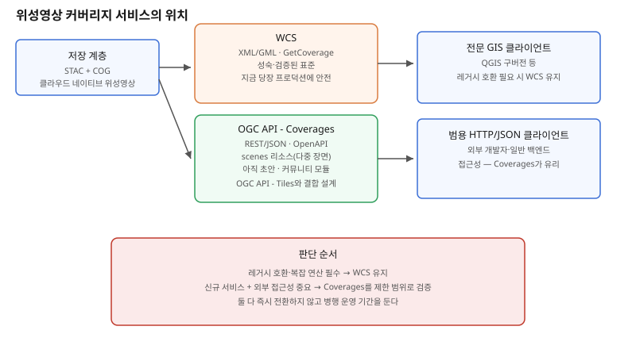

## 왜 지금 이 판단이 중요해졌는가

"위성영상에서 이 지역, 이 시기, 적외선 밴드만 골라서 내려주는 서비스를 만들어주세요." 래스터(격자) 데이터를 다루는 팀이라면 익숙한 요구다. 지금까지 이 요구의 정답은 거의 자동으로 WCS(Web Coverage Service)였다 — OGC가 오래전부터 정의해 온, GetCoverage 요청으로 커버리지 데이터를 잘라 받는 표준 인터페이스다. 그런데 OGC API 계열(REST/JSON 기반으로 WMS·WFS를 대체해 온 흐름)이 이제 커버리지 쪽까지 확장되면서, OGC API - Coverages라는 후보 표준이 나왔다. 2026년 들어 이 표준이 참조하는 ISO 19123-2 커버리지 구현 스키마가 재작성을 마치고 재채택 절차에 들어갔고, 위성영상처럼 여러 장면(scene)으로 구성된 데이터를 다루기 위한 scenes 리소스까지 정의됐다.

문제는 이 표준이 아직 초안·커뮤니티 모듈 단계라는 점이다. "더 새롭고 REST 기반이니 무조건 이걸로 가자"는 판단은 섣부르다. 빌더 입장에서는 WCS의 성숙도와 OGC API - Coverages의 설계 방향을 모두 이해한 뒤, 지금 당장 무엇을 선택하고 무엇을 유예할지를 결정해야 한다.

## 전체 시스템에서의 위치

커버리지 서비스는 저장 계층과 클라이언트 사이의 "조각내어 내려주는" 역할을 맡는다. 아래에는 STAC·COG(클라우드 네이티브 위성영상 저장 포맷)로 쌓인 원본 데이터가 있고, 위에는 분석·시각화 클라이언트가 있다. WCS와 OGC API - Coverages는 이 둘 사이에서 "전체 영상을 통째로 내려받지 않고, 필요한 공간 범위·시간·밴드만 추출해서 준다"는 같은 역할을 하지만, 요청·응답 프로토콜의 모양이 다르다. WCS는 XML/GML 기반 SOAP류 인터페이스이고, OGC API - Coverages는 WMS·WFS가 OGC API - Tiles·Features로 옮겨간 것과 같은 흐름으로 REST/JSON과 OpenAPI 문서를 따른다.

여기서 scenes 리소스가 중요한 이유가 드러난다. 위성영상은 단일 격자가 아니라 여러 번 촬영된 장면(scene)의 모음이다. OGC API - Coverages는 이 다중 장면 커버리지에서 "어떤 장면들이 있는지" 목록을 조회하는 리소스를 표준 안에 명시적으로 넣었는데, 이는 WCS 설계 당시에는 이렇게 명확히 다뤄지지 않았던 부분이다.

## 선택의 트레이드오프

| 기준 | WCS | OGC API - Coverages |
|---|---|---|
| 표준 성숙도 | 오래되고 검증됨, 다수 서버·클라이언트 구현 존재 | 후보 표준, 코어 요구사항 클래스만 확정 |
| 프로토콜 형식 | XML/GML, SOAP류 요청 구조 | REST/JSON, OpenAPI 문서 자동 생성 |
| GeoServer 구현 현황 | 완성도 높은 정식 모듈 | 커뮤니티(실험적) 모듈, 일부 기능만 제공 |
| 다중 장면(위성영상) 지원 | 표준 차원의 명시적 지원 약함 | scenes 리소스로 표준화 |
| 타일 서비스와의 결합 | 별도 체계(WMS/WMTS와 분리) | OGC API - Tiles와 같은 체계로 결합 설계 |
| 클라이언트 생태계 | 전문 GIS 클라이언트 위주 | 범용 HTTP/JSON 클라이언트로 접근 쉬움 |
| 지금 당장 프로덕션 적합성 | 높음 | 낮음 — 핵심 기능만, 변경 가능성 있음 |

이 표가 보여주는 핵심은 "기능이 더 많아서 좋다"가 아니라 "설계 철학이 다르다"는 점이다. WCS는 GIS 전문 클라이언트가 복잡한 커버리지 질의를 정확히 표현하도록 만들어졌고, OGC API - Coverages는 일반 백엔드 개발자도 REST 호출 몇 번으로 커버리지에 접근하게 만드는 방향이다. 위성영상 파이프라인을 외부 개발자에게도 열어줘야 하는 팀이라면 후자의 접근성이 결국 더 큰 가치가 된다.

## 실제 프로젝트 진행 순서

1. **지금 WCS로 풀어야 하는 요구인지부터 확인한다.** 복잡한 공간 연산이나 레거시 GIS 클라이언트와의 호환이 필수라면 아직은 WCS가 안전한 선택이다.
2. **신규 서비스이고 외부·범용 클라이언트 접근성이 중요하다면 OGC API - Coverages를 제한된 범위로 먼저 띄워본다.** 전체 기능이 아니라 코어 요구사항 클래스 수준(기본 커버리지 조회)부터 검증한다.
3. **다중 장면 위성영상을 다룬다면 scenes 리소스 설계를 눈여겨본다.** 이 부분이 WCS 대비 OGC API - Coverages가 실질적으로 더 나은 답을 주는 지점이므로, 위성영상 파이프라인이라면 이 리소스부터 우선 검증 대상으로 삼는다.
4. **WCS와 병행 운영 기간을 둔다.** 기존 WCS 서비스를 당장 걷어내지 말고, 새 클라이언트나 신규 기능만 OGC API - Coverages로 열어 안정성을 확인하면서 비중을 점진적으로 옮긴다.
5. **GeoServer를 쓴다면 커뮤니티 모듈의 기능 범위를 먼저 표로 정리한다.** 컬렉션 목록, 형식별 다운로드, 공간·시간 부분집합 같은 기본 기능만 되는지, 우리가 필요한 세부 기능이 아직 없는지 미리 확인해 기대치를 맞춘다.

## 실무 포인트

**표준이 초안이라는 사실을 숨기지 않는다.** 이 서비스를 쓰는 다른 팀·외부 파트너에게 "아직 변경될 수 있는 인터페이스"라는 점을 명시하지 않으면, 나중에 스펙이 바뀔 때 신뢰를 잃는다.

**ISO 19123-2 재채택처럼 표준화 기구의 진행 상황을 주기적으로 확인한다.** 이런 표준은 한 번에 완성되지 않고 여러 해에 걸쳐 조금씩 굳어지므로, 지금 구축한 코드가 다음 개정에서 깨지지 않도록 변경 로그를 계속 추적해야 한다.

**WCS를 완전히 버리는 결정은 섣불리 하지 않는다.** 레거시 GIS 데스크톱 클라이언트(QGIS 구버전 등)가 여전히 WCS만 지원하는 경우가 많으므로, 사용자층을 먼저 파악한 뒤 병행 기간의 길이를 정한다.

## 마무리

- WCS는 성숙하고 검증됐지만 XML/GML 기반의 무거운 인터페이스이고, OGC API - Coverages는 REST/JSON과 scenes 리소스로 위성영상을 더 쉽게 다루게 하지만 아직 초안·커뮤니티 모듈 단계다.
- 복잡한 공간 연산과 레거시 클라이언트 호환이 중요하면 WCS를, 외부 개발자 접근성과 다중 장면 위성영상 관리가 중요하면 제한된 범위의 OGC API - Coverages 도입을 검토한다.
- 완전 교체가 아니라 병행 운영으로 시작해, 표준이 굳어지는 속도에 맞춰 점진적으로 비중을 옮기는 것이 지금 시점의 가장 안전한 전략이다.

## 참고 자료

- [OGC API - Coverages 초안 문서](https://ogcapi.ogc.org/coverages/overview.html)
- [GeoServer OGC API - Coverages 커뮤니티 모듈 문서](https://docs.geoserver.org/main/en/user/community/ogc-api/coverages/index.html)
- [OGC API - Coverages GitHub 저장소](https://github.com/opengeospatial/ogcapi-coverages)
- 이전 글: GeoWebCache Security-Aware Tiling (2026-10-31)
