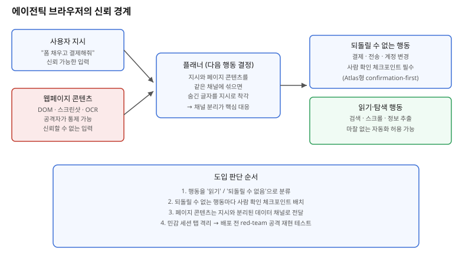

## 왜 지금 이 판단이 중요해졌는가

"내 대신 이 사이트에서 양식도 채우고, 장바구니 담아서 결제까지 끝내주세요." 음성이나 채팅으로 이런 지시를 받은 에이전트가 직접 브라우저를 조작하는 제품(Perplexity Comet, OpenAI ChatGPT Atlas)이 2025년 하반기부터 소비자용으로 풀렸다. 그런데 공개 직후부터 공격이 쏟아졌다. Comet은 2025년 8월 스크린샷 OCR로 읽은 숨은 지시를 실제 명령으로 처리하는 취약점이 공개됐고, 2026년 2월 Perplexity가 의뢰한 Trail of Bits 감사에서는 인증된 세션에서 개인정보를 빼낼 수 있는 인젝션 기법 네 가지가 추가로 드러났다. Atlas는 출시 하루 만에 클립보드 인젝션과 구글 문서를 이용한 화면 모드 변조 공격이 재현됐다.

이 사고들이 공통으로 보여주는 건 모델 성능 문제가 아니라 **구조적 설계 문제**다. 에이전트가 "사용자의 지시"와 "페이지에 쓰인 글자"를 구분하지 못하면, 공격자는 페이지 안에 숨겨둔 텍스트 한 줄로 에이전트의 다음 행동을 조작할 수 있다. "브라우저에서 결제까지 대신 해주세요"라는 한 줄의 요구가 들어오는 순간, 빌더는 이 신뢰 경계를 어디에 어떻게 그을지부터 설계해야 한다.

## 전체 시스템에서의 위치

에이전틱 브라우저의 실행 루프는 크게 세 단계다. 사용자 지시를 받는 입력 단계, 현재 페이지 상태(DOM, 스크린샷, 때로는 OCR로 추출한 텍스트)를 읽어 다음 행동을 정하는 플래너 단계, 그리고 클릭·입력·제출을 실제로 수행하는 실행 단계다. 문제는 두 번째 단계에서 발생한다. 페이지 콘텐츠는 공격자가 완전히 통제할 수 있는 영역인데, 많은 초기 설계는 이 콘텐츠를 사용자 지시와 같은 컨텍스트 창에 섞어 넣는다. 플래너 입장에서는 "사용자가 시킨 것"과 "페이지에 숨겨진 흰 글씨"를 구분할 신호가 없다.

Comet은 자율성을 우선하는 설계라 이 경계가 느슨했고, 공격이 성공하면 검토 없이 바로 행동까지 이어졌다. 반대로 Atlas는 결제·전송처럼 결과를 되돌릴 수 없는 지점마다 사람의 확인을 끼워 넣는 confirmation-first 구조를 택했다. 같은 침해 시나리오라도 어느 단계에 신뢰 경계를 세워뒀는지에 따라 피해가 "이상한 행동 한 번"으로 끝나는지 "자격 증명 탈취"로 번지는지가 갈린다.

## 선택의 트레이드오프

| 기준 | Autonomy-first (Comet형) | Confirmation-first (Atlas형) | 기존 RPA식 전수 승인 |
|---|---|---|---|
| 사용자 마찰 | 거의 없음 | 결제·전송 등 핵심 지점만 | 매 단계마다 승인, 체감 자동화 효과 낮음 |
| 공격 성공 시 피해 범위 | 승인 없이 끝까지 진행될 수 있음 | 결정적 행동 직전에 차단 가능 | 구조적으로 가장 안전하지만 비효율 |
| 적합한 사용처 | 정보 조회, 비가역적 행동 없는 탐색 | 결제·계정 변경·메시지 전송이 포함된 플로우 | 규제·감사가 극도로 중요한 업무 |
| 구현 난이도 | 낮음(검토 로직 생략) | 중간(행동 분류 + 체크포인트 설계 필요) | 높음(모든 단계에 UI·로그 필요) |
| 데모 체감 | 매끄럽고 빠름 | 중간중간 멈춤이 있음 | 느림 |

표의 핵심은 "더 안전한 쪽이 항상 정답"이 아니라는 점이다. 뉴스 요약이나 단순 정보 수집처럼 되돌릴 수 없는 행동이 없는 작업이라면 autonomy-first의 마찰 없는 경험이 더 낫다. 반대로 결제·계정 변경·메일 발송처럼 한 번 실행되면 되돌릴 수 없는 작업이 섞여 있다면, confirmation-first가 지금 시점의 안전한 기본값이다.

## 실제 프로젝트 진행 순서

1. **에이전트가 수행할 행동을 '읽기'와 '되돌릴 수 없는 행동'으로 먼저 분류한다.** 검색·스크롤·정보 추출은 전자, 결제·전송·삭제·계정 설정 변경은 후자다. 이 분류표 없이는 어디에 확인 절차를 넣을지 정할 수 없다.
2. **되돌릴 수 없는 행동마다 사람 확인 체크포인트를 설계한다.** "이 금액을 이 계좌로 결제하시겠습니까"처럼 행동의 구체적 내용을 사람이 읽고 판단할 수 있는 형태로 보여준다. 체크포인트를 건너뛸 수 있는 예외 경로를 만들지 않는다.
3. **페이지 콘텐츠를 사용자 지시와 분리된 채널로 전달한다.** DOM 텍스트나 OCR 결과는 "데이터"로 명시적으로 태깅해, 플래너가 그 안의 문장을 지시로 해석하지 않도록 프롬프트 구조 자체에서 분리한다.
4. **민감 세션과 자유 탐색 세션을 탭·프로필 단위로 격리한다.** 은행·메일처럼 인증된 세션에서 작업할 때는 에이전트가 동시에 임의 외부 사이트를 탐색하지 못하도록 범위를 좁힌다.
5. **배포 전에 자체 red-team 시나리오로 먼저 뚫어본다.** 화이트텍스트 숨김 지시, 이미지 속 OCR 유도 문구, 클립보드 조작 같은 알려진 공격 패턴을 직접 재현해 체크포인트가 실제로 막아주는지 검증한 뒤에만 범위를 넓힌다.

## 실무 포인트

**"완전히 막았다"고 말하지 않는다.** OpenAI CISO는 프롬프트 인젝션을 아직 풀리지 않은 프런티어 문제라고 공개적으로 밝혔고, 영국 NCSC도 이 공격군이 영영 완전히 해결되지 않을 수 있다고 경고했다. 제품 설명이나 사내 보고에서 "방어했다"가 아니라 "피해 범위를 제한했다"로 표현하는 것이 정확하다.

**근본 원인은 아키텍처이지 모델 성능이 아니다.** 더 똑똑한 모델을 붙여도 "페이지에 쓰인 글자를 지시로 착각할 수 있는 구조"는 그대로 남는다. 모델 업그레이드를 보안 대책으로 보고하지 않는다.

**데모와 프로덕션의 기준을 분리한다.** 자율성이 높을수록 데모는 매끄럽지만, 실제 돈이나 민감 데이터가 걸린 플로우에는 confirmation-first를 기본값으로 삼고, autonomy-first는 되돌릴 수 없는 행동이 전혀 없는 영역에만 제한적으로 허용한다.

## 마무리

- 에이전틱 브라우저가 폼 작성·결제까지 대신하게 하려면, 페이지 콘텐츠를 사용자 지시와 분리된 '신뢰할 수 없는 입력'으로 다루는 경계 설계가 모델 성능보다 먼저 와야 한다.
- Comet의 autonomy-first와 Atlas의 confirmation-first는 같은 침해 시나리오에서도 피해 범위가 갈리는 실제 사례로, 되돌릴 수 없는 행동 앞에 사람 확인 체크포인트를 두는 쪽이 지금은 더 안전한 기본값이다.
- "완전히 막을 수 있다"는 약속 대신 행동 분류·확인 체크포인트·세션 격리·배포 전 red-team 검증까지 거친 뒤 자율성 범위를 점진적으로 넓히는 것이 현실적인 진행 순서다.

## 참고 자료

- [Perplexity: Mitigating Prompt Injection in Comet](https://hub-prod.perplexity.ai/hub/blog/mitigating-prompt-injection-in-comet)
- [Shivan Kaul Sahib: Prompt injections in agentic browsers](https://shivankaul.com/blog/prompt-injections-in-agentic-browsers)
- [OWASP LLM01: Prompt Injection](https://owasp.org/www-project-top-10-for-large-language-model-applications/)
