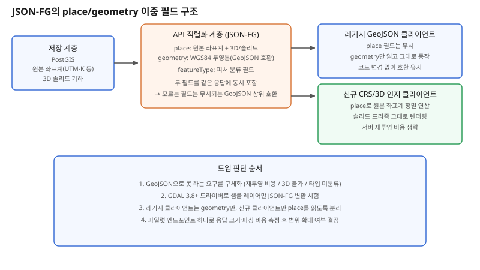

## 왜 지금 이 판단이 중요해졌는가

"이 데이터는 원래 UTM-K 좌표계인데, 변환하지 말고 그대로 내려주세요." "건물을 평면 폴리곤 말고 입체(솔리드)로 보여주세요." 지도 API를 운영하다 보면 언젠가 이런 요구를 받는다. 지금까지 거의 모든 팀의 기본값이었던 GeoJSON(RFC 7946)은 이 두 요구 앞에서 구조적으로 막힌다. 스펙 자체가 좌표계를 WGS84 경위도 하나로 고정하고, 기하 타입도 점·선·면과 그 멀티 버전까지만 정의한다. 솔리드(부피를 가진 입체)도, 피처를 분류하는 타입 필드도 스펙 안에는 없다.

그래서 현장에서는 오랫동안 우회로를 써왔다. `properties`에 원본 좌표계를 따로 적어 보내거나, 서버가 매 요청마다 좌표를 재투영해 변환 비용을 떠안거나, 3D 모델은 아예 별도 포맷(CityJSON, 3D Tiles)으로 쪼개 내려주는 식이다. 이 틈을 정면으로 메우려는 표준이 OGC JSON-FG(Features and Geometries JSON)다. Part 1: Core가 2026년 4월 OGC 국제 표준(문서 21-045r1, 버전 1.0.0)으로 정식 발표됐고, GDAL 3.8부터 드라이버가 들어가면서 실제로 써볼 수 있는 단계에 들어섰다. 핵심은 "GeoJSON을 대체하는 새 포맷"이 아니라 "유효한 JSON-FG는 그대로 유효한 GeoJSON이기도 하다"는 상위 호환 설계라는 점이다.

## 전체 시스템에서의 위치

좌표계·3D 변환 문제는 보통 저장 계층과 API 계층 사이, "이 데이터를 어떤 형태로 직렬화해서 내보낼 것인가"의 경계에서 터진다. PostGIS 같은 저장소는 원본 좌표계와 3D 기하를 그대로 들고 있을 수 있지만, API가 GeoJSON만 뱉는 순간 그 정보는 WGS84 2D로 깎여 나간다. JSON-FG는 이 경계에 `place`(원본 좌표계·3D·솔리드를 담는 필드)와 `geometry`(항상 WGS84로 투영된 GeoJSON 호환 필드)를 동시에 두는 식으로 끼어든다.

이 이중 필드 구조가 실제로 의미 있는 이유는, 클라이언트를 한 번에 다 바꾸지 않아도 되기 때문이다. 구버전 GeoJSON 파서는 모르는 필드인 `place`를 무시하고 `geometry`만 읽으므로 당장 깨지지 않는다. 반면 좌표계·3D를 이해하는 신규 클라이언트는 `place`를 읽어 재투영 없이 정밀 연산을 하거나 입체를 그대로 렌더링한다. 변환 비용을 서버가 미리 떠안는 구조에서, 필요한 클라이언트만 원본을 골라 쓰는 구조로 책임이 옮겨가는 셈이다.

## 선택의 트레이드오프

| 기준 | GeoJSON | JSON-FG | CityJSON/3D Tiles | 자체 확장 properties |
|---|---|---|---|---|
| 좌표계 지원 | WGS84 고정 | 임의 CRS 참조 가능 | 임의 CRS(포맷마다 다름) | 비표준, 파서 직접 작성 |
| 3D·솔리드 지원 | 없음 | 표준 기하 타입(솔리드, 프리즘) | 지원(전용 포맷) | 없음(임의 인코딩) |
| 피처 타입 구분 | 없음 | `featureType` 표준 필드 | 포맷별 스키마 | properties 키로 임의 구현 |
| 기존 GeoJSON 소비자 호환 | 기준 그 자체 | 상위 호환(그대로 읽힘) | 호환 안 됨(별도 변환 필요) | 호환(단 의미 해석 불가) |
| 생태계·툴링 성숙도 | 사실상 모든 지도 라이브러리 지원 | 초기 — GDAL만 네이티브 지원 | GIS 3D 전용 도구 위주 | 팀 내부에만 존재 |
| 도입 비용 | 0(이미 쓰는 중) | 직렬화 계층 수정 + 클라이언트 파서 | 별도 파이프라인 전체 구축 | 낮음, 대신 표준성 없음 |

표가 말해주는 핵심은 "JSON-FG가 다 좋다"가 아니라 "문제의 크기에 맞는 선택지가 따로 있다"는 점이다. 3D 전용 서비스(디지털 트윈, BIM 연계)라면 처음부터 CityJSON·3D Tiles 같은 전용 포맷이 더 적합하다. JSON-FG는 그 중간 지대 — 기존 GeoJSON 파이프라인을 유지하면서 좌표계·3D를 "가끔, 일부 클라이언트에만" 더 얹고 싶은 상황을 위한 선택지다.

## 실제 프로젝트 진행 순서

1. **지금 GeoJSON으로 구체적으로 뭘 못 하고 있는지부터 적는다.** "재투영 비용이 매 요청마다 드는가", "3D를 아예 못 보여주는가", "피처 타입을 프런트에서 매번 하드코딩으로 분기하는가" 중 어느 것인지 명확히 하지 않으면 표준만 바꾸고 문제는 그대로 남는다.
2. **GDAL 3.8 이상의 JSON-FG 드라이버로 기존 PostGIS·Shapefile 데이터를 시험 변환해본다.** 운영 데이터를 바로 건드리지 않고, 샘플 레이어 하나로 place/geometry 두 필드가 실제로 어떻게 나오는지 먼저 확인한다.
3. **소비 클라이언트 목록을 먼저 나눈다.** 레거시 클라이언트는 `geometry` 필드만 보게 두고, 신규로 만들 클라이언트(혹은 사내 분석 도구)만 `place`를 읽도록 설계해 과도기 호환을 끊지 않는다.
4. **파일럿 API 엔드포인트 하나에만 먼저 적용한다.** 응답 크기 증가, 직렬화 비용, 클라이언트 파싱 실패율을 측정한 뒤 범위를 넓힐지 결정한다.
5. **전사 표준으로 확대할지는 반복 빈도로 판단한다.** 비표준 좌표계·3D 요구가 한 번성 이벤트가 아니라 계속 들어온다면 그때 본격 도입을 검토한다.

## 실무 포인트

**"GeoJSON과 호환된다"를 "그냥 바꿔도 안전하다"로 읽지 않는다.** `place` 필드를 쓰는 순간부터는 그 필드를 해석하는 클라이언트와 그렇지 않은 클라이언트의 동작이 달라진다는 뜻이므로, 폴백 경로를 설계 단계에서 명시적으로 넣어야 한다.

**생태계가 아직 초기라는 점을 전제로 일정을 잡는다.** 주요 JS 지도 라이브러리(OpenLayers, Mapbox GL, Leaflet)는 아직 JSON-FG 네이티브 파서를 제공하지 않는다. 당분간은 `place` 필드를 직접 파싱하는 얇은 어댑터 계층을 팀이 직접 들고 가야 한다.

**표준이 깨지는 속도를 과소평가하지 않는다.** Part 1: Core 이후 추가 파트가 나올 가능성이 있으므로, 지금 짠 파서 코드가 다음 리비전에서도 그대로 동작할지 OGC 공지를 주기적으로 확인한다.

## 마무리

- GeoJSON은 WGS84 2D로 고정된 설계라 비표준 좌표계·3D·피처 타입 요구 앞에서 구조적으로 막히고, 현장은 그동안 properties 확장이나 별도 포맷으로 우회해왔다.
- JSON-FG는 `place`(원본 좌표계·3D)와 `geometry`(WGS84 폴백)를 동시에 제공해 기존 GeoJSON 소비자를 깨지 않으면서 새 클라이언트만 확장 기능을 쓰게 하는 상위 호환 구조다.
- 전용 3D 포맷을 쓸 정도로 크지 않고, GeoJSON 전면 교체는 과한 "중간 지대" 요구가 반복될 때 파일럿 엔드포인트부터 좁게 도입하는 것이 지금 시점의 합리적 경로다.

## 참고 자료

- [OGC Features and Geometries JSON (JSON-FG) Standard](https://www.ogc.org/standards/json-fg/)
- [OGC 21-045r1 공식 문서](https://docs.ogc.org/is/21-045r1/21-045r1.html)
- [GDAL JSONFG 드라이버 문서](https://gdal.org/en/stable/drivers/vector/jsonfg.html)
- [OGC-feat-geo-json GitHub 저장소](https://github.com/opengeospatial/OGC-feat-geo-json)
