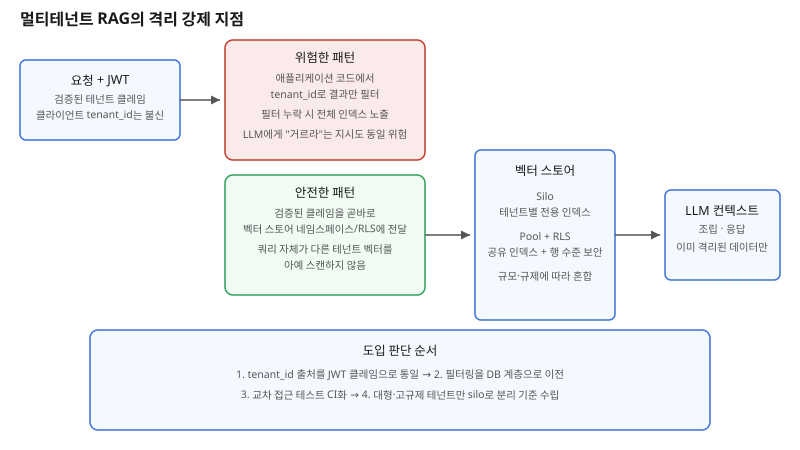

## 왜 지금 이 판단이 중요해졌는가

"고객사마다 자기 회사 문서만 검색되게 해주세요. 다른 회사 데이터가 섞이면 절대 안 됩니다." 멀티테넌트 RAG 서비스를 만들 때 가장 먼저 듣는 요구이고, 동시에 가장 쉽게 잘못 구현되는 요구이기도 하다. 많은 팀이 처음에는 애플리케이션 코드에서 검색 결과를 `tenant_id`로 걸러내거나, 시스템 프롬프트에 "너는 테넌트 A의 데이터만 봐야 한다"고 적어두는 식으로 가볍게 처리한다. 실제로 2026년에 보고된 한 사고에서는 지원 업무를 하던 외부 계약직 직원이 필터링이 허술한 벡터 검색을 통해 CEO의 기밀 문서에 접근한 사례까지 나왔다.

이 사고가 보여주는 건 벡터 검색의 구조적 특성이다. ANN(근사 최근접 이웃) 검색은 기본적으로 인덱스 전체를 대상으로 돈다. `tenant_id` 필터가 애플리케이션 코드 어딘가에서 빠지거나, 버그로 조건이 느슨해지는 순간 전체 인덱스가 그대로 노출된다. 그리고 LLM에게 "이건 보지 마"라고 프롬프트로 지시하는 방식은 접근 제어가 아니다 — 모델은 확률적으로 동작하므로, 프롬프트 인젝션이나 단순한 실수로도 얼마든지 우회될 수 있다. "다른 회사 데이터는 절대 안 된다"는 요구는 결국 "격리를 어느 계층에서, 얼마나 결정론적으로 강제할 것인가"라는 아키텍처 질문으로 번역해야 한다.

## 전체 시스템에서의 위치

멀티테넌트 RAG의 요청 흐름은 인증 → 임베딩 검색 → LLM 컨텍스트 조립 → 응답의 순서를 따른다. 격리가 뚫리는 지점은 거의 항상 두 번째 단계, 즉 "검색 쿼리가 어떤 벡터 집합을 대상으로 도는가"를 결정하는 지점이다. 안전한 설계는 클라이언트가 보내는 `tenant_id` 값을 그대로 믿지 않고, 인증 단계에서 검증된 JWT 안의 테넌트 클레임에서 식별자를 뽑아 그 값을 곧바로 벡터 스토어의 네임스페이스 매개변수나 행 수준 보안(RLS) 정책에 전달한다. 애플리케이션 코드는 이 값을 가공하거나 다시 조립하지 않는다 — 조립하는 코드가 많아질수록 실수로 조건이 빠질 지점도 늘어나기 때문이다.

반대로 격리를 애플리케이션 레이어에만 두면, 새 엔드포인트가 하나 추가될 때마다 그 엔드포인트도 같은 필터링 로직을 빠짐없이 반복해야 한다. 한 곳이라도 빠지면 그 경로를 통해 전체 인덱스가 열린다. 그래서 격리는 "쿼리를 짜는 개발자의 주의력"이 아니라 "벡터 스토어가 구조적으로 강제하는 제약"이어야 한다.

## 선택의 트레이드오프

| 기준 | Silo(테넌트별 전용 인덱스) | Pool(공유 인덱스 + 네임스페이스) | Pool + RLS(pgvector + Postgres) |
|---|---|---|---|
| 격리 강도 | 물리적으로 완전 분리 | 네임스페이스 필터에 의존 | DB 엔진이 행 단위로 강제 |
| 비용 | 테넌트 수만큼 증가 | 낮음, 하나의 인덱스 공유 | 낮음, 기존 RDBMS 재사용 |
| 온보딩·오프보딩 | 인덱스 생성·삭제로 명확함 | 네임스페이스 생성만으로 빠름 | 행 삭제만으로 빠름 |
| 쿼리 성능 | 테넌트별 인덱스 크기에만 좌우됨 | 전체 인덱스 크기의 영향 받음 | 유사, 인덱스 전략에 좌우 |
| 적합한 테넌트 규모 | 소수의 대형·고규제 테넌트 | 다수의 소규모 테넌트 | 다수의 소규모 테넌트 |
| 실수 시 피해 범위 | 해당 테넌트로 한정 | 네임스페이스 필터 누락 시 전체 | RLS 정책 누락 시에도 DB가 기본 차단 |

표가 보여주는 핵심은 "pool이 저렴하지만 더 위험하다"가 아니라 "pool을 쓰더라도 필터링을 어디서 강제하느냐가 더 중요하다"는 점이다. 네임스페이스만으로 격리하는 pool은 애플리케이션 코드가 매번 올바른 네임스페이스를 지정해야 하지만, RLS 기반 pool은 데이터베이스 엔진 자체가 기본값으로 접근을 차단한다. 테넌트 수가 많고 규모가 작다면 pool+RLS가 비용과 안전성의 균형점에 가깝고, 계약 규모가 크거나 규제 산업(금융·의료) 테넌트가 섞여 있다면 그 테넌트만 silo로 분리하는 하이브리드가 현실적이다.

## 실제 프로젝트 진행 순서

1. **테넌트 식별자의 출처부터 점검한다.** 클라이언트 요청 바디나 헤더의 `tenant_id`를 그대로 신뢰하는 코드가 있는지 먼저 찾는다. 반드시 서버가 검증한 JWT 클레임에서 추출한 값만 사용하도록 바꾼다.
2. **필터링을 애플리케이션 코드에서 벡터 스토어 계층으로 옮긴다.** 네임스페이스 API나 Postgres RLS 정책처럼, 쿼리를 짜는 사람이 실수해도 기본적으로 차단되는 메커니즘을 쓴다.
3. **소규모 테넌트는 공유 인덱스(pool)로 시작하되, 격리 테스트를 먼저 자동화한다.** 테넌트 A의 토큰으로 테넌트 B의 문서를 검색해 결과가 0건인지 확인하는 테스트를 CI에 넣는다.
4. **대형·고규제 테넌트를 silo로 분리하는 기준을 미리 문서화한다.** 계약 규모, 컴플라이언스 요구, 데이터 민감도 중 어떤 조건을 넘으면 전용 인덱스로 옮길지 영업·법무와 미리 합의해둔다.
5. **오프보딩 절차를 운영 체크리스트에 넣는다.** 테넌트 계약이 끝났을 때 해당 네임스페이스·행이 실제로 삭제되는지, 백업본에도 남아 있지 않은지 검증하는 단계를 빠뜨리지 않는다.

## 실무 포인트

**LLM에게 거르게 하지 않는다.** "이 문서는 다른 회사 것이니 무시해"라는 프롬프트 지시는 접근 제어가 아니라 권고에 가깝다. 접근 제어는 모델이 그 데이터를 아예 받아보지 못하게 하는 것이어야 한다.

**격리 테스트를 일회성 점검이 아니라 CI 파이프라인에 넣는다.** 새 엔드포인트나 새 검색 로직이 추가될 때마다 테넌트 간 교차 접근 테스트를 자동으로 돌려, 리그레션으로 필터가 빠지는 사고를 조기에 잡는다.

**pool에서 silo로의 마이그레이션 비용을 과소평가하지 않는다.** 처음부터 모든 테넌트를 pool로 설계했다가 특정 테넌트만 나중에 silo로 옮기려면 데이터 이관과 서비스 중단 리스크가 커진다. 계약 단계에서부터 silo 전환 기준을 정해두는 편이 훨씬 싸게 먹힌다.

## 마무리

- 벡터 검색은 인덱스 전체를 스캔하는 구조적 특성 때문에 애플리케이션 코드의 `tenant_id` 필터만으로는 격리가 보장되지 않으며, 실제로 필터 누락으로 인한 데이터 유출 사고가 보고됐다.
- 테넌트 식별자는 검증된 JWT 클레임에서만 추출해 벡터 스토어의 네임스페이스나 RLS 정책에 직접 전달하는, DB 계층에서 결정론적으로 강제되는 격리가 안전한 기본값이다.
- 다수의 소규모 테넌트는 pool+RLS로, 대형·고규제 테넌트는 silo로 분리하는 하이브리드 전략을 계약 단계에서부터 기준을 정해두면 나중의 마이그레이션 비용을 크게 줄일 수 있다.

## 참고 자료

- [AWS: Multi-tenant RAG with Amazon Bedrock Knowledge Bases](https://aws.amazon.com/blogs/machine-learning/multi-tenant-rag-with-amazon-bedrock-knowledge-bases/)
- [pgvector 공식 저장소](https://github.com/pgvector/pgvector)
- [PostgreSQL Row Security Policies 공식 문서](https://www.postgresql.org/docs/current/ddl-rowsecurity.html)
