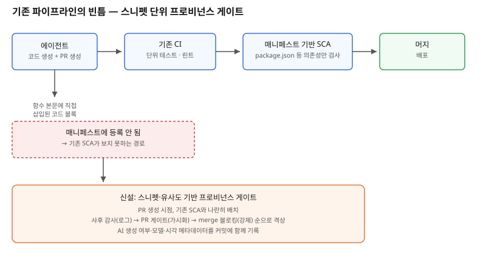

## 왜 지금 이 판단이 중요해졌는가

"이 기능, 빨리 구현해주세요." 코딩 에이전트에게 흔히 던지는 요청이다. 에이전트는 학습 데이터에 포함된 수많은 오픈소스 코드의 패턴을 참고해 결과물을 내놓는데, 이 과정에서 특정 오픈소스 프로젝트의 코드 스니펫과 거의 동일한 블록이 그대로 섞여 들어올 수 있다. 문제는 이 코드가 `package.json`이나 `pom.xml` 같은 의존성 매니페스트에 전혀 등록되지 않는다는 점이다. 사람이 라이브러리를 설치하면 매니페스트에 흔적이 남지만, 에이전트가 직접 타이핑하듯 생성한 코드는 그런 흔적 없이 소스 파일에 바로 섞여 들어간다.

그래서 기존에 조직이 써오던 SCA(Software Composition Analysis) 도구, 즉 매니페스트를 읽어 의존성의 라이선스를 검사하는 방식은 이 경로를 아예 보지 못한다. 업계 보고서는 2026년 기준 오픈소스 컴포넌트의 상당수가 표준 패키지 매니저 바깥 경로로 코드베이스에 들어오고 있으며, 그중에는 AI 생성 경로가 포함된다고 지적한다. 같은 흐름에서 상용 코드 감사 보고서는 조사 대상 코드베이스의 68%에서 라이선스 충돌이 발견됐다고 밝혔는데, 이는 전년 대비 증가한 수치다. AI 코딩 도구를 쓰는 조직 중 공식 정책을 가진 비율이 20%를 밑돈다는 조사 결과까지 겹치면, 지금 이 틈을 메우지 않으면 뒤늦게 발견되는 라이선스 문제가 계속 쌓이는 구조라는 뜻이 된다.

## 전체 시스템에서의 위치

지금 많은 조직의 파이프라인은 "에이전트가 코드를 생성한다 → PR을 올린다 → CI가 단위 테스트와 린트를 돌린다 → 매니페스트 기반 SCA가 의존성 라이선스를 검사한다 → 머지한다" 순서로 짜여 있다. 이 흐름에서 SCA는 `import`나 `require`로 선언된 외부 패키지만 본다. 에이전트가 함수 본문에 직접 써 넣은, 다른 오픈소스 프로젝트와 거의 동일한 코드 블록은 이 검사망에 전혀 걸리지 않는다. 스니펫 자체가 매니페스트에 등록된 적이 없기 때문이다.

이 빈틈을 메우려면 "코드 블록 단위의 유사도·출처 검사"라는 새로운 계층이 기존 파이프라인 중간에 들어가야 한다. 위치는 PR 생성 직후, 기존 SCA 단계와 나란히 두는 것이 합리적이다. 너무 이르게(에이전트가 코드를 생성하는 순간) 넣으면 에이전트 작업 흐름 자체를 막아 생산성이 떨어지고, 너무 늦게(배포 직전) 넣으면 이미 여러 커밋에 걸쳐 섞인 코드를 되돌리는 비용이 커진다.

## 선택의 트레이드오프

| 기준 | Pre-commit 훅 | PR 생성 시 CI 게이트 | Merge 직전 블로킹 게이트 | 사후 정기 감사 |
|---|---|---|---|---|
| 탐지 시점 | 가장 이름 | 코드 리뷰와 동시 | 머지 직전, 가장 늦게 차단 | 이미 머지된 뒤 |
| 개발 속도 영향 | 커밋마다 지연 발생 | 리뷰 대기 시간에 흡수됨 | 머지 지연 발생 | 없음 |
| 우회 가능성 | `--no-verify`로 쉽게 우회 | 리뷰어가 무시하면 통과 | 강제 차단, 우회 어려움 | 이미 늦음 |
| False Positive 대응 | 개발자가 즉시 처리해야 함 | 리뷰 단계에서 논의 가능 | 머지를 막으므로 민감 | 영향 없음(사후) |
| 도입 난이도 | 로컬 환경마다 설정 필요 | 기존 CI에 단계 추가만 하면 됨 | 정책적 합의 필요(강제력 큼) | 가장 쉬움 |

표가 보여주는 결론은 하나의 단계만으로 충분하지 않다는 점이다. 처음에는 "사후 정기 감사"로 시작해 실제 충돌 빈도와 false positive율을 측정하고, 그 데이터를 근거로 "PR 생성 시 CI 게이트"로 끌어올리는 점진적 전환이 현실적이다. 처음부터 merge 블로킹 게이트로 도입하면 도구의 정확도를 검증하기 전에 팀의 반발부터 산다.

## 실제 프로젝트 진행 순서

1. **현재 조직에 AI 코딩 도구 사용에 대한 명시적 정책이 있는지부터 확인한다.** 업계 조사에서 정책 보유 조직이 소수였다는 점을 고려하면, 많은 팀이 이 단계에서부터 시작해야 한다.
2. **스니펫·유사도 기반 스캔 도구를 드라이런 모드로 기존 CI에 먼저 붙인다.** 처음에는 결과를 차단이 아니라 로그로만 남겨, 실제 충돌 빈도와 false positive율을 2~4주간 관찰한다.
3. **커밋·PR 메타데이터에 "AI 생성 여부, 사용한 모델, 생성 시각"을 기록하는 관행부터 도입한다.** 이 메타데이터는 나중에 문제가 된 코드의 출처를 역추적하는 데 필수적이며, 스캐너의 정확도와 무관하게 지금 바로 시작할 수 있다.
4. **드라이런 데이터를 근거로 PR 생성 시 CI 게이트로 전환한다.** 이 시점에는 리뷰어가 결과를 확인할 수 있도록 PR 코멘트 형태로 결과를 노출한다.
5. **false positive율이 충분히 낮아졌다고 판단될 때만 merge 블로킹 게이트로 격상한다.** 이 전환은 기술적 준비뿐 아니라 팀 전체의 합의가 필요한 정책 결정이므로 별도로 공지한다.

## 실무 포인트

**매니페스트 기반 SCA를 이미 쓰고 있다는 이유로 "라이선스 관리는 이미 하고 있다"고 안심하지 않는다.** 기존 SCA는 AI가 직접 작성한 코드 블록을 원천적으로 볼 수 없는 구조이므로, 이 둘은 서로 다른 문제를 다루는 별개의 계층이다.

**AI 생성 코드 자체의 저작권 귀속이 법적으로 아직 불확실하다는 점을 전제로 설계한다.** 순수 AI 생성 결과물을 MIT·BSD 같은 라이선스로 재배포할 때,애초에 재배포할 저작권이 성립하는지가 불확실하다는 지적이 있다. 이는 스캐너 도입과 별개로 법무팀과 함께 검토해야 할 영역이다.

**도구 도입보다 메타데이터 기록 관행이 먼저다.** 스캐너가 아직 없더라도 "이 커밋은 에이전트가 어떤 프롬프트로 생성했는가"를 남기는 습관만으로도, 나중에 문제가 발견됐을 때 추적 비용이 크게 줄어든다.

## 마무리

- 에이전트가 생성하는 코드는 패키지 매니저를 거치지 않기 때문에 매니페스트 기반 라이선스 스캐너의 검사망 바깥에 있고, 업계 조사는 이미 코드베이스 다수에서 라이선스 충돌을 보고하고 있다.
- 이 빈틈을 메우는 스니펫·유사도 기반 프로비넌스 게이트는 기존 CI의 SCA 단계와 나란히, PR 생성 시점에 두는 것이 생산성과 차단 효과의 균형점이다.
- 사후 정기 감사(로그만) → PR CI 게이트(가시화) → merge 블로킹(강제)의 순서로 점진적으로 격상하는 편이, 처음부터 강한 게이트를 도입해 팀의 반발을 사는 것보다 현실적이다.

## 참고 자료

- [AI and assisted programming in open source — Taylor Wessing](https://www.taylorwessing.com/en/insights-and-events/insights/2026/06/ai-and-assisted-programming-in-open-source)
- [68% of codebases contain license conflicts, and AI generated code is making it worse — HeroDevs](https://www.herodevs.com/blog-posts/68-of-codebases-contain-license-conflicts-and-ai-generated-code-is-making-it-worse)
