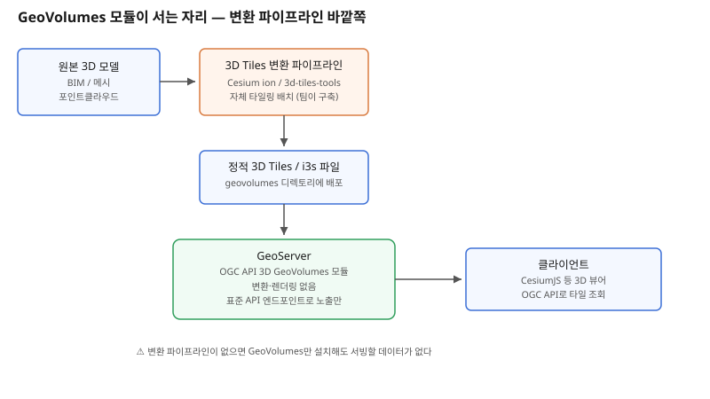

## 왜 지금 이 판단이 중요해졌는가

"지도에 건물을 평면으로만 보여주지 말고, 3D로도 보여주면서 다른 OGC 클라이언트에서도 표준 방식으로 가져다 쓸 수 있게 해주세요." GIS 서비스를 운영하다 보면 이런 요구가 들어온다. 지금까지는 WMS·WFS로 2D 데이터를 내리던 GeoServer와, 3D 모델은 Cesium ion이나 별도 3D Tiles 서버가 처리하는 식으로 역할이 완전히 나뉘어 있었다. 이 간극을 메우려는 시도가 GeoServer의 `OGC API 3D GeoVolumes` 커뮤니티 모듈(GEOS-11509)이다.

그런데 이 모듈의 실제 설계를 들여다보면 기대와 다른 지점이 있다. 개발자가 OSGeo 메일링 리스트에 공개한 설명에 따르면 이 모듈은 "매우 가벼운 구현"으로, 3D Tiles나 i3s 같은 콘텐츠를 **외부에서 생성해 정적 파일로 제공받는** 구조다. GeoServer 데이터 디렉토리 안의 `geovolumes` 서브디렉토리에 결과물을 넣어두면, 모듈은 그걸 OGC API 3D GeoVolumes 스펙(2024년 8월 초안 기준, core conformance class만 구현)에 맞춰 노출해줄 뿐이다. 즉 GeoServer가 3D 변환·렌더링·타일링을 대신 해주는 게 아니라, 이미 완성된 결과물을 표준 API 껍데기로 감싸주는 역할만 한다. 이 차이를 모르고 "GeoServer 하나로 3D까지 해결된다"고 가정하면, 정작 파이프라인에서 가장 손이 많이 가는 "누가 3D Tiles를 만드는가"라는 질문이 빠진 채 설계가 끝난다.

## 전체 시스템에서의 위치

이 구조에서 GeoServer가 서는 자리는 데이터 흐름의 맨 끝, "이미 만들어진 결과물을 어떤 프로토콜로 내보낼 것인가"의 자리다. 앞단에는 원본 3D 모델(BIM, 메시, 포인트클라우드)을 3D Tiles나 i3s로 변환하는 별도 파이프라인이 반드시 있어야 한다. 이 변환 작업은 Cesium ion 같은 상용 서비스, `3d-tiles-tools` 같은 오픈소스 CLI, 혹은 자체 구축한 타일링 배치 작업이 맡는다. GeoServer는 그 결과물이 떨어지는 디렉토리를 감시하다가, OGC API 표준 엔드포인트로 컬렉션 목록과 메타데이터를 응답해주는 얇은 서빙 계층일 뿐이다.

그래서 실제 시스템 설계에서 고민해야 할 지점은 GeoServer 쪽이 아니라 그 앞단이다. 변환 파이프라인을 어떻게 트리거할 것인가(원본 변경 시 자동 재생성 vs 수동 배치), 변환된 파일을 `geovolumes` 디렉토리에 어떻게 배포할 것인가(CI/CD 파이프라인의 아티팩트 배포 단계로 넣을지, 별도 동기화 작업을 둘지), 그리고 디렉토리 경로 규칙(`..`를 이용한 상위 경로 접근이 보안상 차단되어 있다)을 어떻게 지킬 것인가다.

## 선택의 트레이드오프

| 기준 | GeoVolumes 모듈(GeoServer) | Cesium ion 호스팅 | 자체 정적 파일 서버(S3+CDN) | 자체 3D Tiles 변환 파이프라인 구축 |
|---|---|---|---|---|
| 역할 | 완성된 3D Tiles를 OGC API로 노출만 | 변환·호스팅·CDN까지 통합 제공 | 호스팅만, 변환은 별도 | 변환 자체를 직접 구현 |
| 표준 준수 | OGC API 표준 준수(초안 기준) | 비표준, Cesium 생태계 전용 | 없음(단순 정적 호스팅) | 선택한 설계에 따라 다름 |
| 성숙도 | 커뮤니티 모듈, 나이틀리 전용, 미완성 | 상용 서비스로 안정적 | 매우 안정적(범용 인프라) | 팀 역량에 전적으로 의존 |
| 기존 GeoServer 운영 통합 | 같은 서버에서 2D·3D 함께 관리 | 완전히 별도 시스템 | 완전히 별도 시스템 | 통합 여부는 설계 나름 |
| 변환 작업 필요 여부 | 여전히 필요(이 모듈은 변환 안 함) | 불필요(업로드만 하면 변환) | 여전히 필요 | 직접 구현해야 함 |

표가 가리키는 결론은 "GeoVolumes가 Cesium ion의 대체재"가 아니라는 점이다. GeoVolumes는 변환 파이프라인을 이미 갖추고 있고, 그 결과물을 기존 GeoServer 운영 체계 안에서 OGC 표준으로 함께 관리하고 싶은 팀에게만 의미가 있다. 변환 파이프라인이 없는 팀이 "3D도 되나 보다" 하고 GeoVolumes부터 설치하면, 여전히 빈 디렉토리만 보게 된다.

## 실제 프로젝트 진행 순서

1. **먼저 "3D 데이터를 누가, 어떻게 3D Tiles로 만들 것인가"를 확정한다.** GeoVolumes 모듈 설치는 이 질문이 풀린 뒤에 의미가 생긴다. 아직 변환 파이프라인이 없다면 먼저 그것부터 구축하거나 Cesium ion 같은 관리형 서비스로 대체 가능한지 검토한다.
2. **나이틀리 빌드(3.0-SNAPSHOT)로 테스트 환경에 모듈을 설치해 안정성을 먼저 확인한다.** 아직 OGC API 모듈 전체가 "heavy development" 단계로 명시돼 있으므로, 운영 서버에 바로 올리지 않는다.
3. **샘플 3D Tiles 하나를 `geovolumes` 디렉토리 구조에 맞춰 수동으로 배치해보고, OGC API 엔드포인트 응답을 직접 확인한다.** collections 파일 작성 규칙과 경로 제약(`..` 차단)을 이 단계에서 파악한다.
4. **변환 파이프라인의 출력 경로를 `geovolumes` 디렉토리와 연결하는 배포 단계를 CI/CD에 추가한다.** 수동 복사로 시작했다면 이 시점에 자동화한다.
5. **클라이언트(CesiumJS 등)가 OGC API 엔드포인트를 통해 실제로 타일을 정상적으로 로드하는지 파일럿 레이어 하나로 검증한 뒤 범위를 넓힌다.**

## 실무 포인트

**"GeoServer 3D 지원"이라는 말을 들었을 때 변환 기능까지 포함된 것으로 오해하지 않는다.** 영업 문서나 블로그 글에서 이 구분이 흐려지는 경우가 많으므로, 공식 문서의 "externally produced static files" 문구를 직접 확인하는 습관이 필요하다.

**아직 core conformance class만 구현돼 있고 bbox 검색 클래스는 빠져 있다.** 특정 영역만 조회하는 기능이 필요한 서비스라면 지금 시점에는 모듈만으로 해결되지 않을 수 있으니, 요구사항과 구현 범위를 먼저 대조한다.

**경로 보안 규칙을 가볍게 넘기지 않는다.** `geovolumes` 디렉토리 밖을 가리키는 상대 경로(`..`)는 호스팅 환경에서 관리자 권한 악용을 막기 위해 차단돼 있다. 배포 자동화 스크립트를 짤 때 이 제약을 먼저 테스트해야 나중에 배포만 실패하는 상황을 피한다.

## 마무리

- GeoServer의 OGC API 3D GeoVolumes 모듈은 3D 데이터를 변환하거나 렌더링하지 않고, 외부에서 만들어진 3D Tiles·i3s 정적 파일을 OGC 표준 API로 노출만 하는 가벼운 서빙 계층이다.
- 따라서 진짜 설계 작업은 GeoServer 설정이 아니라 그 앞단의 3D Tiles 변환 파이프라인(Cesium ion, CLI 도구, 자체 배치)을 어떻게 구축하고 자동 배포할 것인가에 있다.
- 아직 커뮤니티 모듈·나이틀리 빌드 단계이고 스펙도 초안 기준이므로, 기존 2D 운영과 3D를 한 서버에서 표준으로 통합 관리하려는 팀이 파일럿 레이어로 먼저 검증한 뒤 범위를 넓히는 것이 합리적이다.

## 참고 자료

- [OGC API - 3D GeoVolumes — GeoServer 공식 문서](https://docs.geoserver.org/main/en/user/community/ogc-api/3dgeovolumes/index.html)
- [GeoServer Developer: New community module — OGC API 3D GeoVolumes](https://discourse.osgeo.org/t/geoserver-devel-new-community-module-ogc-api-3d-geovolumes/110195)
