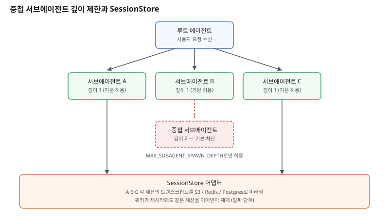

## 왜 지금 이 판단이 중요해졌는가

"이 리서치, 서브에이전트 다섯 개한테 나눠 맡기고 그중 하나는 또 자기 서브에이전트를 불러서 더 깊게 파게 해주세요." 멀티 에이전트 설계를 하다 보면 자연스럽게 이런 요구가 나온다. 하나의 조사 작업을 여러 하위 작업으로 쪼개고, 그 하위 작업이 다시 더 잘게 쪼개지는 재귀적 위임 구조다. Claude Agent SDK는 한때 이 구조를 깊이 5단계까지 기본으로 열어뒀다.

그런데 최근 릴리스에서 이 기본값이 거꾸로 움직였다. 서브에이전트가 기본적으로 더 이상 중첩 서브에이전트를 만들지 못하도록 깊이 상한을 1로 낮추고, `CLAUDE_CODE_MAX_SUBAGENT_SPAWN_DEPTH` 환경 변수로만 더 깊은 중첩을 허용하게 바꿨다. 동시에 동시 실행 가능한 서브에이전트 수에도 기본 상한(20개, `CLAUDE_CODE_MAX_CONCURRENT_SUBAGENTS`로 조정)을 뒀다. 같은 변경에 `SessionStore`라는 알파 기능도 함께 들어왔는데, 세션 트랜스크립트를 S3·Redis·Postgres 같은 외부 저장소에 미러링하고 거기서 재개할 수 있게 하는 어댑터 구조다. 기능이 느는 방향과 기본값을 조이는 방향이 한 릴리스에 같이 온 셈이고, 이 둘을 묶어서 보면 지금 에이전트 시스템을 설계할 때 실제로 바꿔야 할 기본값이 보인다.

## 전체 시스템에서의 위치

멀티 에이전트 시스템에서 깊이 제한은 호출 그래프의 모양을 결정하는 경계다. 루트 에이전트 아래에 서브에이전트가 오고, 그 서브에이전트가 또 서브에이전트를 부를 수 있다면 트리는 통제 없이 옆으로도 아래로도 동시에 자란다. 토큰 소비와 호출 비용은 이 트리의 노드 수에 비례하므로, 깊이와 동시성에 상한이 없으면 한 번의 "조사해주세요" 요청이 수백 개의 호출로 번질 수 있다. 깊이 제한은 바로 이 지점, 즉 "위임이 몇 단계까지 번지는가"를 통제하는 자리에 들어간다.

SessionStore는 그보다 한 계층 아래, 각 에이전트 세션이 만든 상태를 어디에 둘 것인가의 자리에 들어간다. 지금까지는 세션 트랜스크립트가 로컬 프로세스나 로컬 디스크에 묶여 있어서, 프로세스가 죽으면 그 세션의 맥락도 함께 사라졌다. SessionStore 어댑터는 이 상태를 외부 저장소로 밀어내서, 서브에이전트가 재시작되거나 다른 워커로 옮겨가도 같은 세션을 이어받을 수 있게 한다. 깊이·동시성 제한이 "얼마나 많이 열어줄 것인가"의 문제라면, SessionStore는 "열어준 만큼의 상태를 어떻게 잃지 않을 것인가"의 문제다.

## 선택의 트레이드오프

| 기준 | 깊이 제한 없음(과거 기본값) | 깊이 1 + 명시적 허용 | SessionStore 미사용(로컬 상태) | SessionStore 사용 |
|---|---|---|---|---|
| 토큰·비용 통제 | 예측 불가, 재귀 폭주 위험 | 호출 그래프가 선언적으로 고정됨 | 비용과 무관 | 외부 저장소 I/O 비용 추가 |
| 복구력 | 프로세스 죽으면 전체 트리 유실 | 동일 | 워커 재시작 시 세션 유실 | 다른 워커에서도 이어받기 가능 |
| 설계 복잡도 | 낮음(기본값대로 둠) | 깊이가 필요한 작업만 식별해야 함 | 낮음 | 저장소 연동·직렬화 설계 필요 |
| 적합한 상황 | 소규모 실험, 단발성 스크립트 | 프로덕션 멀티 에이전트 파이프라인 | 단일 세션, 단발 작업 | 장시간 실행·분산 워커 환경 |

표가 보여주는 핵심은 두 설정 모두 "기능을 아끼는 것"이 아니라 "기본값이 조직의 평균적인 사용 패턴에 안전하지 않았다"는 판단이라는 점이다. 재귀적 위임이 실제로 필요한 팀은 소수지만, 기본값이 열려 있으면 의도치 않은 재귀 호출로 비용이 새는 팀은 다수다. 반대로 SessionStore는 기본값을 조이는 쪽이 아니라 새로 열어주는 쪽인데, 이는 장시간 실행되는 에이전트 워크플로우가 늘면서 로컬 상태만으로는 더 이상 버틸 수 없는 팀이 생겼다는 신호다.

## 실제 프로젝트 진행 순서

1. **지금 쓰는 서브에이전트 구조에서 실제로 2단계 이상 중첩이 필요한 작업이 있는지부터 식별한다.** 대부분의 "조사 위임" 패턴은 깊이 1(루트가 여러 서브에이전트를 병렬로 호출)만으로 충분하고, 깊이 2 이상이 필요한 경우는 생각보다 드물다.
2. **깊이가 필요한 작업에만 `CLAUDE_CODE_MAX_SUBAGENT_SPAWN_DEPTH`를 명시적으로 올려서 적용 범위를 좁힌다.** 환경 변수를 전역으로 올리지 말고, 그 패턴이 실제로 쓰이는 파이프라인에만 한정한다.
3. **동시성 상한(기본 20)에 걸리는 작업이 있는지 로그로 먼저 확인한다.** 상한을 올리기 전에, 애초에 그만큼의 병렬 호출이 설계 의도대로인지부터 점검한다.
4. **세션이 프로세스 재시작으로 끊기는 사고가 실제로 발생했는지 돌아본다.** 발생한 적이 없다면 SessionStore는 아직 알파 단계이므로 급하게 도입하지 않는다. 발생했다면 가장 가벼운 백엔드(예: Redis)로 파일럿을 먼저 돌려본다.
5. **파일럿에서 직렬화 실패·재개 실패 케이스를 먼저 수집한 뒤 범위를 넓힌다.** 알파 기능이므로 프로덕션 전면 적용보다 특정 장시간 파이프라인 하나에만 먼저 붙인다.

## 실무 포인트

**깊이 제한을 "기능 축소"로 오해하지 않는다.** 기본값이 낮아진 것이지 기능 자체가 사라진 것이 아니다. 환경 변수 하나로 이전 동작을 되살릴 수 있으므로, 중첩이 필요한 파이프라인은 코드 변경 없이 설정만으로 대응 가능하다.

**깊이 제한에는 알려진 버그가 있다는 점을 전제로 검증한다.** 특정 버전에서 깊이를 1로 설정해도 실제로는 한 단계 더 깊게 중첩이 허용되는 사례가 보고됐다. 설정값을 믿지 말고, 실제 호출 트리를 로그로 찍어 의도한 깊이에서 멈추는지 직접 확인해야 한다.

**SessionStore는 아직 알파라는 꼬리표를 가볍게 보지 않는다.** 세션 상태를 외부 저장소로 옮긴다는 것은 장애 지점이 하나 늘어난다는 뜻이기도 하다. 저장소 장애 시 세션을 어떻게 안전하게 실패시킬지(그냥 로컬로 폴백할지, 작업을 중단할지)를 먼저 설계해야 한다.

## 마무리

- 서브에이전트가 서브에이전트를 부르는 중첩 구조는 기본값이 깊이 5에서 1로 낮아졌고, 동시 실행 상한도 기본으로 생겼다 — 재귀적 위임이 소수의 필요였고 다수에게는 비용 누수 위험이었다는 판단이다.
- SessionStore는 그 반대 방향으로, 세션 상태를 외부 저장소로 내보내 장시간 실행·분산 워커 환경에서 세션을 이어받을 수 있게 하지만 아직 알파 단계다.
- 두 변경을 함께 보면 설계 원칙은 하나다 — 위임의 범위(깊이·동시성)는 기본값을 좁게, 상태의 생존(SessionStore)은 필요한 곳에만 선택적으로 넓힌다.

## 참고 자료

- [Claude Agent SDK TypeScript CHANGELOG](https://github.com/anthropics/claude-agent-sdk-typescript/blob/main/CHANGELOG.md)
- [Claude Code 공식 문서](https://code.claude.com/docs/en/features-overview)
