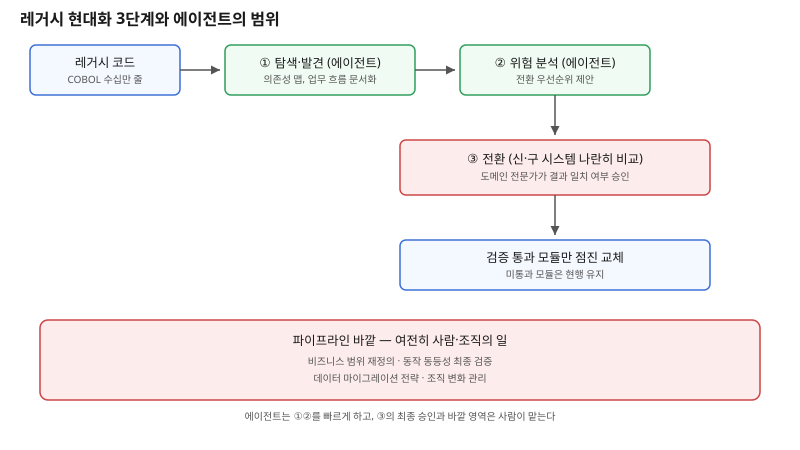

## 왜 지금 이 판단이 중요해졌는가

"이 코볼 시스템, 유지보수할 사람도 없는데 에이전트가 통째로 현대화해주세요." 수십 년 된 메인프레임을 안고 있는 조직이라면 한 번쯤 떠올리는 요구다. 최근 Anthropic이 Claude Code의 레거시 시스템 현대화 기능과 함께 Code Modernization Playbook을 공개했고, 이 발표는 같은 날 IBM 주가를 10% 넘게 떨어뜨릴 만큼 시장을 흔들었다. 하지만 주가 반응과 실제로 에이전트가 할 수 있는 일의 범위는 다른 이야기다.

공개된 내용을 보면 에이전트가 자동화하는 건 코드를 전부 알아서 새 언어로 바꿔 배포하는 것이 아니라, 탐색(exploration)과 분석(analysis) 단계다. 의존성을 매핑하고, 업무 흐름을 문서화하고, 위험 지점을 식별하는 작업이다. 이 부분은 사람이 수십 년 묵은 코드를 한 줄씩 읽으며 몇 주씩 걸리던 일이었고, 에이전트가 빠르게 대체할 수 있는 영역이다. 반면 업계 비평가들은 실제 현대화에는 비즈니스 범위 정의, 동작 동등성 검증, 데이터 마이그레이션 전략, 조직 변화 관리가 함께 필요하다고 지적한다. 이 네 가지는 코딩 도구의 범위 밖이다. 빌더 입장에서 "에이전트가 현대화해주세요"라는 요구는 "어디까지가 에이전트의 일이고, 어디서부터 사람이 설계해야 하는가"를 가르는 작업으로 번역돼야 한다.

## 전체 시스템에서의 위치

레거시 현대화 파이프라인은 세 단계로 나뉜다. 첫 단계는 탐색·발견으로, 수십만 줄의 코볼 코드에서 모듈 간 의존성과 숨겨진 업무 규칙을 뽑아낸다. 사람이 하면 몇 주가 걸리던 일을 에이전트가 코드를 읽어 의존성 그래프와 업무 흐름 문서로 빠르게 정리한다. 두 번째 단계는 위험 분석·기회 매핑으로, 어떤 모듈이 자주 바뀌는지, 어떤 모듈이 다른 시스템과 강하게 얽혀 있는지를 근거로 전환 우선순위를 제안한다.

세 번째 단계인 실제 전환에서는 신·구 시스템을 나란히 돌리며 같은 입력에 대한 출력을 비교하는 방식이 쓰인다. 기존 코볼 시스템과 새로 작성된 코드를 동시에 실행해 결과가 일치하는지 검증하고, 검증을 통과한 모듈부터 점진적으로 교체한다. 이 구조에서 에이전트의 산출물(의존성 맵, 위험 보고서, 변환된 코드 초안)은 입력일 뿐이고, "이 모듈을 지금 바꿔도 되는가"를 최종 승인하는 자리에는 여전히 사람이 앉는다. 비즈니스 범위를 다시 정의하거나 데이터 마이그레이션 전략을 세우는 일은 이 파이프라인 바깥, 더 상위의 조직적 의사결정 단계에 남는다.

## 선택의 트레이드오프

| 기준 | 전면 재작성(빅뱅) | 에이전트 보조 점진 전환(탐색→분석→검증된 교체) | 현행 유지(래핑만) |
|---|---|---|---|
| 초기 가시성 확보 속도 | 느림 — 전체를 다시 이해해야 함 | 빠름 — 의존성·위험을 먼저 자동 매핑 | 빠름 — 분석 자체를 생략 |
| 전환 중 장애 위험 | 높음 — 한 번에 전환 | 낮음 — 모듈 단위 검증 후 교체 | 없음 — 전환 자체가 없음 |
| 숨은 업무 규칙 유실 위험 | 높음 — 재해석 과정에서 누락 가능 | 낮음 — 기존 출력과 비교 검증 | 없음 — 로직 그대로 유지 |
| 필요한 조직 역량 | 도메인 전문가 다수 장기 투입 | 코드 검증 체계 + 도메인 리뷰어 | 최소 — 유지보수 인력만 |
| 적합한 상황 | 레거시가 작고 업무 규칙이 단순 | 대규모·업무 규칙이 코드에만 암묵적으로 존재 | 당장 전환 압박이 없는 경우 |

표가 가리키는 핵심은 에이전트 보조 방식이 "더 빠른 빅뱅 재작성"이 아니라 "검증 비용을 낮춘 점진적 전환"이라는 점이다. 탐색·분석 단계의 자동화가 전체 일정을 줄이는 것은 맞지만, 검증 단계의 신중함까지 줄여도 된다는 뜻은 아니다. 오히려 사람이 매번 전체 코드를 읽을 필요가 없어진 만큼, 비교 검증에 쓸 수 있는 시간이 늘어난다고 보는 편이 정확하다.

## 실제 프로젝트 진행 순서

1. **현대화 대상을 통째로 던지지 않고, 먼저 에이전트에게 의존성 맵과 위험 보고서부터 뽑게 한다.** 이 산출물 자체가 "어디부터 손대야 하는가"를 결정하는 근거가 된다.
2. **위험 보고서에서 가장 고립된(의존성이 적은) 모듈을 첫 전환 대상으로 고른다.** 가장 중요한 모듈부터 시작하지 않는다 — 검증 체계 자체를 먼저 작은 범위에서 다져야 한다.
3. **신·구 모듈을 나란히 돌리는 비교 검증 하네스를 먼저 구축한다.** 이 하네스가 없으면 에이전트가 만든 변환 코드의 정확성을 확인할 방법이 없다.
4. **도메인 전문가를 검증 단계에 반드시 배치한다.** 코볼 코드에만 존재하는 암묵적 업무 규칙은 출력 비교만으로 다 잡히지 않는 경우가 있으므로, 사람의 업무 지식이 검증 루프 안에 있어야 한다.
5. **데이터 마이그레이션과 조직 변화 계획은 코드 전환과 별도 트랙으로 분리해 처음부터 함께 설계한다.** 코드가 다 바뀐 뒤에 데이터·조직 문제를 뒤늦게 다루면 전환 일정이 통째로 밀린다.

## 실무 포인트

**"탐색·분석이 빨라졌다"를 "현대화가 빨라졌다"로 착각하지 않는다.** 전체 일정에서 탐색·분석이 차지하던 비중이 줄어든 것이지, 검증과 조직 합의에 걸리는 시간이 함께 줄어드는 것은 아니다. 오히려 줄어든 시간을 검증에 재투자하는 쪽이 사고를 줄인다.

**신·구 시스템 비교 검증은 "같은 입력, 같은 출력"만으로 끝나지 않는다.** 코볼 시스템의 부수 효과(배치 작업 순서, 외부 시스템 호출 타이밍)까지 재현해야 진짜 동등성 검증이 된다. 단순 입출력 비교만 통과했다고 안심하면 운영 중 타이밍 관련 장애로 이어질 수 있다.

**이 발표가 시장에 준 충격과 실제 적용 난이도를 분리해서 본다.** 주가 반응은 "이제 메인프레임 컨설팅 시장이 통째로 대체된다"는 기대를 반영하지만, 실제로는 대형 금융·보험사의 수십 년 된 시스템일수록 비즈니스 범위 재정의와 조직 변화가 기술적 전환보다 오래 걸리는 경우가 흔하다.

## 마무리

- Claude Code의 COBOL 현대화 발표는 탐색·분석 단계의 자동화이지, 전환·검증·조직 변화까지 포괄하는 완전 자동 현대화가 아니다.
- 실제 파이프라인은 탐색(의존성 매핑) → 분석(위험·우선순위) → 검증된 점진적 교체(신·구 비교) 3단계로 쪼개지며, 마지막 승인은 여전히 사람의 몫이다.
- 고립도가 낮은 모듈부터 비교 검증 하네스로 시작하고, 데이터 마이그레이션·조직 변화는 코드 전환과 별도 트랙으로 처음부터 함께 설계해야 일정이 밀리지 않는다.

## 참고 자료

- [Anthropic — The Code Modernization Playbook](https://resources.anthropic.com/code-modernization-playbook)
- [Claude Code 공식 문서](https://code.claude.com/docs/en/features-overview)
