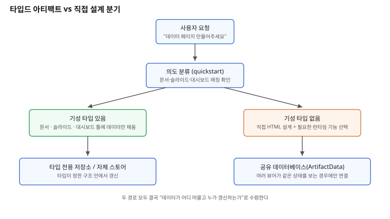

## 왜 지금 이 판단이 중요해졌는가

"우리 팀 KPI를 한눈에 보여주는 페이지 좀 만들어주세요." 이런 요청을 받으면 에이전트는 더 이상 빈 HTML 파일부터 그리지 않는다. 최근 Claude Docs·Slides·Design이 모든 플랜(무료 포함)에서 정식 기능으로 전환됐고, 같은 시점에 Claude Dashboards와 Claude Motion이 베타로 들어왔다. 이 변화의 핵심은 단순히 기능이 늘었다는 것이 아니라, 에이전트가 산출물을 만들기 전에 거쳐야 하는 단계가 하나 더 생겼다는 데 있다. 바로 "이 요청에 맞는 기성 타입이 이미 있는가"를 먼저 확인하는 단계다.

지금까지는 사용자가 무엇을 요청하든 결국 에이전트가 처음부터 HTML·CSS를 짜서 하나의 정적 페이지를 만드는 경로로 수렴했다. 그런데 문서·슬라이드·디자인·대시보드처럼 쓰임새가 뚜렷한 영역은 플랫폼이 이미 틀(템플릿, 저장 방식, 공유 데이터베이스 연동)을 갖춘 전용 타입으로 분리됐다. 이제 빌더가 "페이지를 만들어주세요"라는 말을 들을 때마다 실제로 번역해야 하는 질문은 "이걸 기성 타입에 맡길 것인가, 아니면 내가 처음부터 설계할 것인가"로 바뀌었다. 이 판단을 매번 직감으로 하면 어떤 날은 과도하게 커스텀 HTML을 짜고, 어떤 날은 기성 타입의 제약에 억지로 요구사항을 욱여넣는 비일관성이 생긴다.

## 전체 시스템에서의 위치

요청이 들어왔을 때 시스템이 실제로 거치는 경로는 두 갈래다. 첫 번째 경로는 "문서를 공유하고 싶다", "발표 자료가 필요하다", "데이터를 보여주는 페이지가 필요하다" 같은 의도가 뚜렷할 때다. 이때는 먼저 의도 분류 단계를 거쳐 맞는 기성 타입(문서·슬라이드·디자인·대시보드)이 있는지 확인하고, 있으면 그 타입의 고정된 틀 위에 데이터 파일만 채워 넣는다. 데이터가 나중에도 계속 바뀌어야 한다면 그 타입 자체의 저장소나 공유 데이터베이스로 흐른다.

두 번째 경로는 기성 타입이 없는, 더 일반적인 페이지(설명 페이지, 인터랙티브 도구, 커스텀 UI)다. 이 경우에는 에이전트가 직접 HTML을 설계하는데, 이때도 "이 페이지가 상태를 기억해야 하는가, 여러 사람이 같이 써야 하는가, 실시간으로 바뀌는 데이터를 읽어야 하는가"에 따라 런타임 기능(상태 저장, 공유 데이터베이스, 뷰어 식별 등)을 선택적으로 붙인다. 상태를 여러 뷰어가 공유해야 하는 페이지, 예를 들어 사람이 손으로 기록을 추가하는 트래커나 체크리스트라면, 페이지 소스에 데이터를 박아 넣거나 브라우저 저장소에 맡기는 대신 별도의 공유 데이터베이스 계층을 붙이는 쪽을 선택해야 한다. 이 지점이 "직접 만든 페이지"와 "플랫폼 타입"이 다시 수렴하는 자리다 — 둘 다 결국 데이터가 어디에 머물고 누가 그 데이터를 갱신하는지의 문제로 귀결된다.

## 선택의 트레이드오프

| 기준 | 플랫폼 타입드 아티팩트 (문서·슬라이드·대시보드) | 직접 설계한 HTML 페이지 |
|---|---|---|
| 초기 구축 속도 | 빠름 — 틀이 이미 있어 데이터만 채우면 됨 | 느림 — 레이아웃·반응형·테마까지 직접 설계 |
| 디자인 일관성 | 플랫폼 기준으로 자동 통일 | 매번 디자인 판단이 들어가 편차 발생 가능 |
| 커스터마이징 자유도 | 타입이 정한 구조 안으로 제한 | 요구사항에 맞춰 임의로 확장 가능 |
| 상태·데이터 갱신 | 타입 전용 저장소 또는 자체 스토어 사용 | 런타임 기능을 선택적으로 붙여야 함(기본은 정적) |
| 적합한 요청 | "문서/발표자료/데이터 요약 페이지를 보여주세요" | "이런 식으로 작동하는 도구/화면을 만들어주세요" |
| 플랫폼 의존도 | 높음 — 타입이 바뀌면 산출물도 영향받음 | 낮음 — 표준 HTML이라 이식성 높음 |

표가 보여주는 결론은 "항상 플랫폼 타입을 먼저 쓰라"는 것이 아니라, 요청의 성격이 이미 존재하는 틀에 들어맞는지를 먼저 확인하는 습관이 비용을 줄인다는 점이다. 틀에 맞지 않는 요청을 억지로 타입에 끼워 맞추면 나중에 커스터마이징 벽에 부딪히고, 반대로 틀에 딱 맞는 요청을 매번 처음부터 설계하면 같은 일을 반복하는 셈이 된다.

## 실제 프로젝트 진행 순서

1. **요청을 받으면 먼저 의도를 분류한다.** "공유하고 편집할 문서인가", "발표용 슬라이드인가", "데이터를 보여주는 화면인가", "그 외 인터랙티브한 것인가"로 나눈다.
2. **앞의 세 가지에 해당하면 기성 타입이 있는지부터 확인한다.** 이 확인 없이 바로 직접 HTML을 짜기 시작하면, 이미 있는 틀을 다시 만드는 중복 작업이 된다.
3. **기성 타입이 있으면 그 타입의 데이터 규격에 맞춰 내용만 채운다.** 레이아웃·스타일 판단에 시간을 쓰지 않고 콘텐츠 밀도에 집중한다.
4. **기성 타입이 없다면 직접 설계로 전환하되, 상태가 필요한지부터 따진다.** 단순히 한 번 보여주고 끝나는 페이지인지, 여러 사람이 계속 값을 추가하는 페이지인지에 따라 붙여야 할 런타임 기능이 달라진다.
5. **상태를 공유해야 한다면 그 상태가 어떤 단위(기록 하나하나, 전체 문서 하나)로 쌓이는지부터 설계하고 저장 계층을 고른다.** 이 설계를 건너뛰고 일단 만들고 보면, 나중에 데이터 구조를 바꾸는 비용이 커진다.

## 실무 포인트

**"타입이 있는지 먼저 확인"을 생략하지 않는다.** 바쁘다고 바로 직접 HTML부터 짜면, 플랫폼이 이미 처리해주는 저장·공유·버전 관리를 처음부터 다시 구현하게 된다. 반대로 확인 자체를 잊고 매번 같은 방식으로만 만들면 비일관적인 산출물이 쌓인다.

**브라우저 로컬 저장소와 공유 데이터베이스를 혼동하지 않는다.** 로컬 저장소는 그 사람의 그 기기, 그 브라우저에만 남는 개인 편의 기능이다. 여러 사람이 같이 보는 체크리스트나 트래커처럼 "모두가 같은 값을 봐야 하는" 데이터는 반드시 공유 저장 계층으로 보내야 하며, 이를 로컬 저장소로 잘못 설계하면 사용자마다 다른 화면을 보게 되는 버그로 이어진다.

**플랫폼 타입의 틀은 고정값이라는 점을 설계 초기에 전제한다.** 타입드 아티팩트는 틀 자체를 바꿀 수 없고 데이터만 채우는 구조이므로, 요구사항에 그 틀을 벗어나는 커스터마이징(예: 완전히 다른 레이아웃)이 섞여 있다면 처음부터 직접 설계 경로를 택하는 편이 중간에 갈아타는 것보다 싸다.

## 마무리

- Claude Docs·Slides·Design의 정식 전환과 Dashboards·Motion의 베타 진입은 "페이지를 만들어주세요"라는 요청을 플랫폼 타입과 직접 설계라는 두 경로로 쪼갰다.
- 판단 기준은 디자인 취향이 아니라 요청의 성격(공유·발표·데이터 요약 vs 커스텀 동작)과 상태의 공유 범위(개인 편의 vs 여러 사람이 보는 공유 데이터)다.
- 기성 타입을 확인하는 습관 하나가 중복 구현을 줄이고, 상태의 공유 범위를 먼저 설계하는 습관 하나가 나중의 재설계 비용을 줄인다.

## 참고 자료

- [Claude Docs, Slides, and Design — Anthropic](https://www.anthropic.com/news)
- [Claude 도움말 센터 — Dashboards, Motion](https://support.claude.com/)
