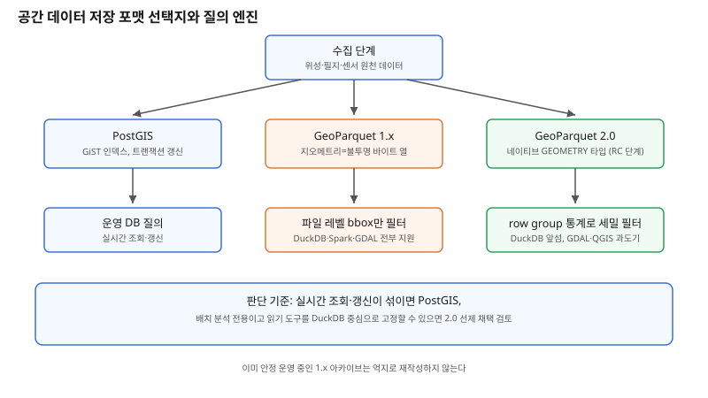

## 왜 지금 이 판단이 중요해졌는가

"위성 영상·필지·센서 로그를 합쳐서 수억 건 단위로 쌓고, 여기에 공간 조건으로 빠르게 질의하게 해주세요." 분석 파이프라인을 짜다 보면 반드시 마주치는 요구다. 지금까지 이 요구에 대한 답은 대체로 둘 중 하나였다 — PostGIS 같은 공간 DB에 넣거나, 클라우드 네이티브 포맷인 GeoParquet 1.x로 객체 스토리지에 올려두고 DuckDB·Spark로 긁어 읽거나.

그런데 GeoParquet 2.0에서 이 전제가 바뀌었다. 1.x는 지오메트리를 WKB(Well-Known Binary)로 직렬화해 Parquet의 평범한 BYTE_ARRAY 열에 욱여넣고, "이 열이 사실은 공간 데이터"라는 사실을 파일 바깥의 메타데이터로만 알려주는 방식이었다. 엔진 입장에서는 이 열이 공간 열인지 몰라서, 인덱스도 못 타고 술어 푸시다운도 못 받는 '불투명한 바이트 뭉치'였다. 2.0은 이걸 뒤집어 Parquet 포맷 자체에 추가된 GEOMETRY·GEOGRAPHY 로지컬 타입을 쓰도록 강제한다. 즉 공간성이 메타데이터의 약속이 아니라 포맷 스키마의 일부가 된다. 문제는 이 스펙이 아직 release candidate 단계이고 OGC 표준 승인도 대기 중이며, 도구 지원도 고르지 않다는 점이다. 이런 전환기에 지금 포맷을 바꿀지, 당분간 기존 방식을 유지할지는 트렌드를 좇는 문제가 아니라 실제 파이프라인 설계 판단이다.

## 전체 시스템에서의 위치

공간 데이터 파이프라인에서 저장 포맷은 수집과 질의 사이, 딱 중간에 앉는다. 앞단에서는 위성 영상 전처리, 필지 데이터 변환, 센서 스트림 적재 같은 수집 작업이 원천 데이터를 쏟아낸다. 이 데이터가 어떤 포맷으로 내려앉느냐에 따라 뒷단에서 쓸 수 있는 질의 엔진의 선택지가 갈린다. PostGIS에 넣으면 공간 인덱스(GiST)와 트랜잭션을 그대로 쓸 수 있지만 쓰기·스케일 비용이 따라온다. GeoParquet 1.x로 객체 스토리지에 두면 저장 비용은 싸지지만, 공간 열이 불투명한 바이트라서 엔진이 파일 전체를 읽은 뒤에야 공간 필터를 적용하는 비효율이 생긴다.

GeoParquet 2.0은 이 중간 지점에 변화를 준다. 지오메트리가 포맷 스키마에 선언되므로, 엔진이 파일을 다 읽지 않고도 파일 단위·row group 단위의 공간 범위(bounding box) 통계만 보고 읽을 파일을 걸러낼 수 있다. 바로 이 지점, "질의 엔진이 저장 포맷의 구조를 얼마나 알고 건너뛸 수 있는가"가 대용량 공간 데이터 파이프라인의 실제 성능을 가른다. 저장 포맷 선택은 그래서 단순한 "어디에 저장할까"가 아니라 "뒷단의 질의 엔진에게 무엇을 미리 알려줄 것인가"의 문제다.

## 선택의 트레이드오프

| 기준 | PostGIS | GeoParquet 1.x | GeoParquet 2.0 |
|---|---|---|---|
| 공간 질의 가속 | GiST 인덱스로 성숙 | 파일 레벨 bbox 통계만 | 네이티브 타입 + row group 통계로 더 세밀 |
| 표준화 상태 | OGC 표준(Simple Features), 안정 | 커뮤니티 표준, 안정 | release candidate, OGC 승인 대기 |
| 도구 생태계 | 전 영역 성숙 | GDAL·DuckDB·Spark 폭넓게 지원 | DuckDB가 가장 앞섬, GDAL·QGIS는 의존 라이브러리 버전 제약으로 과도기 |
| 쓰기·갱신 패턴 | 트랜잭션 단위 갱신에 적합 | 배치 적재, 파일 재작성 기준 | 1.x와 동일(배치 적재) |
| 적합한 상황 | 운영 서비스의 실시간 조회·갱신 | 분석용 대용량 아카이브, 이미 안정화된 파이프라인 | 신규 분석 파이프라인을 지금 설계하는 경우 |
| 피해야 할 상황 | 수억 건 단위 배치 분석 전용 적재 | - | 읽기 도구가 구버전 GDAL·QGIS에 고정된 운영 환경 |

표가 가리키는 핵심은 2.0이 1.x를 당장 대체하는 관계가 아니라는 점이다. 이미 1.x로 안정적으로 돌아가는 파이프라인을 급하게 2.0으로 옮길 이유는 아직 약하다. 반대로 지금 막 새 분석 파이프라인을 설계하는 상황이라면, DuckDB 중심으로 엔진을 고정할 수 있는지에 따라 2.0을 선제적으로 채택할지 판단이 갈린다.

## 실제 프로젝트 진행 순서

1. **먼저 질의 패턴을 분류한다.** 실시간 조회·갱신이 섞여 있으면 PostGIS가 기본값이고, 쓰기 한 번·읽기 여러 번의 분석 전용이면 Parquet 계열이 출발점이다.
2. **분석 전용이라면 읽기 쪽 도구 체인을 먼저 확정한다.** DuckDB·Spark만 쓴다면 2.0의 이점을 바로 누릴 수 있지만, GDAL·QGIS에 의존하는 단계가 파이프라인에 섞여 있다면 해당 버전이 신규 지오메트리 타입을 지원하는지부터 확인해야 한다.
3. **신규 파이프라인은 작은 데이터셋으로 1.x와 2.0을 모두 적재해 비교한다.** 같은 질의에서 읽어들이는 바이트 양과 걸러지는 row group 비율을 직접 재서 실제 이득을 확인한다.
4. **기존 1.x 아카이브는 억지로 재작성하지 않는다.** 변환 비용 대비 체감 이득이 적은 경우가 많으므로, 신규 적재분부터 2.0을 적용하고 과거 데이터는 그대로 둔 채 공존시키는 편이 현실적이다.
5. **스펙이 아직 release candidate라는 점을 운영 문서에 명시한다.** OGC 승인 전까지는 세부 필드가 바뀔 수 있으므로, 벤더 락인처럼 되돌리기 어려운 지점(예: 모든 다운스트림 도구가 2.0 전용 기능에만 의존하는 구조)은 만들지 않는다.

## 실무 포인트

**"네이티브 타입이라 빠르다"는 말을 곧이곧대로 믿지 않는다.** 실제 가속은 엔진이 그 타입을 알고 통계를 활용할 때만 일어난다. 아직 해당 로지컬 타입을 모르는 엔진에서는 1.x와 체감 차이가 없거나, 오히려 호환 레이어를 거치며 더 느려질 수 있다.

**GDAL·QGIS 버전을 먼저 점검한다.** 이 둘은 내부적으로 쓰는 Arrow 라이브러리 버전에 따라 2.0 지오메트리 타입 지원 여부가 갈린다. 파이프라인 중 하나라도 구버전에 묶여 있다면, 그 구간만 1.x로 변환해 넘기는 중간 단계를 설계해야 한다.

**CRS(좌표계) 표기 방식이 바뀐 점을 놓치지 않는다.** 2.0에서는 좌표계 정보가 Parquet 로지컬 타입의 속성 쪽으로 옮겨가면서 표현 방식도 함께 정리됐다. 기존 1.x 메타데이터 파싱 코드를 그대로 재사용하면 좌표계를 놓치는 조용한 버그가 생길 수 있으므로, 변환 스크립트에서 CRS 필드를 별도로 검증해야 한다.

## 마무리

- GeoParquet 2.0은 지오메트리를 불투명한 바이트 열에서 Parquet 네이티브 타입으로 승격시켜, 질의 엔진이 파일을 다 읽지 않고도 공간 범위로 걸러낼 수 있게 한다.
- 하지만 아직 release candidate 단계이고 DuckDB를 제외한 도구 생태계(GDAL·QGIS)는 과도기에 있어, 모든 파이프라인을 당장 옮길 이유는 아직 약하다.
- 판단 기준은 유행이 아니라 질의 패턴(실시간 vs 배치 분석)과 다운스트림 도구 체인이 신규 타입을 실제로 읽을 수 있는가다.

## 참고 자료

- [GeoParquet 공식 스펙 — geoparquet.org](https://geoparquet.org/)
- [Cloud Native Geospatial — GeoParquet 2.0: Going Native](https://cloudnativegeo.org/)
- [Apache Parquet — Native Geospatial Types](https://parquet.apache.org/)
