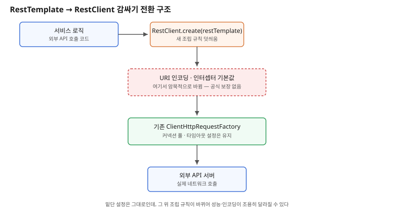

## 왜 지금 이 판단이 중요해졌는가

"외부 API 호출하는 코드, RestTemplate 쓰던 거 그냥 RestClient로 바꿔치기해주세요." 간단해 보이는 요청이다. Spring Framework 7.1부터 RestTemplate에 `@Deprecated(since = "7.1", forRemoval = true)`가 붙고, 8.0에서 완전히 제거될 예정이다. 공식 마이그레이션 가이드가 제시하는 가장 안전한 경로는 "한 번에 새로 짜지 말고, 기존 RestTemplate 인스턴스를 RestClient로 감싸서 점진적으로 옮기라"는 것이다. `RestClient.create(restTemplate)` 한 줄이면 끝나 보인다.

그런데 이 한 줄짜리 전환이 실제로는 조용히 동작을 바꾼다. 커뮤니티에 보고된 사례에서는 `new RestTemplate()`을 `RestClient.create()`로 바꾸자 병렬 호출 처리량이 4배 느려졌는데, 예외도 로그도 남지 않았다. 다른 사례에서는 커스터마이징하지 않은 기본 RestTemplate을 감쌀 때 URI 컴포넌트 인코딩 방식이 달라져서, 쿼리 스트링의 `+` 같은 문자가 다르게 인코딩됐다. 둘 다 로컬 재현 수준의 보고이고 운영 장애로 확정된 사례는 아니지만, "같은 동작을 유지한 채 구현체만 바꾼다"는 전제 자체가 깨질 수 있다는 신호다. 빌더 입장에서 이 요청은 단순한 클래스 치환이 아니라, 요청 팩토리·커넥션 풀·인코딩 설정이 새 구현체로 넘어갈 때 그대로 유지되는지를 검증하는 작업으로 번역돼야 한다.

## 전체 시스템에서의 위치

외부 API를 호출하는 코드에서 HTTP 클라이언트는 서비스 로직과 네트워크 사이에 끼는 얇은 계층처럼 보이지만, 실제로는 요청 팩토리(커넥션 생성 방식), 커넥션 풀(동시 연결 수 제한), URI 인코딩 규칙까지 함께 묶여 있는 조립체다. RestTemplate은 이 조립체를 `ClientHttpRequestFactory`라는 인터페이스로 추상화했고, 팀마다 타임아웃·커넥션 풀 크기를 이 팩토리에 직접 설정해둔 경우가 많다.

`RestClient.create(restTemplate)`로 감싸면 기존 요청 팩토리는 유지되지만, 그 위에 RestClient 고유의 기본 동작(요청 인터셉터 체인, URI 빌더 기본값)이 덧씌워진다. 즉 밑단(네트워크로 나가는 실제 연결)은 그대로인데, 그 위에서 요청을 조립하는 규칙이 바뀐다. 동시 호출이 많은 서비스에서 이 조립 규칙 변화가 커넥션 재사용 패턴에 영향을 주면, 네트워크 설정은 하나도 안 건드렸는데 처리량이 떨어지는 것처럼 보이는 상황이 생긴다. 이 지점이 "구현체 치환"과 "동작 유지"가 갈라지는 자리다.

## 선택의 트레이드오프

| 기준 | 그대로 유지(RestTemplate) | 감싸서 점진 전환(RestClient.create(restTemplate)) | 신규 작성(RestClient 직접 구성) |
|---|---|---|---|
| 작업량 | 없음 | 적음 — 한 줄 치환 | 많음 — 요청 팩토리·인터셉터 재설정 |
| 8.0 제거 대비 | 안 됨, 리스크 누적 | 부분적 — 내부 구현은 여전히 RestTemplate 의존 | 완전 대비 |
| 숨은 동작 변경 위험 | 없음(기존 그대로) | 있음 — 인코딩·동시성 패턴 변화 가능 | 낮음 — 설정을 명시적으로 다시 씀 |
| 적합한 대상 | 단기 운영 종료 예정 서비스 | 호출 지점이 많고 당장 전부 다시 쓰기 어려운 레거시 | 새 모듈, 또는 호출 지점이 적은 서비스 |
| 검증 비용 | 없음 | 인코딩·타임아웃·동시성 회귀 테스트 필요 | 설정을 처음부터 검증하므로 상대적으로 명확 |

표가 보여주는 결론은 "감싸서 전환"이 작업량은 가장 적지만 공짜가 아니라는 점이다. 그 적은 작업량의 대가로 "진짜 동작이 유지되는지"를 검증하는 책임이 통째로 넘어온다. 호출 지점이 수십 개를 넘는 레거시라면 이 트레이드오프가 그래도 합리적이지만, 호출 지점이 몇 개뿐이라면 처음부터 RestClient로 명시적으로 다시 쓰는 편이 검증 비용을 오히려 줄인다.

## 실제 프로젝트 진행 순서

1. **RestTemplate 호출 지점을 전수 조사해 수를 센다.** 수가 적으면(수 개 이내) 감싸기 대신 바로 신규 작성 경로를 택하는 편이 전체 비용이 적다.
2. **호출 지점이 많다면, 그중 동시 호출이 많은(병렬 요청·배치성 호출) 지점을 먼저 식별한다.** 이런 지점이 처리량 회귀 보고와 맞닿아 있는 패턴이므로 우선순위를 높여 검증한다.
3. **감싸기 전환 전, 해당 지점의 현재 처리량·지연시간을 측정 기록으로 남긴다.** 전환 후 비교할 기준선이 없으면 성능 저하를 눈치채지 못한 채 넘어간다.
4. **URI에 특수문자(`+`, 공백, 한글 등)가 들어가는 호출부터 먼저 전환하고 인코딩 결과를 직접 비교한다.** 쿼리 파라미터 테스트 케이스를 전환 전후로 나란히 돌려본다.
5. **전환 후 병렬 호출 벤치마크를 돌려 기준선과 비교한다.** 차이가 나면 커넥션 풀·타임아웃 설정을 RestClient 쪽에서 명시적으로 다시 지정해 기본값에 맡기지 않는다.

## 실무 포인트

**"컴파일이 되면 동작도 같다"는 가정을 버린다.** `RestClient.create(restTemplate)`는 타입만 맞춰줄 뿐, 내부 조립 규칙까지 100% 동일하다는 보장은 공식 문서 어디에도 없다. 특히 기본 설정(커스터마이징하지 않은 `new RestTemplate()`)을 감쌀 때 인코딩 기본값 차이가 가장 먼저 드러난다.

**TestRestTemplate을 쓰는 테스트 코드도 함께 점검한다.** RestTestClient로의 전환이 같이 권장되는데, 통합 테스트 코드를 손대지 않고 운영 코드만 바꾸면 테스트가 실제로 검증하는 경로와 운영 경로가 어긋날 수 있다.

**8.0 제거 시점까지 여유가 있다고 미루지 않는다.** forRemoval 플래그가 붙은 7.1부터 빌드 경고가 누적되고, 팀이 그 경고에 둔감해지는 순간이 가장 위험하다. 경고가 늘기 전에 우선순위가 높은 호출 지점부터 먼저 옮겨두는 편이, 8.0 업그레이드 시점에 한꺼번에 몰아서 하는 것보다 리스크가 작다.

## 마무리

- RestTemplate은 Spring Framework 7.1에서 Deprecated, 8.0에서 완전히 제거될 예정이며, 공식 권장 경로는 RestClient로 감싸는 점진적 전환이다.
- 그러나 "감싸기"는 요청 팩토리 아래가 아니라 그 위의 조립 규칙(인코딩, 인터셉터 기본값)을 바꾸므로, 병렬 처리량과 URI 인코딩에서 조용한 회귀가 보고됐다.
- 호출 지점 수와 동시성 패턴을 기준으로 감싸기와 신규 작성 중 선택하고, 전환 전후 처리량·인코딩을 직접 측정해 비교하는 과정을 생략하지 않는다.

## 참고 자료

- [Spring Framework 공식 문서 — RestClient](https://docs.spring.io/spring-framework/reference/integration/rest-clients.html)
- [Spring Framework GitHub — RestTemplate Deprecation 관련 이슈](https://github.com/spring-projects/spring-framework)
