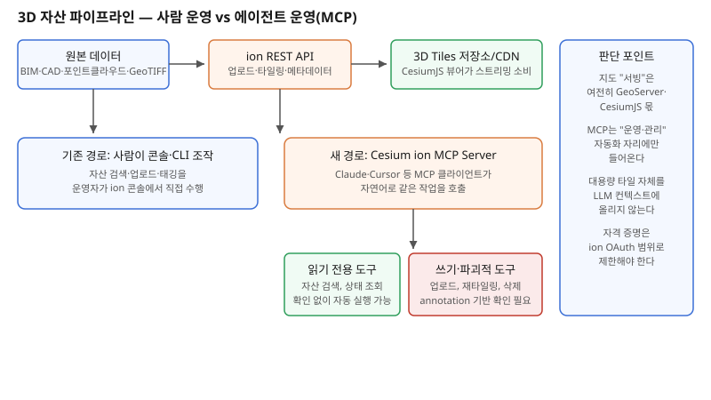

## 왜 지금 이 판단이 불거지는가

"드론으로 새로 찍은 건설 현장 데이터 들어왔는데, 타일링해서 바로 지도에 올려주세요." 3D 공간 데이터를 다루는 팀이라면 매주 반복되는 요구다. 지금까지 이 흐름은 운영자가 Cesium ion 콘솔에 로그인해서 파일을 업로드하고, 타일링 옵션을 고르고, 완료를 기다렸다가 태깅하고, 다른 자산과 겹치지 않는지 확인하는 수작업 연쇄였다. 자동화를 시도해도 결국 ion REST API를 감싼 사내 스크립트를 짜는 정도가 한계였다.

2026년 10월 12일 Cesium이 공개한 **ion MCP Server**는 이 수작업 연쇄 자체를 에이전트 도구 호출로 바꾼다. Claude Code, Claude Desktop, Cursor, GitHub Copilot 같은 MCP 호환 클라이언트가 ion 계정에 OAuth로 로그인한 뒤, 자산을 검색하고, 업로드해 타일링을 요청하고, 라벨로 정리하고, iModel을 임포트하는 작업을 자연어 대화 안에서 처리할 수 있다. 여기서 눈여겨볼 점은 이 서버가 노출하는 게 "공간 질의"(ArcGIS MCP)나 "신규 촬영 주문"(SkyFi MCP)이 아니라 **자산 파이프라인 운영 그 자체**라는 것이다. 질의와 주문은 "지도에 무엇을 보여줄까"의 문제이고, 이번 건은 "그 지도 뒤편의 데이터를 누가, 어떻게 관리할까"의 문제다. 같은 MCP라도 시스템에서 차지하는 자리가 다르므로 설계 판단도 다르게 내려야 한다.

## 전체 시스템에서의 위치

ion MCP Server는 원본 데이터와 타일 저장소 사이, 즉 **자산 수집·가공 단계**에만 자리 잡는다. 그 뒷단 — CesiumJS 뷰어가 타일을 스트리밍해 렌더링하는 서빙 경로 — 는 전혀 바뀌지 않는다. 바뀌는 것은 "누가 자산을 올리고 정리하는가"이지 "지도가 어떻게 보이는가"가 아니다. 이 구분이 중요한 이유는, 팀이 종종 "MCP가 들어왔으니 지도 서빙까지 에이전트가 대신한다"고 과대평가하기 때문이다. 실제로는 에이전트가 ion REST API의 프런트엔드 역할을 할 뿐이고, 대용량 타일 데이터 자체가 LLM 컨텍스트에 올라가는 일은 없다 — 올라가는 것은 자산 메타데이터와 작업 상태뿐이다.

## 선택의 트레이드오프

| 기준 | 기존: 사람이 콘솔 조작 | ion MCP Server 도입 |
|---|---|---|
| 반복 작업 속도 | 매번 수동 — 업로드마다 몇 단계 클릭 | 자연어 요청 한 번으로 체인 실행 |
| 실수 방지 | 숙련도에 의존 | 파괴적 작업에 confirmation annotation |
| 권한 경계 | 콘솔 로그인 계정 권한 그대로 | OAuth 범위를 에이전트 전용으로 제한 가능 |
| 감사 추적 | 콘솔 로그 중심 | MCP 호출 로그를 별도로 쌓아야 함(신규 설계 필요) |
| 커버리지 | ion REST API 전체 | 1.0 버전은 핵심 워크플로만 — 세부 옵션은 아직 콘솔이 필요할 수 있음 |
| 적합한 상황 | 일회성·고위험 자산 작업 | 반복적인 업로드·태깅·정리 작업 |

가장 흔한 함정은 "MCP가 붙었으니 운영자 없이도 돌아간다"고 성급히 결론 내리는 것이다. 읽기 전용 도구(자산 검색, 상태 조회)는 자동 실행에 적합하지만, 업로드·재타일링·삭제 같은 쓰기·파괴적 도구는 클라이언트가 확인을 요청하도록 설계돼 있다. 이 확인 단계를 에이전트 워크플로에서 임의로 생략하면, 운영 중인 타일셋을 에이전트가 실수로 재타일링하거나 삭제하는 사고로 이어질 수 있다.

## 실제 프로젝트 진행 순서

1. **읽기 전용 작업부터 연결한다.** 자산 검색·목록·상태 조회처럼 되돌릴 필요 없는 작업으로 먼저 에이전트 워크플로를 붙이고, 실제로 유용한지 검증한다.
2. **에이전트 전용 ion 계정이나 제한된 OAuth 범위를 분리한다.** 운영자 개인 계정의 전체 권한을 그대로 에이전트에 넘기면 권한 경계가 사람과 에이전트 사이에서 흐려진다.
3. **쓰기·파괴적 도구는 스테이징 자산에서 먼저 검증한다.** 운영 중인 타일셋이 아니라 테스트용 자산으로 업로드·재타일링 흐름을 돌려보고 confirmation 흐름이 실제로 작동하는지 확인한다.
4. **MCP 호출 자체를 감사 로그로 남기는 레이어를 추가한다.** ion 콘솔 로그만으로는 "어떤 에이전트 세션이 이 작업을 호출했는지"가 안 보이므로 별도 기록이 필요하다.
5. **지도 서빙 경로(GeoServer·CesiumJS)는 손대지 않는다.** 이번 변화는 자산 관리 단계로 국한되며, 서빙 아키텍처를 함께 바꿀 필요는 없다.

## 실무 포인트

**"MCP 서버가 공식인가 커뮤니티 프로젝트인가"부터 확인한다.** Cesium ion MCP Server 외에도 CesiumJS 글로브를 조작하는 커뮤니티 MCP 프로젝트가 따로 존재한다. 이름이 비슷해 혼동하기 쉬우니, 공식 ion 계정 연동이 필요한 작업인지 CesiumJS 뷰어 제어가 필요한 작업인지부터 구분해야 한다.

**대용량 자산 처리 시간은 그대로다.** MCP는 호출 인터페이스를 바꿀 뿐 타일링 연산 자체의 속도를 높이지 않는다. 대용량 데이터셋은 여전히 비동기로 처리되며, 에이전트 워크플로도 이 비동기 완료를 폴링하거나 콜백으로 기다리는 설계가 필요하다.

**GIS 전문 지식이 없는 팀원이 에이전트로 작업을 대신하게 될 때의 위험을 고려한다.** 자연어로 작업이 쉬워질수록, 좌표계나 타일링 옵션의 의미를 모른 채 잘못된 설정으로 자산을 올리는 사고 가능성도 함께 커진다.

## 마무리

- Cesium ion MCP Server는 지도 서빙이 아니라 3D 자산 수집·가공 파이프라인의 운영 단계에 들어오는 자동화이며, 기존 ArcGIS·SkyFi MCP의 "공간 질의·영상 주문"과는 시스템에서 차지하는 자리가 다르다.
- 읽기 전용 도구와 쓰기·파괴적 도구를 구분해, 후자에는 확인 단계를 반드시 유지해야 운영 중인 타일셋 사고를 막을 수 있다.
- 에이전트 전용 OAuth 범위 분리와 MCP 호출 감사 로그는 선택 사항이 아니라 도입 초기부터 설계에 포함해야 하는 항목이다.

## 참고 자료

- [Introducing the Cesium ion MCP Server — Cesium Blog](https://cesium.com/blog/2026/10/12/introducing-the-cesium-ion-mcp-server/)
- [Cesium ion MCP 문서](https://cesium.com/learn/ion/mcp/)
- [Model Context Protocol 공식 사양](https://modelcontextprotocol.io/)
- 관련 글: "지도 기능을 에이전트가 직접 쓰게 해주세요" — ArcGIS MCP와 자체 공간 도구 서버 (2026-10-09)
