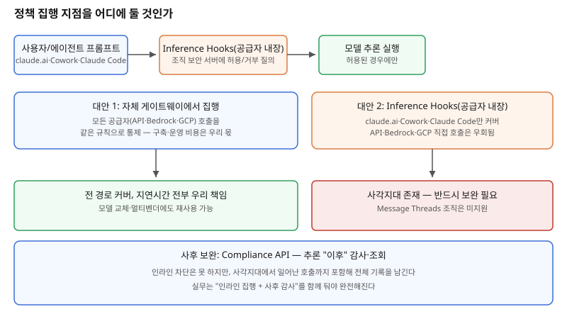

## 왜 지금 이 판단이 불거지는가

"업무 시간 외에는 특정 모델 호출을 막고, 프로젝트마다 쓸 수 있는 모델을 제한해주세요." AI 거버넌스를 챙겨야 하는 조직이라면 늦든 빠르든 마주치는 요구다. 예전에는 이런 통제를 애플리케이션 코드 안에 if문으로 박아 넣거나, 사후에 로그를 뒤져서 위반 사례를 찾는 수밖에 없었다. 문제는 코드에 박아 넣은 규칙은 배포해야 바뀌고, 사후 로그 분석은 이미 일어난 일을 막지 못한다는 점이다.

Anthropic이 Claude Enterprise에 공개한 **Inference Hooks**는 이 문제를 추론이 시작되기 전에 조직의 보안 서버에 "이 요청, 보내도 됩니까"를 묻는 동기 호출로 풀었다. claude.ai, Cowork, Claude Code 세션에서 일어나는 MCP 커넥터·스킬·플러그인을 통한 도구 호출까지 이 한 지점을 거친다. 그런데 이 기능이 **Claude Platform API, Amazon Bedrock, Google Cloud를 통한 직접 호출은 커버하지 않는다**는 점이 빌더에게는 진짜 질문을 던진다 — 공급자가 내장한 정책 집행 지점에 기댈 것인가, 아니면 우리가 직접 모든 경로를 가로채는 게이트웨이를 세울 것인가. 이건 유행을 따라갈 문제가 아니라, 우리 조직의 모델 호출 경로가 몇 개이고 어디까지 통제해야 하는지부터 따져야 하는 아키텍처 결정이다.

## 전체 시스템에서의 위치

정책 집행 지점은 "사용자 프롬프트"와 "모델 추론 실행" 사이, 딱 한 곳에 들어가야 한다. 이 지점이 여러 군데로 흩어지면 규칙이 어디서 적용됐는지 추적하기 어려워지고, 우회 경로가 생기기 쉽다. Inference Hooks는 이 지점을 공급자 플랫폼 안에 내장해 "구축 없이 바로 켜는" 이점을 준다. 반면 자체 게이트웨이는 이 지점을 우리 인프라 안에 두어 모델·공급자가 몇 개든 같은 규칙을 적용할 수 있게 하지만, 그 가용성과 지연시간을 전부 우리가 책임져야 한다. 중요한 건 이 둘이 **상호 배타적이지 않다**는 점이다. Inference Hooks가 커버하는 경로와 게이트웨이가 커버하는 경로가 겹치지 않게 설계하면, 조직 전체의 모델 호출 표면을 빈틈없이 덮을 수 있다.

## 선택의 트레이드오프

| 기준 | 자체 게이트웨이 | Inference Hooks(공급자 내장) |
|---|---|---|
| 구축 비용 | 직접 개발·운영 | 설정만 하면 즉시 적용 |
| 커버리지 | 모델·공급자 무관하게 전 경로 | claude.ai·Cowork·Claude Code만 — API·Bedrock·GCP 직접 호출 제외 |
| 지연시간 책임 | 전부 우리 인프라 성능에 좌우 | 공급자 SLA에 의존, 다만 매 요청 동기 호출 자체가 추가 지연 |
| 집행 시점 | 설계하기 나름(사전·사후 모두 가능) | 추론 시작 전 1회, 응답 측 집행은 아직 없음 |
| 멀티벤더 대응 | 한 번 구축하면 재사용 | 벤더별로 별도 메커니즘 필요 |
| 호환성 제약 | 우리가 설계하므로 제약 없음 | Message Threads 등 일부 신기능과 동시 사용 불가 |
| 롤아웃 전략 | 직접 설계해야 함 | 섀도 모드·비율 롤아웃·역할 제외가 기본 제공 |

표에서 드러나는 핵심은 Inference Hooks가 "빠르게 켤 수 있는 안전망"이지 "완전한 집행 계층"은 아니라는 점이다. 조직이 API를 직접 호출하는 내부 서비스를 하나라도 운영한다면, Inference Hooks만으로는 그 경로가 통제 밖에 남는다. 반대로 소규모 조직이 claude.ai·Cowork·Claude Code만 쓴다면, 굳이 게이트웨이를 새로 짓는 비용을 들일 이유가 약하다.

## 실제 프로젝트 진행 순서

1. **모델 호출 경로를 전수 조사한다.** claude.ai 같은 제품형 접점뿐 아니라 API 직접 호출, Bedrock·GCP를 통한 호출까지 몇 개 경로가 있는지 먼저 목록화한다. 이 숫자가 Inference Hooks만으로 충분한지를 가른다.
2. **섀도 모드부터 켠다.** 규칙을 당장 차단에 쓰지 않고 판정 로그만 쌓아, 오탐으로 인한 업무 중단 없이 규칙의 정확도를 먼저 검증한다.
3. **커버되지 않는 경로를 명시적으로 찾아 별도 조치한다.** API 직접 호출이 있다면 그 경로에는 자체 게이트웨이나 최소한 Compliance API 기반 사후 감사를 반드시 둔다.
4. **역할 제외와 롤아웃 비율을 점진적으로 넓힌다.** 처음부터 전사 100%에 적용하지 않고, 영향 범위가 작은 팀부터 넓혀가며 규칙의 부작용을 관찰한다.
5. **인라인 집행과 사후 감사를 한 쌍으로 설계한다.** Inference Hooks(사전 차단)와 Compliance API(사후 조회)는 서로 다른 시점의 안전망이므로, 하나만 두면 반드시 구멍이 남는다.

## 실무 포인트

**"Inference Hooks를 켰으니 끝"이라고 생각하지 않는다.** 이 기능은 claude.ai·Cowork·Claude Code 세 표면만 덮는다. 이 범위 밖의 호출 경로가 하나라도 있다면 그 경로는 전혀 통제되지 않은 채로 남는다.

**매 요청 동기 호출이라는 점의 무게를 과소평가하지 않는다.** 보안 서버가 응답하지 않거나 느리면 모든 추론 요청이 그 지연을 그대로 떠안는다. 보안 서버 자체의 가용성 설계가 Inference Hooks 도입의 전제 조건이다.

**새 기능과의 호환성을 매번 다시 확인한다.** 공급자가 집행 지점을 내장한 플랫폼에 올라탄 대가로, 플랫폼의 다른 신기능(예: 장시간 세션 최적화 기능)이 이 집행 지점과 호환되지 않을 수 있다는 제약을 함께 떠안는다.

## 마무리

- Inference Hooks 같은 공급자 내장 집행 지점은 빠르게 켤 수 있지만, 그 공급자의 제품 표면만 덮고 API·타 클라우드 직접 호출 같은 경로는 사각지대로 남는다.
- 전 경로를 통제해야 하는 조직은 자체 게이트웨이를 함께 두어야 하며, 두 메커니즘은 경쟁 관계가 아니라 서로 다른 경로를 나눠 맡는 보완 관계로 설계해야 한다.
- 사전 차단(Inference Hooks)과 사후 감사(Compliance API)를 한 쌍으로 두지 않으면, 어느 한쪽만으로는 항상 구멍이 남는다.

## 참고 자료

- [Inference hooks: inline data loss prevention for Claude Enterprise — Anthropic](https://claude.com/blog/claude-enterprise-inference-hooks)
- [Inference Hooks 공식 문서](https://platform.claude.com/docs/en/manage-claude/inference-hooks)
- [Claude 릴리스 노트](https://platform.claude.com/docs/en/release-notes)
- 관련 글: 여러 모델에 걸쳐 호출할 때 — LLM 게이트웨이의 캐시·라우팅·장애 격리 레이어 설계 (2026-10-09)
