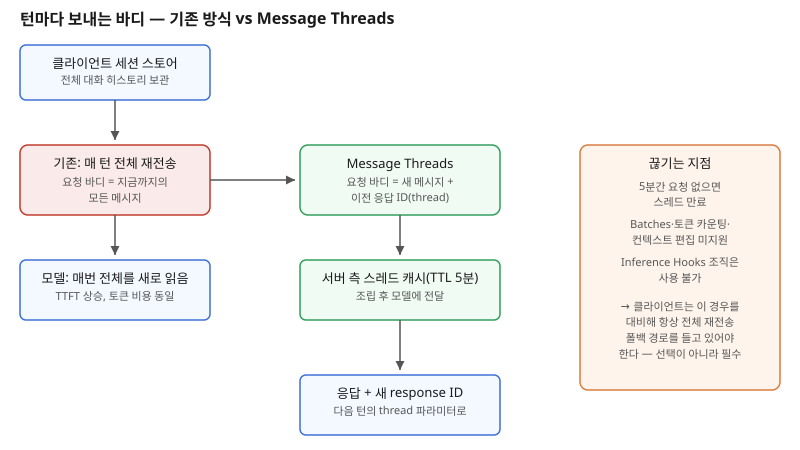

## 왜 지금 이 판단이 불거지는가

"이 작업은 몇 시간짜리인데, 매번 모델을 부를 때마다 지금까지 주고받은 메시지를 전부 다시 올려야 하나요?" 장시간 실행되는 코딩 에이전트나 조사 에이전트를 만들어본 팀이라면 한 번쯤 마주치는 질문이다. 지금까지 답은 명확했다 — 모델은 상태를 기억하지 않으므로, 클라이언트가 전체 대화 이력을 세션 스토어에 들고 있다가 매 요청마다 처음부터 끝까지 다시 실어 보내야 했다. 대화가 길어질수록 요청 바디는 계속 불어나고, 첫 토큰이 나오기까지의 시간(TTFT)도 함께 늘어난다.

2026년 11월 2일 Anthropic이 Messages API에 Message Threads를 퍼블릭 베타로 열면서 이 전제가 흔들렸다. 첫 요청에서 `thread` 파라미터로 스레드를 열면, 이후 요청은 새로 생긴 메시지와 직전 응답 ID만 보내면 된다 — 서버가 나머지를 기억한다. Claude Code에서 이 기능을 기본으로 켠 결과, 50만~100만 토큰짜리 대화에서 TTFT 중앙값이 약 35% 줄었다고 Anthropic은 밝혔다. 문제는 이게 "이제 세션 관리를 안 해도 된다"는 뜻이 아니라는 점이다. 토큰 비용은 그대로이고, 스레드는 5분 TTL을 가진 메모리 캐시일 뿐이다. 이 기능을 어디까지 아키텍처에 끌어들일지가 바로 빌더의 판단 지점이다.

## 전체 시스템에서의 위치

Message Threads는 클라이언트의 세션 스토어와 모델 호출 사이, 딱 "요청 바디 조립" 단계에만 끼어든다. 그 앞단(대화 이력을 어디에 영속화할지)과 그 뒷단(모델이 응답을 어떻게 생성할지)은 전혀 건드리지 않는다. 즉 이 기능이 대체하는 것은 **전송 방식**이지 **세션 상태 관리 책임** 자체가 아니다. 클라이언트는 여전히 전체 대화를 자신의 스토어에 가지고 있어야 한다 — 스레드가 5분 안에 만료되면, 다음 요청은 전체 이력을 다시 실어 새 스레드를 여는 수밖에 없기 때문이다. 이 폴백 경로를 설계에서 빼먹으면, 사용자가 커피 한 잔 마시고 돌아온 순간 요청이 조용히 실패하거나 컨텍스트가 끊긴 채로 이어진다.

## 선택의 트레이드오프

| 기준 | 기존: 매 턴 전체 재전송 | Message Threads |
|---|---|---|
| 요청 바디 크기 | 대화가 길수록 계속 증가 | 새 메시지 분량만 |
| TTFT | 대화 길이에 비례해 증가 | 대형 컨텍스트에서 중앙값 약 35%↓ |
| 토큰 비용 | 매 턴 전체 과금 | 동일 — 서버가 여전히 전체를 읽음 |
| 상태 보관 위치 | 클라이언트 세션 스토어 | 서버 메모리, 마지막 요청 후 5분 TTL |
| 장애 시 영향 | 클라이언트 스토어만 건강하면 안전 | 5분 경과·재시작 시 스레드 소실 |
| 호환성 | 모든 기능과 호환 | Batches·토큰 카운팅·컨텍스트 편집·Inference Hooks 조직 미지원 |
| 적합한 상황 | 짧은 세션, 엄격한 재현성 요구 | 긴 턴 간격 없이 이어지는 대화형 에이전트 |

표가 말해주는 핵심은 Message Threads가 **네트워크 전송 최적화**이지 **비용 최적화나 상태 관리 대체재**가 아니라는 점이다. 토큰 비용을 줄이려면 여전히 압축(compaction)이나 오래된 턴 요약 같은 별도 설계가 필요하고, 멱등성이 중요한 배치·감사 추적이 필요한 조직이라면 Inference Hooks와 동시에 못 쓴다는 제약부터 확인해야 한다.

## 실제 프로젝트 진행 순서

1. **먼저 TTFT가 실제 병목인지 측정한다.** 대화 길이별 TTFT를 재보지 않고 "전체 재전송은 비효율적이니 무조건 켠다"고 결정하면, 정작 병목이 모델 추론 시간이나 도구 호출 왕복이었던 경우 효과를 체감하지 못한다.
2. **기존 세션 스토어는 그대로 유지한 채 베타 헤더를 켠다.** 세션 스토어를 먼저 걷어내면 5분 TTL 만료 시 되돌아갈 데이터가 없다.
3. **5분 무응답 시 전체 재전송으로 넘어가는 폴백 경로를 먼저 구현하고 테스트한다.** 이 경로가 없는 상태로 운영에 올리면 장시간 유휴 세션에서 장애가 사용자에게 그대로 노출된다.
4. **Inference Hooks·Batches·토큰 카운팅 같은 기존에 쓰던 기능과의 충돌 여부를 체크리스트로 확인한다.** 특히 엔터프라이즈 거버넌스를 이미 쓰는 조직이라면 이 단계에서 적용 범위가 갈린다.
5. **실제 트래픽의 일부에만 적용해 TTFT 개선폭과 스레드 만료율을 함께 관찰한 뒤 전체 롤아웃을 결정한다.**

## 실무 포인트

**"상태를 서버가 들고 있다"는 말에 안심하지 않는다.** 스레드는 영속 저장소가 아니라 TTL이 있는 캐시다. 재해 복구나 감사 로그 요구사항이 있다면 클라이언트 세션 스토어가 여전히 단일 진실 공급원(source of truth)이어야 한다.

**토큰 비용 절감을 기대하고 도입하면 실망한다.** 모델은 매 턴 전체 대화를 다시 읽으므로 과금되는 토큰 수는 변하지 않는다. 비용 절감이 목표라면 압축이나 오래된 메시지 요약 같은 별개 레이어를 따로 설계해야 한다.

**베타 기능이라는 점을 운영 문서에 명시한다.** 아직 공개 베타 단계이므로 스펙과 제약이 바뀔 수 있고, 장애 발생 시 재현을 위해 베타 헤더 버전을 로그에 남겨 두는 편이 좋다.

## 마무리

- Message Threads는 장시간 에이전트 대화의 전송 효율을 높이지만, 세션 상태 관리 책임을 대체하지 않는다 — 클라이언트 세션 스토어는 그대로 필요하다.
- TTFT는 줄어도 토큰 비용은 그대로이므로, 비용 절감과 레이턴시 개선을 같은 기능으로 묶어 기대하면 안 된다.
- 5분 TTL 만료, Batches·컨텍스트 편집·Inference Hooks와의 비호환은 선택 사항이 아니라 설계 초기부터 반드시 반영해야 하는 제약이다.

## 참고 자료

- [Make long-running agents faster with message threads — Anthropic](https://claude.com/blog/message-threads)
- [Claude 릴리스 노트](https://platform.claude.com/docs/en/release-notes)
- [Messages API 문서](https://platform.claude.com/docs/en/api/messages)
- 이전 글: 1M 컨텍스트 시대의 RAG vs 롱컨텍스트 설계 판단 (2026-11-01)
