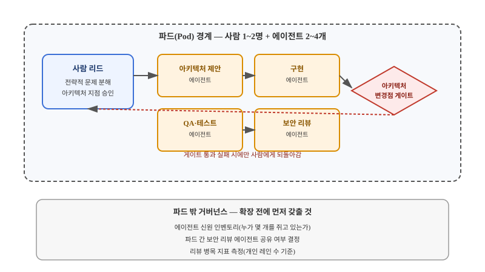

## 왜 지금 이 판단이 불거지는가

"우리 팀도 AI 코딩 에이전트 다 붙였는데, 그럼 인원 충원 안 해도 되는 거 아닌가요?" 경영진이나 기획 쪽에서 이런 질문이 나오면, 많은 리드가 즉흥적으로 "네, 생산성이 올랐으니까요"라고 답하고 넘어간다. 하지만 이 질문은 도구 선택이 아니라 조직 설계 문제다. 에이전트를 몇 개 붙였다는 사실 자체는 아무것도 결정하지 않는다. 진짜 질문은 "엔지니어 한 명이 몇 개의 에이전트를 책임질 것인가", "어떤 작업을 에이전트에게 맡기고 어느 지점에서만 사람이 개입할 것인가"다. 이걸 숫자와 역할로 못박지 않은 채 "에이전트가 다 한다"는 모호한 전제로 팀 규모를 줄이면, 생산성이 오른 것처럼 보이다가 어느 순간 책임 소재가 사라진 코드가 쌓이는 상태에 빠진다.

이 문제를 구조적으로 짚은 것이 Anthropic이 공개한 2026 에이전틱 코딩 트렌드 보고서다. 이 보고서는 2026년을 단일 코딩 에이전트에서 오케스트레이터 아래 여러 전문화 에이전트가 병렬로 움직이는 "에이전트 팀" 체제로의 전환점으로 본다. 동시에 엔지니어의 가치는 코드를 직접 짜는 것에서 시스템 아키텍처 설계, 에이전트 조정, 품질 평가, 전략적 문제 분해로 옮겨간다고 주장한다. 같은 보고서는 개발자가 업무의 약 60%에 AI를 쓰지만 완전히 위임할 수 있는 작업은 0~20%에 불과하다고도 밝혔는데, 이 수치는 벤더 자체 조사라 과장 가능성을 감안해야 하지만, "위임 가능 범위가 제한적"이라는 방향성만큼은 현장 경험과 크게 어긋나지 않는다.

## 전체 시스템에서의 위치 — 파드는 어디에 들어가는가

이 변화는 코드 저장소 경계(모놀리스냐 마이크로서비스냐)나 개인 작업 방식(레인 몇 개를 동시에 돌리느냐)과는 다른 층위의 문제다. 조직을 기능팀 단위로 쪼개던 기존 구조 위에, "사람 1~2명 + 역할별 에이전트 2~4개"로 구성된 작은 파드를 끼워 넣는 설계가 업계에서 보고되고 있다. 업계 블로그들은 시니어 엔지니어 3~5명이 각각 아키텍처 제안, 구현, QA, 보안 리뷰 역할을 맡은 에이전트 2~4개를 조정하는 구조를 소개하고, OpenAI Codex 팀이 2~3인 서브파드 단위로 일한다는 현장 보고도 함께 돌고 있다 — 다만 이는 기업의 공식 발표가 아니라 실무자 후기 수준이므로 그대로 벤치마크로 쓰기보다는 참고 사례로 다뤄야 한다.

구조도에서 핵심은 사람 리드가 모든 에이전트 출력을 매번 검토하지 않는다는 점이다. 리뷰는 "아키텍처 변경점"이라는 명시적으로 정의된 지점에서만 발생하고, 나머지 구현·QA·보안 리뷰는 에이전트 사이에서 자체적으로 순환한다. 이 구조가 성립하려면 "아키텍처 변경점"이 무엇인지에 대한 합의가 코드 리뷰 규칙보다 먼저 있어야 한다 — 정의가 모호하면 사람이 모든 걸 다시 보거나, 반대로 아무것도 못 보고 지나가는 두 극단으로 쏠린다.

## 선택의 트레이드오프

| 기준 | 기존 기능팀 구조(10인 이상, 역할 전담) | 에이전트 파드 구조(3~5인 + 에이전트 2~4개/인) |
|---|---|---|
| 의사결정 속도 | 역할 간 조율 비용 존재 | 빠름 — 오너십이 명확한 소수 |
| 컨텍스트 범위 | 팀 전체가 넓은 코드베이스 공유 | 파드 단위로 좁게 유지 가능 |
| 개인 의존도 | 분산됨 | 높음 — 핵심 인원 이탈 시 타격 큼 |
| 지식 공유 | 자연스럽게 분산 | 파드 간 사일로화 위험 |
| 거버넌스 추적 | 상대적으로 단순 | 에이전트 신원·책임 소재 추적 필요 |
| 규제·법적 요건 | 사람 검토 절차 삽입 쉬움 | 모든 단계 사람 검토가 필요하면 부적합 |

파드 구조로 좁히면 좋은 점은 명확하다. 오너십이 소수에게 집중되므로 의사결정이 빠르고, 한 사람이 들고 있어야 하는 컨텍스트의 범위도 줄어든다. 하지만 그 대가로 개인 의존도가 커지고, 파드 사이의 지식이 자연스럽게 섞이지 않아 같은 문제를 여러 파드가 각자 다르게 푸는 사일로가 생기기 쉽다. IBM이 2026년 실시한 설문에서 기업 경영진의 70%가 "AI 거버넌스가 에이전트 속도를 따라가지 못한다"고 답했다는 보고도 있다 — 이 수치 역시 단일 설문 결과이므로 조직마다 체감은 다를 수 있지만, 속도가 거버넌스를 앞질렀을 때 책임 소재가 흐려진다는 경고로는 유효하다.

언제 파드 구조를 쓰면 안 되는가도 분명히 해야 한다. 규제 산업처럼 모든 변경 단계에 사람 검토가 법적으로 요구되는 환경에서는 "사람이 아키텍처 지점에서만 개입한다"는 전제 자체가 성립하지 않는다. 또한 조직에 에이전트 신원 관리 체계(발급-소유-만료-회수의 생애주기 추적)가 아직 없는 상태에서 파드부터 늘리면, 거버넌스 공백이 파드 수만큼 곱절로 커진다. 파드를 늘리기 전에 "지금 이 조직에 에이전트가 몇 개 떠 있고 누가 책임지는가"부터 답할 수 있어야 한다.

## 실제 프로젝트 진행 순서

1. **현재 팀의 리뷰 병목을 먼저 측정한다**: 엔지니어 한 명이 동시에 감당 가능한 작업 레인 수를 리뷰 역량 기준으로 재본다. 이 수치 없이 파드부터 설계하면 "사람이 몇 명 필요한가"를 감으로 정하게 된다.
2. **파일럿 파드 하나를 먼저 선정한다**: 전사 전환이 아니라 리스크가 낮은 영역 하나에서 사람 1~2명 + 에이전트 2~4개로 구성하고, 역할별 책임을 문서로 명시한다.
3. **"아키텍처 변경점"을 명시적으로 정의한다**: 스키마 변경, 외부 API 계약 변경, 보안 경계 변경처럼 구체적인 기준을 코드 리뷰 체크리스트 수준으로 못박는다.
4. **보안 리뷰 에이전트의 소속을 결정한다**: 파드마다 전속으로 둘지, 여러 파드가 공유하는 중앙 자원으로 둘지는 보안 일관성과 파드 독립성 사이의 트레이드오프다.
5. **거버넌스 신호를 먼저 세팅한 뒤 확장한다**: 에이전트 신원 인벤토리와 책임자 매핑이 갖춰지기 전까지는 파일럿 파드 이상으로 확장하지 않는다.

## 실무 포인트

파드 구조를 조직 전체에 한꺼번에 적용하려는 유혹을 경계해야 한다. 파일럿에서 성공한 파드 하나의 경험은 그 파드 구성원의 암묵지에 크게 의존하는 경우가 많아서, 다른 영역에 그대로 복제하면 역할 분배나 게이트 기준이 맞지 않아 삐걱댄다. 확장은 "같은 구조를 복사"하는 것이 아니라 "같은 원칙(아키텍처 지점에서만 사람 개입, 역할별 에이전트 분리, 거버넌스 먼저)을 다시 적용"하는 작업으로 다뤄야 한다.

## 마무리 요약

- 에이전트 도입과 팀 규모 축소는 별개의 결정이며, 파드 크기·역할 분배·게이트 기준을 먼저 설계해야 한다.
- 파드 구조는 의사결정 속도를 높이지만 개인 의존도와 지식 사일로, 거버넌스 공백 리스크를 함께 키운다.
- 규제 요건이 강하거나 에이전트 신원 관리 체계가 없는 조직은 파드 확장보다 거버넌스 기반부터 갖춰야 한다.

## 참고 자료

- Anthropic, [2026 Agentic Coding Trends Report](https://resources.anthropic.com/2026-agentic-coding-trends-report)
- Anthropic, [Eight trends defining how software gets built in 2026](https://claude.com/resources/articles/eight-trends-defining-how-software-gets-built-in-2026)
