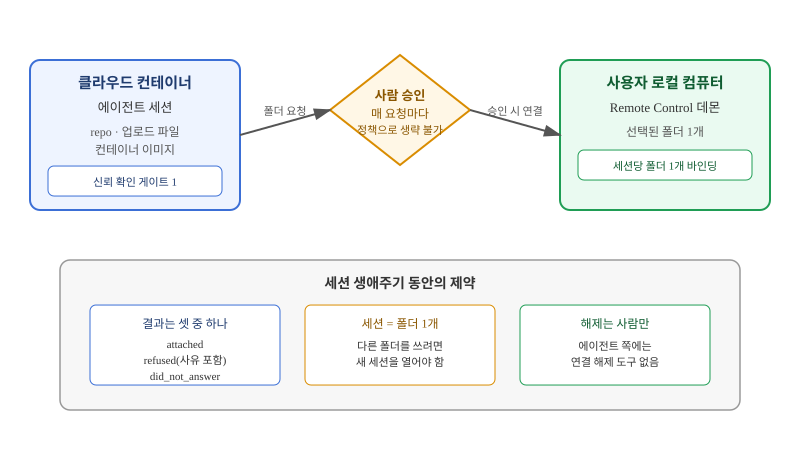

## 왜 지금 이 판단이 불거지는가

"에이전트를 클라우드에서 돌리고 있는데, 로컬에만 있는 라이브러리나 사내 전용 레지스트리, 로컬 DB 덤프 파일은 어떻게 쓰나요?" 클라우드 기반 에이전트 세션을 도입한 팀이라면 금방 마주치는 질문이다. 코드 저장소는 깃헙에 올려두면 되지만, 실무에서는 아직 커밋되지 않은 작업 파일, 회사 VPN 안에서만 열리는 내부 도구, 개발자의 로컬 환경에만 설치된 바이너리처럼 "깃헙에는 없고 내 컴퓨터에만 있는" 자원이 항상 남는다. 이 요구를 그대로 들어주면, 클라우드에 떠 있는 에이전트 프로세스가 사용자의 개인 컴퓨터 파일시스템에 직접 손을 대는 통로가 하나 열린다.

문제는 이 통로가 편도가 아니라는 데 있다. 한 번 열어주면 에이전트가 그 컴퓨터의 다른 폴더로, 또 다른 세션으로 옮겨 다닐 수 있는가? 승인은 한 번만 받으면 영구히 유효한가, 아니면 매번 다시 물어야 하는가? 이런 질문에 답하지 않고 "로컬 접근 기능"부터 구현하면, 보안 사고가 나기 전까지는 편리하다가 사고가 나는 순간 전체 신뢰 모델을 재설계해야 하는 상황에 몰린다. 이 글에서는 실제로 이 문제를 풀기 위해 채택된 설계 — 세션과 로컬 폴더를 1:1로 묶고, 그 연결을 요청하는 행위 자체가 사람에게 보내는 승인 질문이 되도록 만드는 방식 — 을 통해, 비슷한 크로스 바운더리 기능을 직접 설계해야 하는 빌더가 무엇을 참고할 수 있는지 짚어본다.

## 전체 시스템에서의 위치

이 기능은 세 개의 서로 다른 신뢰 영역을 잇는다. 첫째는 클라우드 컨테이너 — 에이전트 세션이 실제로 실행되는 곳으로, 이미 저장소나 업로드 파일, 컨테이너 이미지가 들어 있다. 둘째는 사람의 승인이라는 관문으로, 어떤 자동화 설정으로도 건너뛸 수 없는 지점이다. 셋째는 사용자의 로컬 컴퓨터로, Remote Control이라는 상주 프로세스가 돌면서 "이 폴더는 외부 세션에 내줘도 된다"고 미리 지정해 둔 폴더 목록을 들고 있다.

주목할 지점은 신뢰 확인이 한 곳에서 끝나지 않는다는 것이다. "이 컨테이너 안의 코드·파일을 믿는가"와 "이 세션이 내 다른 컴퓨터·세션에 손대도 되는가"는 서로 다른 질문이라서 별도의 승인 게이트로 분리돼 있다. 컨테이너 하나를 신뢰한다고 해서 사용자의 전체 디바이스 생태계까지 자동으로 열리지 않는다. 이 분리가 없으면, 저장소 하나를 승인한 순간 공격 표면이 "이 레포" 수준에서 "이 사람이 가진 모든 컴퓨터" 수준으로 한 번에 뛰어오른다.

## 선택의 트레이드오프

로컬 자원을 클라우드 에이전트에 연결하는 방법은 이것 말고도 여럿 있다. SSH 터널로 장기 키를 심어두는 방식, VPN과 서비스 계정을 함께 쓰는 방식, 브라우저 네이티브 메시징 호스트처럼 로컬 상주 프로세스와 통신하는 방식이 대표적이다. 각각 운영 부담과 노출 범위가 다르다.

| 방식 | 승인 시점 | 노출 범위 | 해제 주체 | 운영 부담 |
|---|---|---|---|---|
| 장기 SSH 키 | 최초 1회 | 키가 접근 가능한 전체 경로 | 사람(수동 키 폐기) | 키 로테이션 필요 |
| VPN + 서비스 계정 | 계정 발급 시 | 네트워크 세그먼트 전체 | 관리자 | 인프라 유지 비용 큼 |
| 브라우저 네이티브 메시징 | 설치 시 1회 | 브라우저가 띄운 호스트 범위 | 사용자(확장 제거) | 가볍지만 세분화 어려움 |
| 세션-폴더 1:1 바인딩 | **요청마다 매번** | **세션당 폴더 정확히 1개** | 사람만, 에이전트 쪽 해제 도구 없음 | 승인 UX 설계 필요 |

세션-폴더 1:1 바인딩 방식이 다른 셋과 가장 크게 다른 점은 "승인의 유효 기간"이다. 장기 키나 VPN 계정은 한 번 발급되면 누군가 명시적으로 회수할 때까지 계속 살아 있어서, 시간이 지날수록 "이게 아직도 필요한 접근인가"를 아무도 추적하지 못하는 상태가 된다. 반면 이 설계는 세션이 끝나면 접근도 함께 끝난다. 대신 그 대가로 세션마다 사람이 다시 응답해야 하므로, 완전 자동화된 배치 작업에는 쓸 수 없다 — 이건 결함이 아니라 의도된 제약이다. 사람이 물리적으로 그 자리에 없으면 접근이 성립하지 않아야 하는 용도에만 이 패턴을 써야 한다.

반대로, 완전 자동화가 목적이고 사람이 매번 응답할 수 없는 배치·스케줄 작업이라면 이 패턴은 처음부터 맞지 않는다. 그런 경우엔 범위를 좁힌 서비스 계정 + 짧은 TTL 토큰 조합이 낫다. "사람이 승인해야 열리는 통로"와 "사람 없이도 동작해야 하는 자동화"를 같은 메커니즘으로 풀려고 하면 둘 다 어중간해진다.

## 실제 설계에 적용할 때 — 어디서부터 손대는가

비슷한 크로스 바운더리 기능을 직접 만들어야 한다면, 데이터 전송 경로부터 구현하고 싶은 유혹이 크다. 하지만 이 설계가 보여주는 순서는 반대다.

1. **경계부터 정의한다**: "세션 하나당 외부 자원 몇 개까지 연결 가능한가"를 숫자로 못박는다. 여기서는 정확히 1개다. 여러 개를 허용하면 그 순간부터 "이 세션이 지금 뭘 쥐고 있는지"를 추적하는 별도 장부가 필요해진다.
2. **승인 UX를 데이터 평면보다 먼저 만든다**: 실제 파일 전송 로직을 짜기 전에, "요청 → 사람에게 질문 → attached/refused/did_not_answer 세 가지 결과" 흐름부터 끝까지 동작하게 만든다. 데이터 평면은 이 틀 위에 얹는 부가 기능이어야지, 거꾸로 되면 승인이 사후 검증 수준으로 약해진다.
3. **승인을 정책 레이어가 아니라 서버 쪽에서 강제한다**: "UI에서 묻는다"와 "서버가 응답을 받기 전엔 아무 데이터도 내려주지 않는다"는 다르다. 전자는 클라이언트를 바꿔치기하면 우회되고, 후자만 실제 보안 경계가 된다.
4. **모든 연결·해제 이벤트를 로그로 남긴다**: 세션이 어떤 폴더에 언제 붙었고 언제 끊겼는지가 추적되지 않으면, 사고가 났을 때 "그때 뭐가 연결돼 있었는지" 자체를 복원할 수 없다.
5. **신뢰 게이트를 기능 단위로 쪼갠다**: "이 컨테이너 안의 내용을 믿는가"와 "이 세션이 내 다른 자원에 손대도 되는가"를 하나의 승인으로 합치지 않는다. 합치면 한쪽 질문에 답한 사용자가 다른 쪽까지 동의한 것으로 착각하게 만드는 UX 사고가 생긴다.

## 실무 포인트

이 설계를 참고할 때 가장 자주 놓치는 지점은 "해제 주체"다. 에이전트 쪽에 연결 해제 도구를 일부러 주지 않은 것은 실수가 아니라 설계 의도로 봐야 한다. 에이전트가 스스로 연결을 끊을 수 있다면, 반대로 "에이전트가 스스로 다시 연결을 요청하는 루프"를 만들 유인도 함께 생긴다. 해제를 전적으로 사람에게만 맡기면, 적어도 연결이 끊기지 않는 방향으로는 에이전트가 자동화를 밀어붙일 수 없다. 또한 온라인 상태가 아닌 컴퓨터로는 요청이 애초에 성립하지 않는다는 점도 설계에 반영할 가치가 있다 — 오프라인 자원에 대한 요청을 "대기"시키지 않고 즉시 실패로 돌려주는 편이, 사용자가 상태를 오해할 여지를 줄인다.

## 마무리 요약

- 클라우드 에이전트가 로컬 자원에 접근해야 한다는 요구는 기능이 아니라 신뢰 경계 설계 문제로 먼저 번역해야 한다.
- 세션-자원 1:1 바인딩과 매 요청 승인은 장기 키·VPN 방식보다 노출 범위를 좁히는 대신, 완전 자동화와는 양립하지 않는다.
- 데이터 전송 로직보다 승인 UX와 서버 측 강제, 연결·해제 로깅을 먼저 완성해야 사고 시 복원 가능한 설계가 된다.

## 참고 자료

- Anthropic, [Claude Code 문서](https://code.claude.com/docs)
- Anthropic, [Claude Developer Platform 문서](https://docs.claude.com)
