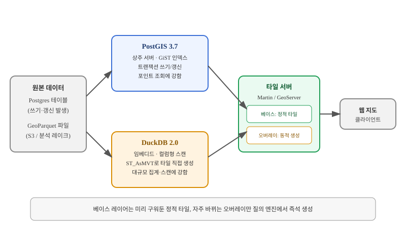

## 왜 지금 이 판단이 불거지는가

"분석팀이 공간 데이터 수억 건에 즉석으로 SQL을 돌리고, 그 결과를 바로 지도에 띄워서 보고 싶어합니다." 기획 쪽에서 이런 요구가 들어오면, 많은 팀이 반사적으로 "PostGIS 붙이면 되죠"라고 답한다. 틀린 답은 아니지만, 이 요구를 분해하면 실제로는 두 가지 전혀 다른 작업 부하가 섞여 있다. 하나는 "지속적으로 갱신되는 운영 데이터 위에서 좌표 기반 조건으로 몇 건을 뽑아오는 것"이고, 다른 하나는 "거의 바뀌지 않는 수억 건짜리 아카이브를 통째로 스캔해 집계하는 것"이다. 같은 질문처럼 들리지만 요구하는 엔진의 성격이 정반대다.

이 판단이 2026년 10월 21일을 기점으로 더 날카로워졌다. 그날 DuckDB 2.0과 PostGIS 3.7.0rc3(PostgreSQL 19 RC1, GEOS 3.15와 함께 사용 권장)가 같은 날 발표되면서, 두 엔진 모두 자신의 영역에서 "공간 데이터를 SQL로 직접 다루고 벡터 타일까지 뽑아낸다"는 기능을 갖추게 됐다. DuckDB 2.0의 공간 확장은 `ST_AsMVT`와 `ST_AsMVTGeom`을 지원해, 이제 DuckDB 쿼리 결과로 곧장 Mapbox Vector Tile을 만들 수 있다. PostGIS 쪽에서만 가능했던 일이 분석 엔진 쪽에도 생긴 것이다. 그래서 "둘 다 되는데 뭘 써야 하나"라는 질문이 이번에는 피할 수 없게 됐다.

## 전체 시스템에서의 위치

두 엔진은 지도 서비스 파이프라인에서 같은 자리를 놓고 경쟁하는 것처럼 보이지만, 실제로는 서로 다른 데이터 성격에 맞춰 들어간다. 원본 데이터가 끊임없이 쓰기·갱신되는 운영 테이블이라면 PostGIS가 자연스럽고, 원본이 S3에 쌓인 GeoParquet 같은 분석용 아카이브라면 DuckDB가 그 위에 바로 붙는다. 이렇게 선택된 엔진의 출력이 Martin이나 GeoServer 같은 타일 서버로 넘어가 최종적으로 웹 지도 클라이언트에 도달한다.

여기서 중요한 실무 포인트가 하나 숨어 있다. 2026년 Martin 타일 서버에 DuckDB를 백엔드로 붙이는 작업이 GSoC 프로젝트(이슈 #2264)로 진행되면서, DuckDB가 생성한 벡터 타일을 별도 ETL 없이 바로 서빙할 길이 열리고 있다. 즉 "DuckDB로 분석 → PostGIS로 옮겨서 타일 서빙"이라는 중간 단계를 건너뛸 수 있는 구조가 만들어지는 중이다. 다만 아직 진행 중인 작업이므로, 지금 당장 프로덕션에 올릴 때는 안정성을 직접 검증해야 한다.

## 선택의 트레이드오프

| 기준 | PostGIS 3.7 | DuckDB 2.0 (공간 확장) |
|---|---|---|
| 운영 모델 | 상시 서버 프로세스(PostgreSQL) | 임베디드 / 프로세스 내 실행 |
| 쓰기·트랜잭션 | 완전 지원, ACID 보장 | 분석 중심, 운영 쓰기에는 부적합 |
| 인덱스 성숙도 | GiST 등 수십 년 축적된 공간 인덱스 | 상대적으로 젊음, 빠르게 발전 중 |
| 강한 워크로드 | 좌표 조건 포인트 조회, 소량 갱신 | 대규모 스캔·집계, 컬럼형 분석 |
| 타일 생성 경로 | 오래전부터 ST_AsMVT로 검증됨 | 2.0부터 지원, Martin 백엔드 통합 진행 중 |
| 데이터 소스 적합성 | 운영 DB 테이블 | Parquet/GeoParquet 파일, 데이터 레이크 |

벤치마크 결과를 볼 때 주의할 점이 있다. 공개된 비교 테스트에서 어떤 쿼리 묶음에서는 PostGIS가 전부 이겼고, 다른 쿼리 묶음에서는 DuckDB가 전부 이겼다는 보고가 함께 나온다. 두 결과가 모순이 아니라, 쿼리의 모양(포인트 조회냐 전체 스캔 집계냐)에 따라 승자가 완전히 뒤집힌다는 뜻이다. 그래서 "어느 엔진이 빠른가"를 먼저 묻지 말고 "우리 쿼리 패턴이 어느 쪽에 가까운가"부터 판별해야 한다.

언제 DuckDB를 쓰면 안 되는가도 분명하다. FOSS4G Europe 2026의 한 발표는 동적 벡터 타일을 매 요청마다 Parquet 파일 전체를 스캔해서 생성하면 데이터가 커질수록 심각한 병목이 된다고 지적했다. 그 발표팀이 택한 해법은 베이스 레이어는 Tippecanoe로 미리 구운 정적 타일을 쓰고, DuckDB는 자주 바뀌는 오버레이 레이어에만 한정해서 쓰는 하이브리드 구조였다. 즉 DuckDB를 "모든 타일을 실시간으로 뽑아주는 범용 엔진"으로 오해하면 그대로 성능 사고로 이어진다.

## 실제 프로젝트 진행 순서

1. **쿼리 로그부터 분석한다**: 현재(혹은 예상되는) 쿼리의 읽기:쓰기 비율과 쿼리 모양(포인트 조회 위주인지, 전체 스캔·집계 위주인지)을 먼저 뽑아본다. 엔진을 고르는 것보다 이 분류가 먼저다.
2. **PostGIS라면 인덱스 전략부터 검증한다**: GiST 인덱스가 실제 쿼리 패턴에 맞게 걸려 있는지, `EXPLAIN ANALYZE`로 확인하지 않고 바로 운영에 올리면 느린 쿼리가 묻혀 있는 채로 서비스가 시작된다.
3. **DuckDB라면 파일 레이아웃부터 검증한다**: GeoParquet 파티셔닝이 쿼리에서 실제로 프루닝(pruning)되는지 확인한다. 파티션 키가 쿼리 조건과 안 맞으면 "컬럼형이라 빠르다"는 전제가 무너진다.
4. **타일 서버를 붙이기 전에 두 엔진을 동일 쿼리로 벤치마크한다**: 이 단계를 생략하고 바로 타일 서빙까지 연결하면, 느린 쿼리가 타일 응답 지연으로 나타난 뒤에야 원인을 역추적하게 된다.
5. **베이스 레이어와 오버레이 레이어를 분리 설계한다**: 거의 안 바뀌는 레이어는 정적 타일로 미리 굽고, 실시간성이 필요한 레이어만 질의 엔진에서 즉석 생성하도록 경계를 분명히 긋는다.

## 실무 포인트

PostGIS 3.7은 이 글을 쓰는 시점에 rc3 단계이므로, 프로덕션 도입 전에 PostgreSQL 19와의 조합 안정성을 별도 스테이징 환경에서 충분히 검증해야 한다. 메이저 버전 전환기에는 공간 인덱스 재구축 비용도 함께 계산에 넣어야 한다. DuckDB 쪽은 Martin의 DuckDB 백엔드가 아직 GSoC 단계의 진행 중인 기능이라는 점을 감안해, 지금 당장은 "DuckDB로 직접 질의해 결과를 받아 애플리케이션 레벨에서 타일로 변환"하는 보수적인 경로를 기본값으로 두고, 네이티브 통합은 안정화된 뒤 전환하는 편이 안전하다.

## 마무리 요약

- PostGIS와 DuckDB의 공간 기능 격차가 좁혀졌지만, 쓰기 지원·운영 모델·강한 워크로드는 여전히 정반대다.
- "어느 엔진이 빠른가"가 아니라 "우리 쿼리가 포인트 조회인가 전체 스캔 집계인가"를 먼저 판별해야 벤치마크 결과를 제대로 해석할 수 있다.
- 동적 타일 생성을 모든 레이어에 적용하면 스캔 비용이 병목이 되므로, 베이스 레이어는 정적 타일로, 오버레이만 즉석 생성하는 하이브리드 구조가 현실적이다.

## 참고 자료

- [PostGIS 공식 사이트](https://postgis.net/)
- [DuckDB 공식 문서 — Spatial Extension](https://duckdb.org/docs/extensions/spatial)
- [Martin 타일 서버 프로젝트](https://maplibre.org/martin/)
