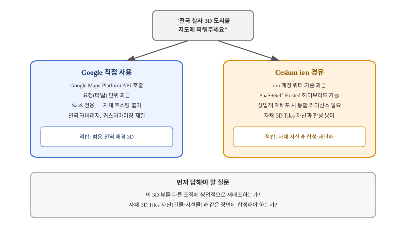

## 왜 지금 이 판단이 불거지는가

"경쟁사도 하던데, 우리 지도에도 전국 단위로 건물이 실제 사진처럼 보이는 3D 배경을 깔아주세요." 부동산·관광·도시계획 쪽 서비스를 만들다 보면 이런 요구를 자주 받는다. 직접 항공 사진을 찍어 포토그래메트리로 3D 모델을 만드는 건 예산도 시간도 감당이 안 되므로, 실무에서는 이미 만들어진 전 세계 실사 3D 타일 데이터를 가져다 쓰는 쪽으로 좁혀진다. 여기서 선택지는 크게 두 갈래다 — Google Maps Platform의 Photorealistic 3D Tiles를 직접 호출하는 경로와, Cesium ion을 경유해 받는 경로다.

문제는 이 선택이 "어떤 API가 더 예쁘게 렌더링되는가"가 아니라 "우리 서비스의 과금 구조와 재배포 계획에 어느 쪽이 맞는가"로 갈린다는 데 있다. 두 경로 모두 결국 같은 Google 원본 데이터를 보여주지만, 과금 단위, 자체 호스팅 가능 여부, 상업적 재배포 조건이 서로 다르다. 이걸 확인하지 않고 프로토타입 단계의 API 키로 먼저 붙여본 뒤 그대로 프로덕션에 가면, 트래픽이 늘었을 때 과금 구조를 뒤늦게 다시 설계해야 하는 상황에 몰린다.

## 전체 시스템에서의 위치

이 두 경로는 지도 서비스 파이프라인에서 "3D 배경 레이어를 어디서 가져오는가"라는 한 지점을 두고 경쟁한다. Google을 직접 호출하면 Google Cloud 계정의 사용량 기반 과금으로 요청이 바로 청구되고, 애플리케이션은 그 결과를 스트리밍만 받는다. Cesium ion을 경유하면 Cesium ion 계정의 월간 루트 타일 쿼터로 사용량이 집계되고, 쿼터를 넘으면 ion 쪽과 별도 협상이 필요하다.

이 위치 선정에서 중요한 제약이 하나 있다. Google Photorealistic 3D Tiles는 SaaS 형태로만 제공되고 자체 서버에 내려받아 호스팅하는 방식은 지원하지 않는다. 반면 Cesium ion은 SaaS 계정과 Self-Hosted 계정을 안전한 연결로 묶어, Google 데이터를 자체 인프라 안에서 다루는 하이브리드 구성을 지원한다. 그래서 "우리가 이미 보유한 3D Tiles 자산(자체 촬영한 건물·시설물 모델)과 Google의 전역 배경을 한 장면에 합성해야 하는가"라는 질문이 경로 선택의 실질적인 분기점이 된다.

## 선택의 트레이드오프

| 기준 | Google 직접 사용 | Cesium ion 경유 |
|---|---|---|
| 과금 단위 | Google Cloud 사용량 기반, 요청(타일)당 과금 | ion 계정 월간 루트 타일 쿼터 + 초과분 협상 |
| 자체 호스팅 | 불가 — SaaS 전용 | SaaS + Self-Hosted 하이브리드 가능 |
| 자체 3D 자산과 합성 | 애플리케이션 레벨에서 별도 처리 필요 | ion 플랫폼 안에서 비교적 자연스럽게 결합 |
| 상업적 재배포 | Google 약관 직접 검토 필요 | 표준 라이선스는 재배포 불가 — 별도 통합 라이선스 필요 |
| 적합한 상황 | 자체 지도 앱 하나에서 전역 배경만 필요 | 자체 3D 자산 보유 + 다른 조직에 제공하는 플랫폼 |

이 표에서 가장 자주 간과되는 줄은 "상업적 재배포" 조건이다. Cesium ion의 표준 라이선스는 ion을 자신의 솔루션에 통합해 다른 조직에 상업적으로 제공하는 것을 허용하지 않는다. 사내 서비스 하나에서만 쓰는 것과, 이 3D 뷰 기능을 다른 고객사에 상품으로 판매하는 것은 완전히 다른 라이선스 영역이라서, 플랫폼 제공자 입장이라면 계약 전에 반드시 별도 통합 라이선스 여부를 영업팀과 확인해야 한다. Google 쪽 역시 API 약관에 재배포 관련 제약이 있으므로, 어느 경로든 "그냥 가져다 쓰면 되겠지"라는 전제는 위험하다.

언제 Google 직접 호출을 쓰면 안 되는가도 분명하다. 이미 자체 3D Tiles 파이프라인(드론 촬영, LiDAR 스캔 등)을 운영 중이고 그 결과물과 전역 배경을 같은 장면에 자연스럽게 합성해야 한다면, Google API를 단독으로 호출하는 구조는 두 데이터를 애플리케이션 레벨에서 수동으로 맞춰야 하는 추가 작업을 만든다. 반대로 단일 서비스에서 전역 배경만 필요하고 자체 3D 자산이 없다면, Cesium ion이라는 중간 계층을 거칠 이유가 크지 않다.

## 실제 프로젝트 진행 순서

1. **재배포 계획부터 확정한다**: 이 3D 뷰가 사내 서비스 전용인지, 다른 조직에 제공하는 플랫폼의 일부인지부터 정한다. 이 답에 따라 필요한 라이선스 종류가 완전히 달라진다.
2. **예상 트래픽으로 두 경로의 비용을 추정한다**: 월간 루트 타일 요청 수를 기준으로 Google 사용량 과금과 Cesium ion 쿼터 초과 비용을 각각 견적 내본다. 프로토타입 단계의 무료·저가 티어 숫자만 보고 결정하면 트래픽이 늘었을 때 비용이 역전될 수 있다.
3. **자체 3D 자산 보유 여부를 확인한다**: 보유하고 있다면 Cesium ion의 합성 경로를 우선 검토하고, 없다면 Google 직접 호출의 단순한 구조를 우선 검토한다.
4. **법무·영업 확인을 구현 전에 끝낸다**: 두 회사 모두 상업적 재배포에는 별도 계약이 필요하므로, 프로토타입이 통과된 뒤가 아니라 설계 단계에서 먼저 약관을 확인한다.
5. **쿼터 초과 시나리오를 미리 테스트한다**: 트래픽 급증 시 요청이 거부되거나 지연되는 상황을 스테이징에서 재현해, 장애 대응 경로를 사전에 마련해 둔다.

## 실무 포인트

커뮤니티에서 보고되는 비용 수치(예: 월 50만 건 이상의 루트 타일 요청에 대한 추정 비용)는 특정 시점의 사례일 뿐, 두 회사 모두 가격 정책을 자주 조정하므로 설계 문서에 수치를 그대로 박아 넣지 말고 반드시 각 영업팀을 통해 최신 견적을 받아야 한다. 또한 "Google Tiles API가 더 이상 별도로 필요하지 않다"는 식의 변경 공지가 과거에도 있었던 만큼, 이 영역은 상대적으로 자주 바뀌는 편이라는 점을 전제로 설계해야 한다.

## 마무리 요약

- 실사 3D 배경 도입은 렌더링 품질보다 과금 단위·호스팅 가능 여부·재배포 라이선스 확인이 먼저다.
- Google 직접 호출은 단순하지만 SaaS 전용이고, Cesium ion 경유는 자체 3D 자산과의 합성과 하이브리드 호스팅에 유리하다.
- 상업적 재배포 계획이 있다면 구현 전에 반드시 양쪽 모두와 별도 라이선스 여부를 확인해야 한다.

## 참고 자료

- [Cesium ion 가격 정책](https://cesium.com/platform/cesium-ion/pricing/)
- [Google Maps Platform — Photorealistic 3D Tiles 안내](https://cloud.google.com/blog/products/maps-platform/commonly-asked-questions-about-our-recently-launched-photorealistic-3d-tiles)
