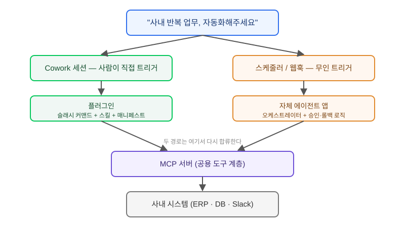

## 왜 지금 이 판단이 필요한가

"재무팀 월말 정산 보고서, 매번 수기로 만드는데 에이전트가 대신 해주면 안 되나요" — 이런 요구가 올라오면 반사적으로 Claude Agent SDK를 열고 오케스트레이터부터 짜기 시작하는 경우가 많다. 하지만 2026년 들어 Anthropic이 Claude Cowork에 플러그인 기능을 붙이고, 영업·재무·인사·엔지니어링 같은 직무별 플러그인 템플릿과 조직 전용 프라이빗 마켓플레이스까지 연 뒤로는 선택지가 하나 더 늘었다. 같은 요구를 자체 에이전트 앱으로 풀지, 이미 있는 Cowork 작업 공간에 플러그인 하나를 얹어서 풀지는 더 이상 당연한 선택이 아니다.

이 판단을 잘못하면 두 방향 다 비용을 치른다. 간단한 반복 업무에 자체 오케스트레이터·인증·배포 파이프라인까지 다 지어 넣으면 유지보수 부담만 늘고, 반대로 조직 전체에 영향을 주는 핵심 워크플로를 플러그인 수준의 느슨한 통합으로 밀어붙이면 권한 경계와 감사 로그가 비어버린다. 그래서 빌더가 먼저 해야 할 일은 모델이나 프롬프트를 고르는 게 아니라, 이 요구가 "세션 안에서 사람과 함께 반복하는 작업"인지 "독립적으로 돌아가야 하는 서비스"인지를 가르는 것이다.

## 전체 구조: 플러그인이 끼어드는 자리

Cowork 플러그인은 완전히 새로운 실행 계층이 아니라, 이미 있는 Cowork 세션에 MCP 커넥터·슬래시 커맨드·스킬을 패키징해서 얹는 방식이다. 반면 자체 에이전트 앱은 그 아래에 있는 MCP 서버와 사내 시스템까지는 똑같이 공유하면서, 세션을 사람이 직접 운전하지 않고 오케스트레이터가 대신 돌린다는 점이 다르다. 두 경로가 어디서 갈라지고 어디서 다시 만나는지를 그림으로 보면 판단 기준이 더 분명해진다.



그림에서 보듯, 차이는 "누가 세션을 운전하는가"에 있다. 플러그인 경로는 사람이 Cowork에서 자연어로 트리거하고 결과를 그 자리에서 확인·수정한다. 자체 앱 경로는 스케줄러나 웹훅이 트리거하고, 사람은 결과만 나중에 받아본다. MCP 서버와 사내 시스템 커넥터는 두 경로 모두에서 재사용 가능한 공용 자산이므로, 어느 쪽을 택하든 이 계층은 먼저 제대로 만들어 둘 가치가 있다.

## 플러그인 vs 자체 에이전트 앱 — 선택 기준

| 기준 | Cowork 플러그인 | 자체 에이전트 앱 (Agent SDK) |
|---|---|---|
| 트리거 방식 | 사람이 세션에서 자연어로 호출 | 스케줄·웹훅·이벤트로 자동 실행 |
| 실행 주체 확인 | 매 단계 사람이 보고 승인 가능 | 무인 실행이 기본, 승인 단계는 직접 설계 |
| 배포 단위 | 플러그인 매니페스트 1개, 마켓플레이스 등록 | 별도 서비스(컨테이너·큐·DB) 운영 |
| 권한 모델 | Cowork 세션·커넥터 권한에 종속 | 서비스 자체 IAM·시크릿 관리 필요 |
| 적합한 작업 | 빈도 낮고 판단 개입이 필요한 반복 업무 | 고빈도·무인·SLA 있는 백오피스 프로세스 |
| 조직 확산 | 프라이빗 마켓플레이스로 즉시 배포 | 각 팀이 엔드포인트·크레덴셜을 따로 확보 |

핵심은 "사람이 결과를 매번 확인해야 하는가"다. 월말 정산처럼 숫자 하나 틀리면 책임 소재가 생기는 작업은 사람이 세션 안에서 중간 결과를 보며 수정할 수 있는 플러그인 경로가 안전하다. 반대로 "매일 새벽 3시에 로그를 집계해서 이상치만 슬랙에 올려주세요"처럼 사람이 상시 붙어있을 필요가 없는 작업은 자체 앱으로 보내는 게 맞다. 이 둘을 섞어서, 플러그인으로 먼저 검증한 뒤 안정화되면 동일한 MCP 서버를 자체 앱 오케스트레이터에 재사용하는 단계적 전환도 실무에서는 흔하다.

## 코드로 보는 경계선

플러그인은 매니페스트와 MCP 서버 참조만 있으면 되고, 실제 비즈니스 로직은 MCP 도구 쪽에 둔다는 점이 중요하다. 이렇게 하면 나중에 자체 앱으로 옮길 때 도구 코드를 그대로 재사용할 수 있다.

```json
{
  "name": "monthly-closing-assistant",
  "version": "0.3.0",
  "description": "월말 정산 보고서 초안 생성 플러그인",
  "mcpServers": {
    "finance-tools": {
      "command": "node",
      "args": ["./servers/finance-tools/index.js"]
    }
  },
  "commands": ["/close-report"]
}
```

같은 MCP 서버를 자체 에이전트 앱에서 재사용할 때는 세션 운전 책임만 오케스트레이터로 옮기면 된다.

```python
from anthropic import Anthropic

client = Anthropic()
response = client.beta.messages.tool_runner(
    model="claude-sonnet-5-5",
    tools=finance_tools_mcp_server,  # 플러그인과 동일한 MCP 서버
    messages=[{"role": "user", "content": "이번 달 정산 초안 만들어줘"}],
)
# 여기서는 사람이 아니라 스케줄러가 run()을 호출하고
# 결과는 검토 큐에 적재한 뒤 승인 로그를 따로 남긴다.
```

도구 계층을 공유하고 "누가 호출을 트리거하고 누가 결과를 승인하는가"만 바꾸는 이 구조가, 플러그인에서 자체 앱으로(혹은 그 반대로) 전환할 때 재작업을 최소화하는 핵심이다.

## 실제로 시작할 때 막히는 지점

먼저 요구사항을 "이 작업에 사람이 중간에 반드시 개입해야 하는 지점이 있는가"로 쪼갠다. 개입 지점이 있으면 플러그인부터 만들어 본다. 플러그인으로 시작했을 때 가장 먼저 막히는 지점은 기존 커넥터만으로 사내 시스템에 닿지 않는 경우인데, 이때는 MCP 서버를 직접 작성해야 하므로 처음부터 "이 서버가 나중에 무인 실행 환경에서도 재사용될 수 있는가"를 염두에 두고 설계해야 한다. 세션 컨텍스트에 의존하는 상태(예: 현재 로그인한 사용자 정보)를 도구 안에 하드코딩하면, 나중에 자체 앱으로 옮길 때 그 부분을 전부 다시 짜야 한다.

조직 확산 단계에서는 프라이빗 마켓플레이스에 올리기 전에 권한 경계부터 점검한다. 플러그인이 참조하는 커넥터가 요청자의 권한으로 동작하는지, 아니면 플러그인 자체에 묶인 서비스 계정으로 동작하는지에 따라 "내가 못 보는 데이터를 플러그인이 대신 조회해 오는" 상황이 생길 수 있다. 자체 앱으로 갈 때는 반대로 사람이 빠진 자리에 승인·롤백 로직을 누가 설계할지를 먼저 정해야 한다. 이 역할 분담이 없으면 무인 실행이 조용히 틀린 결과를 반복 생산하는 사고로 이어진다.

## 마무리 요약

- Cowork 플러그인과 자체 에이전트 앱은 MCP 서버·사내 시스템 계층을 공유하며, 차이는 "누가 세션을 운전하는가"에 있다.
- 사람의 중간 개입과 책임 소재가 필요한 작업은 플러그인으로, 무인·고빈도·SLA가 있는 작업은 자체 앱으로 보낸다.
- 비즈니스 로직을 MCP 도구 계층에 두고 트리거·승인 로직만 분리해 설계하면, 플러그인에서 자체 앱으로 전환할 때 재작업을 최소화할 수 있다.

## 참고 자료

- [Claude Cowork — Anthropic](https://claude.com/cowork)
- [Claude Agent SDK 문서](https://docs.claude.com/en/api/agent-sdk/overview)
- [Model Context Protocol 공식 문서](https://modelcontextprotocol.io/)
