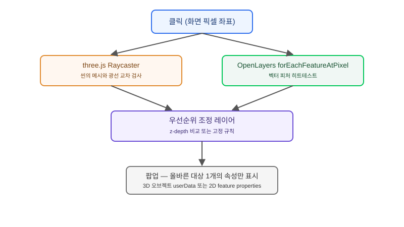

## 왜 이 문제가 반복해서 생기는가

"지도에 띄운 3D 가로등 모델을 클릭하면 그 가로등의 설치일·상태 정보가 팝업으로 떠야 해요. 근데 밑에 깔린 토지 구획 폴리곤까지 같이 클릭되면 안 돼요." 2D 지도 위에 three.js로 3D 오브젝트를 합성하는 작업이 카메라 동기화 단계를 넘어서면, 거의 예외 없이 다음 요구가 바로 이 상호작용 문제다. OpenLayers는 벡터 레이어의 피처를 화면 픽셀 기준으로 피킹하는 `forEachFeatureAtPixel` 체계를 갖고 있고, three.js는 3D 씬 안에서 광선을 쏴 교차하는 메시를 찾는 Raycaster 체계를 갖고 있다. 둘은 서로의 존재를 모른 채 같은 클릭 좌표를 각자의 방식으로 해석한다.

문제가 더 꼬이는 지점은 두 레이어가 화면상 같은 자리에 겹쳐 있을 때다. 3D 오브젝트가 화면에서 어떤 2D 폴리곤 위에 떠 있는 것처럼 보여도, 실제로는 완전히 다른 좌표계의 두 개체가 같은 픽셀을 공유하고 있을 뿐이다. 클릭 한 번에 "이 자리에 있는 3D 오브젝트"와 "이 자리에 있는 2D 피처" 중 무엇을 우선할지, 아니면 둘 다 후보로 올리고 사용자에게 선택지를 줄지를 설계하지 않으면, 사용자는 가로등을 클릭했는데 토지 구획 정보가 뜨는 경험을 하게 된다.

## 전체 구조 — 클릭 한 번이 두 갈래로 갈라지는 지점

클릭 이벤트가 들어오면 화면 픽셀 좌표 하나에서 두 개의 독립적인 피킹 절차가 동시에 시작된다. three.js 쪽은 카메라와 픽셀 좌표로 광선을 만들어 씬의 메시들과 교차 검사를 하고, OpenLayers 쪽은 같은 픽셀 좌표를 지도 좌표로 바꿔 벡터 레이어의 피처 geometry와 히트테스트를 한다. 이 둘의 결과를 하나의 상호작용으로 합치는 조정 레이어가 없으면, 두 이벤트 핸들러가 각자 독립적으로 팝업을 띄우려 들면서 충돌한다.



그림에서 보듯 핵심은 "우선순위 조정 레이어"다. 이 레이어는 두 피킹 결과 중 어느 것을 사용자에게 보여줄지 결정하는 단일 지점이어야 한다. 이 지점을 만들지 않고 각 렌더러의 이벤트 핸들러에 팝업 로직을 직접 붙이면, 나중에 3D 오브젝트 종류가 늘어나거나 2D 레이어가 추가될 때마다 우선순위 규칙이 코드 곳곳에 흩어져 유지보수가 어려워진다.

## 우선순위 전략 비교

| 전략 | 구현 난이도 | 정확도 | 적합한 상황 |
|---|---|---|---|
| 3D 항상 우선 | 낮음 — three.js 히트 있으면 바로 채택 | 3D 오브젝트가 2D 밑에 숨어 있어도 잘못 선택 | 3D 오브젝트 수가 적고 서로 겹치지 않을 때 |
| 2D 항상 우선 | 낮음 | 3D 오브젝트를 아예 선택할 수 없는 경우 발생 | 3D가 순수 시각 장식이고 클릭 대상이 아닐 때 |
| z-depth 비교 | 중간 — 카메라 거리와 2D 레이어 z-index를 함께 비교 | 대부분의 실제 중첩 상황을 올바르게 처리 | 3D 오브젝트와 2D 피처가 실제로 자주 겹치는 서비스 |
| 둘 다 후보로 제시 | 낮음(구현) / 높음(UX 설계 비용) | 사용자가 직접 선택하므로 오판 없음 | 오브젝트 밀도가 높아 자동 판별이 어려운 경우 |

실무에서 가장 균형이 좋은 것은 z-depth 비교 전략이다. three.js 레이캐스트가 반환하는 카메라로부터의 거리값과, 2D 피처가 속한 레이어의 명시적 z-index(혹은 "이 레이어는 항상 배경"이라는 규칙)를 함께 비교해, 화면상 더 가까이 있는 쪽을 우선한다. 다만 이 비교 로직 자체가 또 하나의 유지보수 대상이 되므로, 오브젝트 밀도가 아주 높지 않다면 "3D 오브젝트 레이어는 항상 최우선, 그 아래는 2D"처럼 단순한 고정 규칙으로 시작해 문제가 생길 때만 z-depth 비교로 넘어가는 점진적 접근이 낫다.

## 코드로 보는 조정 레이어

클릭 이벤트 하나에서 두 피킹을 모두 수행한 뒤, 결과를 합쳐서 하나의 처리 함수로 넘기는 구조가 핵심이다.

```javascript
map.on('click', (evt) => {
  const pixel = evt.pixel;

  // three.js 레이캐스트
  const ndc = pixelToNDC(pixel, map.getSize());
  raycaster.setFromCamera(ndc, camera);
  const threeHits = raycaster.intersectObjects(scene.children, true);

  // OpenLayers 피처 피킹
  let olFeature = null;
  map.forEachFeatureAtPixel(pixel, (feature) => {
    olFeature = feature;
    return true; // 가장 위 피처 하나만
  });

  resolvePick(threeHits[0] ?? null, olFeature);
});

function resolvePick(threeHit, olFeature) {
  if (threeHit && (!olFeature || threeHit.distance < Z_PRIORITY_THRESHOLD)) {
    showPopup({ type: '3d-object', data: threeHit.object.userData });
    return;
  }
  if (olFeature) {
    showPopup({ type: '2d-feature', data: olFeature.getProperties() });
  }
}
```

`userData`에 지오메트리가 아니라 속성 데이터(설치일, 상태 등)를 미리 심어 두면, 피킹 성공 즉시 추가 조회 없이 팝업을 띄울 수 있다. 이 데이터를 매 클릭마다 서버에서 다시 가져오게 설계하면 응답 지연이 상호작용 체감 품질을 떨어뜨린다.

## 실제로 막히는 지점

가장 먼저 검증할 것은 투명하거나 아주 작은 3D 오브젝트의 피킹 정확도다. three.js의 기본 Raycaster는 메시의 바운딩 지오메트리를 기준으로 교차를 판정하므로, 가는 기둥 모양 오브젝트는 실제로 보이는 것보다 클릭 판정 영역이 좁아 사용자가 "분명히 눌렀는데 안 눌린다"고 느끼기 쉽다. 이럴 때는 보이지 않는 더 큰 히트박스 메시를 별도로 심어 피킹 전용으로 쓰는 방식이 실무에서 흔히 쓰인다.

두 번째로 흔히 놓치는 지점은 성능이다. 클릭마다 씬의 모든 오브젝트를 대상으로 레이캐스트를 돌리면 오브젝트 수가 늘어날수록 클릭 반응이 느려진다. 피킹 대상이 될 수 있는 오브젝트만 별도 그룹으로 묶어 `intersectObjects`의 대상 범위를 좁히는 것이 첫 번째 최적화이고, 그래도 느리다면 오브젝트 수 한계 축에서 다룬 공간 분할·LOD 전략과 같은 방향으로 피킹 대상 자체를 줄여야 한다. 우선순위 규칙은 처음부터 복잡하게 설계하지 말고, 실제로 겹침이 보고되는 영역이 생겼을 때만 z-depth 비교로 확장하는 순서로 진행하는 것이 과설계를 피하는 길이다.

## 마무리 요약

- 3D 오브젝트와 2D 피처는 서로 다른 피킹 체계(three.js 레이캐스트, OpenLayers forEachFeatureAtPixel)를 쓰므로, 둘을 합치는 우선순위 조정 레이어가 반드시 필요하다.
- "3D 항상 우선"처럼 단순한 고정 규칙으로 시작해, 실제 겹침 문제가 보고될 때만 z-depth 비교로 확장한다.
- 클릭마다 모든 오브젝트를 레이캐스트 대상으로 돌리면 오브젝트 수에 비례해 느려지므로, 피킹 대상 그룹을 미리 분리해 둔다.

## 참고 자료

- [three.js Raycaster 문서](https://threejs.org/docs/#api/en/core/Raycaster)
- [OpenLayers forEachFeatureAtPixel 문서](https://openlayers.org/en/latest/apidoc/module-ol_Map-Map.html#forEachFeatureAtPixel)
