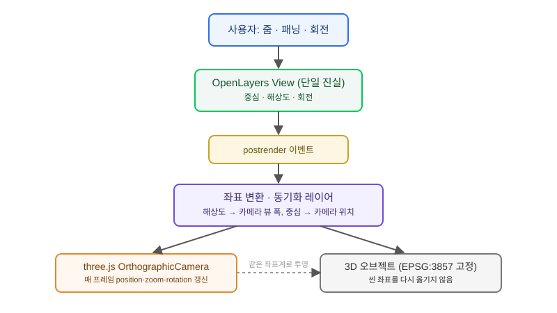

## 왜 이 문제가 반복해서 생기는가

"설치 예정인 전신주 구조물을 지도에 3D로 미리 보여주세요. 줌하거나 지도를 움직여도 위치는 안 틀어지게요." — 이 요구를 받으면 대부분 OpenLayers 지도 위에 three.js 캔버스를 겹쳐 놓고 구조물 하나를 띄우는 데까지는 금방 성공한다. 문제는 그 다음이다. 지도를 줌인하거나 회전시키면 3D 오브젝트가 2D 지도 위 실제 좌표에서 슬쩍 벗어나고, 패닝 중에는 한 박자 늦게 따라온다. 좌표를 다시 찍어도 소용없다. 오브젝트의 지리 좌표는 처음부터 맞았는데, 그 좌표를 화면에 투영하는 three.js 카메라가 OpenLayers의 뷰 상태(중심·해상도·회전)를 매 프레임 따라가지 않기 때문이다.

이 축은 three.js와 OpenLayers를 2D 지도 위에 3D를 얹는 조합에서 기존에 많이 다뤄진 "오브젝트 수가 늘면 프레임이 버벅인다"는 성능 한계와는 다른 질문이다. 오브젝트가 하나뿐이어도 카메라 동기화를 제대로 설계하지 않으면 애초에 위치 자체가 맞지 않는다. Mapbox 생태계에는 Threebox의 CameraSync처럼 이 문제를 해결해 주는 라이브러리가 있지만, OpenLayers 쪽에는 유지보수되는 동급 라이브러리가 마땅치 않다. 결국 빌더가 직접 설계해야 하는 영역이다.

## 전체 구조 — 두 좌표계가 만나는 지점

OpenLayers는 지도를 평면 좌표계(보통 Web Mercator, EPSG:3857)의 픽셀 투영으로 그리고, three.js는 자체 3D 씬 좌표계와 카메라의 투영 행렬로 화면을 그린다. 두 렌더러가 같은 화면 위에 겹쳐 있을 뿐, 서로의 좌표계를 전혀 모른다는 게 핵심 문제다. 이 둘을 잇는 다리는 OpenLayers 뷰의 상태값(중심 좌표, 해상도, 회전각)을 매 프레임 three.js 카메라의 위치·줌·회전으로 변환해 주는 동기화 레이어다.



데이터 흐름은 한쪽으로만 흐른다. 사용자가 지도를 조작하면 OpenLayers 뷰가 먼저 바뀌고, `postrender` 이벤트가 발생할 때마다 동기화 레이어가 현재 중심·해상도·회전을 읽어 three.js 카메라에 반영한 뒤 렌더를 요청한다. three.js 쪽에서 카메라를 독립적으로 움직이게 하면 두 렌더러가 서로 다른 "진실"을 갖게 되므로, OpenLayers 뷰를 항상 단일 진실 공급원으로 두는 것이 동기화가 깨지지 않는 전제조건이다.

## 직접 구현 vs 대안 — 트레이드오프

| 선택지 | 장점 | 한계 |
|---|---|---|
| 직접 동기화 레이어 구현 | OpenLayers 생태계·기존 레이어 그대로 유지 | 투영 수식을 직접 검증해야 하고 유지보수 부담이 전적으로 팀에 있음 |
| Threebox류 패턴 이식(Mapbox 아님) | 검증된 CameraSync 설계를 참고 가능 | OpenLayers용으로 포팅된 유지보수 라이브러리가 없어 결국 재구현 |
| Mapbox GL JS / MapLibre로 전환 | Threebox·MapLibre 3D 플러그인으로 동기화 기성품 사용 | 기존 OpenLayers 레이어·플러그인 자산을 전부 재작성해야 함 |
| Cesium으로 전환 | 2D/3D가 같은 엔진 안에서 애초에 한 좌표계 | 단순 오버레이 수준엔 과한 엔진 교체, 학습 곡선 큼 |

오브젝트 수가 적고 지도가 2D 중심이면서 3D는 보조 시각화인 경우에는 직접 동기화 레이어를 구현하는 쪽이 합리적이다. 반대로 3D가 서비스의 주된 경험이 되어가고 있다면, 동기화 레이어를 계속 쌓기보다 좌표계가 애초에 하나인 Cesium으로 넘어가는 편이 장기적으로 유지보수 비용이 낮다. "오브젝트 수 한계" 글에서 다룬 것처럼 성능 한계에 먼저 부딪힌 팀이라면 이 전환 판단이 이미 섰겠지만, 지금처럼 위치 정합성만 문제라면 전환은 아직 이르다.

## 코드로 보는 동기화 핵심

해상도(resolution)는 지도 1픽셀이 나타내는 실제 거리이므로, three.js 직교(Orthographic) 카메라의 뷰 폭을 캔버스 픽셀 크기와 해상도의 곱으로 맞추면 줌 레벨이 맞아떨어진다.

```javascript
map.on('postrender', () => {
  const view = map.getView();
  const center = view.getCenter();       // [x, y] in EPSG:3857
  const resolution = view.getResolution();
  const rotation = view.getRotation();

  const viewportWidth = map.getSize()[0] * resolution;
  const viewportHeight = map.getSize()[1] * resolution;

  camera.left = -viewportWidth / 2;
  camera.right = viewportWidth / 2;
  camera.top = viewportHeight / 2;
  camera.bottom = -viewportHeight / 2;
  camera.zoom = 1;
  camera.updateProjectionMatrix();

  camera.position.set(center[0], center[1], 1000);
  camera.up.set(Math.sin(rotation), Math.cos(rotation), 0);
  camera.lookAt(center[0], center[1], 0);

  renderer.render(scene, camera);
});
```

3D 오브젝트 자체의 위치는 EPSG:3857 좌표를 그대로 three.js 씬 좌표로 써서, 매 프레임 오브젝트를 다시 옮길 필요 없이 카메라만 움직이게 설계하는 것이 핵심이다. 오브젝트를 화면 좌표로 변환해서 매번 재배치하면 부동소수점 오차가 누적되어 줌을 반복할수록 어긋남이 커진다.

## 실제로 막히는 지점

가장 먼저 검증해야 할 것은 회전이 걸린 상태에서의 정합성이다. 중심과 해상도만 맞추고 회전을 빼먹으면 북쪽을 위로 고정한 기본 상태에서는 멀쩡해 보이다가, 사용자가 지도를 회전하는 순간 3D 오브젝트만 제자리에서 돌지 않아 바로 들통난다. 다음으로 흔히 놓치는 지점은 고해상도 디스플레이(devicePixelRatio)다. two.js 캔버스와 OpenLayers 캔버스의 픽셀 비율을 다르게 설정하면 저해상도 화면에서는 안 보이던 서브픽셀 단위 어긋남이 레티나 디스플레이에서 드러난다.

검증 순서는 줌 레벨 고정 상태에서 패닝 정합성을 먼저 확인하고, 그다음 줌 인/아웃 중 정합성, 마지막으로 회전 중 정합성 순으로 좁혀가는 것이 디버깅 범위를 줄이는 데 효과적이다. 세 단계 중 어디서 어긋나는지에 따라 원인이 해상도 매핑 문제인지, 회전 벡터 계산 문제인지가 갈리기 때문이다. 피킹(마우스로 3D 오브젝트 클릭)까지 지원해야 한다면 스크린 좌표 → three.js 레이캐스트 → 지리 좌표 역변환까지 한 단계가 더 필요하므로, 이 요구가 있는지 초기에 확인해 두어야 나중에 설계를 갈아엎지 않는다.

## 마무리 요약

- 3D 오브젝트가 지도 조작 때마다 어긋나는 원인은 좌표값이 아니라 카메라가 OpenLayers 뷰 상태를 매 프레임 따라가지 않기 때문이다.
- OpenLayers 뷰(중심·해상도·회전)를 단일 진실 공급원으로 두고, `postrender` 이벤트마다 three.js 카메라를 갱신하는 동기화 레이어가 핵심이다.
- 오브젝트 수가 적은 보조 시각화라면 직접 동기화를, 3D가 핵심 경험이 되어가면 Cesium 전환을 저울질한다.

## 참고 자료

- [OpenLayers View API 문서](https://openlayers.org/en/latest/apidoc/module-ol_View-View.html)
- [three.js OrthographicCamera 문서](https://threejs.org/docs/#api/en/cameras/OrthographicCamera)
- [Threebox CameraSync (참고용, Mapbox 전용)](https://www.mintlify.com/jscastro76/threebox/core/camera-synchronization)
