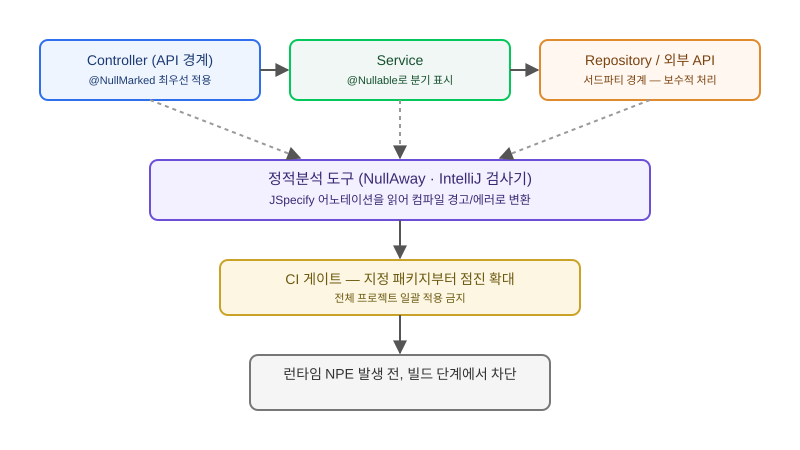

## 왜 지금 이 판단이 필요한가

"운영에서 NullPointerException 터지는 거 그만 보고 싶어요, 리뷰에서 걸러지지 않으면 컴파일할 때라도 걸러주세요." 이런 요구는 테스트 커버리지를 올리는 걸로는 해결되지 않는다. null이 넘어올 수 있는 자리를 타입 시스템 수준에서 표시해 두지 않으면, 아무리 테스트를 늘려도 "이 메서드가 null을 반환할 수 있다는 걸 호출부가 몰랐던" 사고는 계속 생긴다. Spring Framework 7이 자체적으로 쓰던 `org.springframework.lang.Nullable`을 걷어내고 업계 표준인 JSpecify의 `@Nullable`·`@NullMarked`로 전면 이관하면서, 이 판단을 미뤄왔던 팀들도 다시 테이블에 올려야 하는 시점이 됐다.

문제는 "그냥 어노테이션 붙이면 되는 거 아닌가"로 끝나지 않는다는 데 있다. JSpecify는 패키지 단위로 "이 패키지 안의 모든 타입은 기본적으로 null이 아니다"라고 선언하는 `@NullMarked` 방식을 쓰는데, 레거시 코드베이스에 이걸 전면 적용하면 숨어 있던 null 가능 지점이 한꺼번에 컴파일 경고로 쏟아진다. 그래서 "전면 도입이냐 포기냐"가 아니라 "어디서부터, 어떤 범위로 시작할 것인가"가 진짜 질문이다.

## 전체 시스템에서의 위치 — null-safety는 어느 경계에서 의미가 있는가

null-safety 어노테이션이 가장 값어치를 내는 자리는 레이어 경계다. 컨트롤러가 받는 요청 파라미터, 서비스가 리포지토리에서 받아오는 조회 결과, 외부 API 클라이언트가 돌려주는 응답 — 이 세 지점은 모두 "호출하는 쪽이 null 가능성을 모른 채 넘어가기 쉬운" 자리이자, 동시에 NPE가 실제 사고로 이어지는 자리다. 반대로 한 메서드 안의 로컬 변수에 어노테이션을 촘촘히 붙이는 건 투자 대비 효과가 낮다.



그림에서 보듯, null-safety는 코드를 작성하는 시점과 빌드가 검증하는 시점이 분리된 설계다. 어노테이션 자체는 런타임에 아무 동작도 하지 않는다 — 정적분석 도구(NullAway, IntelliJ 검사기, Checker Framework)가 빌드 파이프라인에서 이 어노테이션을 읽고 "null일 수 있는 값을 null이 아닌 자리에 넣었다"는 걸 컴파일 시점 경고나 에러로 바꿔줘야 실제 효과가 난다. 어노테이션만 붙이고 정적분석 게이트를 CI에 넣지 않으면, 문서화 이상의 효과는 없다.

## 선택지 비교 — JSpecify vs 기존 방식

| 방식 | 표준화 수준 | 레거시 공존 | 런타임 영향 |
|---|---|---|---|
| JSpecify `@Nullable`/`@NullMarked` | 업계 표준(Spring·Guava·Kotlin 상호운용 채택) | 패키지 단위 점진 적용 가능 | 없음 — 정적분석 도구가 있어야 의미 있음 |
| Lombok `@NonNull` | 사실상 표준이지만 JSpecify와 별도 생태계 | 필드·파라미터 단위로 쉽게 추가 | 런타임에 즉시 NPE를 던짐(널 가드 코드 생성) |
| `javax.annotation` / `jakarta.annotation` | 레거시, 도구 지원 축소 중 | 기존 코드에 이미 있을 수 있음 | 없음, 도구 지원이 파편화됨 |
| `Optional<T>` 반환 타입 | 타입 자체로 null 가능성을 표현 | 기존 반환 타입 시그니처 변경 필요 | 없음 — 강제력은 타입 시스템 자체 |

실무에서는 이 넷을 섞어 쓰는 경우가 많다. API 경계에는 JSpecify로 "null이 아님"을 기본값으로 선언해 호출자 책임을 명확히 하고, 반드시 즉시 실패해야 하는 생성자·세터 파라미터에는 Lombok `@NonNull`로 런타임 가드를 추가하며, 결과가 아예 없을 수 있는 조회 메서드는 `Optional`로 반환 타입 자체를 바꾼다. JSpecify는 이 중 어떤 것도 대체하지 않고, 그 위에 "이 패키지의 기본 규칙이 무엇인지"를 선언하는 역할만 한다.

## 코드로 보는 적용 범위

패키지 단위로 기본값을 선언하고, 그 기본과 다른 지점만 예외로 표시하는 것이 JSpecify의 핵심 패턴이다.

```java
// package-info.java — 이 패키지의 모든 타입은 기본적으로 null이 아니다
@NullMarked
package com.example.order.api;

import org.jspecify.annotations.NullMarked;
```

```java
public class OrderController {

    // 파라미터는 null이 아님이 기본(패키지 선언 상속)
    @GetMapping("/orders/{id}")
    public OrderResponse getOrder(@PathVariable String id) {
        return orderService.findById(id)
            .orElseThrow(() -> new OrderNotFoundException(id));
    }

    // 명시적으로 null 가능한 지점만 표시
    public @Nullable String resolveDiscountCode(OrderRequest request) {
        return request.getPromotion() != null
            ? request.getPromotion().getCode()
            : null;
    }
}
```

CI에는 Gradle NullAway 플러그인처럼 `@NullMarked` 패키지를 대상으로 정적분석을 돌리는 단계를 추가한다. 처음부터 전체 프로젝트를 대상으로 돌리면 레거시 경고가 수백 건 쏟아지므로, 특정 패키지 목록만 먼저 검사 대상에 넣고 점차 넓혀가는 방식이 현실적이다.

## 실제로 시작할 때 막히는 지점

가장 먼저 손대야 할 곳은 외부로 노출되는 API 계층이다. 컨트롤러 요청/응답 DTO, 외부 API 클라이언트의 응답 모델에 `@NullMarked`를 먼저 적용하면 적은 작업량으로 가장 많은 NPE 경로를 차단할 수 있다. 반대로 내부 유틸리티 클래스나 오래된 배치 코드부터 시작하면 수정량 대비 효과가 떨어지고, 팀의 피로감만 키운다.

두 번째로 막히는 지점은 서드파티 라이브러리와의 경계다. JSpecify로 마킹한 코드가 null-safety 정보가 없는 외부 라이브러리의 반환값을 받으면, 정적분석 도구는 그 값을 보수적으로 "null일 수도 있다"고 간주한다. 이 때문에 라이브러리 경계마다 명시적으로 null 체크를 넣거나 `@SuppressWarnings`로 예외 처리해야 하는 지점이 생기는데, 이걸 전부 없애려 하지 말고 "경계에서 한 번 걸러서 내부로는 null-safe한 값만 들여보낸다"는 원칙으로 범위를 한정하는 게 작업량을 통제하는 요령이다. Spring Boot 4 마이그레이션을 이미 마친 팀이라면 이 작업을 다음 분기 기술 부채 항목으로 바로 올릴 만하다.

## 마무리 요약

- JSpecify는 어노테이션 자체가 아니라 정적분석 도구와 CI 게이트가 붙어야 실제 효과를 내는 설계다.
- API 경계(컨트롤러·외부 클라이언트)부터 `@NullMarked`를 적용하는 것이 투자 대비 효과가 가장 크다.
- Lombok `@NonNull`·`Optional`과 역할을 나눠 쓰고, 서드파티 라이브러리 경계는 전부 없애려 하지 말고 범위를 한정해 걸러낸다.

## 참고 자료

- [JSpecify 공식 문서](https://jspecify.dev/)
- [Spring Framework 7 Null Safety 문서](https://docs.spring.io/spring-framework/reference/core/null-safety.html)
- [NullAway (Uber) GitHub](https://github.com/uber/NullAway)
