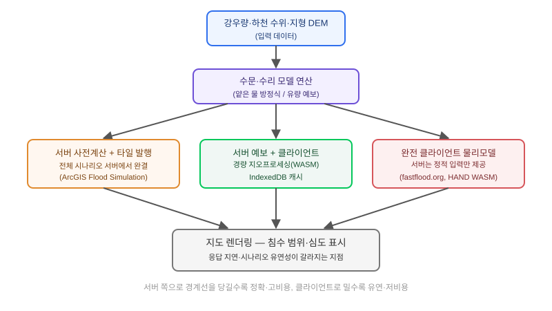

## 왜 지금 이 판단이 필요한가

"장마철마다 민원이 쏟아지는데, 주민들이 자기 동네가 얼마나 잠기는지 지도 켜서 바로 확인하게 해주세요." 지자체나 보험사, 부동산 플랫폼에서 이런 요구를 받으면 팀은 보통 "침수 시뮬레이션 엔진을 어떤 걸 쓸까"부터 고민한다. 하지만 실제로 먼저 정해야 하는 건 엔진 선택이 아니라 **그 연산을 어디서, 언제 돌릴 것인가**다. 침수는 가시권처럼 한 번 계산하면 끝나는 정적 값이 아니라, 강우량·상류 유량·제방 상태 같은 변수가 바뀔 때마다 다시 흘러야 하는 시간축 시뮬레이션이기 때문에, 연산 위치를 잘못 정하면 "비가 더 오면 어떻게 되나요"라는 가장 흔한 질문 하나에 답하는 데도 몇 분씩 걸리는 서비스가 나온다.

이 질문에 대한 업계의 접근은 뚜렷하게 세 갈래로 갈린다. 2026년 2월 Esri가 ArcGIS Pro에 공개한 Flood Simulation 도구처럼 **무거운 계산을 전부 서버/데스크톱에서 끝내고 결과만 타일로 배포**하는 방식, 2026년 8월 *Environmental Modelling & Software*에 실린 Sugiyama 등의 연구처럼 **서버는 예보 데이터만 제공하고 그걸 지도·구조물 데이터와 합치는 가벼운 지오프로세싱을 브라우저에서 돌리는** 방식, 그리고 fastflood.org나 HAND 모델의 WebAssembly 빌드처럼 **물리 기반 시뮬레이션 자체를 브라우저 안에서 완결**시키는 방식이다. 셋 다 "지도에서 침수를 보여준다"는 결과물은 비슷해 보이지만, 요구사항의 성격에 따라 맞는 답이 완전히 달라진다.

## 핵심 개념 1 — 세 가지 연산 배치와 각각이 실제로 하는 일

**서버 사전계산 + 타일 발행형**은 ArcGIS Pro의 Flood Simulation 도구가 대표적이다. 이 도구는 지정한 관심 영역(AOI) 안에서 얕은 물 방정식(shallow water equations)을 돌려 강우 강도·장애물·침투율 같은 조건별 시나리오를 미리 계산하고, 그 결과를 호스팅된 타일형 이미지 레이어로 발행한다. 클라이언트는 이 타일을 3D 씬의 `ImageryTileLayer`에 FlowRenderer로 입혀 유속·흐름 방향을 애니메이션 유선으로 보여줄 뿐, 실시간으로 아무것도 계산하지 않는다. 정확도와 시각적 완성도는 가장 높지만, 시나리오가 바뀔 때마다(강우량을 더 올려본다든지) 다시 서버에서 전체 시뮬레이션을 돌려야 한다.

**서버 예보 + 클라이언트 경량 지오프로세싱형**은 Sugiyama 등이 제안한 프레임워크가 보여준다. 이 구조는 국가 단위 수문 예보 모델(National Water Model)이 내놓는 하천 유량 예보치만 서버에서 받아오고, 그 예보치를 지역 구조물 인벤토리(NSI)와 FEMA Hazus 피해 산정 방식에 맞춰 교차 처리하는 작업을 WebAssembly·Web Worker·IndexedDB로 브라우저 안에서 처리한다. 무거운 수문 모델 자체는 서버가 담당하지만, "이 집이 몇 cm나 잠기고 피해액이 얼마인가"를 계산하는 마지막 단계는 클라이언트가 즉시 처리하고 IndexedDB에 캐시해 둔다. 서버 왕복 없이 여러 필터·여러 건물을 빠르게 조회할 수 있다는 게 핵심 이점이다.

**완전 클라이언트 물리모델형**은 fastflood.org나 HAND 침수 모델의 WebAssembly 빌드처럼, 수리·수문 계산 전체를 브라우저에서 끝낸다. 서버는 지형·강우 입력 데이터만 내려주고 그 이후 시뮬레이션 루프는 전부 클라이언트 CPU(또는 WebGPU)가 돈다. 서버 인프라 부담이 가장 적고 사용자가 파라미터를 자유롭게 바꿔가며 즉시 결과를 볼 수 있지만, 브라우저 메모리와 연산력의 한계 때문에 다룰 수 있는 영역 크기와 모델의 정교함에 뚜렷한 천장이 있다.

## 전체 시스템에서의 위치

세 방식은 "어디까지가 서버의 일이고 어디부터가 클라이언트의 일인가"라는 경계선만 다를 뿐, 데이터가 흐르는 전체 파이프라인의 모양은 같다.



입력(강우량·하천 수위·지형 DEM)에서 출력(지도 위 침수 표시)까지 경계선을 어디에 긋느냐가 곧 아키텍처 결정이다. 경계선을 앞쪽(서버)에 바짝 당기면 클라이언트는 그저 보여주기만 하면 되니 구현은 쉽지만 시나리오 유연성을 잃고, 경계선을 뒤쪽(클라이언트)까지 밀면 유연성은 얻지만 브라우저가 감당할 수 있는 계산 범위라는 물리적 제약이 바로 발목을 잡는다.

## 세 방식의 트레이드오프

| 기준 | 서버 사전계산+타일 | 서버 예보+클라이언트 경량처리 | 완전 클라이언트 물리모델 |
|---|---|---|---|
| 정확도·시각 완성도 | 가장 높음 (전문 수리모델) | 예보 모델 정확도에 의존 | 모델 단순화로 다소 낮음 |
| 시나리오 변경 응답 | 느림 (재계산 필요) | 빠름 (캐시된 예보 재조합) | 즉시 (파라미터만 바꾸면 재생) |
| 서버 인프라 비용 | 높음 (상시 수리모델 연산) | 중간 (예보 모델만 운영) | 낮음 (정적 데이터만 제공) |
| 다룰 수 있는 영역 크기 | 제한 없음 | 넓음 | 브라우저 메모리에 제약 |
| 적합한 요구 | 공식 재난 대응·보험 심사 | 시민 대상 "우리 집은?" 조회 | 교육용·소규모 what-if 도구 |

## 실제 진행 순서

이 판단을 실제 프로젝트에 적용할 때는 엔진부터 고르지 말고 **요구사항이 "하나의 정확한 답"을 원하는지 "빠르게 여러 번 바꿔보는 경험"을 원하는지**부터 정해야 한다. 재난 대응 상황실처럼 틀린 숫자가 치명적인 경우라면 서버 사전계산형으로 시작하고, 시민에게 "우리 집 괜찮나요"를 즉시 답해줘야 하는 서비스라면 예보+클라이언트 경량처리형이 체감 속도와 인프라 비용의 균형점이다.

다음으로 검증할 것은 수문·수리 모델의 출력 포맷이 어느 방식과 궁합이 맞는가다. 기관에서 받는 침수 데이터가 이미 그리드 형태의 완성된 침수 심도 레이어라면 타일 발행형으로 가는 게 자연스럽고, 시계열 유량 예보치처럼 "가공 전" 데이터라면 클라이언트 측 지오프로세싱을 끼워 넣을 여지가 생긴다. 클라이언트 처리 쪽을 택했다면 그다음 막히는 지점은 거의 항상 브라우저 메모리다. Web Worker로 메인 스레드를 막지 않는 것과, 임의로 큰 구조물 인벤토리를 한 번에 메모리에 올리지 않고 화면에 보이는 영역만 IndexedDB에서 꺼내 쓰는 페이징 전략을 가장 먼저 검증해야 한다.

```javascript
// Web Worker: 침수 예보 그리드와 구조물 좌표를 교차 처리
self.onmessage = async ({ data }) => {
  const { depthGrid, structures } = data;
  const cache = await openIndexedDbCache('flood-depth-v1');

  const results = structures.map((s) => {
    const cached = cache.get(s.id);
    if (cached) return cached;

    const depth = sampleDepthAtPoint(depthGrid, s.lon, s.lat);
    const result = { id: s.id, depthCm: depth, risk: depth > 30 ? 'high' : 'low' };
    cache.set(s.id, result);
    return result;
  });

  self.postMessage({ results });
};
```

메인 스레드를 막지 않고 교차 처리 결과를 IndexedDB에 캐시해 두면, 사용자가 같은 영역을 다시 조회하거나 필터만 바꿀 때 서버 왕복 없이 즉시 응답할 수 있다. 다만 이 캐시는 예보가 갱신될 때마다 무효화해야 하므로, 예보 버전을 키에 함께 넣어 두는 것(`flood-depth-v1` 같은 버전 네임스페이스)을 처음부터 설계에 넣는 게 나중에 캐시 무효화 버그를 막는 가장 싼 방법이다.

## 마무리 요약

- 침수 시뮬레이션은 가시권과 달리 시간축을 가진 연산이라, "어디까지 서버가 하고 어디부터 클라이언트가 하는가"의 경계가 곧 아키텍처 결정이다.
- 공식 재난 대응용이면 서버 사전계산+타일 발행, 시민 대상 즉시 조회형이면 서버 예보+클라이언트 경량 지오프로세싱, 교육·소규모 도구면 완전 클라이언트 물리모델이 균형점이다.
- 클라이언트 처리를 택했다면 Web Worker로 메인 스레드를 보호하고, 예보 버전을 캐시 키에 포함시켜 무효화 버그를 처음부터 막아야 한다.

## 참고 자료

- [Esri ArcGIS Blog — ArcGIS FlowRenderer를 활용한 침수 시뮬레이션 시각화](https://www.esri.com/arcgis-blog/products/arcgis-online/3d-gis/arcgis-flowrenderer-flood-simulation-visualization)
- [ArcGIS Pro 문서 — Flood simulation](https://pro.arcgis.com/en/pro-app/3.6/help/mapping/simulation/simulation-in-arcgis-pro.htm)
- Sugiyama, K. et al., "Community-Oriented Data Integration and Communication Framework for Streamflow Forecast Models and Flood Inundation Map Products," *Environmental Modelling & Software*, Vol. 203 (2026), DOI: 10.1016/j.envsoft.2026.107036
