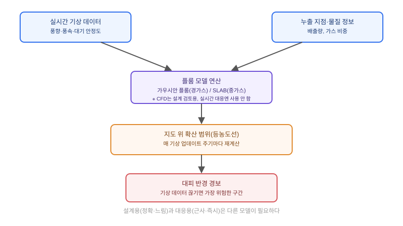

## 왜 지금 이 판단이 필요한가

"공장에서 유해가스가 새면, 그 확산 범위를 지도 위에 실시간으로 보여주세요. 대피해야 할 반경도 같이 알려주시고요." 화학 공장이나 가스 저장시설을 운영하는 조직에서 나오는 이 요구는, 겉보기에는 침수나 가시권 시뮬레이션과 비슷한 "지도 위에 영향 범위 그리기" 문제처럼 보인다. 하지만 실제로는 완전히 다른 제약이 숨어 있다. 침수는 하천 수위처럼 비교적 천천히 바뀌는 입력값을 기반으로 하고, 가시권은 지형이 바뀌지 않는 한 사실상 정적이다. 반면 가스 확산은 **바람의 방향과 세기가 몇 분 단위로 바뀌는 입력값**에 직접 좌우되고, 무엇보다 "사고가 발생한 순간부터 몇 초 안에 대피 방향을 알려줘야 한다"는 응답 시간 제약이 설계 전체를 지배한다.

한국가스안전공사 가스안전연구원의 연구가 정확히 이 문제를 짚는다. 기존의 모사 기반 확산 해석 시스템은 대부분 **설계 단계의 사전 검토용**으로 만들어져 있어서, 실제 사고가 터졌을 때 즉각 대응하기에는 적합하지 않다는 것이다. 빌더가 답해야 할 질문은 "어떤 확산 모델이 가장 정확한가"가 아니라 "이 서비스가 사고 전 설계 검토용인가, 사고 중 실시간 대응용인가"다. 이 질문에 대한 답이 모델 선택부터 인프라 구조까지 전부 다르게 만든다.

## 핵심 개념 1 — 설계용 시뮬레이션과 대응용 시뮬레이션은 다른 제품이다

설계 단계에서 쓰는 시뮬레이션은 "이 설비를 지금 위치에 지어도 되는가"를 판단하는 용도다. 다양한 기상 시나리오(최악의 풍속·대기 안정도 조합 등)를 수백 번 돌려서 가장 넓은 영향 범위를 찾아내는 식이므로, 계산 시간이 몇 분에서 몇 시간씩 걸려도 괜찮다. CFD(전산유체역학) 기반 모델이나 지형 복잡도를 세밀하게 반영하는 모델이 이 용도에 맞다.

반면 사고 대응용 시뮬레이션은 전제 자체가 다르다. 사고는 이미 일어났고, 지금 이 순간의 실제 풍향·풍속을 입력받아 "앞으로 몇 분간 어디까지 위험한가"를 몇 초 안에 계산해 대피 경보에 반영해야 한다. 이 시간 제약 때문에 대응용 시스템은 정확도를 일부 희생하더라도 계산이 빠른 모델을 택할 수밖에 없다. 두 용도를 하나의 시스템으로 묶으려는 시도가 실패하는 이유가 여기에 있다 — "정확하지만 느린" 설계용 모델을 그대로 대응용에 가져다 쓰면 경보가 늦게 나가고, "빠르지만 단순한" 대응용 모델을 설계 검토에 쓰면 인허가 심사를 통과하지 못한다.

## 핵심 개념 2 — 가우시안 플룸 vs SLAB, 가스의 성질이 모델을 가른다

실시간 대응 쪽으로 범위를 좁혀도 모델은 하나가 아니다. 가장 널리 쓰이는 **가우시안 플룸(Gaussian Plume) 모델**은 공기와 밀도가 비슷하거나 가벼운 가스가 바람을 타고 퍼지는 상황을 정규분포 형태의 수식으로 빠르게 근사한다. 계산량이 적어 웹 서버에서 실시간으로 수백 번 돌려도 부담이 적다. 하지만 공기보다 무거운 가스(암모니아, 염소 등 산업 현장의 주요 위험물질)는 바람을 타고 흩어지기보다 지면을 따라 낮게 깔려 흐르는 전혀 다른 물리 거동을 보이는데, 가우시안 플룸은 이 거동을 제대로 표현하지 못한다. 이런 중가스(heavy gas) 누출에는 **SLAB** 같은 전용 알고리즘이 필요하다. 실제로 국내 연구에서도 공기보다 무거운 가스의 확산 해석에 SLAB 알고리즘을 적용한 사례가 보고됐다.

## 전체 시스템에서의 위치

가스 확산 시뮬레이션은 기상 데이터부터 대피 경보까지 끊기면 안 되는 하나의 실시간 파이프라인을 이룬다.



이 파이프라인에서 가장 취약한 연결 고리는 "실시간 기상 데이터 입력"이다. 설계용 시뮬레이션은 과거 기상 통계나 가정값을 쓰면 되지만, 대응용 시스템은 사고 발생 시점의 실제 풍향·풍속을 끊김 없이 공급받아야 한다. 이 데이터 연동이 끊기거나 지연되면, 아무리 모델이 빨라도 틀린 바람 방향으로 대피 경보를 내보내는 더 위험한 상황이 된다.

## 선택의 트레이드오프

| 기준 | 가우시안 플룸 | SLAB(중가스 전용) | CFD 기반 모델 |
|---|---|---|---|
| 계산 속도 | 매우 빠름 (실시간 적합) | 빠름~중간 | 느림 (분~시간 단위) |
| 적합한 가스 | 공기와 비슷하거나 가벼운 가스 | 공기보다 무거운 가스(암모니아, 염소 등) | 모든 가스, 복잡 지형 |
| 지형 반영 | 평탄 지형 가정, 단순화 | 중간 수준 | 건물·지형 세밀 반영 |
| 적합한 용도 | 사고 대응용 실시간 경보 | 사고 대응용(중가스 누출 시설) | 설계 단계 인허가 검토 |
| 운영 부담 | 낮음 | 중간 | 높음(전용 인프라 필요) |

실무에서는 취급 물질의 비중부터 확인하는 것이 모델 선택의 출발점이다. 암모니아·염소처럼 중가스를 취급하는 시설이라면 가우시안 플룸만으로는 실제 위험 범위를 과소평가할 수 있으므로, 처음부터 SLAB 계열을 대응용 모델로 선택해야 한다. CFD는 정확하지만 실시간 대응에는 쓸 수 없으므로, 설계 심사용으로만 쓰고 대응 시스템에는 별도의 빠른 모델을 두는 이원화가 현실적인 구조다.

## 실제 진행 순서

가장 먼저 할 일은 모델을 고르는 게 아니라 **이 서비스가 설계 검토용인지 사고 대응용인지를 요구사항 단계에서 명확히 구분하는 것**이다. 둘을 하나의 요구사항으로 뭉뚱그려 받으면 나중에 "왜 이렇게 느려요" 또는 "왜 이렇게 부정확해요" 둘 중 하나의 불만을 반드시 듣게 된다. 대응용으로 확정됐다면, 두 번째로 검증할 것은 실시간 기상 데이터 공급원의 안정성이다. 기상청 API나 현장 풍향계 센서 중 무엇을 1차 소스로 쓸지, 그리고 그 소스가 끊겼을 때 어떤 값으로 대체할지(최근값 유지 vs 보수적으로 최악 시나리오 가정)를 먼저 정해야 한다.

```javascript
// 실시간 기상 입력으로 가우시안 플룸 농도를 좌표별로 계산
function gaussianPlumeConcentration(x, y, windSpeed, windDirDeg, stabilityClass) {
  const { sigmaY, sigmaZ } = stabilityCoefficients(x, stabilityClass);
  const downwind = rotateToDownwind(x, y, windDirDeg);
  if (downwind.x <= 0) return 0; // 풍상측은 농도 0으로 처리

  const concentration =
    (emissionRate / (Math.PI * windSpeed * sigmaY * sigmaZ)) *
    Math.exp(-(downwind.y ** 2) / (2 * sigmaY ** 2));

  return concentration;
}
```

이 계산을 지도 격자 전체에 대해 매 기상 업데이트 주기마다 반복해 등농도선을 그리면, 서버 한 대로도 충분히 실시간 처리가 가능하다. 다만 풍향이 급변하는 구간에서는 이전 프레임의 확산 범위를 즉시 지우지 말고 짧게 보간해 넘기는 것이, 화면이 매 프레임 뚝뚝 끊겨 보이는 문제를 막는 실무 팁이다.

## 마무리 요약

- 가스 확산 시뮬레이션은 "설계 단계 사전 검토용"과 "사고 발생 시 실시간 대응용"이 서로 다른 모델과 인프라를 요구하므로, 요구사항 단계에서 둘을 구분해야 한다.
- 공기보다 무거운 가스는 가우시안 플룸으로 과소평가되므로, 취급 물질의 비중을 먼저 확인하고 중가스라면 SLAB 계열을 선택한다.
- 대응용 시스템의 가장 취약한 연결 고리는 실시간 기상 데이터 공급이며, 데이터가 끊겼을 때의 대체 전략을 미리 설계해야 한다.

## 참고 자료

- [한국가스안전공사 가스안전연구원 — 실시간 대기확산 피해영향평가 관련 연구](https://koreascience.kr/article/JAKO201909255206635.pdf)
- [EPA CAMEO — ALOHA (Areal Locations of Hazardous Atmospheres) 소프트웨어](https://www.epa.gov/cameo/aloha-software)
