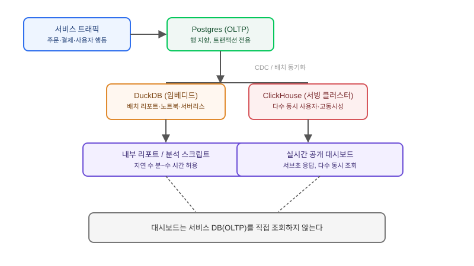

## 왜 지금 이 판단이 필요한가

"운영 대시보드에 실시간으로 집계된 지표를 보여주세요. 매출 추이, 사용자별 활동량, 최근 한 시간 에러율 같은 거요." 서비스 초기에는 이 요구가 그냥 서비스 DB에 `GROUP BY` 쿼리 하나 더 얹는 일처럼 보인다. 실제로도 데이터가 적을 때는 그렇다. 문제는 이 요구가 "한 번 보여주고 끝"이 아니라 계속 늘어난다는 데 있다. 지표 종류가 늘고, 조회 기간이 길어지고, 동시에 보는 사람이 많아지면 같은 Postgres 인스턴스에서 OLTP 트랜잭션과 OLAP 집계 쿼리가 CPU·I/O를 다투기 시작한다. 결제 트랜잭션이 느려지는 원인을 추적해 보면 대시보드의 무거운 집계 쿼리가 범인인 경우가 드물지 않다.

2026년 들어 이 문제에 대한 업계의 답은 "ClickHouse든 DuckDB든 빨리 도입하라"가 아니라 **"이 둘은 경쟁 관계가 아니라 역할이 다른 도구"**라는 쪽으로 정리됐다. PostHog 같은 분석 서비스 업체가 공개적으로 "우리는 DuckDB와 ClickHouse를 함께 쓴다"고 밝힌 것도 이 흐름을 보여준다. 빌더가 답해야 할 질문은 "둘 중 뭐가 더 빠른가"가 아니라 "우리 워크로드가 임베디드로 충분한가, 아니면 다수 사용자가 동시에 쓰는 서빙 계층이 필요한가"다.

## 핵심 개념 1 — OLTP가 집계에 약한 이유는 저장 구조 때문이다

Postgres 같은 행 지향(row-oriented) OLTP DB는 한 행의 모든 컬럼을 디스크에 나란히 저장한다. "주문 하나의 전체 정보를 가져오라"는 트랜잭션성 쿼리에는 이 구조가 유리하다. 하지만 "최근 한 달간 결제 금액의 평균을 구하라"처럼 컬럼 하나만 필요한 집계 쿼리에서는, 필요 없는 컬럼까지 모두 디스크에서 읽어 와야 한다. 행 수가 수백만을 넘어가는 순간부터 이 비효율이 체감되는 지연으로 나타난다. 컬럼 지향(columnar) 저장 방식을 쓰는 OLAP 엔진은 정반대로, 필요한 컬럼만 디스크에서 읽고 압축률도 높아 같은 집계 쿼리를 훨씬 적은 I/O로 끝낸다. 이 구조적 차이가 두 계열 DB가 애초에 다른 워크로드를 위해 만들어졌다는 걸 보여준다.

## 핵심 개념 2 — DuckDB와 ClickHouse는 "같은 문제의 다른 규모판"이 아니다

여기서 흔히 생기는 오해가 "DuckDB는 작은 ClickHouse"라는 생각이다. 실제로는 배포 모델 자체가 다르다. DuckDB는 별도 서버 없이 애플리케이션 프로세스 안에 임베디드로 실행되는 분석 엔진이다. 데이터 과학 노트북, 로컬 분석 스크립트, 혹은 백엔드 서비스 안에서 "이 요청 하나를 처리하는 동안만" 분석 쿼리를 돌리는 용도에 맞다. 네트워크 왕복이 없어 중소 규모 데이터에서는 콜드 쿼리 성능이 ClickHouse와 대등하거나 더 나을 수 있다는 평가도 있다. 반면 ClickHouse는 여러 클라이언트가 동시에 접속해 서브초 단위 응답을 받아야 하는 서빙 워크로드, 즉 "수십 명이 동시에 보는 실시간 대시보드"나 로그·관측성 플랫폼처럼 고동시성 환경에 맞춰 설계됐다. 수십억 행 규모의 분산 환경에서 강점이 있는 대신, 클러스터 운영이라는 대가가 따른다.

## 전체 시스템에서의 위치

OLTP 하나로 버티던 서비스가 분석 요구를 감당하지 못하기 시작하면, 데이터가 흐르는 경로에 새로운 계층이 끼어든다.



핵심은 **대시보드가 서비스 DB를 직접 조회하지 않는다**는 경계선이다. 서비스 DB는 CDC(Change Data Capture)나 주기적 배치로 분석 계층에 데이터를 밀어 넣는 역할만 하고, 대시보드·리포트·에이전트가 던지는 무거운 집계 쿼리는 전부 분석 계층이 받는다. 이 경계가 없으면 분석 쿼리 하나가 서비스 트랜잭션 성능을 갉아먹는 구조가 영구히 반복된다.

## DuckDB vs ClickHouse vs "아직 분리 안 해도 됨" — 선택 기준

| 기준 | Postgres에서 버팀 | DuckDB(임베디드) 도입 | ClickHouse(서빙 클러스터) 도입 |
|---|---|---|---|
| 동시 조회자 수 | 적음 (팀 내부 몇 명) | 적음~중간 | 많음 (다수 사용자·외부 고객) |
| 데이터 규모 | 수백만 행 이하 | 수천만~수억 행, 단일 머신 내 | 수십억 행 이상, 분산 필요 |
| 운영 부담 | 가장 낮음 | 낮음 (서버 없음) | 높음 (클러스터 운영) |
| 지연 요구 | 수 초 허용 | 즉시 응답(로컬 처리) | 서브초, 다수 동시 요청에서도 유지 |
| 적합한 형태 | MVP, 내부 도구 | 배치 리포트, 노트북 분석, 서버리스 함수 내 처리 | 실시간 공개 대시보드, 로그·관측성 플랫폼 |

표에서 가장 중요한 축은 "동시 조회자 수"다. 데이터 규모만 보고 ClickHouse부터 도입하는 팀이 많은데, 실제로 병목이 되는 건 대개 분석 쿼리가 몰리는 시점의 **동시성**이지 데이터 총량이 아니다. 내부 임원 몇 명만 보는 주간 리포트라면 데이터가 수억 행이어도 DuckDB로 배치 처리하는 편이 운영 부담 면에서 훨씬 이득이다.

## 실제 진행 순서

가장 먼저 할 일은 분리를 결정하기 전에 **지금 느려지는 게 트랜잭션인지 집계 쿼리인지를 분리해서 측정하는 것**이다. `EXPLAIN ANALYZE`로 대시보드 쿼리의 실행 계획과 소요 시간을 확인하고, 같은 시간대 결제·주문 같은 핵심 트랜잭션의 지연 분포가 실제로 영향을 받는지 먼저 본다. 영향이 없다면 아직 분리할 시점이 아니다.

분리하기로 했다면 두 번째로 막히는 지점은 거의 항상 동기화 지연 허용 범위다. "실시간"이라는 말을 요구사항에서 그대로 받아들이지 말고, 실제로 몇 초·몇 분까지의 지연이 허용되는지 먼저 합의해야 한다. 이 합의 없이 CDC 파이프라인부터 구축하면 나중에 "왜 대시보드 숫자가 방금 들어온 주문을 반영 못 하냐"는 문의에 매번 설명하게 된다.

```sql
-- DuckDB: Postgres에서 뽑은 Parquet 스냅샷을 그 자리에서 바로 집계
SELECT
  date_trunc('hour', ordered_at) AS hour,
  sum(amount) AS revenue
FROM read_parquet('s3://exports/orders/*.parquet')
WHERE ordered_at >= now() - interval '7 days'
GROUP BY 1
ORDER BY 1;
```

위 쿼리처럼 서버 구축 없이 object storage의 Parquet 파일을 그대로 읽어 집계하는 것이 DuckDB 도입의 전형적인 첫걸음이다. 이 수준에서 성능과 운영 부담이 이미 만족스럽다면, 굳이 ClickHouse 클러스터를 세울 이유가 없다. 동시 조회자가 늘어나고 서브초 응답이 요구되는 시점이 와서야 비로소 ClickHouse 같은 서빙 전용 클러스터 투자가 정당화된다.

## 마무리 요약

- OLTP가 집계에 약한 건 행 지향 저장 구조 때문이고, 컬럼 지향 OLAP 엔진이 이 문제를 구조적으로 해결한다.
- DuckDB는 "작은 ClickHouse"가 아니라 서버 없는 임베디드 분석 도구이고, ClickHouse는 다수 동시 사용자를 위한 서빙 클러스터다 — 선택 기준은 데이터량보다 동시 조회자 수다.
- 분리 전에 트랜잭션 지연과 집계 쿼리 지연을 분리 측정하고, "실시간"의 허용 지연 범위를 먼저 합의한 뒤 CDC를 설계해야 한다.

## 참고 자료

- [PostHog Blog — DuckDB vs ClickHouse: Why we use both](https://posthog.com/blog/duckdb-vs-clickhouse)
- [MotherDuck — Fastest OLAP databases compared: DuckDB, MotherDuck, ClickHouse, Snowflake, BigQuery](https://motherduck.com/learn/fastest-olap-databases-compared/)
