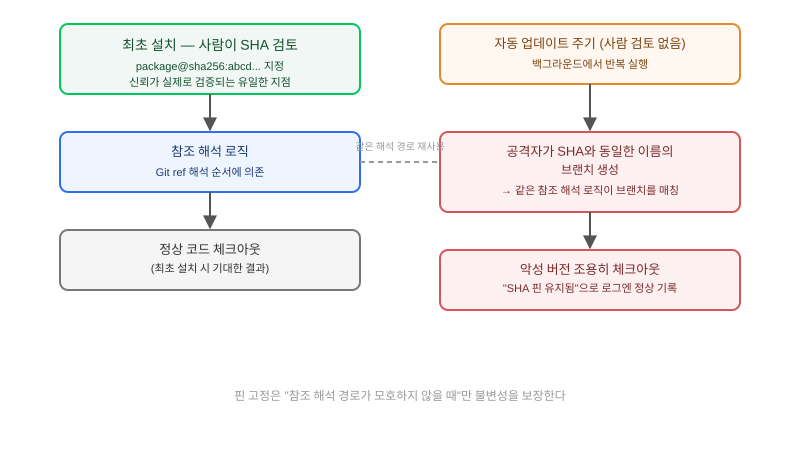

## 왜 지금 이 판단이 필요한가

"외부 플러그인·MCP 서버는 `package@sha256:...`처럼 커밋 해시로 버전을 고정해서 설치하니까 공급망 리스크는 처리됐죠?" 많은 팀이 Agent Skills·MCP 플러그인을 도입하면서 이 한 줄로 공급망 보안을 끝냈다고 생각한다. SHA 핀 고정은 npm 패키지 보안에서 오래 검증된 관행이고, "이 해시의 코드는 절대 바뀌지 않는다"는 수학적으로 맞는 말이기 때문이다. 문제는 2026년 9월 17일 AIR Security가 공개한 **Plugin4Shell**이, 핀 고정된 커밋 자체가 아니라 **그 핀을 해석해서 실제로 체크아웃하는 로직**을 공격 지점으로 삼았다는 데 있다. Claude Code, OpenAI Codex, GitHub Copilot, Gemini CLI까지 네 개 주요 코딩 에이전트가 모두 영향을 받은 이번 사고는, "핀을 걸었으니 안전하다"는 가정이 구현 디테일 하나로 통째로 무너질 수 있음을 보여준 업계 최초의 에이전트 생태계 공급망 사고로 꼽힌다.

빌더가 답해야 할 질문은 "우리도 SHA 핀을 쓰고 있나"가 아니라 "그 핀을 검증하는 코드가 실제로 핀을 끝까지 지키는가, 아니면 어느 지점에서 브랜치 이름 같은 더 느슨한 참조로 되돌아가는가"다.

## 핵심 개념 1 — 공격이 뚫은 지점은 핀이 아니라 "핀 해석"이었다

Plugin4Shell의 핵심 메커니즘은 Git의 참조(ref) 해석 방식을 악용한 것이다. 공격자가 플러그인 저장소를 통제하고 있다면, 승인된 SHA 값과 똑같은 이름의 **브랜치**를 만들 수 있다. 일부 에이전트의 설치·업데이트 로직은 "이 참조가 커밋 해시인지 브랜치 이름인지"를 엄격히 구분하지 않고 Git의 참조 해석 순서에 그대로 의존했는데, 그 순서에서 브랜치 이름이 커밋 해시보다 먼저 매칭되는 경로가 있었다. 결과적으로 에이전트는 "SHA 핀을 그대로 지켰다"고 로그에 기록하면서도, 실제로는 공격자가 만든 악성 브랜치의 코드를 체크아웃하게 된다.

더 치명적인 부분은 "제로클릭"이라는 이름이 붙은 이유다. Claude Code와 Codex는 기본값으로 설치된 플러그인을 백그라운드에서 자동 업데이트한다. 업스트림 저장소의 핀 대상 커밋이 교체되면, 사용자가 아무것도 하지 않아도 다음 자동 업데이트 주기에 이 취약한 체크아웃 경로가 다시 실행되면서 악성 버전으로 조용히 교체된다. 사용자는 "설치할 때 한 번 검토했다"는 안도감을 갖고 있지만, 그 검토는 최초 설치 시점에만 유효했을 뿐 자동 업데이트 시점에는 아무 의미가 없었던 셈이다.

## 핵심 개념 2 — "핀 고정 = 불변"이라는 등식이 성립하는 조건

이 사고가 보여주는 더 일반적인 교훈은, 핀 고정이 불변성을 보장하는 건 **그 핀을 해석하는 코드 경로 전체가 모호성 없이 동작할 때뿐**이라는 점이다. npm의 `package-lock.json`이나 Docker의 `image@sha256:...`가 신뢰받는 이유는 생태계 차원에서 이 해석 경로가 오랫동안 검증됐기 때문이지, SHA 문자열 자체가 마법처럼 안전을 보장해서가 아니다. 에이전트 플러그인 생태계는 아직 이 정도로 성숙한 해석 경로를 갖추지 못한 상태에서, npm·Docker의 "핀 고정하면 안전하다"는 멘탈 모델만 그대로 가져온 것이 이번 사고의 근본 원인에 가깝다. 패치 상태도 이 성숙도 차이를 보여준다. Anthropic은 Claude Code 2.1.179에서, OpenAI는 Codex 0.146.0에서 참조 해석 로직을 고쳤지만, 보도 시점 기준 GitHub Copilot은 수정이 늦었고 Google은 Gemini CLI에 대한 패치를 보류했다 — 같은 취약점 패턴 앞에서 벤더마다 대응 성숙도가 다르다는 뜻이다.

## 전체 시스템에서의 위치

플러그인 하나가 "설치"에서 "실행"까지 가는 경로를 그리면, 신뢰가 실제로 검증되는 지점과 그저 가정되는 지점이 뚜렷이 갈린다.

그림에서 보듯 사람이 실제로 "이 코드를 검토했다"고 말할 수 있는 지점은 최초 설치 시점 하나뿐이다. 그 뒤 모든 자동 업데이트 주기는 사람의 검토 없이 같은 참조 해석 로직을 반복 실행한다. 이 반복 경로에 모호성이 하나라도 남아 있으면, 최초 설치 시점의 신뢰는 그 이후 어느 시점에서든 조용히 무효화될 수 있다. "한 번 설치했으니 끝"이라는 생각이 왜 위험한지가 이 구조에 그대로 드러난다.

## 선택의 트레이드오프 — 신뢰 경계를 어디에 다시 그을 것인가

| 완화 전략 | 구현 비용 | 막는 범위 | 한계 |
|---|---|---|---|
| 자동 업데이트 끄고 수동 승인 | 낮음 | 모든 조용한 교체 차단 | 패치 적용도 늦어짐, 운영 부담 증가 |
| 참조 해석 결과를 설치 시점과 매 업데이트마다 재검증(다이제스트 재확인) | 중간 | 브랜치명 충돌형 우회 차단 | 플랫폼이 이 기능을 지원해야 함 |
| 플러그인 레지스트리 자체를 사내 미러로 운영 | 높음 | 업스트림 저장소 변조 전체 차단 | 운영 인력·인프라 필요 |
| 벤더 패치 상태를 주기적으로 추적만 함 | 거의 없음 | 없음(대응이 아니라 인지) | 패치 없는 벤더 사용 시 무방비 |

실무에서는 첫 번째(자동 업데이트 수동 승인)와 두 번째(재검증)를 함께 쓰는 게 현실적인 시작점이다. 자동 업데이트를 완전히 꺼버리면 보안 패치 자체도 늦게 들어오는 역설이 생기므로, "업데이트는 자동으로 받되 적용 직전에 다이제스트를 재확인하는 게이트를 하나 둔다"는 절충이 대부분의 팀에 맞는다. 사내 미러 운영은 플러그인에 크게 의존하는 조직이 아니라면 비용 대비 과한 투자다.

## 실제 진행 순서

가장 먼저 할 일은 코드를 바꾸는 게 아니라 **우리가 쓰는 에이전트 플러그인 로더의 버전을 확인하는 것**이다. Claude Code는 2.1.179 이상, Codex는 0.146.0 이상인지부터 점검하고, Copilot CLI나 Gemini CLI를 쓰고 있다면 패치 여부를 직접 확인해야 한다(보도 시점 기준 일부 벤더는 패치가 없었다). 그다음은 조직 내에서 자동 업데이트가 켜진 플러그인 목록을 추려내는 작업이다. "누가 언제 이 플러그인을 설치했는지"는 많은 조직이 기록하지만, "자동 업데이트가 켜져 있는지"는 의외로 아무도 확인하지 않는 설정값인 경우가 많다.

마지막으로, 이 사고를 계기로 점검할 질문은 플러그인 하나에 국한되지 않는다. "우리 CI 파이프라인의 Docker 이미지 태그", "우리 IaC의 Terraform 모듈 버전 참조"처럼, "핀 고정했으니 안전하다"고 믿고 있는 다른 지점이 있는지 같은 패턴으로 다시 점검해 볼 가치가 있다. Plugin4Shell의 교훈은 에이전트 플러그인에만 국한된 게 아니라, 버전 참조를 다루는 모든 자동화 시스템에 적용되는 일반 원칙이기 때문이다.

## 마무리 요약

- Plugin4Shell은 SHA 핀 자체가 아니라 핀을 해석하는 Git 참조 로직의 모호성(브랜치명이 커밋 해시처럼 매칭됨)을 공격했다.
- "제로클릭"인 이유는 플러그인 자동 업데이트가 최초 설치 이후에도 같은 취약한 해석 경로를 사람의 검토 없이 반복 실행하기 때문이다.
- 자동 업데이트를 끄기보다는, 업데이트는 받되 적용 직전 다이제스트를 재검증하는 게이트를 두는 절충이 현실적인 완화책이다.

## 참고 자료

- [Help Net Security — Plugin4Shell zero-click RCE vulnerability](https://www.helpnetsecurity.com/2026/09/18/plugin4shell-ai-coding-agents-vulnerability/)
- [Cloud Security Alliance Research Note — Plugin4Shell: SHA-Pinning Bypass Enables AI Coding Agent RCE](https://labs.cloudsecurityalliance.org/research/csa-research-note-plugin4shell-ai-coding-agent-supply-chain/)
