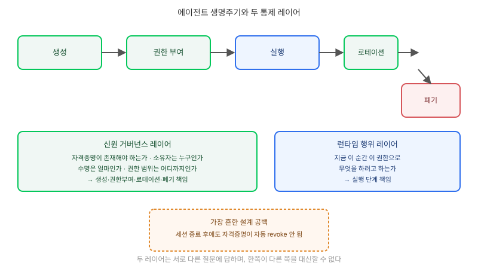

## 왜 지금 이 판단이 필요한가

"이 리서치 에이전트, 우리 내부 API랑 DB에도 접근해야 하니까 계정 하나 만들어주세요." 처음 에이전트 한두 개를 붙일 때는 이 요구가 사소해 보인다. 기존 서비스 계정을 공유하거나 API 키 하나를 발급해 넘기면 끝나기 때문이다. 문제는 그 다음부터다. 한 에이전트가 작업 중간에 서브에이전트를 여러 개 띄우고, 그 서브에이전트들이 저마다 같은 키를 재사용하기 시작하면, "지금 이 API 호출을 한 게 정확히 어떤 에이전트의 어떤 작업인지" 아무도 답할 수 없는 상태가 된다. 2026년 업계 조사들은 이 문제가 더 이상 가설이 아니라고 말한다. 한 설문은 조직의 83%에서 비인간 신원(Non-Human Identity, NHI)이 사람 계정 수를 이미 넘어섰다고 보고하고, SANS는 76%의 조직이 서비스 계정·API 키·자동화 봇의 급증을 겪고 있으며 그중 92%는 90일마다 자격증명을 회전시키지 않는다고 지적한다. Cloud Security Alliance가 2026년 3월 내놓은 Agentic Identity Governance Framework 초안과, NSA가 5월 "MCP가 기본적인 보안 통제를 결여하고 있다"고 경고한 것도 같은 문제의식에서 나왔다.

빌더가 답해야 할 질문은 "이 에이전트에게 권한을 줄 것인가"가 아니라 "이 권한을 가진 신원이 언제 태어나고, 누가 소유하며, 언제 죽는지를 사람이 설계해 뒀는가"다.

## 핵심 개념 1 — 에이전트에게 사람 IAM 모델을 그대로 못 쓰는 이유

사람을 위한 IAM(계정 발급 → 역할 부여 → 주기적 검토 → 퇴사 시 회수)은 몇 가지 전제 위에 서 있다. 한 사람에 계정 하나, 수명은 재직 기간만큼 길고, 늘어나는 속도는 채용 속도에 비례한다. AI 에이전트는 이 전제를 전부 깨뜨린다. 세션 하나가 시작될 때 신원이 생성되고 그 세션이 끝나면 소멸하는 경우가 흔하고, 그 안에서 또 서브에이전트가 자기 자신의 권한 범위 안에서 새 신원을 만들어낼 수 있으며, 늘어나는 속도는 사람 채용이 아니라 "이번 주에 새 자동화 몇 개를 켰는가"에 비례한다. CSA 프레임워크는 이 차이를 인정하고 독립 실행형 에이전트, 오케스트레이션된 서브에이전트, 도구 호출 전용 에이전트 등 다섯 가지 신원 범주를 구분해, 각각 다른 자격증명 수명과 권한 모델을 적용하도록 제안한다. "에이전트 계정 하나 만들어주세요"라는 요청에 기존 서비스 계정 발급 절차를 그대로 복사해 쓰면, 바로 이 수명·증식 속도 차이 때문에 몇 주 안에 추적 불가능한 상태로 빠진다.

## 핵심 개념 2 — 신원 레이어와 행위 레이어를 나눠서 설계한다

여러 벤더와 CSA가 공통으로 수렴하는 구조는 두 레이어의 분리다. **신원 거버넌스 레이어**는 "이 자격증명이 존재해야 하는가, 누가 소유자인가, 얼마나 사는가, 어떤 범위의 권한을 갖는가"를 결정한다. **런타임 행위 레이어**는 그 자격증명을 쥔 에이전트가 지금 이 순간 실제로 무엇을 하려는지를 검사한다. 이 둘을 하나로 뭉쳐서 "자격증명을 발급했으니 그 에이전트는 믿을 수 있다"고 가정하면, 프롬프트 인젝션이나 설계 실수로 에이전트가 원래 의도와 다른 행동을 할 때 막을 지점이 없다. 반대로 행위 감시만 두고 신원 관리를 소홀히 하면, 애초에 누구 소유인지도 모르는 좀비 자격증명이 계속 쌓여 공격 표면만 넓어진다. 두 레이어는 서로 다른 질문에 답하는 독립적인 통제이고, 한쪽이 다른 쪽을 대신할 수 없다.

## 전체 시스템에서의 위치

에이전트 하나가 태어나서 사라질 때까지, 이 두 레이어가 각 단계에서 어떻게 관여하는지를 그리면 설계 공백이 어디 있는지 드러난다.

그림에서 보듯 생성·폐기 단계는 신원 거버넌스 레이어의 책임이고, 실행 단계는 행위 레이어의 책임이다. 많은 조직이 "자격증명을 발급하는 절차"는 어느 정도 갖추고 있지만 "자격증명을 회수하는 절차(폐기)"는 비어 있는 경우가 흔하다 — 세션이 끝난 에이전트의 자격증명이 자동으로 revoke되지 않고 그대로 유효 상태로 남는 것이 가장 흔한 설계 공백이다.

## 선택의 트레이드오프 — 어떤 자격증명 모델로 시작할 것인가

| 접근법 | 구현 비용 | 추적성 | 확장성 | 장애 시 노출 범위 |
|---|---|---|---|---|
| 사람 계정 공유 | 거의 없음 | 전혀 없음 | 에이전트 늘수록 급격히 악화 | 매우 큼(사람 권한 전체) |
| 서비스 계정 고정 키 | 낮음 | 키 단위까지만(에이전트 단위 아님) | 중간(키 관리 부담 누적) | 큼(키가 노출되면 전체 범위) |
| 짧은 수명 토큰 + 자동 로테이션 | 중간(토큰 발급 인프라 필요) | 세션·작업 단위까지 추적 가능 | 좋음 | 작음(토큰 수명만큼으로 제한) |
| 전용 NHI 플랫폼 도입 | 높음(도구·프로세스 전면 구축) | 전체 생명주기 추적 | 가장 좋음 | 가장 작음(즉시 격리 가능) |

에이전트가 한두 개뿐이고 내부 PoC 단계라면 서비스 계정 고정 키로 시작해도 당장 큰 문제는 없다. 다만 서브에이전트가 분기되기 시작하거나 외부 데이터·고객 정보에 닿는 에이전트가 생기는 순간이, 짧은 수명 토큰 체계로 넘어가야 하는 분기점이다. 전용 NHI 플랫폼은 조직 전체의 에이전트 수가 두 자릿수를 넘어가고 수동 추적이 현실적으로 불가능해진 뒤에 고려해도 늦지 않다 — 처음부터 플랫폼부터 들이는 건 과한 투자다.

## 실제 프로젝트 진행 순서

가장 먼저 할 일은 새 체계를 설계하는 게 아니라 **지금 떠 있는 에이전트·서브에이전트 전부를 인벤토리로 뽑아 각각의 사람 소유자를 매핑하는 것**이다. 이 단계만으로도 "누가 만들었는지 아무도 모르는" 자격증명이 드러나는 경우가 많다. 그다음은 우선순위를 매겨 장수명 고정 키부터 교체하는 작업인데, 권한 범위가 가장 넓은 자격증명(예: DB 전체 접근 키)을 최우선으로 짧은 수명 토큰으로 바꾼다. 마지막으로 반드시 점검해야 할 게 폐기 절차다 — 세션이 끝나거나 프로젝트가 종료된 에이전트의 자격증명이 자동으로 revoke되는지 직접 확인해야 한다. 이 확인을 생략하면, 다른 모든 단계를 완벽히 설계해도 결국 아무도 기억하지 못하는 좀비 자격증명이 조직 어딘가에 계속 쌓인다.

## 마무리 요약

- 에이전트는 수명이 짧고 서브에이전트로 분기하며 증식 속도가 사람 채용보다 훨씬 빠르기 때문에, 사람을 위한 IAM 절차를 그대로 복사하면 몇 주 안에 추적 불가능한 상태가 된다.
- "자격증명이 존재해야 하는가"를 정하는 신원 거버넌스 레이어와 "그 권한으로 지금 무엇을 하는가"를 검사하는 런타임 행위 레이어는 서로 다른 통제이며 하나가 다른 하나를 대신할 수 없다.
- 가장 먼저 할 일은 새 플랫폼 도입이 아니라 현재 떠 있는 에이전트의 인벤토리와 소유자 매핑, 그리고 폐기 절차가 실제로 자격증명을 회수하는지 확인하는 것이다.

## 참고 자료

- [Cloud Security Alliance — Agentic Identity Governance Framework (Draft, 2026-03-27)](https://labs.cloudsecurityalliance.org/agentic/agentic-identity-governance-framework-v1/)
- [JumpCloud — How to Govern the Massive Explosion of Non-Human Identities (NHIs)](https://jumpcloud.com/blog/how-to-govern-the-massive-explosion-of-non-human-identities-nhis)
- [THE Journal — Report Recommends Separate Governance Model for 'Non-Human Identities'](https://thejournal.com/articles/2026/08/05/report-recommends-separate-governance-model-for-non-human-identities.aspx)
