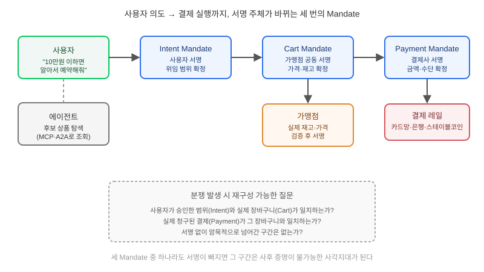

## 왜 지금 이 판단이 필요한가

"출장 항공권, 조건 맞으면 에이전트가 알아서 예약하고 결제까지 끝내주세요." 쇼핑·여행·구독 관리 에이전트가 실무에 들어오기 시작하면서 이런 요구가 더 이상 가설이 아니게 됐다. 문제는 여기서 가장 쉬운 구현이 가장 위험한 구현이라는 점이다. 에이전트에게 저장된 카드 정보나 로그인 세션 토큰을 그대로 넘기면, 에이전트가 실수로든 프롬프트 인젝션으로든 "사용자가 승인하지 않은 결제"를 실행했을 때 가맹점도 카드사도 "이게 정말 사용자의 의사였는지"를 증명할 방법이 없다. Google이 2026년 초 공개하고 이후 FIDO Alliance에 Verifiable Intent 개념을 기증한 AP2(Agent Payments Protocol)는 이 문제를 "카드 정보를 어떻게 안전하게 전달할까"가 아니라 "누가 무엇을 승인했는지를 암호학적으로 검증 가능한 기록으로 남길까"로 바꿔서 풀었다. PayPal 지갑 연동과 Mastercard Agent Pay 파일럿이 이미 이 모델 위에서 돌아가고 있다는 점에서, 올해 안에 결제 기능을 건드리는 에이전트를 설계한다면 이 프로토콜의 사고방식을 모르고 지나치기 어렵다.

빌더가 답해야 할 질문은 "결제 API를 에이전트에게 연결할 것인가"가 아니라 "사용자가 승인한 범위와 에이전트가 실제로 실행한 행동 사이의 간극을, 사고가 난 뒤에도 제3자가 재구성할 수 있게 설계했는가"다.

## 핵심 개념 1 — Mandate는 API 키가 아니라 서명된 위임 사슬이다

AP2의 중심 추상은 기존 결제 흐름에 없던 새로운 개념인 **Mandate**다. 사용자가 에이전트에게 "10만원 이하 항공권이면 알아서 예약해"라고 말하는 순간 **Intent Mandate**가 서명되어 생성된다. 에이전트가 실제 후보 상품을 찾아 장바구니를 구성하면 그 구체적인 내역(가격, 판매자, 조건)이 **Cart Mandate**로 다시 서명된다. 마지막으로 결제가 실행되는 순간 **Payment Mandate**가 결제 수단과 금액을 확정해 서명한다. 세 단계가 각각 독립적으로 서명되기 때문에, 분쟁이 생겼을 때 "사용자가 승인한 의도"와 "에이전트가 실제로 담은 장바구니"와 "실제로 청구된 금액"을 각각 떼어내 대조할 수 있다. 기존 카드 자동결제가 "이 세션이 결제 권한을 가진다"는 한 덩어리짜리 신뢰였다면, AP2는 의도-구성-실행 세 지점에 각각 서명을 박아 두는 셈이다.

## 핵심 개념 2 — 결제 프로토콜은 혼자 동작하지 않는다

AP2는 전체 스택의 한 레이어일 뿐이다. 에이전트가 도구를 호출하고 다른 에이전트와 통신하는 기반은 여전히 MCP·A2A가 맡고, 그 위에서 "상품을 찾고 비교하는 커머스 여정"은 UCP(Universal Commerce Protocol) 같은 별도 계층이 담당하며, AP2는 그 여정의 마지막 단계인 결제 승인·실행만 책임진다. 여기에 Visa TAP, Coinbase x402, PayPal의 자체 프로토콜까지 경쟁 구도로 공존하면서, Mastercard가 AP2·UCP·A2A·ACP를 동시에 지원하겠다고 공식 선언한 것처럼 업계는 "하나의 표준이 승리"보다 "멀티 프로토콜 공존"으로 수렴하는 중이다. 즉 지금 설계에서 중요한 건 AP2 자체를 깊이 파는 것보다, 결제 레이어를 나머지 에이전트 스택과 느슨하게 분리해 두어 어떤 프로토콜이 표준으로 굳어지든 교체 비용을 줄이는 구조다.

## 전체 시스템에서의 위치

사용자의 말 한마디가 실제 결제 실행까지 가려면 아래처럼 서로 다른 신뢰 주체를 거친다.

이 그림에서 중요한 건 화살표마다 서명 주체가 바뀐다는 점이다. Intent는 사용자가, Cart는 가맹점이 실제 재고·가격을 확인한 뒤 공동 서명하고, Payment는 결제 처리자가 레일(카드망·은행·스테이블코인)에 넘기기 직전에 확정한다. 한 구간이라도 서명 없이 암묵적 신뢰로 넘어가면 그 지점이 바로 분쟁 발생 시 아무도 증명할 수 없는 사각지대가 된다.

## 선택의 트레이드오프 — Mandate 모델을 언제 도입하는가

| 접근 방식 | 구현 난이도 | 분쟁 시 증빙력 | 적합한 상황 |
|---|---|---|---|
| 저장 카드 + 세션 토큰 자동결제 | 낮음 | 거의 없음 | 내부 테스트, 사용자 본인이 직접 최종 클릭하는 반자동 흐름 |
| 매 결제마다 사람이 수동 재확인 | 낮음 | 사람 확인 자체가 증빙 | 결제 빈도가 낮고 금액이 큰 경우 |
| AP2 Mandate 체인 도입 | 높음(표준 연동·키 관리 필요) | 단계별 서명으로 재구성 가능 | 외부 고객 대상 반복 결제, 가맹점·결제사가 이미 AP2 생태계에 있는 경우 |
| 자체 위임 토큰 설계(비표준) | 중간 | 설계자 역량에 의존 | 폐쇄망·사내 전용이라 표준 상호운용이 불필요한 경우 |

사내 전용 자동화나 금액이 작고 사용자가 매번 화면을 보는 구조라면 AP2 같은 무거운 표준을 끌어올 이유가 없다. 반대로 외부 가맹점과 실제 돈이 오가고, 나중에 "이건 내가 승인한 적 없다"는 분쟁이 법적 문제로 번질 수 있는 서비스라면 표준 Mandate 체계를 처음부터 설계에 넣는 편이 나중에 전체 결제 흐름을 뜯어고치는 것보다 훨씬 싸다.

## 실제 프로젝트 진행 순서

가장 먼저 할 일은 프로토콜 스펙을 외우는 게 아니라 **우리 서비스에서 사람이 "승인"이라고 느끼는 순간이 정확히 어디인지 UX로 먼저 확정하는 것**이다. "10만원 이하면 알아서"라는 느슨한 위임과 "이 특정 상품, 이 금액"이라는 확정 승인은 전혀 다른 Intent Mandate를 요구한다. 그다음은 연동할 가맹점·결제사가 AP2를 포함해 어떤 프로토콜을 실제로 지원하는지 확인하는 단계다. 아직 생태계가 Visa TAP·x402 등으로 분열돼 있으므로, 특정 파트너사 하나에만 맞춰 깊게 구현하기보다 Mandate라는 개념 모델(의도-구성-실행 분리, 각 단계 서명)을 먼저 내부 구조로 잡아두고 프로토콜 바인딩은 어댑터 계층으로 분리하는 게 안전하다. 마지막으로 분쟁 대응 프로세스를 결제 기능 출시 전에 먼저 그려봐야 한다 — 세 개의 Mandate 중 어느 것이 위조·누락됐는지 운영팀이 몇 분 안에 조회할 수 있는 도구가 없다면, 서명 체계를 아무리 정교하게 설계해도 실제 분쟁 상황에서는 무용지물이다.

## 마무리 요약

- AP2는 에이전트에게 카드 정보를 넘기는 문제를 "누가 무엇을 승인했는지 검증 가능하게 기록하는" Intent·Cart·Payment 3단계 서명 Mandate 체인으로 바꿔서 푼다.
- 결제는 MCP·A2A(도구·에이전트 통신)와 UCP(커머스 여정) 위에 올라가는 한 레이어일 뿐이며, Visa TAP·x402 등과 공존할 멀티 프로토콜 구조를 전제로 설계해야 한다.
- 내부 전용·저빈도·저금액 결제에는 과한 투자이며, 외부 가맹점과 실제 분쟁 가능성이 있는 서비스일수록 Mandate 체인을 설계 초기에 넣는 편이 나중보다 훨씬 싸다.

## 참고 자료

- [Google Cloud — Agent Payments Protocol (AP2) 소개](https://cloud.google.com/blog/products/ai-machine-learning/announcing-agents-payments-protocol-ap2)
- [Vellum AI — Google's AP2: A new protocol for AI agent payments](https://website.vellum.ai/blog/googles-ap2-a-new-protocol-for-ai-agent-payments)
- [BlockEden — The Agent Payment Protocol War: Visa TAP vs Google AP2 vs Coinbase x402 vs PayPal](https://blockeden.xyz/blog/2026/03/14/payment-giants-agent-protocol-war-visa-tap-google-ap2-coinbase-x402-paypal-ai-commerce/)
