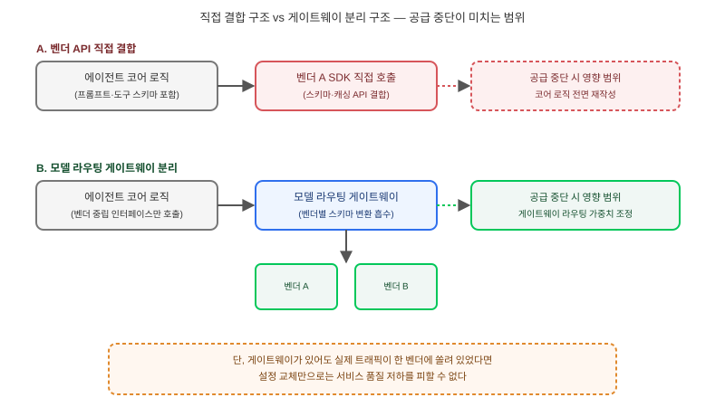

## 왜 지금 이 판단이 필요한가

"사내 코딩 에이전트 도구, 일단 우리가 제일 잘 쓰는 모델 하나에 맞춰서 빨리 만들어주세요." 프로토타입 단계에서는 합리적인 선택이다. 특정 벤더의 도구 호출 스키마와 프롬프트 포맷에 맞춰 구현하면 개발 속도가 빠르고 최적화도 쉽다. 그런데 2026년 8월 28일 OpenAI가 공식 블로그에서 밝힌 결정은 이 선택의 전제를 흔든다. SpaceX가 Cursor의 모회사 Anysphere를 인수하자, OpenAI는 "SpaceX가 자사 모델을 이용약관 안에서 계속 쓸지 확신할 수 없다"는 이유로 Cursor에 대한 신규 모델(Astra 포함) 공급을 중단하겠다고 발표했다. 머스크 계열사와의 과거 분쟁 이력을 이유로 든 이 결정은 2026년 11월 12일부로 기존 모델 접근까지 완전히 끊는 것으로 마무리된다 — 이 글을 쓰는 시점 기준 불과 이틀 뒤다. Cursor 측은 OpenAI 모델이 전체 트래픽의 약 5%에 불과하며 Anthropic·Google·SpaceXAI 모델은 계속 제공한다고 밝혔지만, 이번 사건이 업계에 남긴 질문은 단순하다. "모델 공급이 끊기는 이유가 기술적 결함이 아니라 자본 관계의 변화일 수도 있다는 걸, 우리 도구 설계에 반영해 뒀는가."

빌더가 답해야 할 질문은 "어떤 모델이 제일 좋은가"가 아니라 "이 모델 공급사와의 관계가 끊어질 때, 우리 도구가 코드 몇 줄을 고쳐서 버틸 수 있는가, 아니면 처음부터 다시 설계해야 하는가"다.

## 핵심 개념 1 — 벤더 결합에는 두 가지 축이 있다

지금까지 벤더 락인 논의는 주로 **API 레벨 결합**에 집중해 왔다. 특정 벤더의 도구 호출 스키마, 프롬프트 캐싱 API, 컨텍스트 윈도우 가정에 코드를 깊게 맞추면, 다른 벤더로 옮길 때 스키마 변환 계층을 새로 짜야 한다는 식이다. 이번 Cursor 사건이 드러낸 건 **조직·계약 레벨 결합**이라는 전혀 다른 축이다. Cursor의 코드 자체는 하나도 바뀌지 않았다. 바뀐 건 모회사의 소유 구조뿐인데, 그 변화 하나로 핵심 모델 공급사 하나가 통째로 끊겼다. 기술 부채 측정이나 API 버전 호환성 체크로는 이 리스크를 전혀 잡아낼 수 없다 — 애초에 우리 코드나 설계가 아니라 **공급사 반대편의 지분 구조**가 원인이기 때문이다. API 결합이 "느리지만 예측 가능한 전환 비용"이라면, 조직·계약 결합은 "예고 없이 닥치는 전면 중단"에 가깝다.

## 핵심 개념 2 — Cursor가 버틴 이유는 설계 때문이 아니라 비중 때문이었다

Cursor가 이번 사태에서 서비스를 중단하지 않고 버틸 수 있었던 이유를 정확히 짚어야 한다. 특별히 정교한 벤더 추상화 레이어를 미리 설계해 둬서가 아니라, 애초에 멀티 모델 지원 구조였고 OpenAI 비중이 전체 트래픽의 5%에 불과했기 때문이다. 즉 "모델 라우팅을 해뒀으니 안전하다"가 아니라 "한 공급사에 과도하게 쏠리지 않았다"는 비중 관리가 실제 완충재였다. 이는 설계 교훈을 바꾼다 — 추상화 레이어를 잘 짜는 것만큼이나, 실제 트래픽·기능이 한 벤더에 얼마나 쏠려 있는지를 주기적으로 측정하고 상한선을 두는 운영 규율이 필요하다는 뜻이다.

## 전체 시스템에서의 위치

에이전틱 코딩 툴 내부에서 모델 호출이 어디에 위치하느냐에 따라, 공급 중단이 미치는 영향 범위가 완전히 달라진다.

그림의 위쪽처럼 프롬프트 템플릿·도구 스키마·컨텍스트 관리 로직이 특정 벤더 SDK에 직접 박혀 있으면, 공급 중단 통보를 받는 순간부터 전체 코어 로직을 다시 작성해야 한다. 아래쪽처럼 게이트웨이 레이어가 벤더별 차이를 흡수하고 있으면, 공급 중단의 영향 범위는 "게이트웨이 설정에서 라우팅 가중치를 바꾸는 작업"으로 줄어든다. 다만 게이트웨이가 있어도 그 뒤에서 실제로 쓰는 모델이 한 곳에 쏠려 있었다면, 설정 변경만으로는 서비스 품질 저하를 피할 수 없다는 점은 Cursor 사례에서도 드러난다.

## 선택의 트레이드오프 — 언제 깊게 결합하고 언제 분리할 것인가

| 접근 방식 | 개발 속도 | 최적화 수준 | 공급 중단 시 영향 | 적합한 상황 |
|---|---|---|---|---|
| 단일 벤더 API에 직접 결합 | 빠름 | 높음(벤더 특화 기능 활용) | 전면 재작성 필요 | 내부 PoC, 단기 실험 |
| 추상화 레이어 + 단일 모델 운영 | 중간 | 중간 | 설정 교체로 완화되나 품질 저하 가능 | 프로덕션 초기, 전환 대비는 됐지만 비중 분산은 아직 |
| 추상화 레이어 + 멀티 벤더 실운영 | 느림(검증 비용 증가) | 벤더별 최적화는 포기 | 가장 낮음 | 외부 고객 대상 상용 서비스, 장기 운영 도구 |

프로토타입이나 사내 실험 단계라면 단일 벤더 직접 결합이 여전히 합리적인 선택이다. 문제는 그 도구가 "일단 빨리 만든 것"에서 "팀이 매일 의존하는 핵심 인프라"로 넘어가는 순간을 놓치는 경우다. 그 전환점을 넘기기 전에 최소한 추상화 레이어는 넣어 두고, 상용·외부 서비스로 간다면 실제 트래픽을 한 곳에 쏠리지 않게 분산하는 운영 규율까지 가져가야 한다.

## 실제 프로젝트 진행 순서

가장 먼저 할 일은 코드를 바꾸는 게 아니라 **현재 사내 에이전틱 코딩 도구가 특정 벤더 API의 어떤 디테일(도구 호출 스키마, 프롬프트 캐싱, 컨텍스트 윈도우 가정)에 얼마나 묶여 있는지 감사하는 것**이다. 그다음은 모델 호출 지점을 하나의 게이트웨이 계층 뒤로 몰아넣어, 코어 로직이 벤더별 SDK를 직접 import하지 않도록 격리하는 작업이다. 이 단계에서 끝내지 말고, 최소 두 개 벤더로 실제 폴백 테스트를 돌려 전환이 "설정 한 줄"로 끝나는지 직접 확인해야 한다. 마지막으로, 이번 사건이 주는 가장 중요한 교훈은 리스크 등록부에 새 항목을 추가하는 것이다 — "이 벤더가 기술적으로 문제없어도, 그 벤더의 소유 구조가 바뀌면 공급이 끊길 수 있다"는 조직·계약 리스크를, 기존의 API 변경·가격 인상 리스크와 별도로 추적해야 한다.

## 마무리 요약

- OpenAI가 SpaceX의 Anysphere(Cursor 모회사) 인수를 이유로 모델 공급을 끊은 사건은, 기술적 결함이 아니라 공급사 소유 구조 변화만으로도 모델 접근이 끊길 수 있다는 새로운 리스크 범주를 보여줬다.
- Cursor가 버틴 이유는 정교한 추상화 설계가 아니라 애초에 OpenAI 비중이 5%에 불과했던 트래픽 분산 덕분이었다 — 게이트웨이 설계와 벤더 쏠림 관리는 별개의 과제다.
- 프로토타입 단계의 단일 벤더 결합은 합리적이지만, 도구가 핵심 인프라로 넘어가는 전환점에서는 추상화 레이어 도입과 멀티 벤더 폴백 테스트, 그리고 조직·계약 리스크를 별도로 추적하는 절차가 필요하다.

## 참고 자료

- [OpenAI — Our decision on Cursor following its acquisition by SpaceX](https://openai.com/index/our-decision-on-cursor-following-its-acquisition-by-spacex/)
- [CNBC — OpenAI to end model access to Cursor after acquisition by Elon Musk's SpaceX](https://www.cnbc.com/2026/08/29/openai-cursor-spacex-model-access.html)
- [DevOps.com — OpenAI Cuts Off Cursor's Model Access After SpaceX Acquisition](https://devops.com/openai-cuts-off-cursors-model-access-after-spacex-acquisition/)
