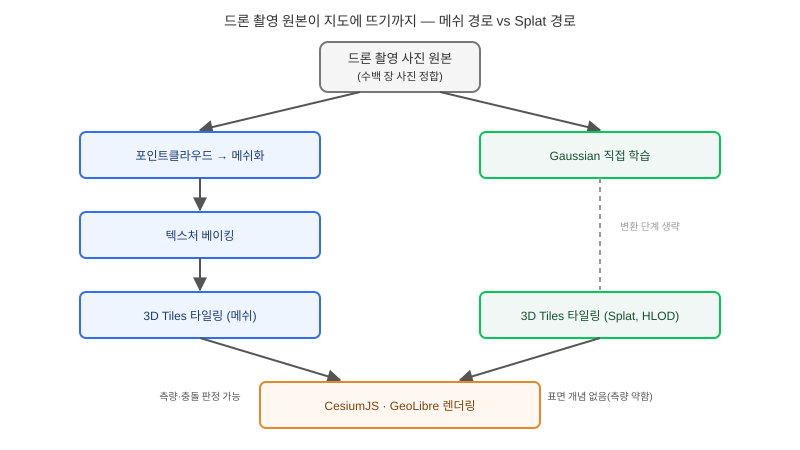

## 왜 지금 이 판단이 필요한가

"현장 답사를 못 가는 사람들에게 드론으로 찍은 영상을 그대로, 최대한 실제처럼 지도 위에서 둘러보게 해주세요." 재난 현장, 공사 진행 상황, 부동산 매물 소개처럼 "정밀한 측량 수치"보다 "거기 있는 것 같은 실사감"이 목적인 요구가 늘고 있다. 기존 답은 photogrammetry로 수백 장의 사진을 메쉬와 텍스처로 변환해 3D Tiles로 굽는 것이었는데, 이 변환 단계 자체가 시간도 오래 걸리고 가느다란 전선이나 유리창, 수면 같은 디테일에서 메쉬 품질이 무너지는 고질적인 한계가 있었다. 2026년 들어 이 전제가 흔들리고 있다. Khronos가 2월 KHR_gaussian_splatting glTF 확장을 릴리스 후보로 내놓았고, Cesium이 3월 CesiumJS·Unreal Engine에 이를 지원하기 시작했으며, 4월에는 3D Gaussian Splat을 3D Tiles 2.0 OGC 커뮤니티 표준 제안에 포함시켰다. 9월에는 오픈소스 데스크톱 GIS인 GeoLibre 3.0.0이 3D Tiles 형태의 splat 자산을 Cesium 글로브 위에 네이티브로 그리는 기능을 추가했다. 메쉬 변환 단계 자체를 건너뛰는 선택지가 실무에 들어온 것이다.

빌더가 답해야 할 질문은 "Gaussian Splatting이 메쉬보다 좋은가"가 아니라 "이 프로젝트가 필요로 하는 게 치수를 잴 수 있는 지오메트리인가, 아니면 그 자리에 있는 것 같은 시각적 체감인가"다.

## 핵심 개념 1 — Gaussian Splat은 표면을 그리지 않고 공간을 채운다

메쉬 기반 3D는 삼각형 면으로 표면을 정의하고 그 위에 텍스처를 입히는 방식이라, "이 점과 저 점 사이의 거리"를 묻는 질문에 구조적으로 강하다. Gaussian Splatting은 전혀 다른 표현을 쓴다. 장면을 수백만 개의 3차원 가우시안(위치, 모양을 결정하는 공분산, 색상, 불투명도를 가진 반투명 타원체)으로 채우고, 카메라 시점에 맞춰 이들을 화면에 래스터화해서 그려낸다. 메쉬가 "표면이 어디 있는가"를 명시적으로 정의하는 반면, splat은 "이 지점에서 빛이 어떻게 보였는가"를 직접 학습한 결과물이라, 가느다란 전선이나 반사하는 유리, 안개 낀 수풀처럼 메쉬로 표면화하기 어려운 피사체에서 더 사실적인 결과를 낸다. 대신 "두 표면이 충돌하는가" 같은 질문에는 메쉬보다 훨씬 약하다 — 애초에 표면이라는 개념이 존재하지 않기 때문이다.

## 핵심 개념 2 — 3D Tiles의 타일 피라미드 안에 splat을 끼워 넣는 법

Gaussian Splat 하나의 파일은 보통 수십~수백만 개의 가우시안을 담아 용량이 크고, 카메라가 멀어질수록 디테일을 줄여야 하는 문제는 메쉬와 동일하다. 그래서 Cesium은 4월 발표에서 기존 3D Tiles의 타일 피라미드 구조를 그대로 재사용하는 계층형 LOD(Hierarchical LOD)를 Gaussian Splat에 적용했다. 먼 거리에서는 적은 수의 "대표 가우시안"만 스트리밍하고, 카메라가 가까워지면 더 조밀한 하위 타일을 불러오는 방식인데, 이게 중요한 이유는 "splat은 작은 PoC에서는 잘 돌아가는데 도시 단위로 넓히면 브라우저가 멈춘다"는 흔한 실패 패턴을 막아주기 때문이다. 다만 이 LOD 체계가 GeoLibre처럼 3D Tiles 포맷의 splat 자산만 네이티브로 처리하고, 변환되지 않은 원본 .ply·.splat·.spz 파일은 2D 지도 레이어로만 표시된다는 점은 파이프라인 설계에서 놓치기 쉬운 디테일이다.

## 전체 시스템에서의 위치

드론 촬영 원본이 지도에 뜨기까지 메쉬 경로와 splat 경로가 어디서 갈라지는지 보면 어디에 비용이 드는지 드러난다.

메쉬 경로는 "사진 정합 → 포인트클라우드 → 메쉬화 → 텍스처 베이킹 → 타일링"이라는 여러 변환 단계를 거치며 각 단계마다 디테일 손실과 시간 비용이 쌓인다. splat 경로는 사진 정합 이후 바로 가우시안을 학습해 3D Tiles로 묶기 때문에 변환 단계 하나가 통째로 빠진다. 다만 그림에서 보듯 splat 경로의 산출물은 곧바로 측량·충돌 판정에 쓰이지 못하고, 그런 용도가 필요하면 결국 메쉬 경로를 별도로 다시 돌려야 한다 — 두 경로가 완전히 대체 관계가 아니라 용도에 따라 병행해야 하는 관계라는 뜻이다.

## 선택의 트레이드오프 — 메쉬냐 Splat이냐

| 기준 | Photogrammetry 메쉬 | Gaussian Splatting |
|---|---|---|
| 재구성 소요 시간 | 길다(메쉬화·텍스처 베이킹 단계 포함) | 상대적으로 짧다(변환 단계 생략) |
| 시각적 사실감 | 평면·단순 표면에 강함 | 전선·유리·수풀 등 복잡한 디테일에 강함 |
| 치수 측량·충돌 판정 | 지원(표면이 명시적으로 존재) | 구조적으로 약함(표면 개념 없음) |
| 클리핑·CSG(제외 구역 처리) | 성숙한 도구 체계 존재 | 아직 초기 단계, 런타임 클리핑 제한적 |
| 브라우저 뷰어 생태계 | CesiumJS·OpenLayers 등 전반적으로 성숙 | KHR_gaussian_splatting 지원 뷰어로 한정 |
| 적합한 용도 | 디지털 트윈, 정밀 계측, BIM 연계 | 몰입형 현장 답사, 프레젠테이션, 신속 현황 공유 |

측량이나 법적 효력이 필요한 디지털 트윈 프로젝트라면 지금 시점에는 메쉬를 포기할 이유가 없다. 반대로 "정확한 치수보다 그 자리에 있는 느낌"이 핵심 가치인 프로젝트, 특히 재구성 속도가 중요한 재난 대응이나 짧은 촬영-공유 주기를 가진 현장 브리핑용이라면 splat이 메쉬 변환 단계의 시간 비용을 그대로 줄여준다.

## 실제 프로젝트 진행 순서

가장 먼저 할 일은 전체 현장을 한 번에 splat으로 바꾸는 게 아니라, 건물 한두 동 정도의 작은 PoC로 KHR_gaussian_splatting을 지원하는 뷰어(최신 CesiumJS, GeoLibre 등)에서 실제로 어떻게 보이는지 확인하는 것이다. 이 단계에서 "우리 프로젝트에 클리핑이나 충돌 판정이 필요한가"를 반드시 체크해야 한다. 필요하다면 해당 구역만 메쉬로 별도 생성해 splat과 겹쳐 쓰는 하이브리드 구조를 설계에 넣는다. 그다음은 재구성 파이프라인 선택이다. Cesium ion 리컨스트럭션 파이프라인은 이제 메쉬 생성 없이 사진에서 바로 splat 자산을 만드는 경로를 지원하므로, 자체 파이프라인 구축 전에 이 경로로 먼저 가늠해 보는 편이 낫다. 마지막으로 도시 단위 확장 전에는 계층형 LOD 스트리밍 성능을 반드시 실측해야 한다 — 건물 하나에서 매끄럽던 프레임이 500개로 늘면 급격히 떨어지는 패턴은 메쉬·splat 모두의 반복되는 함정이다.

## 마무리 요약

- Gaussian Splatting은 표면을 명시적으로 정의하지 않고 수백만 개의 반투명 가우시안으로 공간을 채우는 방식이라, 복잡한 디테일의 사실감은 뛰어나지만 측량·충돌 판정에는 약하다.
- 3D Tiles 2.0에 들어오는 계층형 LOD 덕분에 도시 단위 확장이 가능해졌지만, 네이티브 3D Tiles 포맷으로 변환되지 않은 원본 splat 파일은 여전히 2D 레이어로만 표시된다.
- 측량·BIM 연계가 필요하면 메쉬를 유지하고, 신속한 실사감 공유가 핵심이면 splat을 쓰되 클리핑·충돌 판정이 필요한 구역은 메쉬와 병행하는 하이브리드 설계를 고려해야 한다.

## 참고 자료

- [Cesium Blog — Introducing 3D Gaussian Splats with Hierarchical Level of Detail Using 3D Tiles](https://cesium.com/blog/2026/04/27/3d-gaussian-splats-lod/)
- [Radiance Fields — GeoLibre v3.0.0 Renders Gaussian Splat Tilesets Natively on a Cesium Globe](https://radiancefields.com/geolibre-v3.0.0-renders-gaussian-splat-tilesets-natively-on-a-cesium-globe)
- [Radiance Fields — Cesium ion Reconstruction Pipeline No Longer Requires Mesh Generation for Gaussian Splat Workflows](https://radiancefields.com/cesium-ion-reconstruction-pipeline-no-longer-requires-mesh-generation-for-gaussian-splat-workflows)
