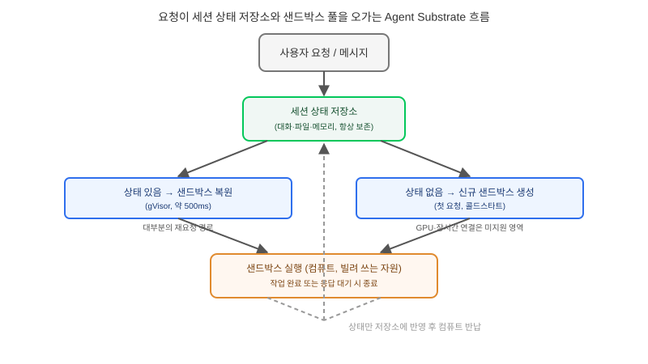

## 왜 지금 이 판단이 필요한가

"사용자가 메신저로 요청만 남기면, 그 뒤로는 에이전트가 알아서 조사하고 코드까지 짜서 돌아오게 해주세요." 상시 가동형 에이전트 자체는 더 이상 새로운 요구가 아니다. 문제는 이 요구가 "사용자 한 명"이 아니라 "동시 사용자 수백~수천 명"으로 번역되는 순간 터진다. 요청마다 컨테이너를 띄우고 계속 켜 두면 대부분의 세션이 실제로는 사용자의 다음 답장을 기다리며 유휴 상태인데도 컴퓨트 비용이 그대로 청구된다. 반대로 요청이 들어올 때만 컨테이너를 새로 띄우면, 그 세션이 쌓아 온 대화 맥락·작업 중이던 파일·중간 추론 상태를 다시 복원하는 데 시간이 걸리거나 아예 사라진다. 이게 단순한 "오토스케일링 문제"가 아닌 이유는, 세션의 정체성과 상태가 지금까지 컴퓨트(컨테이너) 안에 암묵적으로 같이 들어 있었기 때문이다.

2026년 11월 KubeCon North America에서 Google Cloud가 Agent Substrate·gVisor·OpenRL 세 프로젝트를 CNCF Sandbox에 기증하면서 이 문제를 정면으로 겨냥한 설계가 공개됐다. Agent Substrate의 핵심 주장은 단순하다 — 에이전트 세션의 "정체성과 상태"를 "그걸 실행하는 컴퓨트"에서 분리하면, 세션을 500밀리초 안에 멈췄다 복원할 수 있다는 것이다. 빌더가 답해야 할 질문은 "컨테이너를 얼마나 오래 켜 둘 것인가"가 아니라 "이 세션에서 끝까지 들고 가야 할 상태는 무엇이고, 그 상태를 컴퓨트 없이도 어디에 보관할 것인가"로 바뀐다.

## 핵심 개념 1 — 세션은 데이터, 실행은 그때그때 빌리는 자원

기존의 "상시 가동 에이전트" 설계는 세션 하나당 가상 컴퓨터(또는 컨테이너) 하나를 길게 띄워 두고, 그 안에 대화 기록·파일시스템·실행 중인 프로세스를 전부 함께 보관했다. Agent Substrate는 이 묶음을 둘로 쪼갠다. 대화 히스토리, 메모리, 파일시스템 스냅샷, 승인 대기 중인 작업 같은 "세션 상태"는 별도의 상태 저장소에 직렬화해 두고, 실제 코드 실행이 필요한 순간에만 격리된 샌드박스(gVisor 기반)를 빌려와 그 상태를 주입한다. 사용자가 응답을 기다리는 동안에는 컴퓨트를 완전히 반납하고, 다음 메시지가 오면 저장해 둔 상태로 새 샌드박스를 복원한다. 이 복원이 500ms 안에 끝난다는 것이 이 설계의 실용적 핵심이다 — 사용자 입장에서는 세션이 "계속 살아 있던 것"과 체감상 구분이 안 된다.

## 핵심 개념 2 — gVisor가 메우는 신뢰 경계

세션을 자유롭게 멈췄다 복원하려면, 애초에 여러 세션을 같은 하드웨어 위에서 안전하게 돌릴 수 있어야 한다. 에이전트가 사용자 대신 임의의 코드를 생성해 실행하는 구조에서는 이 코드를 신뢰할 수 없는 입력으로 다뤄야 하는데, Agent Substrate는 이 격리층으로 커널 시스템 콜을 가로채는 gVisor를 쓴다. 일반 VM보다 가볍게 다수의 세션을 밀집시키면서도, 한 세션의 코드가 호스트 커널이나 다른 세션의 상태를 건드리지 못하게 막는다. 다만 공개된 문서 기준으로 GPU passthrough를 지원하지 않고, 일시정지 시점에 열려 있던 소켓 연결은 끊어진다는 한계가 명시돼 있다 — 이 두 제약은 설계 초기에 반드시 확인해야 할 체크포인트다.

## 전체 시스템에서의 위치

요청이 들어와 세션이 떴다 멈췄다 복원되는 흐름을 하나의 그림으로 보면, 어디까지가 "항상 떠 있는 것"이고 어디부터가 "그때그때 빌리는 것"인지가 드러난다.

사용자 요청은 먼저 세션 상태 저장소에서 이 세션의 직렬화된 상태를 찾는다. 상태가 있으면 샌드박스 풀에서 격리된 실행 환경을 빌려와 그 상태를 주입해 복원하고, 작업이 끝나거나 사용자 응답을 기다려야 하면 다시 상태만 저장소에 남기고 샌드박스는 풀로 반납한다. 항상 떠 있는 것은 상태 저장소뿐이고, 실제로 비용이 드는 연산 자원은 요청이 있을 때만 잠깐씩 사용된다. 이 그림에서 중요한 것은 "세션 상태 저장소"가 단순 캐시가 아니라 이 아키텍처의 진짜 정체성 보관소라는 점이다 — 여기가 망가지면 복원할 세션 자체가 사라진다.

## 선택의 트레이드오프 — 상시 가동 vs 세션-컴퓨트 분리 vs 매 요청 콜드스타트

| 기준 | 상시 가동(컨테이너 유지) | Agent Substrate형 분리 | 매 요청 콜드스타트 |
|---|---|---|---|
| 유휴 시간 비용 | 높음(계속 과금) | 낮음(상태 저장 비용만) | 없음 |
| 응답 지연 | 즉시 | 약 500ms 내 복원 | 수 초~수십 초(환경 재구성) |
| 장시간 연결(스트리밍 등) | 안정적 | 일시정지 시 끊김 | 애초에 유지 어려움 |
| GPU 워크로드 | 지원 | 공개 문서 기준 미지원 | 구성에 따라 다름 |
| 적합한 워크로드 | 소수 VIP 세션, 실시간 상호작용 | 동시 세션 수가 크고 대부분 유휴인 백그라운드 에이전트 | 완전히 독립적인 단발성 작업 |

동시에 활성인 세션 수가 적고 응답성이 최우선이라면 상시 가동을 유지할 이유가 충분하다. 반대로 세션 수가 수백 단위로 늘고, 그중 대부분이 사용자 답장을 기다리며 아무 일도 안 하고 있다면, 그 유휴 시간의 비용을 어디로 돌릴지가 아키텍처의 핵심 질문이 된다. GPU 추론이나 장시간 소켓 연결이 필수인 워크로드라면 이 패턴을 지금 그대로 들여오기보다 하이브리드로 설계해야 한다.

## 실제 프로젝트 진행 순서

가장 먼저 할 일은 코드를 바꾸는 게 아니라 트래픽 패턴을 재는 것이다. 동시 활성 세션 수와 각 세션의 유휴 시간 분포를 실측해, 유휴 비용이 실제로 전체 비용의 큰 비중을 차지하는지부터 확인한다. 이 숫자 없이 분리 아키텍처를 들여오면 복잡도만 늘고 비용은 안 줄어드는 경우가 흔하다. 두 번째로, 세션마다 "끝까지 들고 가야 할 상태"와 "실행 중에만 필요한 것"을 목록으로 나눈다 — 대화 히스토리와 파일 스냅샷은 보통 전자, 떠 있는 프로세스나 열린 소켓은 후자다. 세 번째로 작은 PoC에서 실제 pause-resume 지연시간을 직접 측정한다. 공개 수치인 500ms는 Google 환경 기준이며, 자체 인프라에서는 상태 직렬화 크기에 따라 달라질 수 있다. 마지막으로 GPU나 장시간 연결이 필요한 기능이 하나라도 있다면, 그 기능만 상시 가동 풀로 분리해 두는 식으로 전면 전환이 아니라 부분 적용부터 시작하는 편이 안전하다.

## 마무리 요약

- 에이전트 세션이 수백 단위로 늘면, 문제는 "컨테이너를 얼마나 오래 켜 둘까"가 아니라 "상태와 컴퓨트를 분리할 수 있는가"로 바뀐다.
- Agent Substrate는 세션 상태를 별도 저장소에 두고 gVisor 샌드박스를 그때그때 빌려 500ms 내 복원하는 패턴을 CNCF Sandbox로 공개 표준화하는 중이다.
- GPU passthrough 미지원과 일시정지 시 소켓 끊김은 설계 초기에 반드시 확인해야 할 명시된 한계다.

## 참고 자료

- [Google Open Source Blog — Sandboxing Untrusted AI Agents at Scale](https://opensource.googleblog.com/2026/11/sandboxing-untrusted-ai-agents-at-scale.html)
- [Google Cloud — Agent Substrate, gVisor, OpenRL donated to CNCF](https://developers.googleblog.com/)
- [CNCF Sandbox Projects](https://www.cncf.io/sandbox-projects/)
