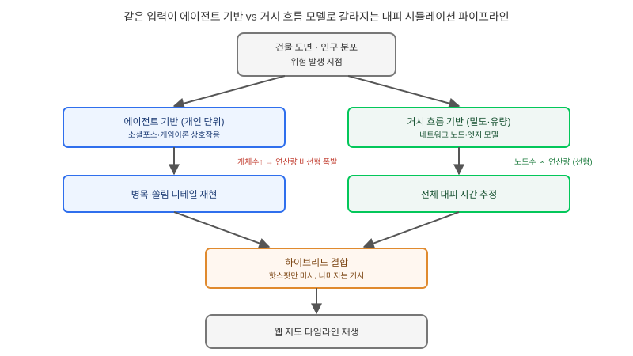

## 왜 지금 이 판단이 필요한가

"화재나 재난 상황에서 이 건물·구역의 대피 시뮬레이션 결과를 지도 위에서 재생해서 보여주세요." 겉보기에는 앞서 다룬 침수나 가스 확산 시뮬레이션과 똑같은 "시간축 시나리오를 웹 지도에 올리는" 요구처럼 보인다. 하지만 대피 시뮬레이션은 물·가스가 물리 법칙에 따라 퍼지는 것과 근본적으로 다른 문제다. 여기서 확산되는 것은 유체가 아니라 사람이고, 사람은 정해진 물리 방정식이 아니라 주변 상황을 보고 판단해서 움직인다. 출구가 막히면 다른 길을 찾고, 앞사람이 몰리면 속도를 줄이고, 때로는 비합리적으로 알고 있는 경로를 고집한다. 이 "판단"을 어느 단위로 모델링할 것인가가 대피 시뮬레이션 설계의 첫 번째 갈림길이다.

2026년 들어 이 분야에서는 두 흐름이 동시에 진행 중이다. 하나는 개별 보행자를 게임 이론적 균형(Bayesian Nash Equilibrium)으로 모델링해 병목·교차로에서의 상호작용을 정교화하는 연구이고, 다른 하나는 LLM을 개별 에이전트의 의사결정 엔진으로 넣어 "더 사람다운" 반응을 만들려는 초기 시도(2026년 EGU 학회 포스터 수준)다. 두 흐름 모두 공통적으로 가리키는 지점은 하나다 — 에이전트 수가 늘어날수록 연산 비용이 비선형으로 폭발한다는 것. 빌더가 답해야 할 질문은 "더 정교한 모델을 쓸 것인가"가 아니라 "이 요구가 개인 단위 상호작용의 디테일을 필요로 하는가, 아니면 집단의 전체 흐름만 필요로 하는가"다.

## 핵심 개념 1 — 에이전트 기반 미시 모델과 거시 흐름 모델

에이전트 기반 모델은 사람 한 명 한 명을 독립된 개체로 시뮬레이션한다. 각 개체는 주변 사람과의 거리(소셜 포스 모델), 다른 사람의 다음 수를 예측한 전략적 선택(게임 이론 모델), 혹은 더 나아가 상황을 "이해"하고 반응하는 LLM 기반 의사결정까지 다양한 방식으로 다음 행동을 결정한다. 병목 지점에서 누가 먼저 끼어드는지, 출구 두 개 중 어디로 쏠리는지 같은 개인 수준의 디테일을 재현할 수 있다는 게 강점이지만, 개체 수가 늘면 개체 간 상호작용 계산량이 빠르게 늘어난다.

거시 흐름 모델은 사람을 개별 개체가 아니라 밀도·유량으로 다루는 셀룰러 오토마타나 네트워크 흐름 모델에 가깝다. 건물 평면을 그래프의 노드·엣지로 바꾸고, 각 통로의 폭과 용량에 따라 사람들의 "흐름"이 어떻게 분산되는지 계산한다. 개인의 비합리적 선택은 재현하지 못하지만, 수만 명 규모의 지역 전체 대피 시간을 빠르게 추정하는 데는 이쪽이 압도적으로 유리하다.

## 핵심 개념 2 — 같은 축 안에서도 "무엇을 검증하려는가"가 모델을 가른다

이 선택은 "어느 모델이 더 정확한가"의 문제가 아니라 "이 요구가 어떤 질문에 답해야 하는가"의 문제다. "이 비상구 폭을 1.2m에서 1.8m로 넓히면 병목이 풀릴까" 같은 설계 검증 질문은 개인 간 상호작용을 재현하지 못하면 애초에 답할 수 없으므로 에이전트 기반이 필요하다. 반면 "이 지역 전체가 완전히 비는 데 몇 분이 걸릴까" 같은 전체 규모 추정 질문은 거시 흐름 모델로 충분하고, 오히려 에이전트 기반으로 도시 전체를 돌리려다 연산이 멈추는 실패를 피할 수 있다. LLM 기반 의사결정 에이전트는 아직 학회 포스터 수준의 초기 연구이므로, 지금 시점에 프로덕션 대피 시뮬레이션에 그대로 들여오는 것은 시기상조로 봐야 한다.

## 전체 시스템에서의 위치

건물 도면과 인구 분포가 입력되어 시뮬레이션 엔진을 거쳐 웹 지도의 타임라인 재생까지 가는 경로를 보면, 모델 선택이 그 뒤 파이프라인 전체의 비용 구조를 바꾼다는 게 드러난다.

같은 입력(건물 도면, 인구 분포, 위험 발생 지점)에서 출발해도, 에이전트 기반 경로는 개체 수 제곱에 가깝게 연산량이 늘어 "도면 하나는 빠른데 지역 전체로 넓히면 멈춘다"는 패턴에 취약하다. 거시 흐름 모델 경로는 노드·엣지 수에 선형에 가깝게 늘어 스케일에 강하지만, 출력이 "구간별 밀도·소요 시간" 수준이라 병목에서 실제로 무슨 일이 벌어지는지는 보여주지 못한다. 두 경로를 하나로 합치는 현실적인 답은, 설계 검증이 필요한 병목 구간만 에이전트 기반으로 떼어 돌리고 나머지 전체는 거시 모델로 덮는 하이브리드 구조다.

## 선택의 트레이드오프 — 에이전트 기반 vs 거시 흐름 기반

| 기준 | 에이전트 기반(미시) | 거시 흐름 기반 |
|---|---|---|
| 재현 가능한 디테일 | 개인 간 상호작용, 병목 쏠림 | 구간별 밀도·흐름량 |
| 연산 비용 확장성 | 개체 수 증가에 비선형으로 악화 | 노드·엣지 수에 선형에 가까움 |
| 적합한 질문 | "이 출구 폭이면 병목이 풀리는가" | "전체가 비는 데 몇 분 걸리는가" |
| 필요 입력 데이터 | 개인별 이동 속도·성향 가정 | 통로 폭·용량·네트워크 구조 |
| 도시 단위 확장 | 핫스팟만 분리하지 않으면 어려움 | 비교적 수월 |

시설 하나의 비상구 설계를 검증하는 단계라면 에이전트 기반을 고르지 않을 이유가 없다. 반대로 행정 단위의 대피 계획처럼 범위가 넓고 "대략 몇 분 안에 끝나는가"가 핵심 질문이라면 거시 모델이 먼저다. 두 질문이 하나의 프로젝트 안에 섞여 있는 경우가 실무에서는 더 흔하고, 그럴 때는 처음부터 하이브리드를 전제로 설계하는 편이 나중에 모델을 통째로 바꾸는 것보다 싸게 먹힌다.

## 실제 프로젝트 진행 순서

가장 먼저 할 일은 모델을 고르기 전에 "이 시뮬레이션으로 답해야 할 질문이 정확히 무엇인가"를 발주자와 문서로 확정하는 것이다. 이 질문이 흐릿하면 중간에 모델을 바꿔야 하는 가장 비싼 실수로 이어진다. 두 번째로 작은 범위(건물 한 층, 블록 하나)에서 PoC를 돌려 연산 시간과 결과물의 시각적 설득력을 함께 확인한다. 세 번째로 범위를 확장할 계획이 있다면 이 시점에 반드시 하이브리드 경계(어디까지 미시, 어디부터 거시)를 미리 설계해 둔다. 마지막으로 결과를 웹 지도에 얹을 때는 기존 시간축 재생 파이프라인(사전 렌더링·벡터 타임슬라이스)을 그대로 재사용할 수 있는지 먼저 확인하고, 새로 만들기 전에 기존 인프라를 점검한다.

## 마무리 요약

- 대피 시뮬레이션은 침수·가스 확산과 달리 "사람의 판단"을 모델링해야 하는 문제라 선택 축 자체가 다르다.
- 에이전트 기반(미시)과 거시 흐름 모델은 "무엇을 검증하려는가"로 갈리며, 둘을 섞는 하이브리드가 현실적인 기본값이다.
- LLM 기반 의사결정 에이전트는 아직 연구 초기 단계이므로 프로덕션 도입은 시기상조다.

## 참고 자료

- [CrowdEgress: A Multi-Agent Simulation Platform for Pedestrian Crowd Evacuation (arXiv)](https://arxiv.org/abs/2406.08190)
- [Agent-Based Simulation of Crowd Evacuation Through Complex Spaces](https://www.iieta.org/node/16298)
- [Simulation Modelling Practice and Theory — Pedestrian Simulation Special Issue](https://boa.unimib.it/retrieve/e00fb7af-7786-4812-8732-76513cefe5ba/Serrano%20et%20al-2026-Simulation%20Modelling%20Practice%20and%20Theory-VoR.pdf)
