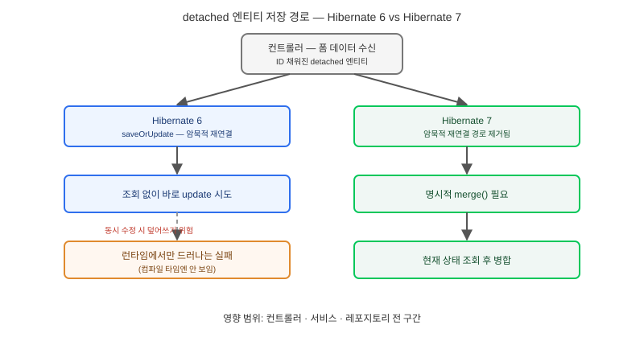

## 왜 지금 이 판단이 필요한가

"Spring Boot 4로 올리는 김에 Hibernate도 최신 버전으로 맞춰주세요." 이 요구는 의존성 버전 하나를 올리는 단순 작업처럼 들리지만, Hibernate 7은 Jakarta Persistence 3.2 베이스라인 위에서 오래된 암묵적 동작 몇 가지를 의도적으로 제거한 메이저 버전이다. 그중 가장 조용히, 그러나 가장 넓게 영향을 주는 변경은 **detached 상태의 엔티티를 영속성 컨텍스트에 암묵적으로 재연결하는 동작의 제거**다. 폼에서 받은 데이터를 엔티티에 채우고 그대로 저장소에 넘겨 저장하는 패턴은 Hibernate 레거시 API(`saveOrUpdate` 계열)에 기대어 수년간 당연하게 동작해 왔는데, 이 가정이 Hibernate 7에서는 더 이상 성립하지 않는다.

문제는 이 변경이 컴파일 타임에 드러나지 않는다는 점이다. 코드는 그대로 빌드되고, 로컬 테스트에서는 조회 흐름이 단순해서 우연히 통과하다가, 운영 환경에서 특정 업데이트 경로를 탈 때만 `IllegalStateException`이나 예상과 다른 insert/update가 발생한다. 빌더가 답해야 할 질문은 "Hibernate 버전을 올릴 것인가"가 아니라 "우리 코드베이스 어디에서 detached 엔티티를 암묵적으로 재연결에 의존하고 있는가"다.

## 핵심 개념 1 — Detached 재연결이 왜 암묵적 위험이었는가

영속성 컨텍스트(1차 캐시)는 하나의 세션 안에서 엔티티의 상태 변화를 추적해 트랜잭션 커밋 시점에 변경분만 반영한다. 세션이 닫히면 그 안의 엔티티는 "detached" 상태가 되어 더 이상 추적되지 않는다. 레거시 Hibernate API는 이 detached 엔티티를 다시 세션에 밀어 넣어 "마치 계속 추적되고 있던 것처럼" 처리하는 재연결을 허용했는데, 이 동작은 두 세션 사이에 그 엔티티가 실제로 변경되지 않았다는 가정에 암묵적으로 기대고 있었다. 동시에 다른 트랜잭션이 같은 행을 수정했다면, 재연결은 그 변경을 덮어쓰는 방식으로 조용히 데이터를 잃게 만들 수 있다. Hibernate 7은 JPA 표준이 정의한 `merge()` 경로만 공식 지원하도록 좁히면서, 이 암묵적 위험을 "명시적으로 병합 전략을 선택하라"는 요구로 바꿨다.

## 핵심 개념 2 — 레거시 어노테이션 제거와 JPA 3.2 네임 충돌

같은 맥락에서 Hibernate 전용 `@Where`, `@OrderBy`, `@ForeignKey`, `@Index` 어노테이션이 제거되고 각각 `@SQLRestriction`, `@SQLOrder`와 JPA 표준 대응 어노테이션으로 대체됐다. `@Cascade`와 `CascadeType`도 deprecated 처리됐다. 여기에 더해 Jakarta Persistence 3.2가 새로 도입한 `Nulls`·`SchemaManager` 같은 타입이 기존 Hibernate 고유 타입(`NullPrecedence` 등)과 이름이 겹치면서 import 충돌이 발생하는 경우도 공식 마이그레이션 가이드에 명시돼 있다. 하나하나는 사소해 보이지만, 레거시 어노테이션을 광범위하게 쓴 코드베이스라면 전수 치환 작업 자체가 작지 않은 공수다.

## 전체 시스템에서의 위치

폼 데이터가 엔티티로 바뀌어 저장되기까지의 경로에서, Hibernate 6와 7이 어디서 갈라지는지 보면 영향 범위가 드러난다.

컨트롤러가 폼 데이터를 받아 ID가 채워진 detached 엔티티를 만드는 지점까지는 두 버전이 동일하다. 여기서 Hibernate 6까지는 이 엔티티를 그대로 레거시 API에 넘기면 내부적으로 조회 후 병합이 암묵적으로 일어났지만, Hibernate 7부터는 이 경로가 사라지고 개발자가 `merge()`를 명시적으로 호출하거나, 애초에 영속 상태의 엔티티만 다루는 서비스 레이어 패턴으로 바꿔야 한다. 이 그림에서 중요한 것은 영향받는 지점이 "레이어 하나"가 아니라 컨트롤러·서비스·레포지토리 전 구간에 흩어져 있다는 사실이다 — 그래서 버전 업그레이드가 아니라 마이그레이션 프로젝트로 다뤄야 한다.

## 선택의 트레이드오프 — Hibernate 6 유지 vs Hibernate 7 전환

| 기준 | Hibernate 6 유지 | Hibernate 7 전환 |
|---|---|---|
| 기존 코드 호환성 | 높음(현행 패턴 그대로 동작) | detached 재연결 패턴 전수 수정 필요 |
| JPA 3.2 신규 기능 | 미지원 | `SchemaManager` 등 표준 기능 사용 가능 |
| Spring Boot 4 정합성 | 과거 호환 모드로만 가능 | 공식 베이스라인과 일치 |
| 장기 지원 | 종료 시점이 다가옴 | 신규 패치·보안 업데이트 대상 |
| 전환 비용 | 없음(당장은) | 레거시 어노테이션·재연결 패턴 전수 치환 |

당장 안정성이 최우선이고 전환 인력을 투입하기 어렵다면 Hibernate 6을 당분간 유지하는 것도 합리적인 선택이다. 다만 Spring Boot 4 생태계가 Hibernate 7을 기본 베이스라인으로 삼고 있어, 유지 기간이 길어질수록 다른 라이브러리와의 호환성 문제가 누적된다. 전환하기로 했다면 "버전 번호만 올리고 나머지는 나중에"가 아니라, 재연결 패턴 치환을 전환 작업의 본체로 보고 일정에 반영해야 한다.

## 실제 프로젝트 진행 순서

가장 먼저 할 일은 코드베이스에서 `saveOrUpdate`, `update()` 호출부와 "폼에서 받은 ID 있는 객체를 그대로 저장소에 넘기는" 서비스 메서드를 전수 검색하는 것이다. 이 목록이 이번 마이그레이션의 실제 작업 범위다. 두 번째로 제거된 레거시 어노테이션(`@Where`, `@OrderBy`, `@ForeignKey`, `@Index`, `@Cascade`) 사용처를 별도로 찾아 JPA 3.2 표준 대응으로 치환한다. 세 번째로, 이 둘을 한 번에 바꾸지 말고 먼저 Hibernate 6의 최신 마이너 버전에서 deprecated 경고를 전부 확인해 "7에서 무엇이 깨질지"를 사전에 드러낸 다음 전환하는 편이 안전하다. 마지막으로, 재연결 패턴이 몰려 있던 서비스 메서드는 단위 테스트로 커버된 상태에서만 전환하고, 테스트가 없는 영역이라면 전환 전에 테스트부터 추가하는 순서를 지킨다.

## 마무리 요약

- Hibernate 7은 detached 엔티티의 암묵적 재연결을 제거해, 오래 써 온 폼 저장 패턴이 런타임에만 조용히 깨질 수 있다.
- `@Where`·`@OrderBy` 등 레거시 어노테이션 제거와 JPA 3.2 타입 네임 충돌도 전수 점검 대상이다.
- 버전 업그레이드가 아니라 마이그레이션 프로젝트로 보고, 재연결 패턴 전수 검색을 작업 범위의 중심에 둬야 한다.

## 참고 자료

- [Hibernate ORM 7.0 Migration Guide](https://docs.hibernate.org/orm/7.0/migration-guide/)
- [Hibernate ORM 7.0 What's New](https://docs.hibernate.org/orm/7.0/whats-new/)
- [in.relation.to — Hibernate ORM Seven](https://in.relation.to/2025/05/20/hibernate-orm-seven/)
