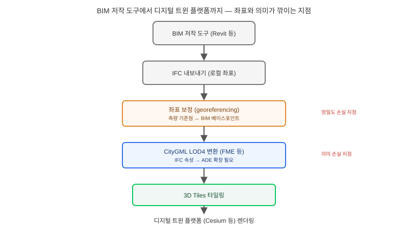

## 왜 지금 이 판단이 필요한가

"건축사무소에서 설계 단계에 쓰던 BIM 모델이 있는데, 이걸 그대로 우리 도시 디지털 트윈 지도 위에 얹어주세요." 이 요구를 받으면 흔히 "IFC 파일을 3D Tiles로 변환하는 컨버터 하나 돌리면 되는 일"로 축소해 버리기 쉽다. 하지만 BIM과 GIS는 애초에 "원점"을 다르게 정의하는 두 세계다. BIM 모델은 건물 설계 기준점을 (0, 0, 0)으로 두는 로컬 좌표계에서 밀리미터 단위 정밀도로 그려지고, GIS 디지털 트윈은 전지구 좌표계(EPSG:4326 등) 위에서 미터 단위로 동작한다. 이 둘을 붙이는 georeferencing 작업 자체가 이번 요구의 진짜 난이도가 숨어 있는 지점이다.

2025~2026년 발표된 연구들은 이 지점을 거듭 지적한다. ISPRS 저널의 한 연구는 IFC·CityGML 양쪽에 커스텀 좌표참조계를 할당해 위치 정확도를 끌어올리는 방법론을 제안했고, 같은 시기의 또 다른 연구는 IFC 4.3과 CityGML 3.0이 둘 다 도로·인프라 요소에 대한 네이티브 지원을 추가했음에도 "두 표준 사이의 매핑은 여전히 의미론적으로 깨지기 쉽다"고 명시한다. 빌더가 답해야 할 질문은 "변환 도구를 어떤 걸 쓸 것인가"가 아니라 "이 변환 체인의 어느 단계에서 좌표 정밀도와 BIM 속성 정보가 사라지는가, 그리고 그게 우리 프로젝트에 허용 가능한가"다.

## 핵심 개념 1 — 로컬 좌표와 지구 좌표 사이의 georeferencing

BIM 저작 도구(Revit 등)에서 건물은 프로젝트 베이스 포인트를 기준으로 한 로컬 좌표계에서 설계된다. 이 모델을 지도 위에 올리려면 이 로컬 원점이 지구 좌표계 상의 정확히 어느 지점·고도·회전각에 대응하는지를 측량 기준점과 맞춰야 하는데, 이 보정값이 조금만 어긋나도 건물 전체가 도로 위에 떠 있거나 옆 건물과 겹치는 형태로 나타난다. 문제는 이 보정이 변환 도구가 자동으로 해주는 일이 아니라, 실제 측량 데이터와 BIM 모델의 기준점을 수작업으로 대조해야 하는 단계라는 점이다. 앞서 언급한 ISPRS 연구가 "커스텀 CRS 할당"을 따로 제안하는 이유도, 기본 변환 경로만으로는 이 정밀도가 보장되지 않기 때문이다.

## 핵심 개념 2 — IFC → CityGML → 3D Tiles에서 의미가 뭉개지는 지점

좌표가 맞았다고 끝이 아니다. IFC는 벽·창·배관 같은 건축 요소를 상세한 속성과 관계로 표현하는 반면, CityGML은 도시 스케일에서 건물을 LOD(상세도) 단계로 단순화해 표현하도록 설계됐다. 실무에서 가장 흔한 경로는 FME 같은 ETL 도구로 IFC를 CityGML LOD4로 변환한 뒤, 이를 다시 3D Tiles로 타일링해 Cesium 같은 플랫폼에 올리는 2단 변환이다. 이 과정에서 IFC가 가진 "이 배관의 유지보수 이력", "이 벽의 내화 등급" 같은 속성 정보는 CityGML의 LOD 체계가 애초에 수용하도록 설계되지 않은 정보라 변환 과정에서 누락되거나 별도 확장(ADE)으로 끼워 넣어야 한다. "그대로 올려주세요"라는 요구에 이미 어떤 속성까지 "그대로"인지가 빠져 있다는 뜻이다.

## 전체 시스템에서의 위치

BIM 저작 도구에서 지도 렌더링까지, 좌표 보정과 의미 변환이 각각 어느 단계에서 일어나는지 보면 병목이 어디인지 드러난다.

IFC 내보내기 직후의 좌표 보정 단계에서는 정밀도가, CityGML 변환 단계에서는 속성 정보가 각각 다른 이유로 깎여 나간다. 두 손실이 서로 독립적이라는 점이 중요하다 — 좌표를 완벽하게 맞춰도 속성은 그대로 사라질 수 있고, 반대로 속성 매핑에 공들여도 좌표가 어긋나 있으면 지도 위에서 건물이 엉뚱한 자리에 뜬다. 그래서 이 파이프라인을 검수할 때는 "지도에 제대로 뜨는가"와 "필요한 속성이 다 살아 있는가"를 반드시 따로 확인해야 한다.

## 선택의 트레이드오프 — 직접 변환 vs CityGML 경유

| 기준 | IFC → 3D Tiles 직접 변환 | IFC → CityGML LOD4 → 3D Tiles |
|---|---|---|
| 변환 속도·비용 | 빠르고 단순 | ETL 도구·중간 단계 필요, 비용 높음 |
| 기하 정밀도 | 원본에 가까움 | LOD 단순화로 디테일 손실 가능 |
| 도시 스케일 상호운용성 | 낮음(타 CityGML 기반 트윈과 결합 어려움) | 높음(표준 LOD 체계로 타 데이터와 결합) |
| 속성·의미 정보 보존 | 변환기 구현에 따라 제각각 | ADE 확장으로 일부 보존 가능하나 수작업 필요 |
| 적합한 상황 | 단일 건물 시각화, 빠른 PoC | 도시 단위 디지털 트윈, 타 기관 데이터와 통합 |

단일 건물을 빠르게 지도 위에 띄워 보는 PoC 단계라면 직접 변환이 공수 대비 합리적이다. 반대로 여러 건물·여러 기관의 데이터를 하나의 도시 디지털 트윈으로 묶어야 한다면, 당장 번거롭더라도 CityGML을 경유하는 경로가 나중에 다른 데이터와 결합할 때의 비용을 줄여 준다.

## 실제 프로젝트 진행 순서

가장 먼저 할 일은 변환 도구를 고르는 게 아니라, 측량 기준점과 BIM 프로젝트 베이스 포인트가 일치하는지부터 확인하는 것이다. 이 기준점이 틀어져 있으면 뒤의 모든 단계가 의미 없어진다. 두 번째로 건물 한 동만 골라 전체 변환 체인(좌표 보정 → CityGML 변환 → 3D Tiles 타일링 → 렌더링)을 끝까지 돌려 보는 작은 PoC를 수행한다. 세 번째로 이 PoC 단계에서 반드시 발주자와 "지도에서 필요한 BIM 속성이 정확히 무엇인가"를 합의해 둔다 — 이 목록이 ADE 확장 설계의 범위를 결정한다. 마지막으로 전체 단지나 지역으로 확장하기 전에, 몇 개 건물을 실측 좌표와 대조해 georeferencing 정밀도가 허용 오차 안에 있는지 반드시 재검증한다.

## 마무리 요약

- BIM의 로컬 좌표계와 GIS의 지구 좌표계를 맞추는 georeferencing은 변환 도구가 자동으로 해결해 주지 않는, 별도로 검증해야 할 단계다.
- IFC → CityGML → 3D Tiles 변환 체인에서는 좌표 정밀도와 BIM 속성 정보가 서로 다른 단계에서 독립적으로 손실된다.
- 단일 건물 PoC와 도시 단위 통합은 요구하는 정밀도와 상호운용성 수준이 달라 변환 경로 선택이 갈린다.

## 참고 자료

- [Evaluating and Enhancing Georeferencing Accuracy in BIM and 3D GIS Models for Built Environment Digital Twins (ISPRS Annals, 2025)](https://doaj.org/article/a121b7c8a9164b28846b86fead1fe58a)
- [ISPRS Archives — IFC 4.3 · CityGML 3.0 Road Modelling Interoperability (2025)](https://isprs-archives.copernicus.org/articles/XLVIII-4-W15-2025/63/2025/isprs-archives-XLVIII-4-W15-2025-63-2025.pdf)
