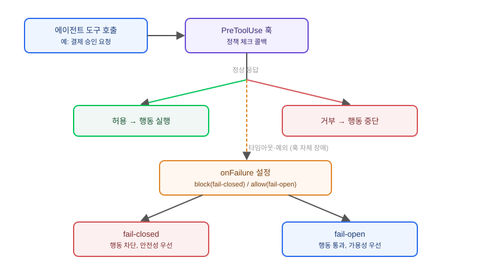

## 왜 지금 이 판단이 필요한가

"에이전트가 결제를 승인하기 전에 사기 탐지 체크를 반드시 거치게 해주세요." 이런 요구를 받으면 보통은 PreToolUse 훅 하나를 달아 끝냈다고 생각한다. 외부 정책 서버에 질의해서 승인 여부를 받아오는 훅 콜백을 붙이고, 통과하면 에이전트가 결제 도구를 호출하게 둔다. 그런데 여기서 빠뜨리기 쉬운 질문이 하나 있다 — 그 정책 서버가 타임아웃되거나, 훅 콜백 코드 자체에 예외가 터지면 에이전트는 어떻게 해야 하는가. 체크를 통과한 것으로 치고 그냥 진행시킬 것인가, 아니면 체크가 안 됐으니 일단 막을 것인가.

2026년 11월 3일 전후 배포된 Claude Code 2.1.317은 이 질문에 직접 답을 주는 변화를 담았다. 커맨드·HTTP 훅에만 있던 `onFailure: "block"` 옵션이 Agent SDK의 훅 콜백에도 확장됐다 — 즉 커스텀 검증 코드가 크래시하거나 잘못된 출력을 반환했을 때, 그 훅이 지키던 행동 자체를 막을지 말지를 명시적으로 고를 수 있게 됐다. 겉보기엔 설정 필드 하나지만, 실제로는 "가드레일이 고장 났을 때 시스템이 어느 쪽으로 넘어갈 것인가"라는, 오래전부터 보안·안전 공학에서 다뤄온 **페일오픈(fail-open) vs 페일클로즈드(fail-closed)** 판단을 에이전트 자동화에 그대로 가져온 것이다. 빌더 입장에서 중요한 건 이 필드가 생겼다는 사실이 아니라, 우리 시스템의 어떤 훅에 어느 쪽을 적용해야 하는지 스스로 판단할 기준이다.

## 왜 훅은 조용히 죽을 수 있는가

훅 콜백이 실패하는 경로는 생각보다 다양하다. 외부 정책 서버나 모더레이션 API에 네트워크 호출을 거는 훅이라면 그 서버의 순간 장애나 타임아웃이 곧 훅의 실패다. 자체 로직만으로 판단하는 훅이라도 입력 스키마가 예상과 달라지면 파싱 단계에서 예외가 난다. 더 까다로운 경우는 훅이 "실패"가 아니라 "애매한 응답"을 돌려줄 때다 — 타임아웃으로 빈 응답이 온 것과 정책상 명백히 거부된 것을 같은 코드 경로로 처리하면, 장애 상황에서 거부된 요청과 똑같이 취급돼 버린다. 이 세 가지 실패 경로를 구분하지 않고 "훅이 실패하면 무조건 A로 처리" 식으로 한 줄 설정만 두면, 실제 장애가 났을 때 어느 쪽으로 넘어가는지 아무도 설명하지 못하는 블랙박스가 된다.

## 전체 시스템에서의 위치

훅은 에이전트의 도구 호출 경로 한가운데 끼어드는 체크포인트다. 이 체크포인트의 실패 처리 방식이 그 뒤에 오는 실제 행동(결제·배포·데이터 삭제 같은)의 운명을 가른다.



그림에서 보듯 훅의 정상 판정(허용/거부)과 훅의 장애 상태는 서로 다른 분기다. 많은 팀이 전자만 설계하고 후자는 기본값에 맡겨 버리는데, 바로 그 기본값이 사고의 원인이 된다. 결제·배포처럼 되돌리기 어려운 행동일수록 이 장애 분기를 명시적으로 그려 둬야 한다.

## fail-open vs fail-closed — 훅 종류별 선택 기준

| 기준 | fail-open (훅 실패 시 통과) | fail-closed (훅 실패 시 차단) |
|---|---|---|
| 가용성 영향 | 낮음 — 정책 서버 장애가 서비스 중단으로 안 번짐 | 높음 — 훅이 죽으면 그 행동 전체가 멈춤 |
| 안전성 영향 | 높음 — 장애 중에는 검증 없이 행동이 통과됨 | 낮음 — 미검증 행동이 절대 나가지 않음 |
| 적합한 훅 예 | 추천 품질 체크, 로깅용 모니터링 훅 | 결제 승인, 프로덕션 배포 승인, PII 마스킹 |
| 장애 시 노출 리스크 | 검증 누락 상태로 계속 운영됨 | 기능 정지로 즉시 눈에 띔 |
| 운영 부담 | 낮음 (조용히 넘어감) | 높음 (온콜 알림·수동 개입 필요) |

이 표에서 핵심은 "어느 쪽이 더 안전한가"가 아니라 **"이 훅이 지키는 행동이 되돌릴 수 있는가"**다. 추천 랭킹을 조정하는 훅이 죽어서 통과돼도 피해는 품질 저하 수준이지만, 결제 승인이나 프로덕션 리소스 삭제를 지키는 훅이 fail-open으로 설정돼 있으면 장애 상황에서 검증 없는 행동이 그대로 실행된다. 반대로 사용자 응답 속도가 핵심인 저위험 기능에 fail-closed를 걸면, 정책 서버가 잠깐 느려질 때마다 전체 기능이 멈추는 과잉 방어가 된다.

## 실제 프로젝트 진행 순서

가장 먼저 할 일은 설정값을 정하는 게 아니라, 지금 운영 중인 훅들을 "이 훅이 지키는 행동이 되돌릴 수 있는가"라는 질문으로 분류하는 것이다. 되돌릴 수 없는 행동(결제, 외부 발송, 인프라 변경)을 지키는 훅부터 fail-closed로 명시하고, 나머지 저위험 훅은 fail-open으로 둬도 된다고 합의한다. 두 번째로 중요한 건 fail-closed로 막았을 때의 사용자 경험이다 — 그냥 에러를 던질 것인지, 재시도 큐에 넣을 것인지, 사람 승인으로 넘길 것인지까지 미리 설계해야 "막혔다"가 곧 "서비스 중단"이 되지 않는다.

```typescript
// Agent SDK 훅 콜백 등록 예시 — 되돌릴 수 없는 행동은 명시적으로 fail-closed
sdk.registerHook({
  event: "PreToolUse",
  tool: "process_payment",
  onFailure: "block", // 정책 체크가 죽으면 결제 도구 호출 자체를 막는다
  callback: async (input) => checkFraudPolicy(input),
});
```

세 번째로는 훅 실패 자체를 모니터링 대상으로 올려야 한다. 훅이 fail-closed로 막은 횟수와 fail-open으로 통과시킨 횟수를 별도 지표로 쌓지 않으면, 정책 서버 장애가 얼마나 자주 보안 구멍을 열었는지조차 나중에 알 수 없다. 마지막으로 이 분류와 설정을 점진적으로 적용한다 — 전사 훅을 한 번에 바꾸지 말고, 영향이 가장 큰 결제·배포 훅부터 먼저 fail-closed로 전환하며 알림 체계가 실제로 작동하는지 확인한 뒤 나머지로 넓혀 간다.

## 마무리 요약

- 훅의 "정상 판정(허용/거부)"과 "훅 자체의 장애"는 서로 다른 분기이며, 둘 다 설계해야 한다.
- fail-open과 fail-closed의 선택 기준은 가용성과 안전성 중 무엇이 중요하냐가 아니라, 그 훅이 지키는 행동을 되돌릴 수 있는가다.
- 되돌릴 수 없는 행동부터 fail-closed로 명시하고, 훅 실패율을 별도 지표로 모니터링하며 점진적으로 전환한다.

## 참고 자료

- [Claude Agent SDK — Hooks](https://platform.claude.com/docs/en/agent-sdk/hooks)
- [Claude Code 변경 로그](https://code.claude.com/docs/en/whats-new)
