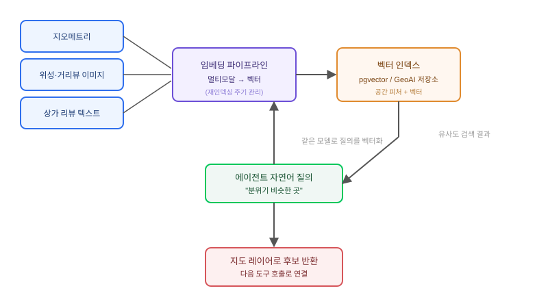

## 왜 지금 이 판단이 필요한가

"신규 매장 입지를 고를 때, 지금 잘되는 이 상권이랑 분위기가 비슷한 다른 지역을 찾아주세요." 이런 요구를 받으면 전통적인 GIS 접근은 반경 검색이나 속성 필터로 시작한다. 유동인구 몇 명 이상, 특정 업종 밀집도 몇 퍼센트 이상 같은 숫자 조건을 걸고 공간 쿼리를 돌리는 식이다. 문제는 "분위기가 비슷하다"는 말이 숫자 몇 개로 환원되지 않는다는 데 있다. 상가 간판의 느낌, 유동인구의 시간대별 패턴, 주변 건물의 용도 혼합 같은 것들이 뒤섞인 직관을 속성 필터 몇 개로 쪼개려다 보면 늘 뭔가가 빠진다.

2026년 들어 GIS 벤더들이 공통으로 밀고 있는 답은 **공간 피처·위성 이미지·텍스트 설명을 같은 벡터 공간에 임베딩해서, "유사함"을 거리 계산으로 바꾸는 것**이다. Esri가 ArcGIS Pro 3.7에 들여온 GeoAI 임베딩 툴셋은 이미지·피처·텍스트에 대한 벡터를 생성해 ArcGIS 안에 저장하고, 이걸 다운스트림 에이전트가 바로 검색에 쓸 수 있게 한다. 빌더 입장에서 중요한 건 "임베딩이 생겼다"는 사실이 아니라, 이 벤더 기능을 그대로 쓸지, 아니면 PostGIS+pgvector 위에 직접 쌓을지, 그리고 그 결정이 데이터 주권과 갱신 비용에 어떤 대가를 요구하는지다.

## 이 요구가 번역되는 기술 문제

"분위기가 비슷한 곳"이라는 모호한 요구는 실제로 세 가지 결정으로 번역된다. 첫째, 무엇을 벡터화할 것인가 — 지오메트리(폴리곤 형태, POI 밀집 패턴), 이미지(위성·거리뷰), 텍스트(상가 리뷰·업종 설명) 중 어느 조합을 쓸지다. 둘째, 그 벡터들을 하나의 공간에 합칠지 각각 따로 검색하고 점수를 합산할지다. 셋째, 에이전트가 이 검색 결과를 "지도 위 몇 개 후보"로 받아 다음 행동(상세 리포트 생성, 다른 도구 호출)으로 이어갈 수 있게 인터페이스를 어떻게 노출할지다. 이 세 결정을 건너뛰고 임베딩 모델부터 고르면, 나중에 "텍스트 리뷰는 반영되는데 왜 상가 형태는 반영이 안 되냐"는 질문에 답을 못 하게 된다.

## 전체 시스템에서의 위치

공간 의미 검색은 기존 공간 쿼리 파이프라인 옆에 새로운 인덱스 계층을 하나 더 얹는 구조다. 원본 공간 데이터는 그대로 두고, 그 데이터를 벡터로 변환해 별도 인덱스에 쌓은 뒤 에이전트가 그 인덱스만 조회한다.



이 구조에서 핵심 경계는 두 군데다. 첫째, 원본 데이터와 벡터 인덱스 사이에 **재인덱싱 파이프라인**이 있어야 한다. 상가가 폐업하거나 새로 생길 때마다 벡터를 다시 계산하지 않으면 검색 결과가 과거 상권 모습을 보여주는 사고가 난다. 둘째, 에이전트의 자연어 질의도 같은 임베딩 모델로 벡터화돼야 하는데, 이 모델이 공간 피처를 임베딩한 모델과 다르면 애초에 같은 벡터 공간에 놓이지 않아 유사도 계산 자체가 무의미해진다.

## 벤더 임베딩 vs 자체 구축 — 선택 기준

| 기준 | ArcGIS GeoAI 임베딩 (벤더) | PostGIS + pgvector 자체 구축 |
|---|---|---|
| 초기 구축 속도 | 빠름 — 기존 ArcGIS 데이터에 바로 적용 | 느림 — 임베딩 모델·파이프라인 직접 구성 |
| 데이터 주권 | 벤더 플랫폼 내부 처리 | 완전히 자체 인프라 내부 |
| 임베딩 모델 선택권 | 제한적 — 벤더가 제공하는 모델 범위 | 자유 — 도메인 특화 모델 교체 가능 |
| 멀티모달 결합(이미지+텍스트+지오메트리) | 플랫폼이 통합 제공 | 각 모달별 파이프라인을 직접 설계 |
| 적합한 조직 | 이미 ArcGIS 생태계에 데이터가 있는 팀 | PostGIS 중심이거나 모델 커스터마이징이 필요한 팀 |
| 비용 구조 | 라이선스·사용량 기반 | 인프라 운영비 + 개발 리소스 |

표에서 가장 중요한 축은 "지금 공간 데이터가 어디에 있는가"다. 이미 ArcGIS Online이나 Enterprise에 데이터가 쌓여 있는 조직이라면 GeoAI 툴셋을 그대로 쓰는 쪽이 재구축 비용을 아낀다. 반대로 PostGIS 중심 스택이거나, 상가 리뷰 같은 도메인 특화 텍스트에 범용 임베딩 모델이 잘 안 맞는 경우라면 pgvector 위에 직접 쌓는 편이 장기적으로 유리하다. 데이터 주권이 중요한 공공·지자체 프로젝트도 자체 구축 쪽으로 기운다.

## 실제 프로젝트 진행 순서

가장 먼저 할 일은 임베딩 모델을 고르는 게 아니라, "비슷함"을 판단할 때 실제로 어떤 모달이 가장 중요한지 현업 담당자와 합의하는 것이다. 상권 분석이라면 유동인구 패턴과 업종 혼합이 텍스트 리뷰보다 중요할 수 있고, 반대로 관광지 추천이라면 이미지와 텍스트가 더 결정적일 수 있다. 이 우선순위 없이 모든 모달을 균등하게 섞으면 어느 쪽 신호도 뚜렷하게 반영되지 않는 희석된 결과가 나온다.

```sql
-- PostGIS + pgvector: 상권 피처 테이블에 임베딩 컬럼을 추가하고 유사도 검색
SELECT id, name,
       ST_AsGeoJSON(geom) AS geometry,
       1 - (embedding <=> query_embedding) AS similarity
FROM commercial_districts
ORDER BY embedding <=> query_embedding
LIMIT 10;
```

두 번째로 막히는 지점은 재인덱싱 주기다. "실시간으로 반영해주세요"라는 말을 그대로 받아들이기 전에, 원본 데이터 갱신 빈도(상가 데이터는 보통 일 단위)와 임베딩 재계산 비용(이미지 임베딩은 텍스트보다 훨씬 비싸다)을 먼저 맞춰 봐야 한다. 세 번째로는 작은 지역 하나만 골라 PoC를 돌리고, 현업 담당자가 결과를 보고 "이게 진짜 비슷한 곳이 맞다"고 확인하는 검증 루프를 거친 뒤에야 전국 단위로 확장한다. 이 검증 없이 확장하면 벡터 거리상으로는 가깝지만 실무적으로는 전혀 엉뚱한 지역이 섞여 나오는 문제를 뒤늦게 발견하게 된다.

## 마무리 요약

- "분위기가 비슷한 곳"처럼 속성 필터로 환원 안 되는 요구는 지오메트리·이미지·텍스트를 같은 벡터 공간에 임베딩하는 의미 검색으로 번역된다.
- 벤더 임베딩(ArcGIS GeoAI)과 자체 구축(PostGIS+pgvector)의 선택 기준은 모델 성능보다 데이터가 이미 어디 있는가와 데이터 주권 요구다.
- 재인덱싱 파이프라인과 질의-인덱스 임베딩 모델 일치 여부를 먼저 설계하지 않으면, 검색 결과가 과거 상권을 보여주거나 애초에 무의미한 유사도를 계산하게 된다.

## 참고 자료

- [Esri — ArcGIS Pro 3.7 Release Notes](https://pro.arcgis.com/en/pro-app/latest/get-started/whats-new.htm)
- [pgvector — Open-source vector similarity search for Postgres](https://github.com/pgvector/pgvector)
