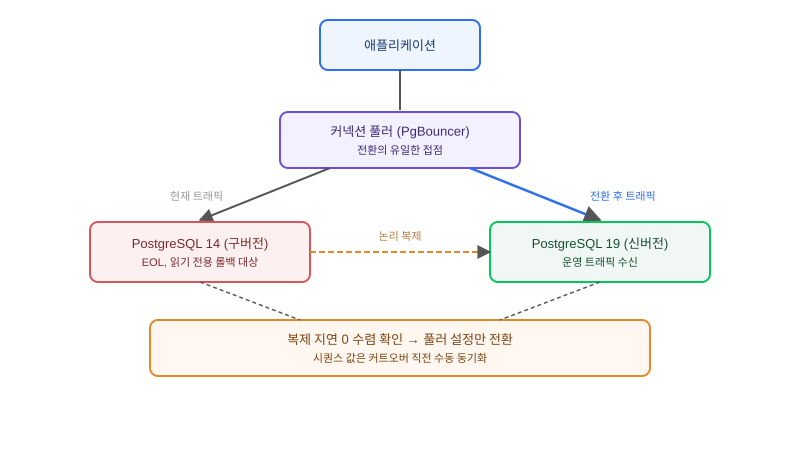

## 왜 지금 이 판단이 필요한가

"DB 버전이 오래됐다고 하니 그냥 최신으로 올려주세요." 이런 요구를 받으면 흔히 `pg_upgrade`를 돌리는 작업 하나로 생각하기 쉽다. 실제로 오늘 2026년 11월 12일은 PostgreSQL 14가 커뮤니티 보안 패치 지원을 끝내는 날이고, PostgreSQL 19는 2차 RC를 거쳐 11월 19일 GA를 앞두고 있다. 즉 "메이저 버전 하나 올리기"라는 말 뒤에는 지원 종료 압박과 신버전 전환 압박이 동시에 걸려 있다. 문제는 메이저 버전 업그레이드가 마이너 버전 패치와 전혀 다른 종류의 작업이라는 데 있다 — 온디스크 포맷이 바뀌기 때문에 단순 롤링 배포로는 풀리지 않고, 전통적인 `pg_upgrade`는 기본적으로 DB를 내려야 하는 작업이다.

빌더가 실제로 답해야 할 질문은 "업그레이드를 할 것인가"가 아니라 **"이 서비스가 감내할 수 있는 다운타임이 몇 초인가, 그리고 그 숫자에 맞는 토폴로지를 어떻게 짤 것인가"**다. 내부 배치 시스템이라면 새벽 시간대 몇 분의 다운타임을 그냥 받아들이는 게 논리 복제 파이프라인을 구축하는 것보다 싸다. 반대로 결제·주문처럼 24시간 트래픽이 끊기지 않는 서비스라면, 다운타임을 0에 가깝게 만드는 토폴로지를 설계하는 비용이 장애 비용보다 작다.

## pg_upgrade가 다운타임을 요구하는 이유

`pg_upgrade`는 구버전 데이터 디렉터리의 시스템 카탈로그를 신버전 포맷으로 변환하는 작업이다. `--link` 모드를 쓰면 데이터 파일 자체는 하드링크로 재사용해 복사 시간을 크게 줄이지만, 변환이 끝날 때까지는 신버전 서버가 그 데이터 디렉터리를 아직 열 수 없다. 즉 구버전 서버를 내리고 변환하고 신버전 서버를 올리는 그 사이 구간은 어떤 최적화를 해도 DB가 쓰기를 받을 수 없는 시간으로 남는다. 데이터 규모가 작으면 이 구간이 수 초~수십 초로 끝나지만, 카탈로그가 비대한 테이블 수천 개짜리 서비스에서는 이 구간이 분 단위로 늘어날 수 있다. "그냥 버전만 올려주세요"라는 요구가 암묵적으로 이 구간의 길이를 몇 초로 가정하고 있는지부터 확인해야 하는 이유다.

## 전체 시스템에서의 위치

무중단을 요구하는 순간 아키텍처는 "버전 전환" 문제에서 "두 버전이 동시에 살아있는 동안 트래픽을 안전하게 옮기는" 문제로 바뀐다.



그림에서 핵심은 **커넥션 풀러가 애플리케이션과 DB 사이의 유일한 전환 지점**이라는 것이다. 애플리케이션이 DB 호스트를 직접 하드코딩하고 있으면 전환 순간 모든 서비스 인스턴스를 동시에 재배포해야 하고, 그 자체가 또 다른 장애 지점이 된다. PgBouncer나 애플리케이션 레벨 라우팅 계층이 먼저 있어야 "신버전으로 트래픽을 돌린다"가 설정 변경 수준의 작업이 된다.

## pg_upgrade 직접 전환 vs 논리 복제 컷오버

| 기준 | pg_upgrade --link (직접 전환) | 논리 복제 기반 컷오버 |
|---|---|---|
| 다운타임 | 수초~수분 (데이터 규모·카탈로그 크기에 비례) | 초 단위 (복제 지연만큼) |
| 구축 복잡도 | 낮음 — 명령 한 번 | 높음 — publication/subscription 설계, 시퀀스·스키마 동기화 |
| 롤백 용이성 | 어려움 — 구버전 데이터 디렉터리가 이미 변환됨 | 쉬움 — 구버전이 그대로 살아있어 즉시 되돌릴 수 있음 |
| 대용량 데이터 적합성 | 낮음(카탈로그 변환 시간이 늘어남) | 높음(초기 스냅샷 이후 증분만 따라잡음) |
| 적합한 상황 | 내부 도구, 배치 전용, 짧은 점검창 허용 서비스 | 24시간 트래픽, 결제·주문 등 중단 비용이 큰 서비스 |

표에서 드러나듯 두 방식의 본질적 차이는 속도가 아니라 **되돌릴 수 있는가**다. pg_upgrade는 전환이 끝나면 구버전으로 되돌리기가 사실상 불가능한 반면, 논리 복제 컷오버는 신버전으로 트래픽을 돌린 뒤에도 구버전이 당분간 읽기 전용으로 살아있어 문제가 발견되면 즉시 되돌릴 수 있다. 이 롤백 여유가 바로 무중단 설계의 핵심 가치이지 다운타임 숫자 자체가 아니다.

## 실제 프로젝트 진행 순서

가장 먼저 할 일은 애플리케이션이 쓰는 확장(extension)과 커스텀 타입이 신버전에서도 동작하는지 점검하는 것이다. 메이저 업그레이드 사고의 상당수는 토폴로지 설계 실패가 아니라 `pg_upgrade --check`나 복제 셋업 이전에 걸러졌어야 할 비호환 확장 때문에 일어난다. 두 번째로 스테이징 환경에서 논리 복제를 먼저 구성해 초기 스냅샷 적용 시간과 증분 복제 지연을 실측한다. 이 숫자가 실제 커트오버 창의 길이를 결정한다.

```bash
# 신버전 서버에서 구버전을 publication으로 구독 설정 (스키마 사전 동기화 완료 가정)
psql -h new-pg19-host -d appdb -c \
  "CREATE SUBSCRIPTION app_sub CONNECTION 'host=old-pg14-host dbname=appdb' PUBLICATION app_pub;"

# 복제 지연이 0에 수렴했는지 확인 후 커넥션 풀러 설정만 전환
psql -h new-pg19-host -d appdb -c \
  "SELECT now() - pg_last_xact_replay_timestamp();"
```

세 번째 단계가 가장 자주 빠뜨리는 지점이다 — 시퀀스 현재값과 자동 생성 ID는 논리 복제로 자동 동기화되지 않으므로, 커트오버 직전에 수동으로 맞춰야 한다. 이 단계를 빠뜨리면 전환 직후 PK 충돌이 터진다. 마지막으로 트래픽을 신버전으로 돌린 뒤에도 구버전을 최소 하루 이상 읽기 전용으로 남겨 두고, 이상 징후가 없는지 확인한 다음에야 구버전 인스턴스를 폐기한다.

## 마무리 요약

- 메이저 업그레이드는 마이너 패치와 달리 온디스크 포맷이 바뀌므로, "다운타임을 몇 초로 볼 것인가"를 먼저 합의해야 토폴로지가 정해진다.
- pg_upgrade 직접 전환과 논리 복제 컷오버의 본질적 차이는 속도가 아니라 되돌릴 수 있는가다 — 중단 비용이 큰 서비스일수록 롤백 여유를 사는 쪽을 택한다.
- 확장 호환성 점검과 시퀀스 수동 동기화를 빠뜨리면 토폴로지가 아무리 정교해도 커트오버 직후 장애로 이어진다.

## 참고 자료

- [PostgreSQL — Versioning Policy](https://www.postgresql.org/support/versioning/)
- [PostgreSQL 공식 문서 — pg_upgrade](https://www.postgresql.org/docs/current/pgupgrade.html)
- [PostgreSQL 공식 문서 — Logical Replication](https://www.postgresql.org/docs/current/logical-replication.html)
