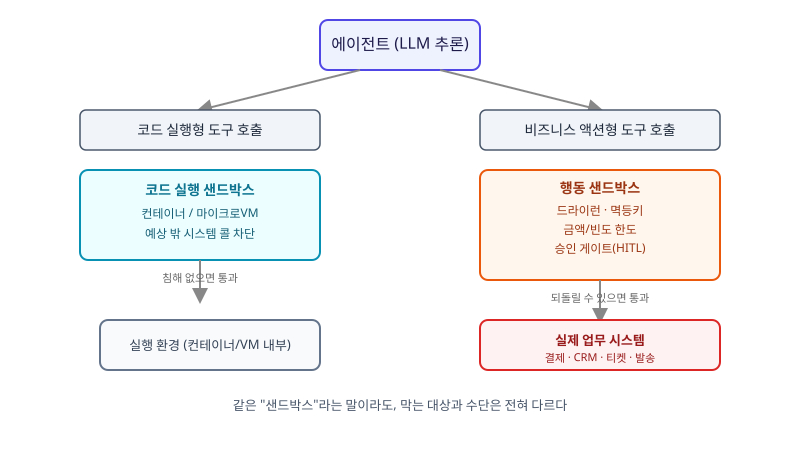

## 왜 지금 이 판단이 필요한가

"이 에이전트가 고객 문의를 보고 환불을 직접 처리하게 해주세요." 몇 달 전이었다면 이 요구는 에이전트가 쓸 함수 하나를 짜고 끝났을 일이다. 하지만 막상 설계에 들어가면 질문이 달라진다. 에이전트가 잘못된 판단으로 환불 금액을 두 배로 승인하면, 그 행동을 되돌릴 방법이 있는가. 같은 티켓에 두 번 환불이 나가지 않는다는 보장은 어디서 거는가. 지금까지 "에이전트 샌드박싱"이라고 하면 거의 항상 코딩 에이전트가 짠 셸 명령을 컨테이너나 마이크로VM 안에 가두는 이야기였다. 그런데 이 요구는 코드를 실행하는 게 아니라 실제 비즈니스 시스템에 쓰기 작업을 내보내는 일이고, 여기서 위험한 건 "악성 코드 실행"이 아니라 "되돌릴 수 없는 정당한 API 호출"이다.

2026년 11월 4일 공개된 Thoughtworks Technology Radar Volume 35는 이 변화를 정면으로 반영했다. 기존 "Sandboxed Execution for Coding Agents"를 흡수한 "Agent Sandboxing" 블립이 Trial을 거쳐 Adopt 링에 올라갔는데, 더 중요한 건 범위 설명이다 — 더 이상 코딩 환경에만 한정하지 않고, 에이전트가 비즈니스 시스템에서 자율적으로 행동하는 경우까지 포함해 권고한다. 빌더 입장에서 이건 "컨테이너를 쓰느냐 마느냐"의 문제가 아니라, 우리 에이전트가 만지는 행동들 중 어느 것이 코드 실행형 위험이고 어느 것이 비즈니스 액션형 위험인지 구분해서 전혀 다른 격리 수단을 골라야 한다는 뜻이다.

## 두 가지 샌드박스는 막는 대상이 다르다

코드 실행 샌드박스(Bubblewrap, 디스포저블 마이크로VM 등)가 막는 건 "예상치 못한 시스템 콜"이다. 파일시스템 접근, 네트워크 호출, 프로세스 생성 같은 행위 자체를 커널 레벨에서 차단하면 끝난다. 반면 비즈니스 액션의 위험은 시스템 콜이 아니라 **의미**에 있다. 에이전트가 호출하는 `refund_api.create()`는 OS 입장에선 정상적인 HTTPS 요청일 뿐이고, 권한도 멀쩡히 갖고 있다. 문제는 그 호출이 잘못된 판단에서 나왔다는 것, 그리고 한 번 나가면 돈이 이미 움직였다는 것이다. 이 둘을 같은 방식으로 다루면, 코드 샌드박스를 아무리 단단히 쳐도 에이전트는 샌드박스 밖으로 나가지 않고도 사고를 낼 수 있다.

## 전체 시스템에서의 위치

비즈니스 액션 샌드박스는 에이전트의 도구 호출과 실제 업무 시스템(결제, CRM, 티켓) 사이에 끼어드는 별도의 계층이다. 코드 실행 격리와는 위치도 역할도 다르다.



그림의 핵심은 두 샌드박스가 병렬로 존재한다는 점이다. 코드 실행 경로는 "이 프로세스가 시스템을 침해하는가"를 보고, 행동 경로는 "이 호출이 되돌릴 수 있는가, 중복 실행되지는 않는가, 사람 승인 없이 나가도 되는 규모인가"를 본다. 하나를 잘 만들었다고 다른 하나가 저절로 따라오지 않는다.

## 선택의 트레이드오프 — 네 가지 격리 수단

| 수단 | 막는 위험 | 비용 | 비즈니스 액션에 효과적인가 |
|---|---|---|---|
| 컨테이너/마이크로VM | 악성·예상 밖 시스템 콜 | 중간 | 아니오 — 정상 API 호출은 그대로 통과 |
| 드라이런(dry-run) 모드 | 실제 부수효과 발생 자체 | 낮음(API가 지원해야 함) | 부분적 — 사전 검증엔 좋으나 최종 실행은 결국 실제 호출 |
| 승인 게이트(human-in-the-loop) | 금액·범위가 큰 단일 행동 | 높음(지연, 온콜 부담) | 예 — 되돌릴 수 없는 행동에 가장 직접적 |
| 멱등키 + 한도(rate/amount cap) | 중복 실행, 폭주성 연쇄 행동 | 낮음 | 예 — 특히 재시도·루프로 인한 반복 피해 차단 |

컨테이너 격리는 "에이전트가 시스템을 탈취하는" 시나리오에는 필수지만 "에이전트가 정상 권한으로 잘못 판단한" 시나리오에는 거의 무력하다. 반대로 승인 게이트와 멱등키는 코드 실행 격리 없이도 비즈니스 액션의 블라스트 레디어스를 줄인다. 실무에서는 네 가지를 겹쳐 쓰되, 각 도구 호출마다 "이게 되돌릴 수 있는 행동인가"를 기준으로 어느 수단을 얼마나 두껍게 쌓을지 정해야 한다 — 모든 도구에 승인 게이트를 걸면 에이전트를 쓰는 의미가 없어지고, 전부 생략하면 Radar가 경고한 바로 그 사고가 난다.

## 실제 프로젝트 진행 순서

가장 먼저 할 일은 에이전트가 호출할 도구 목록을 "코드 실행형"과 "비즈니스 액션형"으로 분류하는 것이다. 그다음 비즈니스 액션형 도구마다 되돌릴 수 있는지(취소 API가 있는가), 중복 호출 시 피해가 누적되는지(멱등키로 막을 수 있는가), 단일 호출의 최대 피해 규모가 얼마인지를 적어본다. 되돌릴 수 없고 피해 규모가 큰 행동(대량 환불, 계정 삭제, 외부 발송)부터 승인 게이트를 걸고, 나머지는 멱등키와 금액·빈도 한도만으로 운영한다.

```python
# 비즈니스 액션 도구 호출 전 공통 가드 — 샌드박스가 아니라 행동 자체를 제약한다
def guarded_call(tool, args, idempotency_key):
    if tool.max_impact(args) > APPROVAL_THRESHOLD:
        return request_human_approval(tool, args)  # 되돌릴 수 없는 규모면 승인 게이트로
    if seen_recently(idempotency_key):
        raise DuplicateActionError()  # 재시도·루프로 인한 중복 실행 차단
    return tool.execute(args, idempotency_key=idempotency_key)
```

마지막으로 이 가드를 통과한 호출과 승인 게이트에서 막힌 호출을 별도 지표로 쌓아야 한다. 승인 게이트가 너무 자주 걸리면 임계값이 낮게 잡힌 것이고, 거의 안 걸리면 애초에 그 기준이 현실의 사고를 못 잡아내고 있다는 신호다.

## 마무리 요약

- 코드 실행 샌드박스는 "시스템 침해"를, 비즈니스 액션 샌드박스는 "되돌릴 수 없는 정당한 호출"을 막는다 — 서로 다른 위험이라 수단도 달라야 한다.
- Thoughtworks Radar Vol.35가 에이전트 샌드박싱을 코딩 에이전트 밖으로 확장한 것은, 업무 시스템에 쓰기 작업을 하는 에이전트가 늘고 있다는 신호다.
- 도구를 코드형/행동형으로 나누고, 되돌릴 수 없는 행동부터 승인 게이트·멱등키로 블라스트 레디어스를 줄여 나간다.

## 참고 자료

- [Thoughtworks Technology Radar — Agent Sandboxing](https://www.thoughtworks.com/radar/techniques/agent-sandboxing)
- [Thoughtworks Technology Radar Volume 35](https://www.thoughtworks.com/radar)
