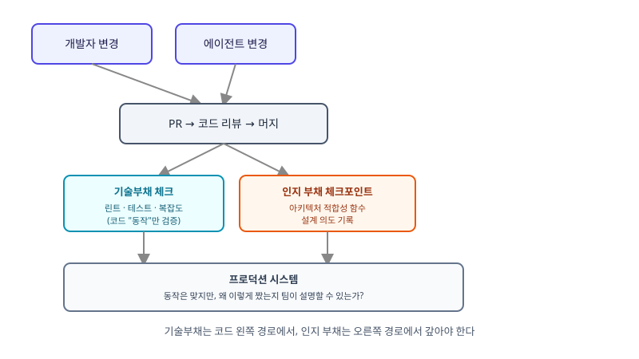

## 왜 지금 이 판단이 필요한가

"이번 스프린트는 에이전트한테 많이 맡겨서 평소보다 PR이 세 배 나왔어요." 팀 입장에선 희소식처럼 들리지만, 이 상황을 두 달쯤 끌고 가본 팀이라면 다른 질문을 하게 된다 — 이 코드를 왜 이렇게 짰는지, 지금 이 레포에서 설명할 수 있는 사람이 몇 명이나 되는가. 기술부채라는 말은 익숙하다. 코드 안에 쌓인 임시방편, 테스트 없는 분기, 중복된 로직 — 전부 코드를 읽으면 보인다. 그런데 AI 에이전트가 변경 속도를 끌어올리면서 전혀 다른 종류의 부채가 드러나기 시작했다. 코드 자체는 멀쩡히 동작하는데, 왜 이런 구조로 짰는지, 어떤 제약 때문에 이 경로를 선택했는지를 아무도 설명하지 못하는 상황이다.

Thoughtworks Technology Radar Volume 34(2026년 4월)는 이 현상에 "codebase cognitive debt"라는 이름을 붙였다. 정의는 명확하다 — 시스템의 실제 구현과, 팀이 그 시스템이 왜 그렇게 동작하는지에 대해 공유하고 있는 이해 사이의 간극. 기술부채가 코드 안에 있다면, 인지 부채는 개발자들의 머릿속에 있다. 여러 에이전트가 동시에 코드를 바꾸는 "코딩 에이전트 스웜"이 흔해질수록 이 간극은 더 빨리 벌어진다 — 변경은 빠른데 그 변경의 설계 의도와 숨은 커플링을 따라잡는 속도는 사람 머릿속 용량에 묶여 있기 때문이다. 빌더 입장에서 중요한 건 이 개념을 아는 것이 아니라, 우리 프로세스에 이걸 갚아나갈 장치가 있는지 점검하는 것이다.

## 전체 시스템에서의 위치

인지 부채는 코드 변경이 머지되는 파이프라인의 "눈에 안 보이는 부산물"이다. 아래 구조도는 그 부산물이 어디서 생기고 어디서 갚아지는지를 보여준다.



그림에서 보듯 기존 CI 파이프라인(린트, 테스트, 보안 스캔)은 코드의 "동작"만 검증한다. 인지 부채를 다루려면 "이 변경이 팀의 아키텍처 이해와 얼마나 어긋났는가"를 재는 별도 체크포인트가 필요하다 — 이게 바로 아키텍처 적합성 함수(architectural fitness function)가 들어갈 자리다.

## 기술부채 관리와 인지 부채 관리는 다른 도구를 쓴다

| 기준 | 기술부채 | 인지 부채 |
|---|---|---|
| 존재하는 곳 | 코드 자체 | 개발자들의 머릿속 공유 이해 |
| 측정 수단 | 정적 분석, 코드 커버리지, 복잡도 지표 | 아키텍처 적합성 함수, 코드 소유권 맵, 온보딩 소요 시간 |
| AI 코딩이 미치는 영향 | 늘어나는 속도가 빨라짐 | AI가 변경 속도를 올릴수록 간극이 더 빨리 벌어짐 |
| 되갚는 방법 | 리팩터링, 중복 제거 | 설계 의도 기록, 피처 센서, 아키텍처 리뷰 주기 단축 |
| 방치했을 때 결과 | 버그 증가, 성능 저하 | 아무도 시스템 전체를 설명 못 해 변경이 점점 더 위험해짐 |

두 부채를 같은 도구로 다루려는 시도가 가장 흔한 실수다. 린트 규칙을 더 깐깐하게 돌린다고 인지 부채가 줄지 않는다. 코드는 깨끗한데 "왜 이 모듈이 저 모듈을 직접 호출하면 안 되는지"를 아무도 모르는 상태는 얼마든지 가능하다. 반대로 아키텍처 적합성 함수만 잔뜩 깔아두고 기본적인 코드 품질 게이트를 소홀히 하면 기술부채가 먼저 터진다. 두 축을 별도로 측정하고 별도로 갚아야 한다.

## 실제 프로젝트 진행 순서

가장 먼저 할 일은 코드를 더 많이 리뷰하는 게 아니라, 우리 아키텍처의 "깨지면 안 되는 규칙"을 목록으로 적는 것이다 — 예를 들어 "도메인 레이어는 인프라 레이어를 직접 import하지 않는다", "결제 모듈은 특정 큐를 거치지 않고 DB에 직접 쓰지 않는다" 같은 것들이다. 이 목록이 없으면 적합성 함수를 짤 기준 자체가 없다. 목록이 생기면 ArchUnit(Java)이나 dependency-cruiser(JS) 같은 도구로 이 규칙들을 자동 체크로 바꿔, 사람이 아니라 에이전트가 만든 변경에도 똑같이 적용되게 만든다.

```java
// ArchUnit 예시 — 도메인 레이어가 인프라 레이어를 직접 참조하지 못하도록 적합성 함수로 고정
@ArchTest
static final ArchRule domain_should_not_depend_on_infrastructure =
    noClasses().that().resideInAPackage("..domain..")
        .should().dependOnClassesThat().resideInAPackage("..infrastructure..");
```

두 번째로는 변경이 머지될 때 "왜 이렇게 짰는가"를 코드와 함께 남기는 습관을 제도화한다 — PR 설명에 ADR 링크를 걸거나, 에이전트에게 변경 이유를 커밋 메시지가 아니라 설계 문서에 요약하게 시킨다. 마지막으로 분기마다 온보딩하는 사람이 특정 모듈을 설명하는 데 걸리는 시간을 재본다. 이 시간이 늘어나고 있다면 적합성 함수가 놓치고 있는 인지 부채가 어딘가에 쌓이고 있다는 신호이고, 그 모듈부터 아키텍처 리뷰 주기를 당겨야 한다. 세 장치(적합성 함수, 설계 의도 기록, 온보딩 시간 측정) 중 하나라도 빠지면 인지 부채는 다시 조용히 쌓인다 — 적합성 함수만 있으면 규칙을 왜 세웠는지는 여전히 코드에 안 남고, 설계 의도 기록만 있으면 아무도 안 읽어서 깨져도 아무도 모른다.

## 마무리 요약

- 기술부채는 코드에, 인지 부채는 팀의 머릿속 이해에 쌓이며 AI 코딩이 변경 속도를 올릴수록 후자가 더 빨리 벌어진다.
- 아키텍처 적합성 함수로 "깨지면 안 되는 규칙"을 자동 체크로 바꿔, 사람이든 에이전트든 같은 기준으로 걸러낸다.
- 온보딩 소요 시간처럼 인지 부채를 간접적으로 드러내는 지표를 분기마다 재면서 리뷰 주기를 조정한다.

## 참고 자료

- [Thoughtworks Technology Radar — Codebase Cognitive Debt](https://www.thoughtworks.com/radar/techniques/codebase-cognitive-debt)
- [ArchUnit — Architecture testing for Java](https://www.archunit.org/)
