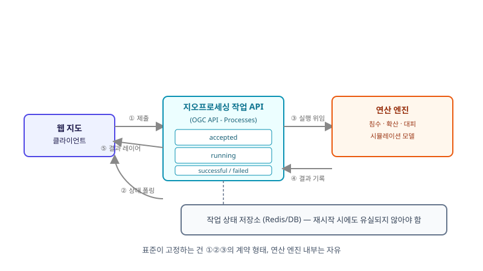

## 왜 지금 이 판단이 필요한가

"지도에서 지역을 그리고 '침수 시뮬레이션 돌리기'를 누르면 결과가 지도 위에 뜨게 해주세요." 기획자의 이 한 문장은 생각보다 복잡한 기술 문제로 번역된다. 시뮬레이션 연산은 몇 초가 아니라 몇 분, 심하면 몇십 분이 걸릴 수 있어서 HTTP 요청-응답으로 바로 받을 수 없다. 그러면 작업을 큐에 넣고, 작업 ID를 돌려주고, 클라이언트가 그 ID로 상태를 폴링하다가 끝나면 결과를 받아오는 비동기 작업 패턴이 필요해진다. 여기까지는 백엔드 개발자라면 Celery나 BullMQ로 수없이 짜본 구조다. 문제는 이 작업이 "지오프로세싱"이라는 점이다 — 입력은 폴리곤과 좌표계가 섞인 공간 데이터이고, 결과도 지도에 바로 얹을 수 있는 형태여야 한다. 이걸 사내 REST API로 직접 설계할지, 아니면 OGC가 정한 표준인 OGC API - Processes를 따를지가 바로 이 자리의 선택이다.

이 표준은 2022년에 Part 1(Core)이 정식 승인됐지만, 실무에서 체감되는 변화는 최근이다. pygeoapi 같은 오픈소스 구현체가 스레드풀 기반 비동기 실행을 지원하기 시작했고, GeoServer 쪽에서도 커뮤니티 모듈 형태로 Processes API를 노출하는 시도가 올라오고 있다. 동시에 Part 3(워크플로)는 여러 프로세스를 체이닝하고 다른 OGC API(피처, 커버리지)의 자원을 프로세스 입력으로 직접 참조하는 쪽으로 확장 중이다. 빌더 입장에서 중요한 건 "표준이 있다"는 사실이 아니라, 우리가 지금 짜려는 비동기 작업 큐를 표준 스펙에 맞춰 짜는 게 실제로 이득인지 판단하는 기준이다.

## 전체 시스템에서의 위치

지오프로세싱 작업 API는 웹 지도 클라이언트와 실제 연산 엔진(시뮬레이션 모델, 공간 분석 라이브러리) 사이에서 "요청 접수 → 상태 관리 → 결과 전달"을 담당하는 계층이다.



그림에서 보듯 클라이언트는 연산 엔진을 직접 보지 않는다. 항상 작업 API를 거쳐 "제출 → 폴링 → 결과 수신"의 3단계를 지난다. 여기서 OGC API - Processes가 표준화하는 건 바로 이 3단계의 엔드포인트 형태와 상태 모델(`accepted → running → successful/failed`)이다. 연산 엔진 자체(어떤 침수 모델을 쓰는지)는 표준이 전혀 관여하지 않는다 — 표준은 어디까지나 그 엔진을 감싸는 API 계약이다.

## 선택의 트레이드오프

| 기준 | 자체 REST + 작업 큐 (Celery/BullMQ) | OGC API - Processes |
|---|---|---|
| 개발 속도 | 빠름 — 익숙한 패턴 그대로 적용 | 느림 — 프로세스 디스크립션, 상태 모델 등 스펙 학습 필요 |
| 클라이언트 재사용성 | 낮음 — 우리 프런트만 호출 가능 | 높음 — QGIS, pygeoapi 클라이언트 등 표준 호환 도구가 바로 붙음 |
| 입력 유연성 | 높음 — 원하는 어떤 형태든 받을 수 있음 | 중간 — 프로세스 디스크립션(JSON Schema)으로 입력을 명시해야 함 |
| 다른 OGC 데이터와 연계 | 직접 구현해야 함 | Part 3에서 피처·커버리지 API 결과를 입력으로 바로 참조 가능 |
| 생태계 성숙도 | 해당 없음(사내 전용) | 중간 — pygeoapi 등은 성숙, GeoServer 쪽 모듈은 아직 Draft |
| 장기 유지보수 | 팀이 떠나면 문서만 남음 | 표준 문서가 계약서 역할을 함 |

핵심 판단 기준은 "이 지오프로세싱 기능을 외부에 공개하거나, 다른 GIS 도구(QGIS, 타 기관 시스템)와 연동할 계획이 있는가"다. 사내 전용으로 끝나는 단발성 기능이라면 표준을 따르는 학습 비용이 아깝다. 반대로 여러 시뮬레이션 모델을 동일한 패턴으로 계속 추가해 나가야 하거나, 외부 기관·다른 팀이 같은 작업 API를 호출해야 한다면 표준의 일관성이 빠르게 이득으로 돌아온다. 또한 GeoServer를 이미 쓰고 있다면 Processes 모듈이 아직 Draft 단계라는 점도 고려해야 한다 — 프로덕션에 바로 올리기보다는 pygeoapi를 프록시 삼아 먼저 검증하는 편이 안전하다.

## 실제 프로젝트 진행 순서

가장 먼저 할 일은 표준을 공부하는 게 아니라, 우리 시뮬레이션이 실제로 얼마나 걸리는지 측정하는 것이다. 몇 초 안에 끝난다면 애초에 비동기 작업 자체가 필요 없고 동기 API로 충분하다. 몇 분 이상 걸린다는 게 확인되면, 그다음은 프로세스 입력·출력 스키마를 OGC의 프로세스 디스크립션 형식(JSON Schema 기반)으로 먼저 적어본다 — 이 단계에서 "우리 입력이 표준 스키마로 깔끔하게 표현되는가"를 확인하면 전체 도입 여부가 거의 결정된다.

```json
{
  "id": "flood-simulation",
  "inputs": {
    "area": { "schema": { "type": "object", "format": "geojson-polygon" } },
    "rainfallMm": { "schema": { "type": "number", "minimum": 0 } }
  },
  "outputs": {
    "floodExtent": { "schema": { "type": "object", "format": "geojson-featurecollection" } }
  }
}
```

스키마가 자연스럽게 나오면 pygeoapi 같은 참조 구현 위에 우리 연산 엔진을 플러그인으로 얹어 프로토타입을 돌려본다. 여기서 막히는 지점은 대개 두 곳이다 — 하나는 작업 상태를 어디에 저장할지(단순 인메모리 큐로는 재시작 시 유실되므로 Redis나 DB가 필요하다), 다른 하나는 결과 지오메트리가 커질 때 작업 API 응답에 직접 담을지 별도 타일/파일로 분리해 링크만 돌려줄지다. 이 두 가지를 먼저 검증한 뒤에야 전체 시뮬레이션 축(침수·확산·대피)에 같은 패턴을 재사용할 수 있다.

## 마무리 요약

- 지도 위 시뮬레이션 버튼은 결국 비동기 작업 큐 문제이며, OGC API - Processes는 그 작업 API의 엔드포인트·상태 모델을 표준화한 것이다.
- 외부 연동·다른 시뮬레이션 모델로의 확장 계획이 있다면 표준을, 단발성 사내 기능이라면 익숙한 Celery/BullMQ 패턴을 고른다.
- 도입 전 입력·출력을 프로세스 디스크립션 스키마로 먼저 적어보면 적합성이 빠르게 드러난다.

## 참고 자료

- [OGC API - Processes 공식 개요](https://ogcapi.ogc.org/processes/overview.html)
- [pygeoapi — Publishing processes via OGC API - Processes](https://docs.pygeoapi.io/en/stable/publishing/ogcapi-processes.html)
