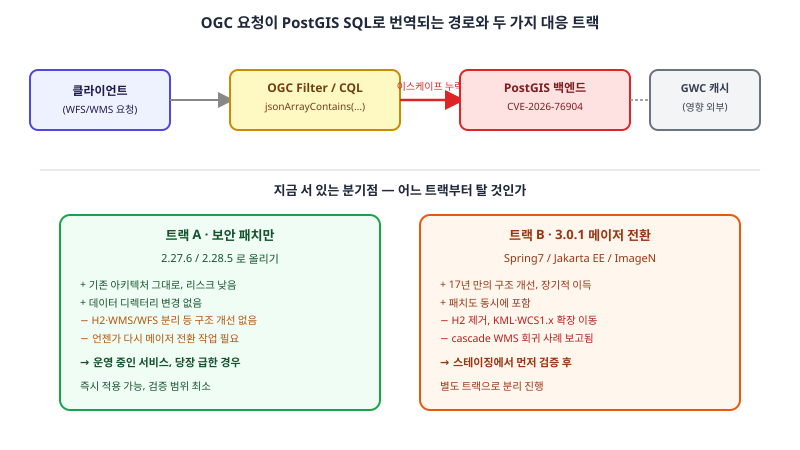

## 왜 지금 이 판단이 필요한가

"GeoServer에 심각한 보안 경고가 떴다는데, 이참에 오래 미뤄온 3.0 업그레이드까지 같이 해야 할까요?" 운영 중인 공간 데이터 서비스를 맡고 있다면 2026년 8월 이후 한 번은 마주쳤을 질문이다. 2026년 6월 11일, GeoServer는 17년 만에 아키텍처를 전면 개편한 3.0.0을 내놓았다. WMS와 WFS 서비스를 코드 레벨에서 분리하고, 내부적으로 Spring Framework 7과 Jakarta EE Servlet API 6.1로 넘어갔으며, 오래 쓰던 순수 자바 H2 데이터베이스를 들어냈고, KML과 WCS 1.0/1.1은 핵심에서 확장 모듈로 밀려났다. 단순한 마이너 패치가 아니라 기반 자체를 바꾼 릴리스다.

그런데 두 달 뒤인 8월 14일, 전혀 다른 성격의 공지가 떴다. GeoTools의 `jsonArrayContains` CQL 필터 함수에서 PostGIS를 백엔드로 쓰는 레이어를 대상으로 한 미인증 SQL 인젝션, CVE-2026-76904다. 치명도 Critical, 별도 설정으로 막을 방법 없음, 그리고 공개 직후 몇 시간 안에 탐색 시도가 관측됐다는 보고까지 나왔다. 이 함수는 2023년에도 같은 종류의 취약점(CVE-2023-25158)이 있었던 자리인데, 3.0 개편 과정에서 그 수정이 다시 풀려버린 회귀였다. 결국 빌더는 "보안 패치만 조용히 적용할지, 이참에 메이저 업그레이드까지 밀어붙일지"라는 두 가지 작업이 같은 타이밍에 겹친 상황에 놓인다.

## 전체 시스템에서의 위치

이 취약점이 왜 위험한지 이해하려면, 클라이언트의 WFS/WMS 요청이 실제 데이터베이스 쿼리로 바뀌는 경로를 먼저 봐야 한다. 클라이언트가 OGC Filter나 CQL 구문으로 조건을 걸면, GeoServer는 이를 파싱해 PostGIS에 보낼 SQL로 번역한다. `jsonArrayContains(컬럼, 포인터, 값)`처럼 JSON 컬럼을 다루는 함수는 이 번역 과정에서 `값` 파라미터를 이스케이프 없이 그대로 SQL에 끼워 넣었다 — 그래서 WFS GetPropertyValue 요청 하나로 인증 없이 터진다. GWC 캐시 레이어는 이 흐름의 바깥에 있어 직접 영향받지 않지만, 캐시된 레이어라도 그 밑의 PostGIS 데이터소스가 뚫리면 캐시 자체의 신뢰성도 의미가 없어진다.



그림의 위쪽 절반이 공격 경로다. 중요한 건 이 경로가 WMS든 WFS든 OGC Filter를 파싱하는 모든 진입점에 걸쳐 있다는 점이다 — "우리는 WFS를 안 쓰니 안전하다"는 판단은 성립하지 않는다. 아래쪽 절반은 지금 선택해야 하는 두 트랙이다.

## 선택의 트레이드오프

| 기준 | 트랙 A: 보안 패치만 (2.27.6 / 2.28.5) | 트랙 B: 3.0.1 메이저 전환 |
|---|---|---|
| 적용 시급성 | 즉시 가능 — 기존 설정·데이터 디렉터리 그대로 | 스테이징 검증 필요 — 바로 운영에 못 올림 |
| 구조 개선 | 없음 — 같은 아키텍처 유지 | WMS/WFS 분리, Spring7 등 내부 전면 개편 |
| 알려진 리스크 | 거의 없음 — 다수 기관이 이미 운영 중인 검증된 라인 | cascade WMS 실패 등 회귀 보고 존재 |
| 제거된 기능 | 없음 | H2 내장 DB 제거, KML·WCS1.x 확장 이동 필요 |
| 장기 유지보수 | 2.x 라인 EOL이 다가올수록 다시 전환 작업 필요 | 당분간 최신 라인에서 지원받음 |
| 권장 순서 | 보안 패치를 선행 조건으로 분리 | 패치 이후 별도 일정으로 검증 후 진행 |

핵심은 두 트랙을 하나의 작업으로 묶지 않는 것이다. CVE는 지금 당장 익스플로잇이 도는 활성 위협이고, 메이저 업그레이드는 아키텍처 리스크를 동반하는 별도 프로젝트다. 둘을 한 번에 처리하려다 메이저 업그레이드의 회귀 테스트가 길어지면, 그 사이 패치되지 않은 서비스가 계속 노출된 채로 남는다. "패치가 급하니 메이저도 같이"는 직관적으로 보이지만 실제로는 가장 느린 선택이다.

## 실제 프로젝트 진행 순서

가장 먼저 할 일은 업그레이드 계획을 세우는 게 아니라, PostGIS 데이터소스를 쓰는 레이어에서 `jsonArrayContains`를 실제로 호출하는 CQL 필터나 저장된 쿼리가 있는지 감사하는 것이다. 없다면 노출 범위가 제한적이라는 뜻이고, 있다면 그 필터를 당장 비활성화하거나 애플리케이션 레벨에서 우회할 방법부터 찾는다.

```bash
# 운영 중인 GeoServer 버전과 GeoTools 버전 확인
curl -s https://geoserver.example.org/geoserver/web/ | grep -i "GeoServer Version"
# 데이터 디렉터리에서 jsonArrayContains 사용 흔적 검색
grep -rl "jsonArrayContains" /opt/geoserver/data_dir/
```

감사가 끝나면 패치 버전(2.27.6 혹은 2.28.5, 이미 2.28.x 이상이면 패치만 적용)으로 즉시 업그레이드한다. 이 단계는 기존 데이터 디렉터리를 거의 그대로 쓸 수 있어 검증 범위가 작다. 패치가 끝난 뒤에야 3.0 전환을 별도 트랙으로 띄운다 — 이때는 스테이징 환경에 H2를 쓰던 설정이 있는지, KML·WCS 1.0/1.1에 의존하는 클라이언트가 있는지, 그리고 무엇보다 cascade WMS(다른 GeoServer나 외부 WMS를 프록시하는 레이어)를 쓰고 있다면 3.0.1에서 보고된 회귀부터 재현해 본다. 이 순서를 지키면 "보안은 지금, 구조 개선은 검증된 뒤"라는 두 일정이 서로의 발목을 잡지 않는다.

## 마무리 요약

- CVE-2026-76904는 WFS든 WMS든 OGC Filter를 파싱하는 모든 진입점에 걸리는 미인증 SQL 인젝션이며, 설정으로 우회할 방법이 없다.
- 보안 패치(2.27.6/2.28.5)와 3.0 메이저 전환은 성격이 다른 작업이므로 반드시 별도 트랙으로 분리해 진행한다.
- 3.0 전환 전에는 H2 의존·KML/WCS1.x 사용 여부·cascade WMS 회귀 재현을 스테이징에서 먼저 검증한다.

## 참고 자료

- [GeoServer 3.0.1 보안 릴리스 공지](https://geoserver.org/announcements/vulnerability/2026/08/14/geoserver-3-0-1-released.html)
- [GeoServer 3.0.0 릴리스 공지](https://geoserver.org/announcements/vulnerability/2026/06/11/geoserver-3-0-0-released.html)
- [GeoServer 2.28 → 3.0 마이그레이션 가이드](https://geoserver.org/geoserver-cloud/configuration/migration-2.28-to-3.0/)
