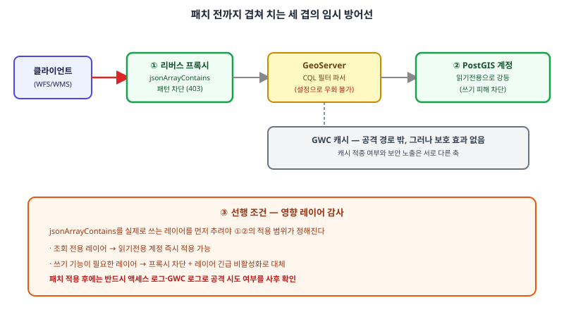

## 왜 지금 이 판단이 필요한가

"운영 중인 지도 서비스에 긴급 보안 경고가 떴는데, 패치 적용은 변경 관리 절차 때문에 최소 며칠이 걸립니다. 그동안 뭘 해야 하나요?" 2026년 8월 14일 공개된 CVE-2026-76904는 이 질문을 피할 수 없게 만든 사례다. GeoTools의 `jsonArrayContains` CQL 필터 함수가 PostGIS를 백엔드로 쓰는 레이어를 대상으로 미인증 SQL 인젝션에 노출된 것인데, 공식 권고문 자체가 "설정으로 막을 워크어라운드는 없다"고 못 박았다. 보통의 보안 공지는 "이 옵션을 끄면 임시로 안전하다"는 식의 완화책을 함께 내놓지만, 이번엔 그 선택지 자체가 없다. 게다가 이 함수는 2023년에도 같은 종류의 취약점(CVE-2023-25158)이 있었던 자리인데, 그 수정이 이번 릴리스 과정에서 다시 풀려버린 회귀였고, 공개 직후 몇 시간 안에 실제 탐색 시도가 관측됐다는 보고까지 나왔다.

이런 상황에서 "패치가 유일한 답이니 승인될 때까지 기다린다"는 현실적인 선택이 아니다. 조직의 변경 관리 프로세스는 보안 공지의 긴급성에 맞춰 당겨지지 않는 경우가 많고, 그 간극 동안 서비스는 그대로 노출된 채 남는다. 빌더가 실제로 풀어야 하는 문제는 "패치를 얼마나 빨리 넣을까"가 아니라, "GeoServer 설정 자체로는 막을 수 없는 취약점을, GeoServer 바깥의 계층에서 어떻게 임시로 틀어막을 것인가"다.

## 전체 시스템에서의 위치

이 취약점의 공격 경로는 클라이언트의 OGC Filter/CQL 요청이 GeoServer 내부에서 파싱돼 PostGIS SQL로 번역되는 지점에 있다. GeoServer 설정으로는 이 경로를 끊을 수 없지만, 이 경로의 앞단과 옆에는 GeoServer가 아닌 다른 컴포넌트들이 있고, 그 컴포넌트들은 패치와 무관하게 지금 바로 손댈 수 있다.



그림에서 보듯 리버스 프록시·API 게이트웨이는 요청이 GeoServer에 도달하기 전에 위치하고, PostGIS 접속 계정의 권한은 GeoServer가 쿼리를 실행하는 바로 그 지점에 위치한다. GWC 캐시는 이 공격 경로의 바깥에 있지만, 캐시된 레이어라도 그 밑의 데이터소스가 뚫리면 캐시가 제공하는 보호는 사실상 없다는 점도 함께 봐야 한다 — 캐시 적중 여부와 보안 노출은 서로 다른 축이다.

## 선택의 트레이드오프

| 임시 방어선 | 차단 범위 | 정상 기능에 미치는 영향 | 적용 속도 |
|---|---|---|---|
| 프록시/WAF에서 `jsonArrayContains` 패턴 차단 | 해당 함수 호출만 차단 | 이 함수를 정상적으로 쓰던 요청도 함께 막힘 | 빠름 — 룰 하나 추가 |
| 취약 레이어만 긴급 비활성화 | 해당 레이어 전체 | 그 레이어를 쓰던 클라이언트 기능 중단 | 빠름 — 레이어 설정 토글 |
| PostGIS 계정을 읽기전용으로 강등 | SQL 인젝션의 쓰기·변경 피해 | 없음 — 조회만 하는 서비스라면 영향 없음 | 빠름, 단 쓰기 기능 쓰는 서비스는 불가 |
| 조치 없이 패치 승인만 대기 | 없음 | 없음 | 느림 — 승인 절차에 종속 |

네 가지 중 어느 하나만으로는 충분하지 않다. 프록시 패턴 차단은 공격 문자열의 변형(인코딩, 공백 삽입 등)에 취약하고, 레이어 비활성화는 그 레이어가 핵심 기능이면 선택하기 어렵다. PostGIS 계정 강등은 가장 근본적인 완화지만 쓰기 작업이 필요한 서비스에는 적용할 수 없다. 실무적으로는 "프록시 패턴 차단 + PostGIS 읽기전용 전환(가능한 레이어만)"을 동시에 겹쳐 적용하고, 패치가 들어오면 그제서야 걷어내는 순서가 가장 현실적이다.

## 실제 프로젝트 진행 순서

가장 먼저 할 일은 패치 일정을 잡는 게 아니라, PostGIS 데이터소스를 쓰는 레이어 중 실제로 CQL 필터나 저장된 쿼리에서 `jsonArrayContains`를 호출하는 레이어를 추려내는 것이다. 이 감사 결과가 이후 모든 조치의 범위를 결정한다.

```bash
# 데이터 디렉터리에서 jsonArrayContains 사용 흔적 검색
grep -rl "jsonArrayContains" /opt/geoserver/data_dir/

# 리버스 프록시(nginx 예시)에서 해당 패턴이 포함된 요청을 즉시 차단
location /geoserver/ {
    if ($query_string ~* "jsonArrayContains") {
        return 403;
    }
    proxy_pass http://geoserver-backend;
}
```

감사와 프록시 룰 적용을 같은 날 끝낸 뒤, 영향받는 레이어의 PostGIS 접속 계정을 확인한다. 조회 전용으로 서빙만 하는 레이어라면 해당 계정을 즉시 읽기전용으로 전환해 SQL 인젝션이 성공하더라도 쓰기·변경 피해로 번지지 않게 막는다. 이 두 조치를 끝낸 시점부터가 비로소 "패치를 기다려도 되는" 상태다. 패치가 적용된 뒤에는 액세스 로그와 GWC 로그를 함께 훑어, 임시 방어선을 치기 전 시간대에 공격 시도가 실제로 있었는지 사후 확인하는 단계를 반드시 거친다.

## 마무리 요약

- CVE-2026-76904는 GeoServer 설정 자체로는 우회할 방법이 없는 취약점이므로, 방어는 GeoServer 바깥 계층(프록시, 데이터베이스 계정 권한)에서 먼저 만들어야 한다.
- 프록시 패턴 차단과 PostGIS 읽기전용 전환을 동시에 겹쳐 적용하는 것이 패치 적용까지의 공백을 메우는 현실적인 방법이다.
- 임시 방어선을 걷어낸 뒤가 아니라 적용하기 전부터, 영향받는 레이어를 먼저 감사해 조치 범위를 좁혀야 한다.

## 참고 자료

- [GeoServer 3.0.1 보안 릴리스 공지](https://geoserver.org/announcements/vulnerability/2026/08/14/geoserver-3-0-1-released.html)
- [GeoServer 2.28.5 보안 릴리스 공지](https://geoserver.org/announcements/2026/01/21/geoserver-2-28-2-released.html)
