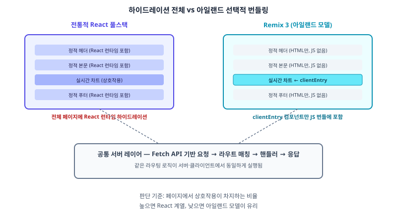

## 왜 지금 이 판단이 필요한가

"신규 서비스인데 번들 크기가 너무 커서 저사양 기기에서 첫 화면이 늦게 뜬다는 지적이 계속 나와요." 프런트엔드 프레임워크를 새로 고르는 자리에서 이런 요구가 나오면, 보통은 코드 스플리팅이나 서버 컴포넌트로 답을 찾는다. 그런데 2026년 8월 31일 첫 릴리스 후보를 거쳐 10월 Remix Jam에서 공개된 Remix 3는 더 급진적인 답을 들고 나왔다 — React 자체를 들어낸 것이다. 원래 Remix 2는 이미 React Router로 흡수됐고, "Remix"라는 이름은 이번에 완전히 새로운 프레임워크로 다시 쓰였다. MIT 라이선스 단일 npm 패키지로 배포되고, 클라이언트 런타임은 React가 아니라 Preact 기반의 자체 포크를 쓴다.

왜 React를 버렸는가가 이 글의 핵심이다. 서버는 Fetch API를 1급 인터페이스로 삼아 요청을 받고, 라우트에 매칭하고, 핸들러를 실행하고, 응답을 반환하는 구조를 클라이언트와 서버가 동일한 라우팅 로직으로 공유한다. 그리고 컴포넌트는 기본적으로 정적 HTML로만 렌더링되고, `clientEntry`로 명시한 컴포넌트만 클라이언트 자바스크립트 번들에 포함되는 아일랜드(islands) 모델을 쓴다. 다만 RC 단계의 공지들이 서로 엇갈리는 부분이 있다 — 접근성 UI 컴포넌트는 3.0 안정 버전에 포함되지 않았고, 공식 마이그레이션 문서와 보안 감사가 아직 마무리 중이라는 보고도 있었다. 그래서 이 글은 "지금 당장 운영 서비스를 옮겨라"가 아니라 "이 아키텍처 선택이 우리 판단 기준에 들어와야 하는가"를 다룬다.

## 전체 시스템에서의 위치

전통적인 React 풀스택 프레임워크(Next.js, Remix 2/React Router, TanStack Start)는 서버에서 렌더링한 HTML을 클라이언트로 보낸 뒤, 그 위에 React 런타임 전체를 다시 올려 이벤트 핸들러를 연결하는 하이드레이션 과정을 거친다. 이 과정에서 페이지에 상호작용이 전혀 없는 부분까지도 React 런타임과 컴포넌트 코드가 번들에 실려 내려간다.



Remix 3의 구조는 이 전제를 뒤집는다. 서버가 반환하는 건 이미 완성된 HTML이고, 클라이언트로 내려가는 자바스크립트는 명시적으로 `clientEntry`를 단 컴포넌트뿐이다. 나머지 95%가 정적인 콘텐츠 페이지라면, 번들에는 딱 그 5%의 상호작용 로직만 들어간다. 이건 Astro나 Qwik이 먼저 보여준 패턴이지만, Remix 3는 이걸 React 생태계 밖에서 Fetch 표준 기반으로 다시 짰다는 점이 다르다.

## 선택의 트레이드오프

| 기준 | React 계열 유지 (TanStack Start, React Router) | Remix 3 (Preact 포크 + 아일랜드) |
|---|---|---|
| 생태계 성숙도 | 높음 — UI 라이브러리·상태관리·폼 라이브러리 풍부 | 낮음 — 아직 서드파티 생태계 얇음 |
| 번들 크기 | 상호작용 비율과 무관하게 React 런타임 전체 포함 | 정적 비율이 높을수록 유리, 아일랜드만 번들링 |
| 마이그레이션 경로 | Remix 2 → React Router로 공식 경로 존재 | 없음 — 완전히 새 프로젝트 취급 |
| 안정성 | 수년간 검증된 운영 사례 다수 | RC 직후, 공식 문서·보안 감사 진행 중 |
| 팀 러닝커브 | 기존 React 지식 그대로 재사용 | Preact 차이·Fetch 기반 서버 모델 새로 학습 |
| 적합한 상황 | 복잡한 상호작용이 페이지 대부분을 차지 | 콘텐츠 중심, 상호작용이 일부 섹션에 국한 |

판단 기준은 명확하다. 페이지 대부분이 폼·대시보드·실시간 상태처럼 상호작용으로 채워져 있다면 React 생태계를 유지하는 쪽이 여전히 생산성이 높다. 반대로 콘텐츠·마케팅 페이지처럼 정적 비율이 압도적으로 높은데 React 하이드레이션 비용만 억울하게 물고 있었다면, 아일랜드 모델의 이득이 체감된다. 다만 기존 Remix 2나 React Router 운영 프로젝트를 Remix 3로 "전환"한다는 선택지는 없다는 점도 분명히 해야 한다 — 이건 전환이 아니라 신규 프로젝트의 프레임워크 선택 문제다.

## 실제 프로젝트 진행 순서

운영 서비스를 다루고 있다면 Remix 3는 지금 건드릴 대상이 아니다. 대신 신규로 띄우는 작은 프로젝트나 내부 도구를 PoC 대상으로 고른다. 가장 먼저 확인할 건 우리가 의존하는 핵심 라이브러리(폼 검증, 날짜 선택기, 리치 텍스트 에디터 등)가 Preact 포크 위에서 그대로 동작하는지다 — React 전용으로 만들어진 라이브러리는 그대로 깨질 가능성이 높다.

```tsx
// routes/dashboard.tsx — 정적 부분과 아일랜드 경계 구분 예시
export default function Dashboard() {
  return (
    <main>
      <h1>이번 달 통계</h1>
      <StaticSummaryTable data={monthlyStats} />
      <LiveChart clientEntry data={monthlyStats} />
    </main>
  );
}
```

`StaticSummaryTable`은 서버에서 HTML로만 렌더링되고 번들에 들어가지 않지만, `clientEntry`가 붙은 `LiveChart`만 클라이언트 자바스크립트로 내려간다. 이 경계를 설계하는 연습 자체가 아일랜드 아키텍처를 익히는 핵심이다. PoC에서 이 경계 나누기가 자연스럽게 되는지, 그리고 라우팅·데이터 로딩 패턴이 기존 React Router 지식과 얼마나 다르게 느껴지는지를 먼저 검증한 뒤에야 다음 신규 프로젝트에 실제로 쓸지 판단할 수 있다.

## 마무리 요약

- Remix 3는 React를 버리고 Preact 포크 + Fetch API 기반 서버 + 아일랜드 모델로 완전히 새로 지어진 프레임워크다.
- 정적 콘텐츠 비율이 높은 서비스에서는 번들 크기 이득이 크지만, 상호작용이 많은 서비스에는 아직 React 계열이 유리하다.
- 기존 Remix 2/React Router 운영 서비스를 "전환"하는 경로는 없으므로, 신규 소규모 프로젝트에서 PoC로만 먼저 검증한다.

## 참고 자료

- [Remix 3 Release Candidate 공지](https://remix.run/blog/remix-3-release-candidate)
- [Remix 3 Beta Preview](https://remix.run/blog/remix-3-beta-preview)
- [Remix Future Flags — 메이저 릴리스 방침](https://remix.run/start/future-flags)
