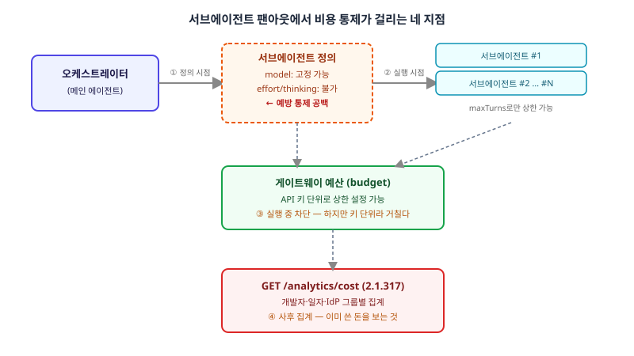

## 왜 지금 이 판단이 필요한가

"코드베이스 전체를 훑어서 보안 취약점을 찾아달라"는 요구를 받으면, 요즘의 에이전트 설계는 하나의 거대한 프롬프트 대신 서브에이전트를 여러 개 띄워 파일별·모듈별로 쪼개 맡기는 쪽으로 수렴한다. 문제는 이 팬아웃(fan-out)의 폭을 사람이 미리 정확히 예측할 수 없다는 점이다. 리포지토리 크기에 따라 서브에이전트가 5개로 끝날 수도, 50개로 불어날 수도 있다. 그리고 서브에이전트마다 "이 정도 깊이로 생각해도 된다"는 reasoning effort를 설정할 방법이 없다면, 단순한 파일 하나짜리 점검에도 메인 에이전트와 똑같은 고비용 추론이 걸릴 수 있다. 이건 버그가 아니라 설계의 공백이다.

이 공백은 실제로 커뮤니티에서 오래 지적돼 온 지점이다. 서브에이전트 frontmatter는 모델 선택까지는 지원하지만 effort나 thinking budget 필드는 아직 없고, 2026년 11월 2일 나온 Claude Code 2.1.317도 이 공백을 직접 메우지는 않았다. 대신 이 릴리스가 가져온 건 다른 층의 해법이다 — 게이트웨이 어드민 API에 `GET /v1/organizations/analytics/cost`가 추가되어, 개발자·일자·IdP 그룹별로 과거 지출을 조회할 수 있게 됐다. 즉 "에이전트를 설계하는 시점에 비용을 미리 막는" 기능은 그대로 비어 있고, "다 쓴 뒤에 누가 얼마 썼는지 집계하는" 기능만 새로 생긴 것이다. 빌더 입장에서 중요한 건 이 둘의 성격 차이를 알고, 지금 당장 가진 도구만으로 어디에 통제를 걸지 정하는 것이다.

## 전체 시스템에서의 위치

팬아웃 설계에서 비용이 통과하는 지점은 네 군데로 나뉜다. 서브에이전트를 정의하는 시점(모델은 고정할 수 있지만 effort는 아직 못 고정), 오케스트레이터가 실제로 몇 개를 띄울지 결정하는 실행 시점(`maxTurns`로 개별 서브에이전트의 턴 수는 제한 가능하지만 동시에 몇 개가 뜨는지 전역 상한은 없음), 그 호출들이 실제로 요금으로 빠져나가는 게이트웨이 예산 층(API 키 단위 상한은 걸리지만 "이 작업 하나"에는 걸리지 않음), 그리고 이미 다 쓴 뒤에야 보이는 비용 리포트 API다.



그림에서 보듯 지금 실제로 손에 쥘 수 있는 레버는 ②의 `maxTurns`와 ③의 게이트웨이 예산뿐이다. ①의 서브에이전트별 effort 고정은 아직 기능으로 없고, ④의 비용 리포트는 막는 기능이 아니라 보는 기능이다. 이 구조를 모르고 "비용 리포트 API가 생겼으니 비용 문제는 해결됐다"고 넘어가면, 실제로는 예방이 아니라 사후 감사만 갖춘 채로 운영하게 된다.

## 선택의 트레이드오프

| 통제 지점 | 할 수 있는 것 | 못 하는 것 | 적용 시점 |
|---|---|---|---|
| 서브에이전트 정의 | 모델 티어 고정 | effort/thinking 고정 | 설계 시점 |
| 오케스트레이터 | `maxTurns`로 개별 턴 수 제한 | 동시 팬아웃 개수 전역 상한 | 실행 시점 |
| 게이트웨이 예산 | API 키 단위 지출 상한 | 작업·세션 단위 세분화 | 실행 중 차단 |
| 비용 리포트 API | 개발자·일·IdP 그룹별 집계 조회 | 집계 시점엔 이미 지출 끝남 | 사후 |

네 층 중 어느 하나에만 기대면 반드시 구멍이 생긴다. 모델 티어 고정만 믿으면 같은 모델 안에서도 추론 깊이 차이로 비용이 몇 배 벌어질 수 있고, `maxTurns`만 믿으면 턴 하나하나가 길어지는 건 못 막는다. 게이트웨이 예산만 믿으면 한 팀의 폭주가 상한에 걸리기 전까지는 다른 작업과 뒤섞여 보이고, 비용 리포트만 보고 있으면 알아차렸을 때는 이미 청구서가 나온 뒤다. 결국 지금 시점에서는 이 네 층을 전부 겹쳐 쓰는 수밖에 없다 — "완벽한 예방"이 아니라 "여러 겹의 느슨한 그물"이라는 전제를 갖고 설계해야 한다.

## 실제 프로젝트 진행 순서

가장 먼저 할 일은 서브에이전트 정의에 모델 티어부터 명시적으로 박아 두는 것이다. 단순 분류·요약 작업에는 가벼운 모델을, 깊은 추론이 필요한 작업에만 상위 모델을 쓰도록 분리한다.

```yaml
# .claude/agents/file-scanner.md
---
name: file-scanner
model: haiku-5-5
tools: Read, Grep
---
```

그다음으로 오케스트레이터 쪽 서브에이전트 호출부에 `maxTurns` 상한을 강제로 걸어, 서브에이전트 하나가 루프에 빠져 턴을 무한정 늘리는 상황을 막는다. 이 두 가지는 코드 레벨에서 바로 적용할 수 있는 예방 조치다.

그다음 단계가 게이트웨이 쪽이다. 아직 작업 단위 예산이 없으므로, 실무적으로는 팀·프로젝트별로 API 키를 쪼개서 발급하고 그 키 단위로 상한을 거는 방식으로 "작업 단위"를 흉내 낸다. 키가 이미 하나로 통합돼 있는 조직이라면 이 키 분리 작업 자체가 먼저 해야 할 선행 작업이다. 마지막으로 새로 생긴 비용 리포트 API를 매일 배치로 당겨와 개발자·그룹별 추이를 대시보드에 올리고, 전날 대비 급증이 보이면 알림이 뜨게 연결한다. 이건 예방이 아니라 조기 발견이지만, 지금 시점에 없는 기능을 기다리는 것보다 당장 쓸 수 있는 조합으로 그물을 겹쳐 치는 게 현실적인 답이다.

## 마무리 요약

- 서브에이전트 팬아웃의 비용 통제는 정의·실행·예산·리포트 네 층으로 나뉘고, 그중 "설계 시점에 effort를 미리 고정"하는 예방 레버는 아직 비어 있다.
- 2026년 11월 추가된 게이트웨이 비용 리포트 API는 사후 집계 도구이지, 지출을 막는 기능이 아니다.
- 지금은 모델 티어 고정 + `maxTurns` + 키 단위 예산 분리 + 매일 비용 리포트 모니터링을 겹쳐 쓰는 수밖에 없다.

## 참고 자료

- [Claude Code 변경 이력](https://code.claude.com/docs/en/changelog)
- [Claude Agent SDK — 서브에이전트](https://docs.claude.com/en/api/agent-sdk/subagents)
- [Claude 비용 가시성·통제 가이드](https://claude.com/blog/a-guide-to-cost-visibility-and-control-in-claude)
