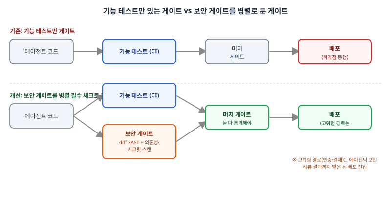

## 왜 지금 이 판단이 필요한가

"이 기능 에이전트한테 짜게 하고, 테스트만 초록불이면 바로 머지해주세요"라는 요구는 이제 흔하다. 문제는 "테스트가 초록불"이라는 신호가 실제로 무엇을 보장하는지다. 기능 테스트는 "요구한 동작을 하는가"만 확인한다. "그 동작을 구현한 방식이 안전한가"는 애초에 검증 범위 밖이다. 그런데 많은 팀의 머지 게이트는 이 둘을 사실상 같은 것으로 취급한다 — CI가 초록불이면 리뷰어도, 때로는 사람도 더 보지 않고 넘긴다.

최근 벤치마크들이 이 간극을 숫자로 못박았다. 카네기멜런의 SusVibes 벤치마크는 실제 CVE를 기반으로 재구성한 200개 리포지토리 규모 과제에서, 가장 좋은 에이전트 조합이 기능 테스트를 61% 통과시켰지만 그중 80% 이상이 여전히 취약점을 그대로 품고 있었다고 보고했다. 이를 이어받은 Endor Labs의 Agent Security League 리더보드에서는 최고 구성의 기능 정확도가 84.4%인 반면 보안 정확도는 7.8%에 그쳤고, 설정별 중간값 격차는 45퍼센트포인트에 달했다. 다른 벤치마크들도 기능 통과율 70~90%대, 보안·기능 동시 통과율 20% 안팎이라는 비슷한 패턴을 반복해서 보여준다. 즉 "테스트 통과 = 안전"이라는 전제가 여러 독립적인 측정에서 동시에 깨진 것이다. 이건 특정 모델 하나의 문제가 아니라, 기능 테스트라는 검증 수단 자체가 보안을 측정하도록 설계되지 않았다는 구조적 공백이다. 에이전트가 코드를 더 빨리, 더 많이 쏟아낼수록 이 공백을 그대로 방치한 파이프라인의 위험도 같이 커진다.

## 전체 시스템에서의 위치

요구사항이 에이전트에게 들어가 코드로 나오고, 그 코드가 머지되어 배포되기까지 검증이 걸리는 지점은 세 군데로 나뉜다. 에이전트가 코드를 작성하는 생성 단계, PR이 올라와 자동 검증을 받는 게이트 단계, 그리고 배포된 뒤 런타임에서 걸리는 단계다. 지금 대다수 파이프라인은 게이트 단계에 기능 테스트 하나만 올려두고, 거기서 초록불이 뜨면 바로 다음 단계로 넘긴다.



그림의 위쪽처럼 기능 테스트 하나만 머지 게이트로 쓰면, 벤치마크가 보여준 격차 그대로 "동작은 하지만 취약한 코드"가 그대로 배포 단계로 넘어간다. 아래쪽처럼 기능 테스트와 별도로 보안 게이트(정적 분석, 의존성·시크릿 스캔, 필요하면 에이전틱 보안 리뷰)를 같은 위치에 병렬로 세워야, 두 게이트를 모두 통과한 코드만 다음 단계로 넘어가는 구조가 된다. 핵심은 보안 검증을 기능 테스트의 "보너스"가 아니라 머지를 막을 수 있는 동등한 자격의 게이트로 승격시키는 것이다.

## 선택의 트레이드오프

| 검증 수단 | 확인하는 것 | 놓치는 것 | 속도 |
|---|---|---|---|
| 기능 유닛·통합 테스트 | 요구한 동작의 재현 여부 | 입력 검증, 권한 체크, 인젝션 경로 | 빠름 (초~분) |
| 정적 분석(SAST) | 알려진 취약 패턴 룰셋 | 설계 의도상의 논리적 결함, 새 패턴 | 빠름 (초~분) |
| 의존성·시크릿 스캔 | 알려진 CVE, 하드코딩된 키 | 직접 새로 작성된 취약점 | 빠름 (초) |
| 에이전틱 보안 리뷰(LLM) | 설계 의도 기반 추론, 신규 패턴까지 | 실행마다 결과가 달라짐, 비용·지연 | 느림 (분 단위) |

이 넷 중 어느 하나도 혼자서 전체를 커버하지 못한다. 기능 테스트는 보안을 안 보고, SAST는 룰셋에 없는 패턴을 놓치고, 의존성 스캔은 이미 알려진 취약점만 잡고, LLM 보안 리뷰는 느리고 실행마다 판단이 흔들린다. 그래서 "어느 도구를 쓸 것인가"가 아니라 "어느 조합을 어느 순서로 겹칠 것인가"가 실제 설계 질문이다. 속도가 빠른 세 가지(기능 테스트·SAST·의존성 스캔)를 머지를 막는 필수 게이트로 두고, 느리고 변동성 있는 에이전틱 리뷰는 비동기로 돌리되 그 결과 없이는 자동 배포까지는 못 가게 막는 식의 단계적 조합이 현실적이다.

## 실제 프로젝트 진행 순서

가장 먼저 손댈 곳은 SAST의 스캔 범위다. 레포 전체를 매번 긁으면 기존 코드의 오래된 경고까지 섞여 노이즈가 커지고, 에이전트가 방금 작성한 변경분이 묻혀 버린다. PR의 diff에만 좁혀서 돌리는 것부터 시작한다.

```yaml
# .github/workflows/security-gate.yml
name: security-gate
on: [pull_request]
jobs:
  diff-sast:
    runs-on: ubuntu-latest
    steps:
      - uses: actions/checkout@v4
        with: { fetch-depth: 0 }
      - name: Semgrep on changed files only
        run: semgrep --config auto --diff-main --error --severity=ERROR
  dependency-secret-scan:
    runs-on: ubuntu-latest
    steps:
      - uses: actions/checkout@v4
      - run: trivy fs --severity CRITICAL,HIGH --exit-code 1 .
```

이 두 잡을 `functional-tests`와 함께 브랜치 보호 규칙의 필수 상태 체크로 등록하면, 셋 중 하나라도 실패하면 머지 버튼 자체가 비활성화된다. 다음 단계는 심각도 분류다. critical·high만 머지를 막고, medium 이하는 자동으로 별도 이슈를 생성해 추적하되 머지는 막지 않는다 — 처음부터 모든 경고를 막으면 팀이 게이트를 무시하기 시작하므로, 막을 기준을 의도적으로 좁게 잡는 게 오래간다. 그다음으로 비용이 큰 에이전틱 보안 리뷰는 모든 PR이 아니라 인증·결제·외부 입력을 다루는 경로를 건드린 PR에만 트리거하도록 범위를 제한하고, 결과가 나오기 전까지는 자동 배포 파이프라인 진입을 보류한다. 마지막으로 기능 테스트 통과율 옆에 보안 게이트 통과율을 나란히 올린 대시보드를 만들어, 에이전트·모델별로 이 격차가 좁혀지고 있는지 아니면 그대로인지를 계속 관찰한다. 격차가 안 좁혀진다면 모델을 바꾸는 게 아니라 게이트 자체를 더 좁히고 엄격하게 만드는 쪽으로 대응해야 한다.

## 마무리 요약

- 여러 독립적인 벤치마크가 공통으로 보여주는 수치: 에이전트 코드의 기능 테스트 통과율은 70~90%대인데 보안까지 함께 통과하는 비율은 10~25% 안팎에 그친다.
- "CI가 초록불이면 안전하다"는 전제는 깨졌다. 보안 게이트는 기능 테스트의 부속물이 아니라 머지를 독립적으로 막을 수 있는 동등한 자격의 체크로 설계해야 한다.
- 지금 당장 적용 가능한 최소 구성은 diff 범위로 좁힌 SAST + 의존성·시크릿 스캔을 필수 체크로 걸고, 느린 에이전틱 보안 리뷰는 고위험 경로에만 비동기로 붙이는 것이다.

## 참고 자료

- [Endor Labs — Agent Security League](https://endorlabs.com/learn/agent-security-league-evaluating-the-security-of-ai-coded-software)
- [SusVibes: Tests Pass, Code Is Vulnerable](https://hyrax.dev/blog/tests-pass-code-is-vulnerable-susvibes)
- [DualGauge: Automated Joint Security–Functionality Benchmarking](https://arxiv.org/html/2511.20709)
