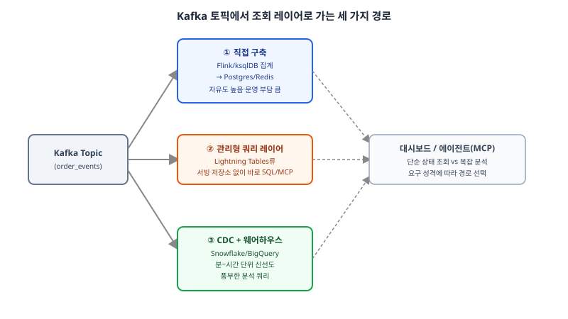

## 왜 지금 이 판단이 필요한가

"주문 상태가 바뀌는 순간 운영팀 대시보드에서, 그리고 고객 응대 에이전트가 바로 확인할 수 있게 해주세요"라는 요구는 이벤트 기반 아키텍처를 쓰는 팀이라면 한 번쯤 받는다. 문제는 Kafka 토픽이 원래 "조회용"이 아니라 "전달용"으로 설계됐다는 점이다. 토픽 자체에는 SQL을 던질 수 없고, 특정 주문 하나의 현재 상태를 보려면 파티션을 처음부터 훑어 재구성하거나, 별도의 조회 가능한 저장소를 하나 더 만들어야 한다.

이 문제에 대한 답이 최근 두 갈래로 갈라졌다. 2026년 11월 8일, Confluent는 Current 컨퍼런스에서 Lightning Tables를 AWS 리전에 GA로 내놓았다. Kafka 토픽 위에 올리는 읽기 전용 레이어로, SQL·REST API·MCP로 토픽의 현재 상태를 바로 조회할 수 있게 해준다 — 별도 스트림 프로세서나 서빙 저장소를 팀이 직접 두지 않아도 된다는 게 핵심 주장이다. 반대쪽에는 기존의 정석, 즉 ksqlDB나 Flink로 토픽을 머티리얼라이즈드 뷰로 집계해 자체 서빙 저장소(Postgres, Redis 등)에 꽂는 방식이 있다. 둘 다 "스트림 위에 쿼리 가능한 레이어를 만든다"는 목표는 같지만, 신선도·운영 부담·확장성에서 결과가 갈린다. 에이전트가 MCP로 데이터를 직접 조회하는 패턴이 늘어나는 지금, 이 선택은 단순한 기술 취향이 아니라 "조회 레이어를 누가 운영할 것인가"의 구조적 판단이다.

## 전체 시스템에서의 위치

주문 이벤트가 프로듀서에서 Kafka 토픽으로 들어온 뒤, 그 토픽이 조회 가능한 형태로 바뀌어 대시보드와 에이전트에 도달하기까지 세 가지 경로가 있다.



①은 ksqlDB나 Flink로 토픽을 직접 집계해 Postgres·Redis 같은 서빙 저장소에 쓰는 경로다. 팀이 스키마, 집계 로직, 저장소 운영까지 전부 쥔다. ②는 Lightning Tables처럼 토픽 위에 바로 올라가는 관리형 쿼리 레이어로, 별도 서빙 저장소 없이 토픽 자체를 SQL·MCP로 노출한다. ③은 CDC로 이벤트를 웨어하우스(Snowflake, BigQuery 등)에 적재해 배치·근실시간으로 조회하는 경로로, 신선도보다 분석 쿼리의 표현력을 우선한다. 세 경로는 공존 가능하다 — 실시간 상태 조회는 ②, 복잡한 집계 분석은 ③으로 나누는 식이다. 문제는 하나의 요구("지금 바로 조회하게 해주세요")에 세 경로 중 무엇을 기본값으로 둘지 미리 정하지 않으면, 팀마다 제각각 파이프라인을 만들어 같은 데이터가 세 번 복제되는 상황이 벌어진다는 점이다.

## 선택의 트레이드오프

| 기준 | ① 직접 구축(ksqlDB/Flink) | ② 관리형 쿼리 레이어(Lightning Tables류) | ③ CDC+웨어하우스 |
|---|---|---|---|
| 신선도 | 초 단위, 집계 로직에 좌우 | 초 단위, 토픽에 가까움 | 분~시간 단위 |
| 운영 부담 | 프로세서+서빙 저장소 둘 다 직접 | 벤더가 흡수 | ETL 파이프라인 운영 |
| 쿼리 표현력 | 자유로운 집계 로직 설계 가능 | 벤더 지원 범위로 제한 | 풍부한 분석 SQL |
| 에이전트 연동 | 직접 MCP 서버 구현 필요 | MCP 네이티브 지원(해당 제품 기준) | 별도 연동 계층 필요 |
| 비용 구조 | 인프라+운영 인건비 | 사용량 기반 구독 | 웨어하우스 적재·쿼리 비용 |

세 경로 모두 "정답"이 아니라 "다른 걸 포기하는 선택"이다. ①은 자유도가 가장 높지만 집계 로직 하나하나를 팀이 설계하고 검증해야 한다. ②는 운영 부담을 벤더에 넘기는 대신 집계·조인 로직의 표현력이 벤더 기능 안으로 제한된다. ③은 신선도를 포기하는 대신 가장 복잡한 분석 질의를 감당한다. "주문 상태 하나를 바로 보여주세요"처럼 단순 조회가 목적이면 ①·②가 맞고, "지난 분기 주문 패턴을 분석해주세요"처럼 집계가 목적이면 ③이 맞다 — 요구의 성격을 먼저 분류하지 않고 하나의 레이어로 전부 받으려 하면 어느 쪽도 제대로 못 한다.

## 실제 프로젝트 진행 순서

가장 먼저 할 일은 "얼마나 신선해야 하는가"를 숫자로 못박는 것이다. "실시간"이라는 말은 각자 다르게 해석하므로, 수 초 이내인지 수 분 이내인지를 요구사항 단계에서 합의해야 다음 선택이 갈린다. 그다음은 토픽 스키마를 레지스트리에 명시적으로 등록해 두는 일이다 — 어떤 쿼리 레이어를 고르든 스키마가 불안정하면 집계도, 관리형 레이어도 깨진다.

```sql
-- Flink SQL로 직접 구축할 때의 머티리얼라이즈드 뷰 예시
CREATE TABLE order_status_view AS
SELECT order_id,
       LAST_VALUE(status) AS current_status,
       MAX(event_time) AS updated_at
FROM order_events
GROUP BY order_id;
```

작은 범위(주문 상태 하나)로 먼저 PoC를 돌려 신선도·쿼리 지연·비용을 양쪽 경로에서 실측한다. 이 단계에서 "관리형 레이어가 지원하는 조인·집계 범위를 우리 쿼리 패턴이 벗어나는가"를 반드시 확인한다 — 벗어난다면 처음부터 직접 구축으로 가는 게 나중에 마이그레이션하는 것보다 싸다. 조회 패턴이 늘어나기 시작하면, 단순 상태 조회는 관리형 레이어에 남기고 복잡한 집계만 별도 파이프라인으로 분리하는 하이브리드 구성으로 넘어간다. 마지막으로 어떤 경로를 택하든 조회 레이어는 토픽의 파생물이지 원본이 아니라는 원칙을 지켜, 장애 시 토픽을 재생해 조회 레이어를 통째로 다시 만들 수 있는 재구성 경로를 처음부터 설계해 둔다.

## 마무리 요약

- Kafka 토픽은 전달용이지 조회용이 아니므로, 조회 가능한 레이어를 직접 구축·관리형·CDC 세 경로 중 하나로 반드시 따로 만들어야 한다.
- 2026년 11월 GA된 Confluent Lightning Tables는 운영 부담을 벤더에 넘기는 대신 집계 표현력을 벤더 기능 범위로 제한하는 트레이드오프를 가져온다.
- 신선도 요구치를 먼저 숫자로 정하고, 작은 범위 PoC로 쿼리 패턴이 관리형 레이어의 지원 범위를 벗어나는지부터 확인한 뒤 경로를 정한다.

## 참고 자료

- [Confluent Lightning Tables 발표](https://www.confluent.io/)
- [Apache Flink SQL 문서](https://nightlies.apache.org/flink/flink-docs-stable/docs/dev/table/sql/overview/)
- [ksqlDB 문서](https://docs.ksqldb.io/)
